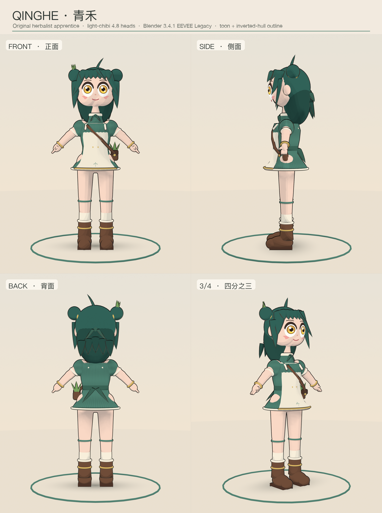
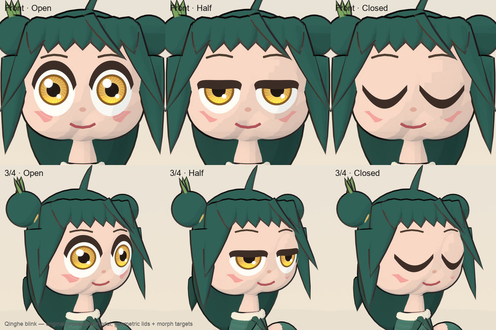

# 青禾 / Qinghe — Blender 二次元角色能力探针

原创小药师角色，用于验证 game-artist agent 在本机 Blender 管线上能做到什么。
**不是生产资产**：这是 T-20261121-029 的能力探针样片，配套报告见
[`docs/agent-capabilities/blender-anime-probe.md`](../../docs/agent-capabilities/blender-anime-probe.md)。



## 设计

- 青禾 / Qinghe，原创药师学徒；无参考游戏/IP 角色、服装、脸。
- 轻 chibi 4.8 头身；身高 1.30 m（含呆毛 1.388 m）。
- 青绿色波波头 + 双丸子 + 叶子发簪 + 呆毛；琥珀色分层大眼；奶油围裙 + 青玉连衣裙 + 棕色药囊。
- 色板：发 `#2F6157`，裙 `#4F8272`，围裙 `#F6EDD9`，金 `#D8B563`，肤 `#F7D6C3`，琥珀瞳 `#D9A03F`。
- 全部几何与纹理由 `scripts/build_qinghe.py` 程序化生成；无外部/付费资产。

## 规格（实测）

| 项 | 数值 |
|---|---|
| 骨架 | 22 骨（root + 21 deform），A-pose，无 IK/约束/动画 |
| 网格 | 103,558 tris / 52,221 原始 verts（GLB 拆分后 54,539）+ 101,870 tris 描边壳 |
| 材质 | 21 个 toon/emission 材质 + Outline；GLB 内 22 个 Principled 材质 |
| 贴图 | 3 张嵌入 GLB：T_Dress / T_Apron / T_EyeIris（256²）；GLB 内嵌 |
| GLB | `qinghe.glb`，7,015,008 B；3.4.1 复导入通过 |
| .blend | `qinghe.blend`，20,208,544 B（打包贴图） |
| 渲染 | Blender 3.4.1 EEVEE Legacy，1440×1800 / 1440×1440，32 samples |
| 渲染耗时 | 6 张板共 87.2 s（首帧 53.5 s 含 shader 编译；其余 8–9 s） |
| 眨眼变体 | `../blink-test/qinghe_blink.blend/.glb`：几何眼睑 + 6 morph targets + 7 s / 24 fps 眨眼 clip（T-20261125-011，见 `docs/BLINK.md`） |

## 复跑

```bash
cd agent-probes/blender-anime-girl

# 1) 构建 .blend + GLB + 纹理（Blender 3.4.1）
/Applications/Blender.app/Contents/MacOS/Blender -b -P scripts/build_qinghe.py

# 2) 渲染 turnaround / face / silhouette（约 2 分钟）
/Applications/Blender.app/Contents/MacOS/Blender -b -P scripts/render_qinghe.py

# 3) 拼 contact sheet / 25% 缩略图 / 纯黑剪影
python3 scripts/make_sheets.py

# 4) GLB 复导入校验（3.4.1；换 4.2.9 路径也可）
/Applications/Blender.app/Contents/MacOS/Blender -b -P scripts/validate_glb.py
```

预览模式（640×800，8 samples）：

```bash
/Applications/Blender.app/Contents/MacOS/Blender -b -P scripts/render_qinghe.py -- --preview
```

## 目录

```text
agent-probes/blender-anime-girl/
├── qinghe.blend / qinghe.glb
├── scripts/
│   ├── build_qinghe.py       程序化建模/材质/绑定/GLB
│   ├── render_qinghe.py      四视图 + 特写 + 剪影 alpha 板
│   ├── make_sheets.py        角色卡/缩略图/纯黑剪影（Pillow）
│   ├── validate_glb.py       GLB 复导入报告
│   └── probe_engines_42.py   4.2.9 Workbench/EEVEE Next/Cycles CPU 探针
├── textures/                 T_Hair/T_Dress/T_Apron/T_EyeIris/T_Shadow/T_Backdrop
└── renders/
    ├── front / side / back / three_quarter .png   1440×1800
    ├── face_closeup.png                             1440×1440
    ├── contact_sheet.png / contact_sheet_25pct.png
    ├── silhouette_front.png  纯黑剪影（白底）
    ├── engine42_cycles_cpu_test.png  4.2.9 Cycles CPU 反例（toon 节点变黑）
    └── preview_*.png         迭代预览
```

## 引擎实测（本机）

| 引擎 | 结果 |
|---|---|
| Blender 3.4.1 / EEVEE Legacy | ✅ 本样片最终渲染路径 |
| Blender 3.4.1 / EEVEE + Freestyle | ⚠️ 能出线，但 320×400 单球 Freestyle visibility 51 s，已弃用；改 inverted-hull 描边 |
| Blender 4.2.9 / Workbench | ❌ SIGSEGV（draw manager `drw_state_set`），默认立方体也崩 |
| Blender 4.2.9 / EEVEE Next | ❌ 同上 SIGSEGV |
| Blender 4.2.9 / Cycles CPU | ⚠️ 能渲染；但 Shader-to-RGB toon 节点在 Cycles 不成立，角色变深色（见反例图） |

## 眨眼变体（T-20261125-011）



在 qinghe 的 decal 眼上新建几何眼睑（上睑帘 + 可动睫毛带 + 下睑带，522 verts / 392 quads，
刚性绑 head），加 6 个 morph targets，做 7 s / 24 fps 眨眼循环（4 次眨眼含 1 次双眨、左右 1 帧错开）。
GLB 在 Godot 4.6 导入 6 blend shapes + 6 条 blend-shape 轨道；Blender 3.4.1 回导 6 targets + 1–168 帧 action；
27/27 自动检查通过。资产在 [`../blink-test/`](../blink-test/)，方法/坑/数字见
[`docs/BLINK.md`](../../docs/BLINK.md)。

## 已知边界

- 眼睛是贴合头面的分层 decal + 虹膜贴图；正/3-4 视图好，**正侧面会看到眼白浮起**。
- 头发是低模发片/球体 + 平涂 toon；发丝贴图因各部件 UV 方向不一致未用于最终头发。
- 头/身用 voxel remesh + smooth，**无动画级环线**；自动最近骨权重；手指不单独绑骨。
- 原版无面部表情/口型、无头发骨、无动画 clip、无 IK。眨眼变体（`../blink-test/`）已补：几何眼睑 + `Blink_Half/Closed`（左右独立）+ 7 s 循环；仍无口型、眉/颊联动、眼神 look-at。
- 描边壳使几何量翻倍；生产需 LOD/可选描边。
- Tripo 图生 3D **未测**：本机无 `TRIPO_API_KEY`（API 经代理可达但 401）。见探针报告。

## 授权

原创角色与程序化资产，由本项目生成；未使用第三方模型/贴图/付费资产。
技术实现参考了本仓库 `blender-wukong-ultimate` 的程序化建模/绑定思路（同仓库自研），未复制任何外部角色。
