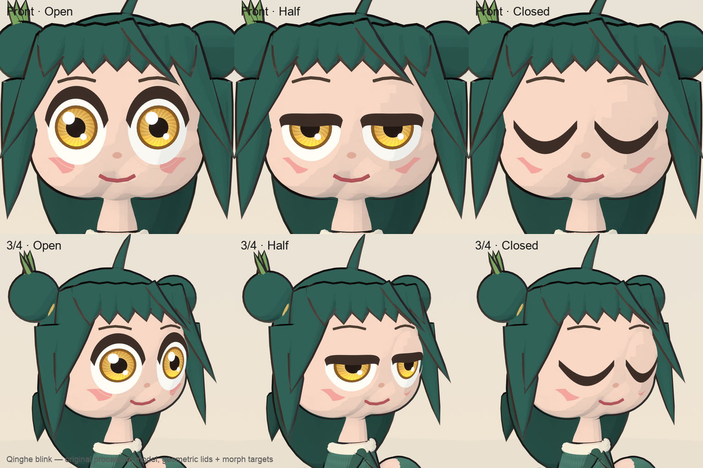
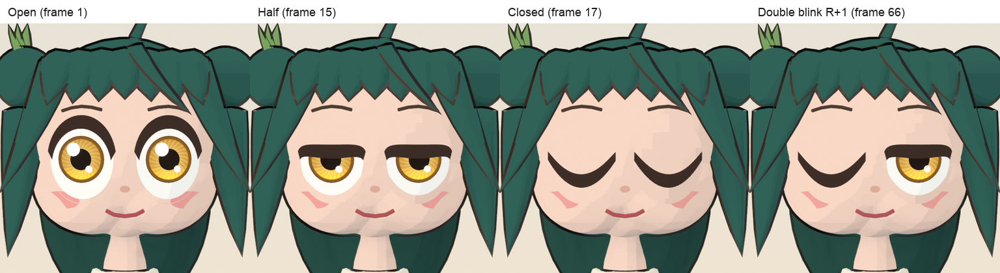
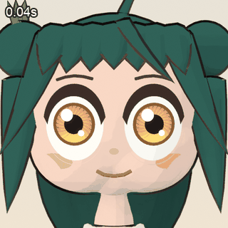
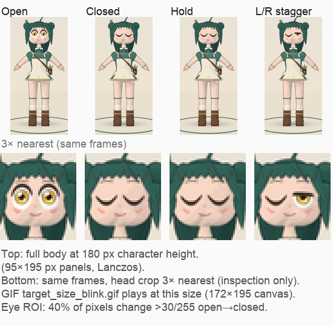

# Qinghe Blink — 原创角色眨眼能力测试

T-20261125-011 的产物：在原创角色 **青禾 / Qinghe**（`agent-probes/blender-anime-girl/qinghe.blend`）上，
用**几何眼睑 + 形态键**做了一次真实可跑的眨眼循环，并导出 GLB morph targets。

完整方法 / 坑 / 数字见 **[`docs/BLINK.md`](../../docs/BLINK.md)**。这里只放资产说明与复跑。



## 交付

| 文件 | 内容 |
|---|---|
| `qinghe_blink.blend` | 4.45 MB；原 qinghe + `Qinghe_BlinkLids`（522 verts / 392 quads，绑 head）+ 7 个 shape keys + `Blink_Loop_24fps` action |
| `qinghe_blink.glb` | 7.33 MB；6 morph targets、1 weights 通道、168 采样、7.0 s、22 joints、3 张贴图 |
| `blink_face_loop.mp4` | 512×512 / 24 fps / 7.0 s / 168 帧；主展示 |
| `blink_face_loop.gif` | 320×320 / 168 帧 / 7.000 s；带时间码 |
| `blink_keyframes.png` | Open / Half / Closed / 双眨左右错帧 |
| `blink_timeline.png` | GLB 实际导出权重的节奏图 |
| `target_size_strip.png` | 180 px 角色高：全身 + 3× 头部 nearest |
| `target_size_blink.gif` | 172×195；角色 180 px 下的 7 s 循环 |
| `open_parity.png` | 原 `face_closeup` vs 新 Open（3/4 机位） |
| `blink_validation.json` | 27/27 项自动验收 |
| `blink_report.json` / `media_metrics.json` / `reimport_check.json` | 建模/导出、媒体、回导数字 |
| `blink_schedule.json` | seed=20261127 的节奏 |
| `godot_import_check.txt` | Godot 4.6 headless 导入日志 |
| `renders/` | 6 张 1024² 关键帧 |



## 规格（实测）

- 眼型：原 qinghe 是贴脸椭球的分层 decal（眼白 4.5 mm / 虹膜 6.2 / 瞳孔 7.4 / 高光 8.2 / 睫毛 6.4）。
  本测试删除原静态睫毛 56 faces，新建上睑帘 + 可动睫毛带 + 下睑带。
- 闭合：中央列上睑 **81.98%**、下睑 **18.02%**；闭眼线 `meet(u)=1.0995+0.0355u²`，两端收到眼角。
- 形态键（同一网格，6 targets）：`Blink_Half`、`Blink_Closed`、`Blink_Left_Half`、
  `Blink_Left_Closed`、`Blink_Right_Half`、`Blink_Right_Closed`；`Blink_Open` 是 basis。
- 深度：眼睑关键态离面 10.5–10.8 mm；投影 Half 使两段混合中点最小 9.43 mm，高于高光 8.2 mm。
  直接 Open→Closed 的中间态会掉到 5.57 mm（高光穿出）——这是本项目最重要的修正。
- 节奏：24 fps / 168 帧 / 7.0 s / seed 20261127；眨眼帧 14、61、71（双眨）、131；
  hold 2/1/1/1 帧；右眼 +1 帧错开 ×2；p_double=0.08（200 窗口实测 7.03 对/100 次眨眼）。
- 引擎：Godot 4.6 导入 6 blend shapes + 6 条 blend-shape 轨道（clip 显示为 `Blink`，7.0 s）；
  Blender 回导 6 targets + action 1–168，帧 1→17 顶点最大位移 73.9 mm。

## 媒体





## 复跑

```bash
# Blender 3.4.1（本机 4.2 EEVEE Next 在 Intel HD 6000 上崩溃，不用）
/Applications/Blender.app/Contents/MacOS/Blender -b -P tools/blender_blink/build_blink.py
/Applications/Blender.app/Contents/MacOS/Blender -b -P tools/blender_blink/render_blink.py -- --mode stills
/Applications/Blender.app/Contents/MacOS/Blender -b -P tools/blender_blink/render_blink.py -- --mode anim
/Applications/Blender.app/Contents/MacOS/Blender -b -P tools/blender_blink/render_blink.py -- --mode target
python3 tools/blender_blink/make_media.py
/Applications/Blender.app/Contents/MacOS/Blender -b -P tools/blender_blink/reimport_check.py
python3 tools/blender_blink/validate_blink.py
```

节奏生成器可单独跑：

```bash
python3 tools/blender_blink/blink_schedule.py --seed 20261127
python3 tools/blender_blink/blink_schedule.py --stats --blinks 200
```

渲染耗时（本机实测）：1024²/32 samples 每张 3.4–4.7 s（首帧 ~14 s 着色器编译）；
512²×168 约 3 分 39 秒；360×450×168 约 2 分 44 秒。

`anim/` 与 `target_size/` 是 168 帧中间序列（可再生，未入库）；`renders/` 是最终关键帧。

## 迭代记录

1. **v1 直接 Open→Closed**：几何与覆盖率 OK，但半闭帧高光/瞳孔穿出。射线检测在高光像素命中
   `EyeHighlight`；原因是椭球弦垂：中点离面只有 5.57 mm（高光 8.2 mm）。
2. **v2 投影 Half + 统一接触边参数化**：把 Half 重投影到完整偏移面，动画分两段；同时修正
   下睑顶边与睫毛内缘的 x 参数化不一致（原来在眼角会露 5–9 mm 白缝）。复测：关键态 10.5 mm、
   混合中点 9.43 mm、Open 保真 1.42/255。
3. **v3 GLB 材质修正**：toon 材质的 Emission 颜色是连线的，`default_value` 为白；改为优先读
   MixRGB Color2 → Skin/Hair 等 GLB 底色正确。Godot/Blender 回导全过。
4. **v4 媒体与验收**：修正关键帧编号（闭眼帧是 17 而不是半闭的 16）、GIF 丢帧/时长
   （PIL 合并相同帧；40/50 ms 交替精确 7.000 s）、目标尺寸指标（眼部 ROI 40.2%）。

## 边界与 handoff

- 眼睑是贴在 decal 前方的曲面片，不是生产级眼窝/结膜；闭眼线继承原睫毛厚度，偏粗。
- 无眉/颊联动、无眼神/look-at、无口型；Outline 反壳不含新眼睑。
- Godot 只做了 headless 导入验证，未做 GPU 回放；建议 game-engineer 补 60 fps 运行时与相机距离测试，
  game-qa-lead 按 180 px / 60 px 两档复核。
- 未做 taoyao 变体（结构相同，改眼中心/尺寸即可）。

## 授权

原创模型与程序化资产；眼睑、动画、渲染、文档均由本仓库脚本生成。无第三方模型/贴图/付费素材，
无参考游戏/IP 素材。
