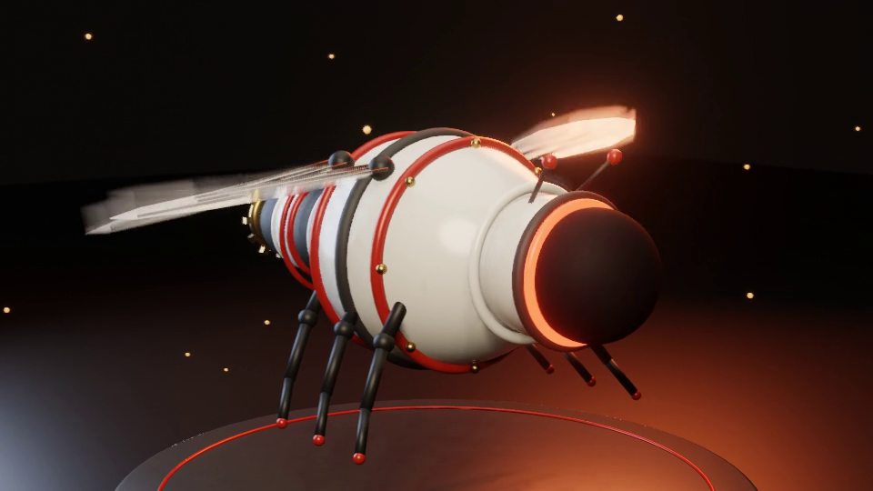

# Blender HB-7 · 10s 程序化产品短片

用 **Blender + Python (`bpy`)** 从零生成的一段 10 秒机械蜂核心产品短片：
程序化几何、材质、灯光、相机轨道、关键帧和渲染全部由代码完成。
这条链路就是视频里 Fable 5.2 / Claude 通过 BlenderMCP 做的事——只是本次直接跑 `bpy`，
不需要手点 Blender 界面。



- 视频：`docs/hb7_core.mp4`（10s，960×540，24fps）
- GIF：`docs/hb7_core.gif`
- 工程：`hb7_core.blend`（可由 Blender 3.4.1 打开继续改）
- 构建脚本：`scripts/build_scene.py`

## 这台机器的特殊情况

| 项 | 结果 |
| --- | --- |
| Blender 4.2.9 | 已安装到 `/Applications/Blender-4.2.app`，MCP 插件已启用 |
| EEVEE Next（4.2） | 在 Intel HD 6000 上渲染直接崩溃（Metal GPUFamily macOS 1） |
| Cycles CPU（4.2） | 可用但慢：640×360 / 8 samples ≈ 7.5s/帧 |
| **Blender 3.4.1** | **EEVEE Legacy 可用**，本片用它渲染 |
| MCP | `mcp-for-blender` 已配置到 Claude Code（`claude mcp list` 显示 Connected） |

> 结论：**建模/MCP 用 4.2，最终渲染用 3.4.1**。MCP 插件在 3.4 和 4.2 两个版本里都已安装并启用。

## 运行

生成视频（默认 960×540、24fps、240 帧）：

```bash
bash scripts/render.sh
```

只渲染一张预览（60% 分辨率）：

```bash
/Applications/Blender.app/Contents/MacOS/Blender -b -P scripts/build_scene.py -- --still 60
```

打开工程继续改：

```bash
open -a /Applications/Blender.app hb7_core.blend
```

## BlenderMCP 怎么用

本机已安装：

- MCP 插件：`~/Library/Application Support/Blender/{3.4,4.2}/scripts/addons/blender_mcp_addon.py`
- MCP server venv：`~/.local/share/mcp-for-blender/`
- Claude Code 配置：`blender`（`python -m blender_mcp.server`）

使用步骤：

1. 手动打开 Blender（3.4.1 或 4.2）。
2. 在 3D 视图按 `N` → **MCP for Blender** 标签 → **Start MCP Server**（默认端口 9876）。
   插件在打开 Blender 时会自动尝试启动。
3. 重启 Claude Code，让 `blender` 的 MCP 工具加载；然后直接说：
   > 建一个机械蜂的爆炸图，带相机轨道和 10 秒动画。
4. Agent 会通过 MCP 调 `execute_blender_code`，本质仍是写 `bpy`。

> 注意：插件**不能在 `blender -b` 后台模式启动服务器**——必须有 GUI 的 Blender 在运行。
> 本次成片就是用 `bpy` 直接渲染的，没有走 MCP 的 GUI 通道。

## 场景构成

- **胸腔**：白色陶瓷壳 + 黑色核心 + 红/黑环 + 黄铜螺栓
- **头部**：白壳、黑色光学镜头、红色发光环、触角
- **腹部**：白/黑交替的 4 段 + 红色环 + 黄铜尾齿轮
- **4 翼**：自定义网格 + 透明膜材质 + 3 条叶脉 + 铰链
- **6 腿**：髋/膝/踝/趾圆柱 + 关节球
- **灯光**：暖主光 + 冷补光 + 红色轮廓光 + 顶部柔光
- **相机**：父级 orbit 空物体，固定朝看心；116° 轨道 + 轻微推近
- **动画**：机身漂浮、4 翼 3.6Hz 拍动（线性烘焙）、镜头环脉冲、尘埃旋转

## 验证

- 渲染帧数：240；输出 `frame_0001.png` … `frame_0240.png`
- 视频：`ffprobe` 检查 960×540 / 24fps / 10.0s
- 静帧：`docs/poster.png`、`docs/shots/`（运行截图工具可补）

详细拆解见 [`docs/TECH.md`](docs/TECH.md) 与 [`docs/迭代记录.md`](docs/迭代记录.md)。
