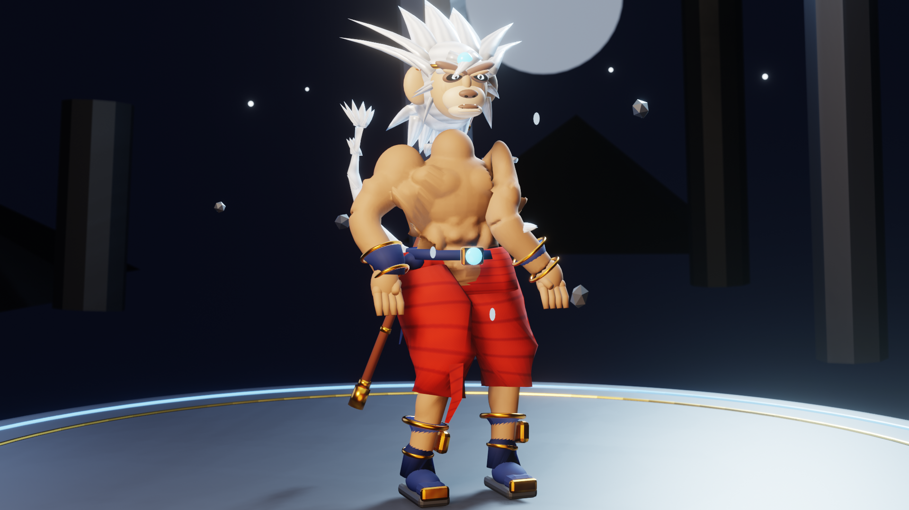
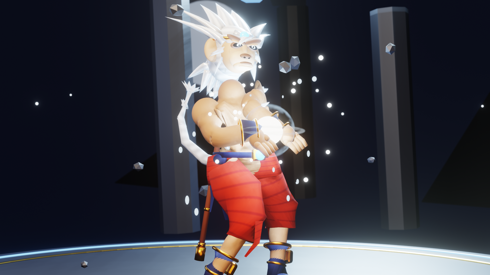
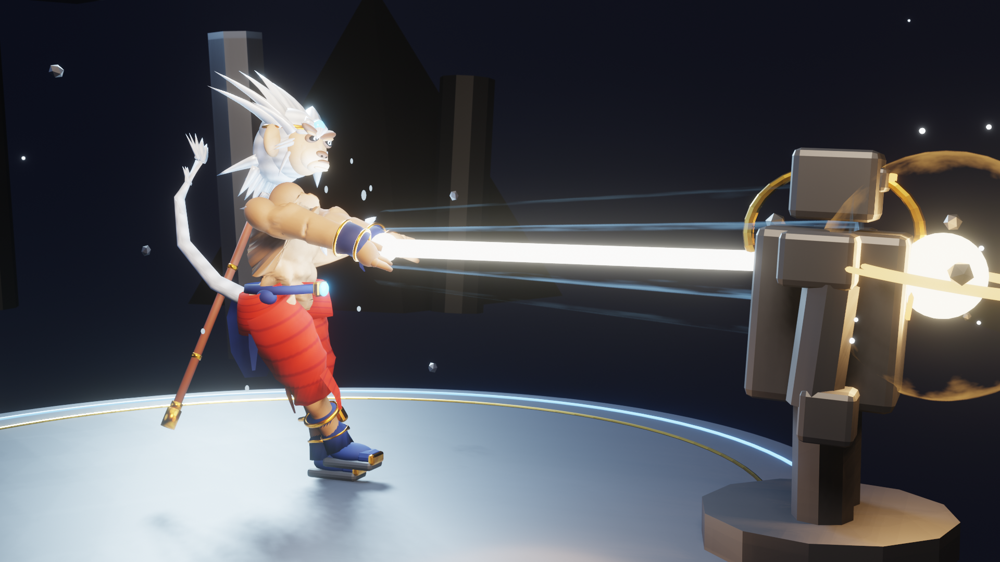

# 齐天大圣 · 极意 — Blender 资产

原创、英雄比例的程序化角色：**银白后掠尖发、银白斗气+浮空碎石气质、赤膊肌肉躯干、破损橙裤、蓝腰带/护腕/靴、猴脸/尾巴/金箍/背棍**。
不是《龙珠》悟空复刻；没有复制任何具体版权角色的脸、发型轮廓、服装或标志。



| 蓄力 | 放波 |
| --- | --- |
|  |  |

## 文件

- `wukong_ultimate.blend` — 可编辑工程（IK 控制骨 + 蒙皮 + 6 个 action）
- `wukong_ultimate.glb` — 游戏资产（烘焙 IK、29 关节、6 动画、56,072 tris、15 材质、5 贴图）
- `scripts/build_ultimate.py` — 程序化建模 / 贴图 / 骨架 / 蒙皮 / 6 动画 / 预览渲染
- `scripts/export_glb_ultimate.py` — 逐 action bake IK、清理控制骨、导出 GLB + 校验
- `scripts/render_stills.py` — 1080p 三张定帧（Blender 3.4.1 EEVEE）
- `docs/before_after.png` — 与首版 chibi 的 before/after 对比
- `docs/TECH.md` / `docs/CREDITS.md` / `docs/迭代记录.md` / `docs/verification.txt`
- `textures/` — 5 张程序化贴图（已 pack 进 .blend 并嵌入 GLB）

## 统计

| 项 | 值 |
| --- | --- |
| 比例 | 约 6.5 头身；含发 2.26 m |
| 网格 | 56,072 tris；单一蒙皮网格；15 材质分区 |
| .blend 骨架 | 41 骨（29 导出 + 12 非变形 IK/控制） |
| GLB 骨架 | 29 关节 |
| 动画 | Idle 2.0 / Run 0.667 / Charge 1.333 / Cast 1.208 / Hit 0.542 / Victory 2.0 s |
| 贴图 | 橙布 / 蓝布 / 银发 / 银毛 / 金（无外部素材） |
| 渲染 | 3 × 1920×1080 PNG，EEVEE Legacy，40 samples |

## 复现

```bash
cd blender-wukong-ultimate

# 建模 + 保存 .blend + 可选预览
/Applications/Blender.app/Contents/MacOS/Blender -b -P scripts/build_ultimate.py

# 烘焙 IK + 导出 GLB
/Applications/Blender.app/Contents/MacOS/Blender -b -P scripts/export_glb_ultimate.py

# 1080p 定帧
/Applications/Blender.app/Contents/MacOS/Blender -b -P scripts/render_stills.py
```

- Blender **3.4.1**（EEVEE Legacy）。4.2 的 EEVEE Next 在本机 Intel HD 6000 上崩溃，故不用 4.2 渲染。
- 所有几何、贴图、材质、骨架、动画均为程序化/原创；无外部模型或贴图。

## 动画

| Clip | 时长 | 说明 |
| --- | --- | --- |
| Idle | 2.000 s | 呼吸、重心微移、尾巴摆 |
| Run | 0.667 s | 原地跑循环 |
| Charge | 1.333 s | 双手胸前聚气、蓄力颤抖 |
| Cast | 1.208 s | 双手前推放波 |
| Hit | 0.542 s | 后仰受击 |
| Victory | 2.000 s | 起身举拳 |

## 与首版对比

`docs/before_after.png`：左为首版金色 chibi（首版工程 `../blender-wukong/` 的海报），右为本版银白蓄力定帧。
本版从 chibi 拼装升级到单一连续肌肉体（remesh）、英雄比例、可编辑 IK 骨架 + 烘焙动画、6 个游戏 clip。

## Godot 可玩展示

资产用于 `../godot-wukong-ultimate/`：第三人称移动、空格蓄力/放气功、石傀命中/击退、HUD、屏震、伤害数字、胜利/重置。
运行：

```bash
cd ../godot-wukong-ultimate
godot --headless --path . --editor --quit
godot --path . --resolution 1280x720
```

## 已知边界

- 风格化程序化角色，不是影视级雕刻：肩背/躯干有少量块面感，手部为简化体块，无面部 blendshape、无布料/毛发解算。
- 头发/鬃毛为刚性绑定到 head；头部特写会看到发片穿插。
- GLB 为烘焙后的 FK 动画；继续调 IK 请编辑 .blend 后重新导出。
- 材质为 glTF PBR + 顶点色；不含程序化节点，便于引擎直接使用。
