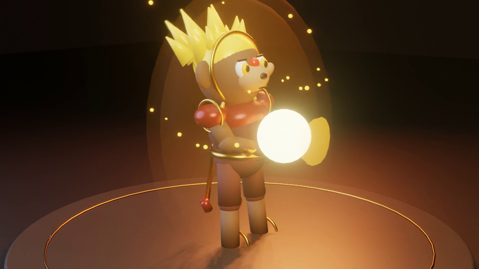
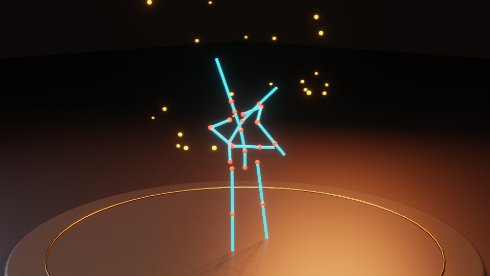

# 齐天大圣 · 斗战形态

一段 **程序化角色 + 骨骼 + 蒙皮 + 气功波动画** 的 8 秒 Demo。
角色是原创的「金发猴王」：金色斗气、红金战甲、尾巴、金箍、背棍，
参考《西游记》齐天大圣和金色爆气类动漫的视觉语言；**不复刻任何具体版权角色的造型/服装/标识**。



- 视频：`docs/wukong_ki.mp4`（8s，960×540，24fps）
- GIF：`docs/wukong_ki.gif`
- Blender 工程：`wukong.blend`（含 IK 骨架、蒙皮、动画）
- 游戏资产：`wukong.glb`（已烘焙骨骼动画，无 IK 约束）
- 构建脚本：`scripts/build_wukong.py`
- 导出脚本：`scripts/export_glb.py`

### 骨架预览



> 24 根变形骨骼（另加非变形的 root）；青色为骨骼、红点为关节。
> `.glb` 里是同一套骨架 + 烘焙后的 8 秒动画。

## 内容

| 环节 | 实现 |
| --- | --- |
| 建模 | 程序化球/柱/锥/环拼装：头、猴脸、金发尖刺、金箍、胸甲、肩甲、护腕、靴、尾巴、金箍棒 |
| 绑骨 | 25 根骨骼：root/hips/spine/chest/neck/head、双臂（肩/上臂/前臂/手）、双腿（大腿/小腿/脚）、4 节尾巴 |
| 蒙皮 | 单一 `Wukong_Body` 网格 + 显式顶点组 + Armature 修改器；躯干距离权重，关节球 50/50 混合，护甲/头发刚性绑定 |
| IK | 手臂 2 骨 IK + 肘 pole；腿 2 骨 IK + 膝 pole；脚踝锁定，蹲姿由骨架整体下移驱动 |
| 动画 | 蓄力（0–3.3s）→ 双手前推/放波（4s）→ 光束持续/回收（4–8s） |
| 特效 | 金色斗气壳、能量球、双层光束、火花、点光、Bloom、相机震动 |
| 输出 | EEVEE 3.4.1 渲染 PNG 序列 → ffmpeg MP4/GIF；GLB 由烘焙动画导出 |

## 运行

```bash
bash scripts/render.sh
```

只渲一张定帧：

```bash
/Applications/Blender.app/Contents/MacOS/Blender -b -P scripts/build_wukong.py -- --still 80
```

打开工程：

```bash
open -a /Applications/Blender.app wukong.blend
```

## 角色 / 骨架说明

- **网格**：所有零件 join 成一个 `Wukong_Body`，材质多槽；Armature 修改器使用顶点组。
- **蒙皮策略**：
  - 躯干 = 到 hips/spine/chest/neck 骨段的距离权重（平滑弯曲）；
  - 关节球 = 父子骨骼 50/50；
  - 护甲、头发、眼睛、金箍、棍 = 刚性 100% 到对应骨骼；
  - 这是风格化/分段角色的稳妥做法：程序化模型没有连续拓扑，自动热权重容易失败。
- **IK**：`forearm.L/R`、`shin.L/R` 上挂 2 骨 IK；手/脚目标 + pole 目标为空物体。
  GLB 导出前会逐帧 bake，清除约束，保证游戏引擎可用。
- **动画**：手 IK 目标关键帧 + 躯干/头旋转 + 尾巴摆动 + 能量球/光束缩放；
  释放时相机抖动、点光闪烁。

## 已知边界

- 这是**风格化 chibi**，不是影视级雕刻：没有肌肉细节、面部表情骨骼、布料/毛发模拟。
- 关节以重叠球体隐藏接缝；适合游戏/短视频，不适合极端特写。
- 4.2 的 EEVEE Next 在本机 Intel HD 6000 上崩溃，渲染使用 3.4.1 的 EEVEE Legacy。
- GLB 的动画是烘焙后结果；如果要继续在 Blender 里用 IK 调动作，请编辑 `.blend` 后重新导出。

## 验证

- 192 帧，960×540，24fps；`ffprobe` 检查 8.0s；
- `scripts/export_glb.py` 输出 `GLB_OK ... skins 1 animations 1`；
- `docs/poster.png` 为蓄力定帧。
