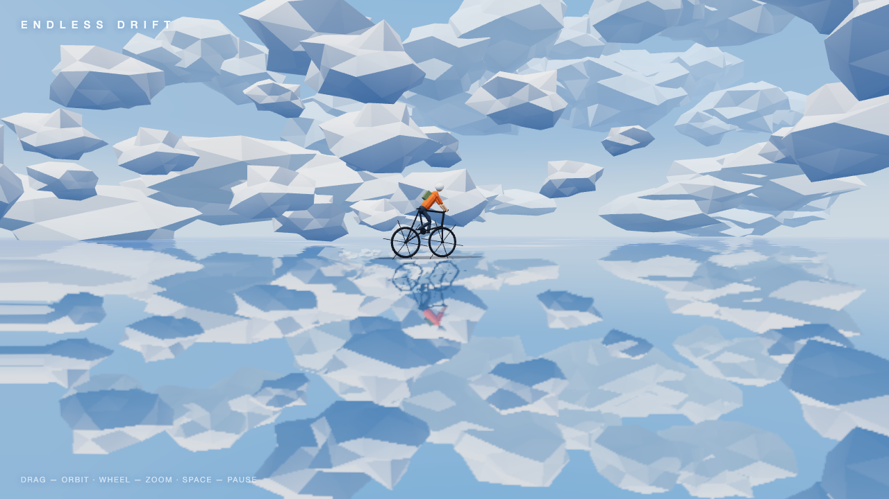

# Cloudride — 用 Craft Anything 复刻 209 期 Top 14 云海骑行

目标：B 站《Three.js 案例合集（209期）》（BV1VxnX6ZECh）封面 / **Top 14**
—— “The infinite ride” 云海骑行者（原作 uyuni / @nabendu82）。

方法：**Craft Anything v0.6.1** 净室复刻（research → build → check → ready），
构建方是本机 Claude Code。只依据封面/关键帧的可见画面重建；**不复制 uyuni
的代码、材质、模型、品牌或 “The infinite ride” 文案**。Demo 使用原创标题
**ENDLESS DRIFT**。



- 视频：`app/docs/demo.mp4`（8.6s，1280×720，真实 Chrome GPU 录制）
- 截图：`app/docs/screenshot.png`
- 应用：`app/`（Three.js r180，静态 ES modules，无构建步骤）

## 运行

```bash
cd app
python3 -m http.server 8801
# open http://localhost:8801/
```

- 鼠标拖拽环绕，滚轮缩放，空格暂停/继续
- 载入即自动骑行

## 场景与技术

- **云海**：低多边形云团 + 一层平铺的云海面；远景融进雾/地平线。
- **镜面倒影**：真实的平面反射——相机按云海平面镜像到半分辨率 RTT，
  海面 shader 做软化模糊与轻微涟漪；半透明程序化云层再压一层，倒影不脏。
- **骑行者**：程序化低模（胶囊/球/圆柱/盒），双脚锁在曲柄上做两骨骼 IK
  踩踏；车轮旋转、身体轻微起伏；橙色外套、深色裤子、白头盔、背包。
- **天空**：蓝色渐变 + 低模积云 + 轻雾；ACES + sRGB，平滑而非像素风。
- **性能**：浮云实例化、半分辨率反射、低 draw call；1280×720 在集显上
  保持 30fps 以上。

## Craft Anything 执行记录

```bash
craft-anything-cli rebuild - \
  "Read inputs/REQUEST.md and inputs/ANALYSIS.md. Build the original Three.js endless cloud ride demo in app/." \
  --project-folder craft-cloudride --existing start-from \
  --rounds 1 --unattended --allow-run --clean-room \
  --backend "Claude Code"
```

- 自检 **2/2 通过**（build + app-screenshot）；项目记录在 `craft.json`、
  `checks/`、`build-activity.log`。
- 与上一轮相同的工具限制：Craft Anything v0.6.1 的 app-screenshot 检查只支持
  有“可启动程序”的栈，不认识纯静态网站。builder 在 `app/` 里加了零依赖
  Rust 启动器（`--screenshot` 时驱动 Playwright 截真实页面）让检查可跑；
  真实 GPU 验证仍以 Playwright + Chrome 截图/视频为准。
- builder 在本轮自己发现并修掉了“倒影被重复压暗 + 光照过暗”的问题；最终
  GPU 截图与它的检查截图一致，未再需要手改。

## 许可

- Craft Anything：Apache-2.0；Three.js r180：MIT。
- 本 demo 为原创净室实现；参考帧只在构建时使用，未随仓库分发（仅保留文字分析）。
