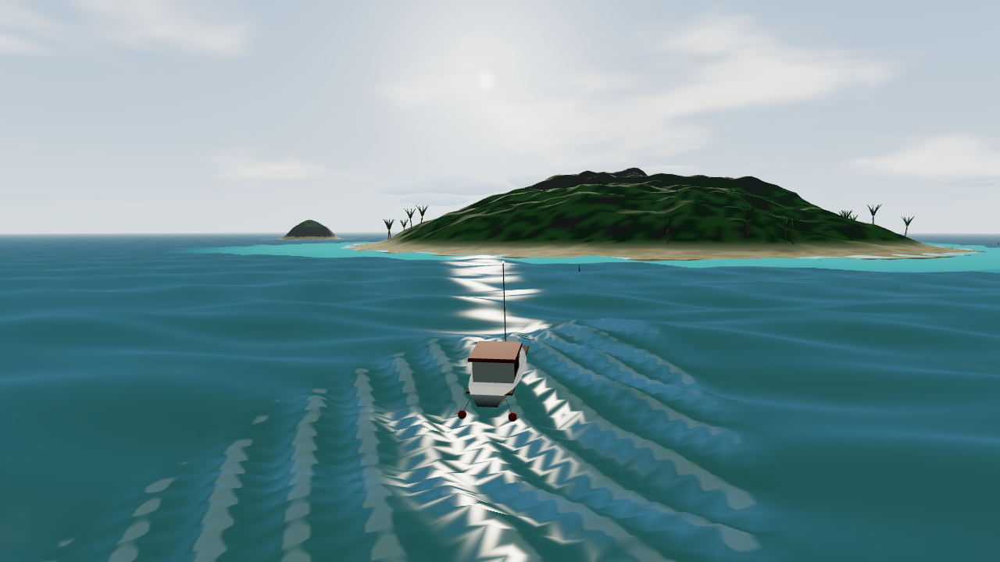

# Craft Island — 用 Craft Anything 复刻 Water Pro 海岛

目标：B 站《Three.js 案例合集（207期）》（BV1x4nY6xEHo）封面 / **Top 2** ——
Dan Greenheck 为 Three.js Water Pro 扩展的大尺度海岛探索场景。

方法：**Craft Anything v0.6.1**（`storytold/craft-anything`，Apache-2.0）的
净室复刻流程：研究可见证据 → 构建 → 检查 → 就绪。它与 REA（`morluto/rea`）
互补：REA 看程序内部，Craft Anything 只依据可见画面重建；构建方是本机已登录的
Claude Code。

> 本仓库不包含 Water Pro / Craftscape 的代码、材质、模型或贴图；也不随仓库分发
> 原视频帧。`inputs/ANALYSIS.md` 只是对可见画面的文字拆解。

## 结果



- 视频：`app/docs/demo.mp4`（17.6s，1280×720，真实 Chrome GPU 录制）
- 截图：`app/docs/screenshot.png`
- 应用：`app/`（Three.js r180 + 静态 ES modules，无构建步骤）

## 运行

```bash
cd app
python3 -m http.server 8801
# open http://localhost:8801/
```

- **W/S / ↑↓** 油门，**A/D / ←→** 转向
- 鼠标拖拽环绕，滚轮缩放
- 6 秒无输入自动巡航

## Craft Anything 执行记录

- 下载 v0.6.1 macOS CLI，`doctor` 通过（Chrome / Playwright / Claude Code 均识别）。
- 先用一个最小 cube 验证整条链路，再做正式 `rebuild`：

```bash
craft-anything-cli rebuild - \
  "Read inputs/REQUEST.md and inputs/ANALYSIS.md. Build the original Three.js island demo in app/." \
  --project-folder craft-island --existing start-from \
  --rounds 1 --unattended --allow-run --clean-room \
  --backend "Claude Code"
```

- 工具记录：`craft.json`、`checks/`、`build-activity.log`、`feed.json`。
- 最终检查 **2/2 通过**（build + app-screenshot）。
- 一个已确认的工具限制：Craft Anything v0.6.1 的 app-screenshot 检查只支持
  Rust/egui、Godot、Unity、Unreal 等有“可启动程序”的栈，不认识纯静态网站。
  builder 为此在 `app/` 里加了一个零依赖 Rust 启动器（带 `--screenshot`
  时驱动 Playwright 截真实页面），让检查可跑；真实 GPU 验证仍以 Playwright
  + Chrome 的截图/视频为准。

## 第一版 GPU 实拍发现的问题（已修）

| 现象 | 根因 | 修复 |
| --- | --- | --- |
| 船周围一大片白色锯齿“泡沫” | 128² 高度场 RT 未初始化，NaN 留在波方程里；wake splat 每帧叠加把高度顶到 clamp | 三个 RT 首次使用前清零；wake 注入按 dt 缩放；高度 clamp 收紧到 ±0.35 |
| 整片海都有白浪 | `vCrest` 阈值 0.07–0.10 与 Gerstner 波峰幅值 0.099 重合；岸线 foam 的 depth 被 clamp 到 0.3 | 提高 crest 阈值并衰减；depth 不再强制最小；泡沫只在尾迹/岸边 |
| 天空看不到云 | 低模云球是受光材质，镜头看到的是暗底面 | 在 sky shader 里加 fbm cumulus 层；低模云保留做层次 |
| 船像浮箱 | 船体白色与泡沫混在一起；红顶被 ACES 洗淡 | 船体按水线分白/红/暗三色；红顶更饱和；棕榈增加到 30 棵并放大 |
| 相机太近/太低 | 泡沫占满前景 | 拉远 + 抬高（dist 24，elevation 0.24） |

详见 `docs/迭代记录.md`。

## 许可

- Craft Anything：Apache-2.0。
- Three.js r180：MIT（`app/vendor/LICENSE-three.txt`）。
- 本 demo 的代码与程序化资产：原创净室实现；参考仅来自公开视频的可见画面。
  视频封面/关键帧未随仓库分发。
