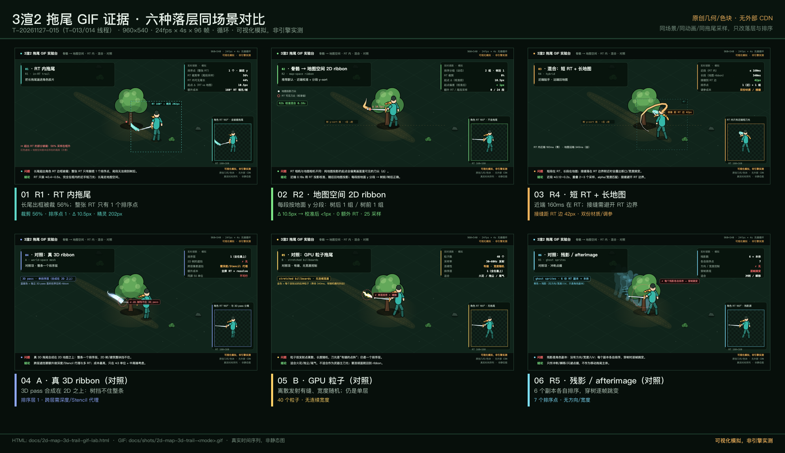
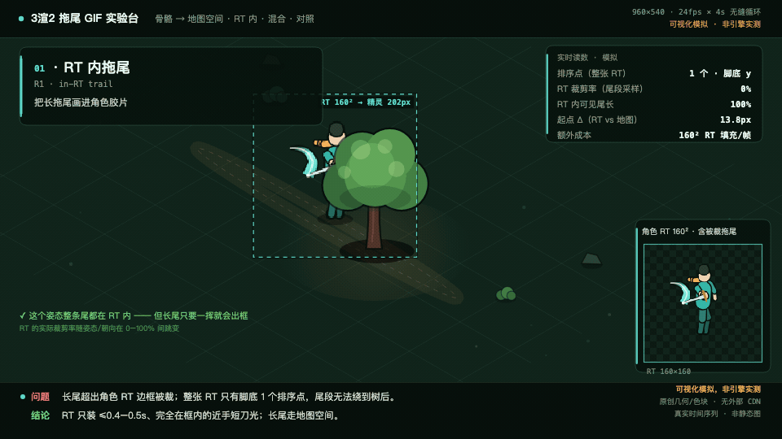
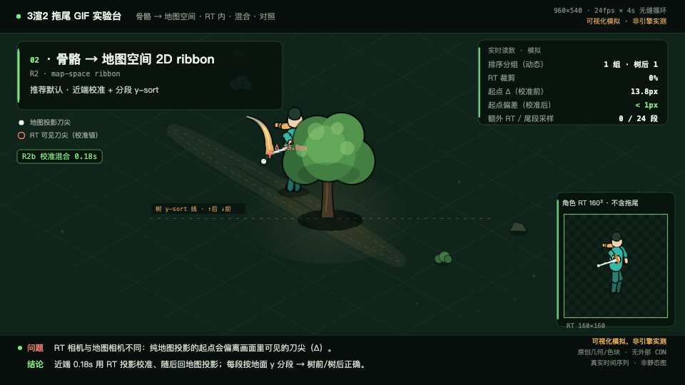
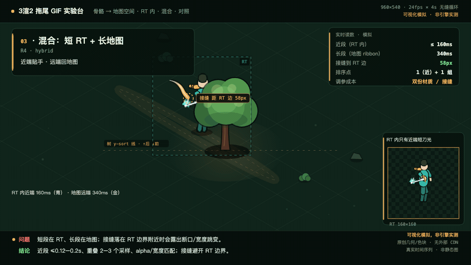
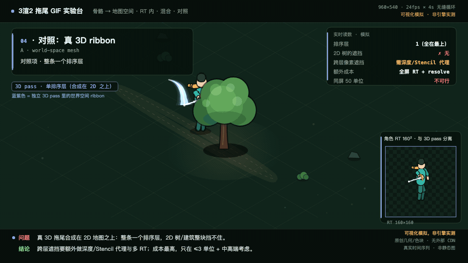
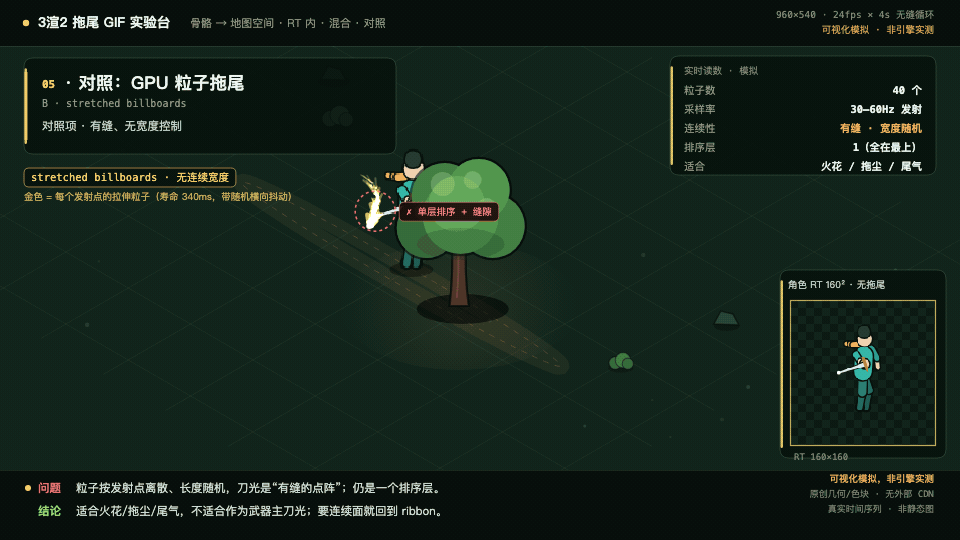
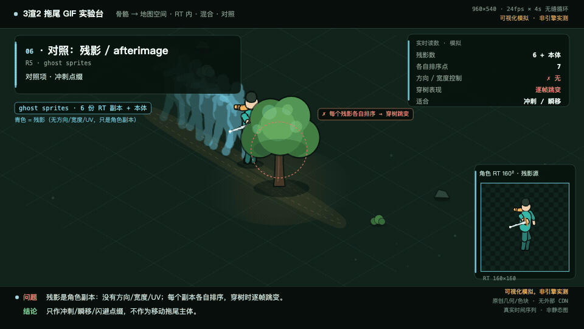

# 3渲2 角色 + 2D 地图：骨骼绑定 3D 拖尾的管线、校准与决策

- 任务：T-20261127-014（T-20261127-013 的 follow-up，同一线程）
- 日期：2026-11-27
- 前置：`docs/2d-map-3d-trail-options.md`（A–H 方案与纯 2D 地图结论）、`docs/2d-map-3d-trail-options-交互版.html`
- 场景：俯视/等轴 2D 地图；角色是 **3渲2**——3D 蒙皮模型由角色相机渲染到 RT，再把 RT 作为 2D 精灵放进地图；移动/技能拖尾绑定在骨骼/武器挂点上；移动端；多人同屏
- 性质：技术调研与方案决策，不写游戏代码、不改现有项目；不复制任何游戏素材、UI、品牌
- 标注约定：〔官方〕引擎/平台官方文档；〔厂商〕厂商博客/宣传；〔社区〕非官方实现/论坛；〔推断〕本文工程判断；〔待实测〕必须用 PoC 验证
- 本文用 **R1–R5** 指代“3渲2 管线下的五种落层方式”，避免与前置文档的 A–H 方案编号冲突；对应关系见 §2.0

---

## 0. 结论先行

**3渲2 角色下，骨骼绑定的拖尾默认应该做在“地图空间”，而不是角色 RT 里。**

推荐链路（R2）：

```text
骨骼/武器挂点世界变换
  → 角色地图根变换（地图 x,y + 高度 z）
  → 地图相机/等轴投影
  → 屏幕空间 2D ribbon（按地面 y 分段）
  → 与树/建筑/角色同一套 2D 排序与遮挡
```

角色 RT 里只保留**近手、短寿命、完全落在 RT 框内、需要被角色手臂/武器自遮挡**的短刀光（R1）；要做长拖尾时用 **R4 混合**：短段留在 RT，长段回到地图空间。**R3（独立 3D pass + 深度/Stencil 代理）只在“同一屏内跨层/逐像素遮挡”是硬需求，且同屏高价值单位 ≤3、目标中高端时才考虑。** R5 残影只做冲刺/瞬移点缀。

### 0.1 分档表（先看这张）

| 情形 | 推荐 | 不建议 | 关键理由 |
|---|---|---|---|
| 3渲2 主角/技能/坐骑的长拖尾（>0.5s 或 >1m） | **R2 地图空间骨骼 ribbon** | 把长尾塞进角色 RT（R1） | RT 边框会裁尾；角色精灵只有一个排序点，无法逐树遮挡；RT 尺寸随尾长膨胀〔推断〕 |
| 近手短刀光/武器轨迹（≤0.4–0.5s，完全在 RT 框内） | **R1 RT 内短拖尾**；需要长尾时 R4 | 为短刀光单开全屏 3D pass | 复用角色已有 RT/pass，边际成本主要是填充与 RT 尺寸；还能被角色手臂/身体正确自遮挡〔推断〕 |
| 同一屏内跨层/逐像素遮挡（桥下、拱门、屋檐、多层地形） | **R3 独立 3D pass + 深度/Stencil 代理** | 纯 2D 分段硬扛 | 2D y-sort 表达不了“同一屏内两层”；但只有 ≤3 单位 + 中高端才值得〔推断〕 |
| 3渲2 同屏 10–50 玩家/NPC 移动 | **R2 精简版**（12–24 段、30Hz、1 层） | R1（逐角色 RT 膨胀）、R3 | 移动端先是 RT pass/带宽与 overdraw，再是顶点；R2 无额外 RT〔推断〕 |
| 低端机 / 发热/内存受限 | **R2 8–12 段** 或 **R5/G 单 quad/精灵** | R1 动态放大 RT、R3 全屏 RT | 少一次 RT clear/resolve、少一层透明就是收益〔官方〕〔推断〕 |
| 冲刺/瞬移/闪避残影 | **R5 残影** | 把残影当移动拖尾主体 | 便宜、观感强，但没有方向/宽度/UV 控制〔推断〕 |

### 0.2 五个硬结论

1. **RT 是角色的“胶片”，拖尾是地图上的“墨迹”。** 角色 RT 只负责把模型画成一张图；拖尾一旦要在树/建筑之间前后穿插，就必须活在 2D 地图的排序系统里，而不是胶片里。〔推断〕
2. **RT 内拖尾的边际成本不是 draw call，而是 RT 边界与填充。** 角色本来就要渲染 RT，短拖尾塞进去几乎不增加 pass；但拖尾一长，RT 必须变大，显存/带宽/填充按面积平方增长，且仍只有一个排序点。〔推断〕
3. **“骨骼投影到地图”只解决了位置，没解决“和可见武器尖对齐”。** 角色 RT 相机（3/4、常带透视）与地图相机（俯视/等轴、常正交）不同；必须用 RT 相机投影做近端锚点校准，再在中远段回到地图空间。否则会出现拖尾从脚/头飘出、或与画面里的刀尖错开。〔推断/待实测〕
4. **遮挡默认用“分段 y-sort + 图层/遮罩”，不是 Stencil。** 把每段拖尾按地面 y 排序、在树/建筑的排序线处切段，能解决绝大多数 2D 地图遮挡；树冠、桥、拱门这类“同一屏两层”才是深度代理的用武之地。〔推断〕
5. **风格必须在 2D 材质阶段与角色 RT 对齐。** RT 里的描边/色阶/AA/透明度是按 RT 像素算的；地图空间 ribbon 要按屏幕像素重算描边、量化色阶、匹配 AA，否则会出现“角色是 3渲2、拖尾是写实光效”的割裂。〔推断〕

### 0.3 先问五个问题

| 问题 | 是 | 否 |
|---|---|---|
| 1. 角色是不是 3渲2（3D→RT→2D 精灵）？ | 进入本文 R1–R5；默认 R2 | 回到前置文档的纯 2D 路线 C/H/G |
| 2. 拖尾是否短到完全落在角色 RT 框内（≤0.4–0.5s / ≤0.5m）？ | 可考虑 R1（需要自遮挡时优先） | R2；要兼顾近端贴合用 R4 |
| 3. 拖尾是否需要在同一屏内跨层/逐像素遮挡？ | 评估 R3（≤3 单位 + 中高端） | R2 + 分段 y-sort / 图层 / 遮罩 |
| 4. 同屏人数与目标机型？ | 50 人 + 低端：R2 精简或 R5 | 1–3 人 + 中高端：R1/R4 可上更高保真 |
| 5. 远端角色有没有可采样的骨骼/动画？ | 有：R2 本地重建；没有：用根运动/挂点近似或关闭 | 只能同步位置/事件，不能做骨骼拖尾 |

> 一句话决策：**3渲2 长拖尾 → R2；近手短刀光 → R1/R4；跨层像素级遮挡 → R3；冲刺残影 → R5；低端/50 人 → R2 精简或 R5。**

---

## 1. 管线：两条链与一个校准点

### 1.1 3渲2 的两条链

| 链 | 路径 | 输出 | 谁决定“看起来在哪” |
|---|---|---|---|
| 渲染链 | SkinnedMesh + Skeleton → 角色相机（RT 相机）→ RT 纹理 → 2D 精灵/Quad → 地图 2D 渲染器 → 屏幕 | 角色的一张带 alpha 的图 | RT 相机投影 + 精灵在地图里的摆放（pivot/缩放/翻转） |
| 拖尾链（R2） | 骨骼/挂点世界变换 → 角色地图根变换 → 地图投影 → 2D ribbon → 地图 2D 渲染器 → 屏幕 | 一条可分段排序的 2D 带 | 地图相机/等轴公式 + y-sort |
| 校准桥 | 同一骨骼分别过 RT 相机与地图投影，比较两个屏幕位置 | 每帧/每姿态的偏移 Δ | RT 相机与地图相机的差异 |

〔推断〕关键不是“有没有骨骼”，而是**两条链的相机不是同一个**。R2 的默认做法是让拖尾主体跟地图相机；校准桥只负责把“起点”拉回画面里可见的武器尖。

### 1.2 变换链（按地图 x,y + 高度 z 约定）

设：

- `B`：骨骼在骨架空间的全局姿势（Godot 的 `get_bone_global_pose` 返回“相对 skeleton”的变换，不是世界变换〔官方〕）；
- `S`：Skeleton3D/骨架节点在模型内的变换；
- `M`：模型根在角色空间内的变换（含模型缩放、Z-up→Y-up 轴修正、脚底 pivot 偏移）；
- `C`：角色在地图世界里的根变换（地图 x,y、朝向 yaw、缩放 s、高度 z=0）；
- `P_map`：地图相机/等轴投影（世界 → 屏幕像素）；
- `P_rt`：角色 RT 相机投影（角色 RT 场景 → NDC/RT 像素）。

则：

```text
p_char   = M · S · B                     // 角色空间（脚底为原点更利于排序）
p_map    = C · p_char                    // 地图世界：x,y 地面 + z 高度
p_screen = P_map · p_map                 // 地图屏幕像素（R2 的 ribbon 用这个）
p_rt_ndc = P_rt · T_rt · p_char          // RT 相机下的 NDC（T_rt 通常是单位/固定摆位）
p_rt_px  = (p_rt_ndc.xy * 0.5 + 0.5) * rtSize
p_sprite = SpriteQuad(p_rt_px)           // RT 像素 → 精灵局部 → 地图屏幕（R1/校准用）
```

其中 `SpriteQuad` 要处理：Y 翻转（RT/纹理坐标 vs 屏幕坐标）、精灵 pivot、水平镜像、缩放、地图相机 zoom。**这一步是“RT 内拖尾/校准锚点”唯一的正确来源；不要用动画帧的屏幕坐标反推 3D。**

#### 坐标约定陷阱

| 陷阱 | 症状 | 处理 |
|---|---|---|
| Godot 默认 Y-up，地图用 x,y+高度 z | 角色“站着”但骨骼投影到地图后上下颠倒 | 在 `M` 里做一次轴映射；不要在两个地方各转一次 |
| 模型单位 cm、地图单位 m | 拖尾长 100 倍/短 100 倍 | 统一在 `M` 里缩放；骨骼采样后只做一次单位换算 |
| 模型原点在骨盆、角色根在脚底 | 拖尾整体上移/下移半个身位 | 在 `M` 里加脚底偏移；用地面影子/脚底 marker 校验 |
| 骨骼 global pose 是“相对 skeleton” | 忘了乘 `S`，角色移动/转向时拖尾不动 | `p_char = M · S · B`；或用 `BoneAttachment3D.global_transform`〔官方〕 |
| 动画 root motion 与角色根同时移动 | 拖尾双倍位移/漂移 | 二选一：根运动驱动角色，或骨骼采样去掉 root bone 位移 |
| 精灵镜像（左右翻转） | 左手刀光出现在右手 | 在 `SpriteQuad` 里同步镜像；R2 用地图朝向而不是精灵翻转 |
| RT/纹理 Y 轴翻转 | 拖尾从头顶/脚底反向长出 | 明确 RT 的 UV 原点；用 1px marker 验证 |

〔官方〕Godot `Skeleton3D.get_bone_global_pose()`：“Returns the overall transform of the specified bone, with respect to the skeleton. Being relative to the skeleton frame, this is not the actual 'global' transform of the bone.”；`BoneAttachment3D` 则是“dynamically copies or overrides the 3D transform of a bone in its parent Skeleton3D”，可直接拿节点全局变换。

### 1.3 三条可选落层（对应 R1/R2/R3）

```text
R1：p_rt_px → 画在角色 RT 内（和角色同一张胶片，单排序点）
R2：p_screen → 画在地图 2D 层（分段 y-sort，推荐默认）
R3：p_rt_ndc → 画在独立 3D pass/RT（真 3D，深度/Stencil 代理）
```

**选择不是“哪个更 3D”，而是“拖尾要不要参与地图的排序/遮挡”。** 一旦答案是“要”，就只能 R2 或 R3；R1 只适合不需要逐树遮挡的短尾。

---

## 2. R1–R5：五种落层方式

### 2.0 与前置文档 A–H 的对应

| 本文 | 用户问题里的选项 | 前置文档对应 | 一句话 |
|---|---|---|---|
| R1 | A：角色 RT 内 | A/F 的“角色 RT 局部版” | 最贴手、能自遮挡，但被 RT 框裁、单排序点 |
| R2 | B：骨骼世界变换 → 地图空间 2D ribbon | H + F 的 3渲2 版 | **默认推荐**：排序/遮挡/成本最稳 |
| R3 | C：独立 3D pass + Viewport/Stencil/深度 | E + A | 真 3D、可像素级遮挡，但成本最高 |
| R4 | D：混合 | R1 + R2 | 短段 RT、长段地图；按距离/技能/LOD 切 |
| R5 | E：RT 残影/精灵副本 | D | 便宜，只做冲刺/瞬移点缀 |

### 2.1 R1：角色 RT 内拖尾

**数据流**：骨骼/挂点 → 在角色 RT 的 3D 场景里生成 ribbon mesh（与角色同一相机/同一 pass）→ 渲染进角色 RT → RT 作为精灵参与 2D 排序。

**强项**：

- **与可见武器尖绝对贴合**：它和角色模型是同一张图，不存在“RT 相机 vs 地图相机”的校准误差。
- **自遮挡正确**：拖尾可以被手臂、身体、武器正确遮挡（3D 深度测试），这是 R2 的 2D 平面 ribbon 做不到的。
- **不增加 2D draw call / 不增加额外 3D pass**：角色本来就要渲染 RT；短尾只是多几个三角形和一点 RT 填充。〔推断〕
- **风格天然一致**：共享角色的光照/描边/色阶/后处理（如果 RT 有）。

**弱项**：

- **RT 边界裁剪**：拖尾超出角色框就被裁掉；框放大→RT 面积/显存/带宽按平方增长。
- **单排序点**：整张 RT 精灵只有一个排序键（通常脚底 y）。角色在树前，整条拖尾都在树前；角色在树后，整条都在树后。无法“尾段绕到树后”。〔推断〕
- **分辨率绑定**：RT 分辨率固定，地图 zoom/角色远近变化时，拖尾的像素密度和描边宽度会变；像素风会破网格。
- **RT 相机与地图相机不同**：RT 内拖尾的屏幕方向/长度是 RT 相机的，不是地图相机的；角色转身/镜头缩放时可能“看起来对、放在地图上不对”。
- **动态 RT 昂贵**：为长尾临时放大 RT 会触发重分配/清屏/带宽峰值，且每个角色一份。

**适用**：近手短刀光、武器轨迹、需要被身体自遮挡的 ≤0.4–0.5s 短尾；单角色/少量高价值单位。

**引擎提示**：Unity 在角色相机里加 `TrailRenderer`/自定义 mesh；Godot 在 `SubViewport` 的 3D 场景里加 `ImmediateMesh`/`ArrayMesh`（4.6 无 `Trail3D`，4.8+ 才有〔官方〕）；Cocos 在角色相机里用 `TrailModule` 或自定义 mesh；Unreal 用 Niagara Ribbon；Three.js 在角色 `WebGLRenderTarget` 场景里加 `BufferGeometry` ribbon。

### 2.2 R2：骨骼世界变换 → 地图空间 2D ribbon（默认）

**数据流**：骨骼/挂点世界变换 → 角色地图根变换（x,y+高度 z）→ 地图投影 → 采样历史 → 屏幕空间左右偏移生成三角带 → 按地面 y 分段 → 2D 渲染器/y-sort。

**两种子模式**：

| 子模式 | 起点 | 主体 | 优点 | 缺点 |
|---|---|---|---|---|
| R2a 纯地图投影 | 地图投影的骨骼位置 | 地图投影 | 世界一致、排序正确、实现简单 | 与画面里可见武器尖可能有偏差（相机不同） |
| R2b 锚点校准 + 地图投影 | RT 相机投影的武器尖 → 精灵 → 地图屏幕 | 地图投影 | 近端贴合可见武器，远端保持世界一致 | 多一层校准/混合；极端姿态可能跳变 |

**强项**：

- **排序/遮挡正确**：每段按地面 y 参与 y-sort，树/建筑前后关系自然；可按遮挡线切段/分桶。
- **无额外 RT**：不增加角色 RT 尺寸、不增加 RT pass；50 单位也可行。
- **风格可控**：2D 材质直接按屏幕像素做描边/色阶/抖动/像素对齐。
- **网络/回放友好**：只依赖本地骨骼/动画；不同步段。
- **跨引擎可移植**：数据契约与前置文档 H 相同，只是采样源从“角色位置”换成“骨骼/挂点”。

**弱项**：

- **相机校准**：RT 相机与地图相机不同，近端可能与可见武器尖错位；需要 R2b 校准。
- **无真实深度/光照**：刀光的体积感靠截面/朝向/影子/描边，不是 PBR。
- **自遮挡**：2D 平面 ribbon 不会自动被角色手臂/身体遮挡；需要短段 R1/身体遮罩/接受。
- **逐段排序成本**：切段会打断合批；用分桶/分带把 draw call 控制在 2–5。

**适用**：3渲2 主角/技能长拖尾、同屏 10–50 单位、低端机主力。

### 2.3 R3：独立 3D pass + Viewport/Stencil/深度合成

**数据流**：拖尾（或整个特效层）在独立 3D 相机/RT 里渲染 → 用 2D 遮挡物的深度/Stencil 代理裁剪 → 在 2D 地图的某个排序层合成。

**强项**：

- 真 3D 几何/深度，能做像素级跨层遮挡（桥下、拱门、屋檐）。
- 可统一后处理/描边/色彩空间；适合“必须真 3D 观感”的高价值技能。

**弱项**：

- **2D 精灵默认不写深度**：要让 3D 拖尾被 2D 树/建筑遮挡，必须额外做深度/Stencil 代理（不可见 3D 面片/遮罩 RT），这是额外 pass 与美术维护。
- **单 RT 只能对应一个排序层**：拖尾要在多棵树之间前后穿插时，一个全屏 RT 不够；需要多 RT/多段合成。
- **成本最高**：全屏 RT + resolve + 额外 pass；移动端低端机不友好；50 单位不可行。
- **风格割裂风险**：3D pass 的光照/AA 与 2D 地图不同，需要材质/后处理对齐。

**适用**：≤3 个高价值单位、跨层遮挡硬需求、中高端机型、团队能维护多相机/RT。

**判定清单（同时满足才上）**：

1. 遮挡无法用 y 线/图层/2D 遮罩表达（同一屏内多层）；
2. 需要像素级正确，而不是“大致前后”；
3. 同屏高价值单位 ≤3；
4. 目标中高端，且 RT 成本有预算。

### 2.4 R4：混合（短 RT + 长地图）

**数据流**：同一骨骼采样分两段：`age ≤ T_short`（如 0.12–0.2s）的样本走 R1 的 RT 内 mesh；其余样本走 R2 的地图空间 ribbon。两段在空间/透明度上交接。

**强项**：

- 近端贴合/自遮挡（R1）+ 远端排序/长度（R2）兼得。
- 可按技能/距离/LOD 切换：普攻短尾走 R1，大招长尾走 R2/R4。

**弱项**：

- **接缝**：两段的宽度/颜色/透明度/描边必须连续；RT 边界处容易看到“断口”。
- **双份采样/双份材质**：实现与调参成本高；低端机不建议。
- **排序仍以 R2 为主**：短段在 RT 内仍受角色单排序点影响，只是它足够短，视觉上不易察觉。

**适用**：主角武器技能、坐骑/长兵器、需要“近处贴手、远处入地图”的高价值效果。

**交接建议**：短段在 RT 内做 0.12–0.2s；长段从短段末端开始，重叠 2–3 个采样点；用 alpha 渐变/宽度匹配隐藏接缝；RT 边界处不要正好切在拖尾中段（会被看到）。

### 2.5 R5：RT 残影/精灵副本 afterimage

**数据流**：复制角色 RT 精灵/角色 mesh 的过去 N 帧，按时间衰减 alpha/偏移/缩放；或后处理 feedback。

**强项**：最便宜、观感强，适合冲刺/瞬移/闪避；不需要历史曲线/骨骼。

**弱项**：不是拖尾；没有方向/宽度/UV 控制；副本增加 overdraw/draw call；与手绘/像素风容易割裂。

**适用**：冲刺/瞬移/受击闪避的点缀层，不作为移动拖尾主体。

### 2.6 五方案对比

| 维度 | R1 RT 内 | R2 地图空间 | R3 独立 3D pass | R4 混合 | R5 残影 |
|---|---|---|---|---|---|
| 与可见武器尖贴合 | 5（同一张图） | 3–4（校准后 4–5） | 4 | 5（近端） | 2 |
| 自遮挡（手臂/身体） | 5 | 2（需遮罩） | 4 | 4–5 | 1 |
| 逐树/建筑遮挡 | 1（单排序点） | 5（分段 y-sort） | 4–5（需代理） | 4（长段） | 2 |
| RT 边界裁剪风险 | 5（高） | 0 | 1（独立 RT 可大） | 3（短段小） | 0 |
| 校准难度 | 1（无需） | 4（中） | 3 | 5（最高） | 1 |
| 风格一致性 | 4（随 RT） | 5（可控） | 3 | 4 | 3 |
| 同屏 1 单位成本 | 低–中（RT 填充） | 低 | 高 | 中–高 | 低 |
| 同屏 10 单位 | 中–高（10 RT） | 低 | 不可行 | 高 | 低 |
| 同屏 50 单位 | 不可行 | 低–中 | 不可行 | 不可行 | 低 |
| 网络/回放 | 依赖骨骼 | 依赖骨骼 | 依赖骨骼 | 依赖骨骼 | 只依赖位置 |
| 低端机 | 中（RT 尺寸） | 高 | 低 | 低 | 高 |
| 结论 | 短刀光工具 | **默认** | 跨层遮挡工具 | 主角技能 | 冲刺点缀 |

> 评分是工程判断，不是实测；数字随项目/机型变化。〔推断〕

---

## 3. 校准：让拖尾从“看得见的武器尖”出发

### 3.1 为什么“骨骼投影到地图”会错位

角色 RT 相机与地图相机至少在三处不同：

| 差异 | RT 相机（典型 3渲2） | 地图相机（典型俯视/等轴） | 后果 |
|---|---|---|---|
| 朝向/pitch | 3/4 视角，30–45° 俯角，正面偏侧 | 俯视 45–60° 或 2:1 等轴 | 同一段垂直/前后位移在两个屏幕上的方向/长度不同 |
| 投影 | 常透视，近大远小 | 常正交，无近大远小 | 武器前后摆动时，RT 里长度变化，地图里不变 |
| 取景/中心 | 角色居中/偏上，固定 framing | 角色在地图任意位置，相机跟随/缩放 | 同一世界偏移对应的像素偏移不同 |
| 镜像 | 精灵可能左右翻转 | 地图朝向由 yaw 决定 | 刀光可能出现在反手 |
| 分辨率 | RT px（可能 2× 超采样） | 屏幕 px | 1px 描边/像素网格不一致 |

〔推断〕因此：

- **用地图投影做整条拖尾**：世界一致、排序对，但近端起点可能偏离画面里的刀尖（“拖尾从手腕旁边飘出”）。
- **用 RT 投影做整条拖尾**：近端绝对贴合，但远端是“精灵局部空间”的延伸，不随地图相机/地面走；超出精灵框后没有意义，且排序仍是单点。
- **正解是分段/混合**：近端用 RT 锚点，远端用地图投影，中间平滑过渡。

### 3.2 三种校准方法

| 方法 | 做法 | 精度 | 成本 | 适用 |
|---|---|---|---|---|
| C1 运行时 RT 锚点 | 每帧把骨骼过 RT 相机，得到 `A_rt`；同时算地图投影 `A_map`；用 `Δ = A_rt - A_map` 修正起点 | 高（与画面一致） | 低（几次矩阵乘法） | R2b 默认；近端 0.1–0.2s |
| C2 离线 per-pose 表 | 对每个动画 clip × 朝向 × 镜像，离线烘焙 `Δ`，运行时按 clip 时间/混合权重插值 | 高（固定 clip/相机） | 中（烘焙/存储/维护） | 相机/RT framing 固定、动画集稳定；或作为 C1 的降级 |
| C3 混合 origin | `origin = A_map + w(age)·Δ`，`w` 从 1 衰减到 0；只修正起点，不解算整条 | 中–高 | 低 | R2b 通用；与 C1 组合 |

**推荐**：C1 + C3。C2 只在“RT 相机矩阵运行时拿不到”或“需要逐帧完全复现”时用；不要为了校准去 GPU readback（会卡管线）。

### 3.3 混合 origin 公式

```text
A_rt(t)  = SpriteQuad( P_rt · T_rt · p_char(t) )      // 可见武器尖（RT 像素→精灵→地图屏幕）
A_map(t) = P_map · C · p_char(t)                     // 地图投影
Δ(t)     = A_rt(t) - A_map(t)                        // 屏幕像素偏移

对拖尾第 i 个采样点（年龄 age_i）：
  w_i = clamp(1 - age_i / T_blend, 0, 1)             // T_blend = 0.12–0.25s
  p_i = P_map · C · p_char(t_i) + Δ(t_i) · w_i
```

- `T_blend` 太小：近端贴合但中段突然“拐”回地图；太大：远端被 RT 偏移拖歪。
- 起点（age=0）完全用 `A_rt`，保证“从刀尖出发”；0.2s 后完全回到地图投影，保证世界一致。
- 如果 `Δ` 抖动（姿态/相机噪声），对 `Δ` 做低通（如 10–15Hz）或按 clip 时间平滑；不要在每帧硬切。
- 镜像/左右手切换时，`Δ` 必须跟着镜像；否则会瞬间跳到另一侧。

### 3.4 校准流程（最小可执行）

1. **加两个 marker**：在 RT 场景的武器尖放一个 1px 亮色 marker（或直接用骨骼点画一个小十字）；在地图投影的同一骨骼位置画另一个 marker。截图/像素采样，量两者像素差。
2. **覆盖测试集**：3 个动作（idle / run / attack）× 4 个朝向（0/90/180/270）× 2 个镜像 × 2 个 zoom（1×/1.5×），共 48 个采样点；记录 `Δx/Δy`。
3. **实现 C1**：运行时用同一套相机矩阵算 `A_rt`/`A_map`，不要读回 RT 像素。
4. **实现 C3**：按 age 衰减 `Δ`；在 0/0.1/0.2/0.3s 四个年龄点各截一帧，检查接缝。
5. **回归**：换皮肤/换武器/换动画后重跑；把 `Δ` 的 p95 作为验收指标。

### 3.5 验收指标

| 指标 | 建议门槛 | 证据 |
|---|---|---|
| 起点偏差 | ≤2px @1080p，≤1.5px @720p（p95） | marker 截图/像素采样 |
| 朝向切换跳变 | ≤1px，且无单帧大跳 | 4 朝向 × 2 镜像录屏 |
| 近端 0.2s 内与刀尖贴合 | 10/10 帧肉眼无脱离 | 逐帧截图/盲评 |
| 中远段世界一致 | 角色移动 1m，拖尾尾端跟随地图地面，不“贴精灵” | 录屏/轨迹叠加 |
| 接缝 | R4 短/长段交接无可见断口/宽度跳变 | 逐帧截图 |

〔待实测〕以上阈值是起点，不是行业标准；先量基线，再逐版对比。

### 3.6 “从脚/头飘出”排查清单

1. 骨骼 global pose 有没有乘 skeleton/model 变换？（Godot 的 `get_bone_global_pose` 是相对 skeleton〔官方〕）
2. 模型根 pivot 在脚底还是骨盆？`M` 里有没有脚底偏移？
3. 单位是 cm 还是 m？缩放是否只做了一次？
4. 动画 root motion 与角色根是否重复位移？
5. 精灵 pivot/RT framing padding 是否计入 `SpriteQuad`？
6. 左右镜像/换手时 `Δ` 是否同步镜像？
7. 地图相机 zoom/shake 是否作用到了拖尾层，但没作用到角色精灵（或反之）？
8. RT 的 Y 轴/UV 原点是否翻转了两次？

---

## 4. RT 边界、分辨率与像素化

### 4.1 为什么长拖尾塞不进角色 RT

设角色屏显 96×128px，RT 为 256×256（约 2× 超采样）。若 1m ≈ 100 屏幕 px，一条 3m 拖尾在屏幕上约 300px；RT 只有 256px 宽，**还没算角色自身占位、留边、透视缩短**，就已经出框。5m 拖尾约 500px，必然被裁。

更一般地：

```text
所需 RT 边长 ≈ 角色在 RT 中的包围盒 + 2 × 拖尾在该方向上的最大屏幕长度 × RT 超采样倍率
RT 面积成本 ∝ 边长²
```

〔推断〕这就是“短刀光可以进 RT，长拖尾不行”的算术原因：拖尾长度线性增长，RT 面积/显存/填充按平方增长。

### 4.2 RT 成本表（估算）

| RT 尺寸 | RGBA8 颜色 | +D24 深度 | 4×MSAA（粗估） | 每帧写+采样（1 次） | 10 角色/帧 | 50 角色/帧 |
|---|---:|---:|---:|---:|---:|---:|
| 128×128 | 64 KB | 112 KB | ~0.45 MB | ~0.22 MB | 2.2 MB | 11 MB |
| 256×256 | 0.25 MB | 0.44 MB | ~1.75 MB | ~0.88 MB | 8.8 MB | 44 MB |
| 512×512 | 1 MB | 1.75 MB | ~7 MB | ~3.5 MB | 35 MB | 175 MB |
| 1024×1024 | 4 MB | 7 MB | ~28 MB | ~14 MB | 140 MB | 700 MB |

> 说明：RGBA8=4B/px，D24=3B/px；MSAA 4× 按颜色/深度 4× 粗估，实际取决于引擎/压缩/tile 内存。每帧写+采样按 1 次写 + 1 次读估算；若每帧 clear/resolve/多 pass，乘 2–3。**这些是量级估算，不是实测。**〔推断/估算〕

- 10 个 512² RT 已经 10–35MB/帧的 RT 流量；50 个不可接受。
- 角色 RT 通常只需 128–256²（小角色/小屏），但长拖尾会把“角色 RT”逼到 512–1024²，成本跳一个量级。
- tile-based GPU 上，每个 RT 的 clear/load/store 是独立 pass 开销；**很多小 RT 比一个大 RT 更贵**。〔厂商〕（Arm/Qualcomm 对 render pass/带宽的通用建议，见前置文档来源 24–26）

### 4.3 动态 RT 尺寸的成本

- **重分配**：每帧改 `width/height` 会重建纹理/帧缓冲，触发 GPU 同步/内存碎片；不能按拖尾长度逐帧变。
- **打破合批**：每个角色一份 RT → 一次 RT 切换 + 一次 2D 精灵采样；图集/合批收益消失。
- **清屏/Resolve**：RT 越大，clear + resolve 带宽越高；MSAA 更贵。
- **排序不变**：RT 再大，角色精灵仍是一个排序点；长尾的逐树遮挡不会因为 RT 变大而变好。

**建议**：

1. **角色 RT 只包角色 + 10–20% padding**；不为拖尾扩 RT。
2. 需要动态尺寸时用**固定档位**（128/192/256/384），只给主角升档；不要连续插值。
3. 长拖尾走 R2；如果必须 RT 内长尾，给主角单独一个**大 RT + 独立相机**（本质是 R3），不要污染所有角色 RT。
4. 50 单位一律 R2/精灵；不要尝试逐角色 RT 长尾。

### 4.4 分辨率、像素网格与风格一致性

设屏幕精灵高 `H_s` px、RT 高 `H_rt` px，超采样倍率 `k = H_rt / H_s`。

| 风格 | 建议 k | 采样 | 拖尾处理 |
|---|---:|---|---|
| 像素风 | 1（整数） | NEAREST | 2D ribbon 按屏幕像素对齐；宽度/描边取整数 px；8–16 色调色板；关闭 AA；角色 RT 也按整数倍渲染 |
| 手绘/卡通 | 1.5–2 | LINEAR | 2D ribbon 用同样的超采样或轻微 alpha 羽化匹配 RT 边缘；描边 1–2 屏幕 px；色阶 4–6 |
| 写实 3D 风 | 2–4 | LINEAR/MSAA | 允许软边/轻微 glow；但仍建议色阶/描边统一，避免与 2D 地图割裂 |

**关键**：

- **拖尾宽度用屏幕像素定义，不用 RT 像素定义。** `w_px = base_width * zoom`；RT 内则要换算 `w_rt = w_px * k`，但 RT 内无法逐帧改 k（除非重渲染）；这就是“地图空间 ribbon 更容易保持一致”的原因。
- **像素网格**：如果角色 RT 是 NEAREST 且按整数倍放大，2D ribbon 也必须整数对齐/整数宽度；否则拖尾比角色“更清晰/更锯齿”。
- **描边**：RT 内描边是按 RT 像素算的；地图空间 ribbon 要按屏幕像素算（`1–2px`），并随 zoom 保持屏幕宽度，而不是世界宽度。
- **透明边缘**：RT 常用 straight alpha；2D 材质若用 premultiplied，边缘会出现暗边/亮边；统一 blend 模式。
- **色彩空间**：RT 可能在 linear 空间渲染、sRGB 显示；2D 材质要匹配 gamma，否则拖尾颜色比角色亮/暗。

〔推断〕验收时不要只看“拖尾好不好看”，要同时截“角色 + 拖尾 + 树”的局部放大图，量描边宽度、色阶数、边缘 AA、调色板 ΔE。

---

## 5. 2D 排序与遮挡

### 5.1 单排序点 vs 分段排序

| 方式 | 排序键 | 优点 | 缺点 |
|---|---|---|---|
| 角色精灵单点（R1） | 脚底 y（整张 RT 一个） | 简单、与角色完全同步 | 长尾无法逐树穿插；树冠/桥下必错 |
| 拖尾分段（R2） | 每段采样点的**地面 y** | 可逐树/逐建筑穿插；可分层 | 切段打断合批；需要分桶/分带 |
| 独立 3D pass（R3） | 深度/Stencil | 像素级正确 | 成本最高；需要代理 |

**注意**：分段排序的键要用**采样点在地面的投影 y**（`project(x,y,0).y`），不是 ribbon 抬高后的屏幕 y。否则高处的拖尾段会按“空中高度”排序，插到错误的树前/树后。

### 5.2 三种遮挡策略

| 策略 | 做法 | 适用 | 成本 | 结论 |
|---|---|---|---|---|
| 1. 分段 y-sort | 在树/建筑的排序 y 线处把 ribbon 切成前后段；每段一个排序键 | 绝大多数 2D 地图 | 2–5 个 draw call/分带 | **默认** |
| 2. 前后层 + 树冠 overlay | 拖尾分 `trail-back` / `trail-front` 两层；树冠单独一层，压在同一 y 带的角色/拖尾上 | 树冠、屋檐、低垂枝叶 | 多一层透明；需要作者标 layer | 2D 地图常用 |
| 3. Stencil/深度代理 | 2D 遮挡物写深度/Stencil；3D 拖尾测试 | 桥下/拱门/多层地形；像素级 | 额外 pass/RT/代理资产 | 仅 R3 场景 |

### 5.3 树冠、桥、屋檐、多层地形

- **树冠**：树干底部 y 是排序键，但树冠覆盖范围可能延伸到角色前方。角色在树干前、树冠下时，正确表现是“角色被树冠遮住一部分”。标准 y-sort 做不到；用单独的 canopy overlay 层，按 y 带压住角色/拖尾，或给树冠一个 2D 遮罩。
- **桥/拱门**：同一屏内“桥面在上、桥下可走人”，y-sort 无法表达；需要把地图拆成 layer/region（地面层、桥层），角色/拖尾按所在区域切层；长拖尾跨区域时在边界切段/裁剪。
- **多层地形**：类似桥；如果层数少且固定，用 layer + 每层独立 y-sort；如果层数多/动态，才考虑 R3 的深度代理。
- **UI**：拖尾永远不盖 UI；UI 用独立 CanvasLayer/Screen Space Overlay；拖尾层不被 UI 遮罩裁剪。

### 5.4 角色自身遮挡

- R1 在 RT 内天然正确：拖尾在手臂后面就被手臂挡住。
- R2 的 2D ribbon 是一个平面层，默认画在角色精灵之上或之下；如果刀光应该绕到身体后面，需要：
  - **短段 R1/R4**：近手 0.1–0.2s 放 RT；
  - **身体遮罩**：把角色剪影当 2D mask，给拖尾做“在身体后”的裁剪；
  - **接受**：多数俯视游戏里刀光在身体上方也能接受，先别过度工程。
- 不要用“把拖尾画在角色精灵下面”一刀切：脚部拖尾/地面影子应该在角色下，刀光应该在角色上；按效果分层。

### 5.5 合批与分带

- **逐段一个节点 = 逐段一个 draw call**，32 段就是 32 个；不可取。
- 正确做法：**按遮挡线/排序带分桶**，每桶一个动态 mesh（或一个 `MeshInstance2D`/`MeshRenderer`），桶内合批；通常屏幕内只有 2–5 条树/建筑排序线，所以 2–5 个 draw call。
- 桶的排序键取桶内最低/最高的地面 y，按桶整体插入 y-sort；桶内不再逐段排序（同一桶内没有遮挡物）。
- 动态更新桶时只改桶的排序键/顶点，不要重建节点树；避免每帧 alloc/GC。

---

## 6. 相机/投影错位

### 6.1 两个相机不同会怎样

| 现象 | 原因 | 表现 |
|---|---|---|
| 拖尾方向偏 | RT pitch/yaw 与地图 pitch/yaw 不同 | 角色向右挥刀，拖尾在地图上偏上/偏下 10–30°〔推断/待实测〕 |
| 长度不一致 | RT 透视近大远小，地图正交 | 武器朝镜头时 RT 里长、地图里短；或反之 |
| 垂直运动错位 | 跳跃/挥砍的高度在两个相机上的屏幕 y 系数不同 | 拖尾起点在角色跳起时“追不上”或“飞过头” |
| 起点错位 | RT framing/pivot/镜像/单位 | 从手腕、脚、头飘出 |
| 缩放错位 | 地图 zoom 改变精灵大小，但 RT 内拖尾按 RT 像素固定 | 拉近镜头后拖尾变粗/描边变粗，或与角色比例不一致 |
| 抖动错位 | 地图相机 shake 作用于拖尾层但没作用于精灵（或反之） | 角色和拖尾分离/重影 |

### 6.2 用哪个投影：对比

| 方案 | 起点 | 主体 | 排序 | 适用 |
|---|---|---|---|---|
| 地图投影（R2a） | 地图投影 | 地图投影 | 正确 | 大多数长拖尾；接受近端小偏差 |
| 精灵屏幕空间（R1/整条） | RT 投影 | 精灵局部 | 单点 | 短刀光；不需要逐树遮挡 |
| 混合 origin（R2b） | RT 投影 | 地图投影 | 正确 | **推荐**：近端贴合 + 远端世界一致 |
| 独立 3D（R3） | 3D 世界 | 3D 世界 | 深度/Stencil | 跨层像素级遮挡 |

### 6.3 地图缩放/旋转/shake

- **zoom**：地图相机 zoom 改变时，角色的 RT 精灵被缩放；R2 拖尾要按 `zoom` 重算宽度/长度（用屏幕像素），并每帧重投影历史点（32 点很便宜）。不要缓存屏幕坐标。
- **旋转**：2D 地图通常不旋转；若允许旋转（如斜 45°/自由镜头），等轴公式要跟着旋转；R1 的精灵局部拖尾会跟着精灵转，可能更“贴合”，但排序仍是单点。
- **shake**：把 shake 作用在“地图层 + 角色精灵 + 拖尾”同一个父节点/相机上；不要只 shake 拖尾。RT 相机本身不要 shake（否则角色在 RT 里晃，精灵又晃，双重）。
- **像素风**：zoom 取整数倍/吸附到像素网格；否则 RT 和 2D ribbon 的像素网格都会破。

### 6.4 避免“从脚/头飘出”的工程约束

1. **以脚底为角色根**，骨骼采样减去 root motion；地图排序用脚底 y。
2. **武器尖 anchor** 用 `BoneAttachment3D`/Socket 的全局变换，不要用骨骼数组下标猜。
3. **每帧 sanity check**：`|A_rt - A_map|` 超过角色包围盒的 1.5 倍 → 判定为异常（换装/动画事件/镜像），临时把拖尾淡出或夹到角色附近，避免“跨屏长带”。
4. **换装/换武器**：重新绑定 anchor，清空历史；不要用旧骨骼索引。
5. **死亡/复活/传送**：`epoch++`，清历史；否则拖尾会从旧位置拉一条跨地图的带。

---

## 7. 风格：3D 写实 vs 2D 手绘/像素

| 问题 | 做法 | 不要做 |
|---|---|---|
| 光照割裂 | 无光照/Unlit、2–3 阶 ramp、固定方向高光；与角色 RT 的 toon 参数一致 | PBR 高光、环境反射、真实阴影 |
| 颜色割裂 | 从角色/地图色板取 4–8 色；沿长度量化；尾部降明度 | 全彩渐变 + 大面积 bloom |
| 边缘割裂 | 1–2 屏幕 px 深色描边/硬边 alpha；像素风 1px 对齐 | 软边、羽化、景深模糊 |
| 体积感 | 主带 + 地面影子 + 可选竖向 curtain；宽度按速度拉伸 | 只靠“抬高 z” |
| 像素风 | k=1 整数、NEAREST、2–4 色阶、Bayer 抖动、关闭 AA、整数像素宽度 | 亚像素宽度、平滑渐变、非整数缩放 |
| 手绘风 | 笔刷纹理、硬边 + 少量内发光、色阶 | 写实 soft particle |
| 与 RT 一致 | 匹配 RT 的超采样 k、描边宽度、gamma、alpha blend；局部放大对比 | 只在大图上看“差不多” |

**R1 vs R2 的风格差异**：

- R1 共享角色 RT 的后处理/描边/AA，最容易“像角色的一部分”；但拖尾的像素密度被 RT 固定，地图 zoom 时会变。
- R2 完全可控，最容易匹配 2D 地图；但要手动复刻 RT 的描边/色阶/AA，否则会“比角色更锐/更软”。
- R4 要在接缝处匹配两套参数；先做 R2，再决定是否值得为近端上 R1。

---

## 8. 性能

### 8.1 成本模型

```text
R1（RT 内）：
  额外成本 ≈ RT 面积 × (clear + 角色/拖尾填充 + resolve) × 角色数
  + 每个角色 1 次 RT 切换/采样
  + 拖尾 mesh 顶点（通常很小）
  （不增加 2D draw call；不增加额外 3D pass，因为角色本来就要渲染 RT）

R2（地图空间 2D ribbon）：
  额外成本 ≈ 拖尾屏幕面积 × 透明层数（overdraw）
  + 每帧 mesh 重建/上传
  + 2–5 个分带 draw call（按 y 桶）
  + 骨骼采样（很小）
  （无额外 RT；无额外 3D pass）

R3（独立 3D pass）：
  额外成本 ≈ 全屏/大 RT 的 clear/resolve/采样
  + 额外 3D pass + 深度/Stencil 代理 pass
  + 拖尾几何/透明填充
```

〔推断〕**R1 的边际成本是“RT 面积”，不是“多一个 pass”**；这是它适合短尾、不适合长尾的根本原因。R2 的边际成本是“屏幕上的透明面积”，与单位数线性相关，但没有 RT。R3 的边际成本是“额外 pass/RT”，最贵。

### 8.2 采样与段数

| 项 | 建议 | 说明 |
|---|---|---|
| 采样频率 | 30Hz（普通）/ 60Hz（快速刀光） | 时间制寿命，保证 30/60fps 长度一致 |
| 距离采样 | 每 4–6cm 或每 2 帧 | 低速时减少冗余点 |
| 段数 | 16–32（R2 普通）/ 8–12（低端）/ 32–48（主角） | 分段排序用桶，不是逐段节点 |
| 历史长度 | 0.3–0.8s | 超过 0.8s 的移动拖尾在俯视地图里通常太长 |
| 池化 | 预分配数组/mesh/材质属性块 | 稳态 GC ≈ 0 |
| 骨骼采样 | 只采 1 个挂点（武器尖），不要每帧遍历全骨骼 | 50 单位 × 60Hz 也只是几千次变换 |

### 8.3 1/10/50 单位预算（R2 默认）

| 单位数 | 段数 | 层数 | 屏幕覆盖（720p，估算） | Draw calls（分带） | 说明 |
|---:|---:|---:|---:|---:|---|
| 1 | 32–48 | 2（主带+影子） | ≤5% | 2–3 | 主角可上 R1/R4 |
| 10 | 16–24 | 1–2 | 7–20% | 2–5 | 按距离/屏幕尺寸剔除 |
| 50 | 8–16 | 1 | 15–35% | 2–5（理想） | 只保留玩家/技能；NPC 关闭或 8 段 |

> 覆盖公式：`coverage = units × trailLengthPx × trailWidthPx / screenPx`；两层 ×2。160×40px × 50 = 34.7%（720p），与前置文档一致。〔推断/估算〕

### 8.4 降级顺序

1. 降低同时可见拖尾数量（远处/非玩家/NPC 关闭）；
2. 缩短寿命/长度（时间制）；
3. 降低段数（32 → 16 → 8）；
4. 去掉第二层（影子/curtain/glow）；
5. 低端切 R5/G 单 quad/精灵；
6. 只保留玩家/技能。

**R1 专用降级**：先缩 RT 档位（384→256→192），再缩短尾长（保证不出框），最后切 R2/关闭。**不要**逐帧动态改 RT 尺寸。

### 8.5 低端机

- Godot Compatibility 不支持 `GPUParticles3D` 粒子 trails〔官方〕；R2 的 `Line2D`/2D mesh 仍可用，但避免每段一个节点。
- Unity 低端机避免 soft particle/深度纹理/多 RT；R2 用 unlit + 单图集。
- Unreal 移动端避免半透明大 overdraw；R2 用 unlit/无光照材质；R3 不要上低端。
- 所有引擎：限段、限长、限数量、距离剔除；R1 角色 RT 只给主角，其他角色用低分辨率/关闭拖尾。

---

## 9. 网络 / 回放

- **只同步移动/技能事件**：位置、速度、朝向、状态、技能触发；拖尾段/顶点/RT 不进网络包。〔推断〕
- **本地重建**：远端用插值后的可视位置 + 动画时间采样骨骼/挂点；不要用 10–20Hz 原始网络位置直接采样（会抖/折线）。
- **远端动画 LOD**：如果远端角色降为烘焙精灵/无骨骼，R1/R2 的骨骼拖尾无法采样；降级为根运动拖尾、固定挂点或关闭。不要假装有骨骼。
- **传送/重生/重连**：清空历史 + `respawnEpoch`；否则跨地图长带。
- **回放**：动画确定性 + 事件即可重建；若动画不确定，只对高光片段记录武器尖世界位置（10–15Hz）或随机种子，不要常态同步段。
- **反作弊**：拖尾纯 cosmetic，服务端不依赖；提供“关闭他人拖尾/低特效”选项。

---

## 10. 引擎映射（3渲2 专用）

| 引擎 | 角色 RT | 骨骼/挂点世界变换 | 投影到屏幕 | 2D ribbon | 排序/遮挡 | 注意 |
|---|---|---|---|---|---|---|
| **Unity 6 / URP** | `RenderTexture` + `Camera.targetTexture`〔官方〕；角色相机渲染到 RT；`SpriteRenderer`/`RawImage`/Quad 显示 | `Animator.GetBoneTransform` 或 `Transform`/Socket；`Transform.position` 是世界坐标 | `Camera.WorldToScreenPoint`（左下原点，z=相机距离）〔官方〕；`WorldToViewportPoint` 归一化 | 自定义 2D mesh + `MeshRenderer.sortingOrder`，或 `SpriteRenderer` 分段；`LineRenderer` 需单独处理 3D 排序 | 2D Renderer `TransparencySortMode`（Perspective/Orthographic/Custom Axis）〔官方〕；`SortingGroup`；分带设 `sortingOrder` | URP 2D 与 3D 相机的排序是两套；不要让 `LineRenderer` 混进 2D 排序 |
| **Cocos Creator 3.8** | `RenderTexture.reset({width,height})` + `Camera.targetTexture`；`SpriteFrame.texture = rt` 给 Sprite〔官方/搜索摘要〕 | `SkeletalAnimation`/`SkinnedMeshRenderer` 的 joint 节点；`node.worldPosition` | `Camera.worldToScreen`（左下原点，z 归一化）〔社区〕；注意实际窗口/设计分辨率换算 | 2D 自定义 assembler（前置文档 SuperTrail 参考）或 `Graphics`/`MeshRenderer`；`Sprite` 分段 | 节点树/siblingIndex、2D 合批；分带调整 siblingIndex/层 | GPU 粒子渲染器不支持 TrailModule〔官方〕；RT 采样注意 `SAMPLE_FROM_RT`/UV 翻转 |
| **Godot 4.6** | `SubViewport` + `Camera3D` + `ViewportTexture` 给 `Sprite2D`〔官方〕；`render_target_update_mode=ALWAYS`；透明背景 | `Skeleton3D.get_bone_global_pose(idx)` 返回**相对 skeleton** 的 Transform〔官方〕；`BoneAttachment3D.global_transform` 直接给全局 | `Camera3D.unproject_position(world_point)` 返回 Viewport 2D 坐标〔官方〕；地图 2D 用 `Camera2D`/canvas transform 或等轴公式 | `Line2D`（width_curve/gradient/joint/cap）或 `MeshInstance2D` + `ArrayMesh`；按分带拆多个节点 | `CanvasItem.y_sort_enabled`（同 z_index 内按 Y）〔官方〕；`z_index`；分带节点设 y/排序键 | 4.6 无 `Trail3D`（4.8+）〔官方〕；`GPUParticles3D` trails 仅 Forward+/Mobile〔官方〕；`Line2D` 合批按节点，别逐段一个 |
| **Unreal 5.x** | `SceneCaptureComponent2D` + `UTextureRenderTarget2D`（`TextureTarget`）〔官方/搜索摘要〕；`CompositeMode`；5.4+ `bRenderInMainRenderer` 可减少独立 pass | `USkeletalMeshComponent::GetSocketTransform(Socket, RTS_World)`〔官方/搜索摘要〕；骨骼 Socket/挂点 | `UGameplayStatics::ProjectWorldToScreen`（玩家相机）；自定义地图相机需用 `FSceneView`/相机组件自己做投影 | Niagara Ribbon Renderer；或自定义 mesh；2D 合成用 Paper2D/UMG | `TranslucencySortPolicy`（`SortAlongAxis` 适合 2D）、`TranslucencySortPriority`〔官方〕；Paper2D/UMG z-order | 半透明排序策略与 2D 排序不是一套；R3 需要 Custom Depth/Stencil 代理 |
| **Three.js** | `WebGLRenderTarget` + `renderer.setRenderTarget(rt)` 渲染角色；`rt.texture` 给 `SpriteMaterial`/Plane〔官方〕 | `Bone.getWorldPosition(v)` / `Object3D.getWorldPosition`；`SkinnedMesh` | `Vector3.project(camera)` → NDC〔官方〕；再转像素；或用 `OrthographicCamera` + 自定义等轴公式 | `BufferGeometry` + `ShaderMaterial` ribbon；`Line2`（屏幕/世界宽度）〔官方〕；分段 mesh | `renderOrder`/`depthTest`/`depthWrite`；无内置 y-sort，自己维护绘制顺序 | `Sprite` 永远面向相机〔官方〕；2D/DOM 层级要自己做；WebGL RT 的 Y 翻转/alpha |

### 10.1 移植契约（R2）

沿用前置文档的四层契约，只改“采样源”：

1. **`TrailSample`**：`{ t, mapWorldPos, groundY, screenPos, widthPx, color, uv }`；`groundY` 用于排序，`screenPos` 用于 mesh。
2. **`BoneAnchor`**：`{ skeleton, boneName/socket, modelRoot, characterRoot, rtCamera, mapProjection }`；每帧输出 `{ A_rt, A_map, Δ }`。
3. **`TrailMeshBuilder`**：输入屏幕点 + 分带；输出每带顶点/索引；段数上限、宽度曲线、UV 模式。
4. **`TrailCompositor`**：分带排序键（groundY）、遮挡模式（none/y-sort/canopy/stencil）、每档预算（段数/寿命/层数/数量）。

**关键**：R2 的 `TrailSample` 必须同时保留“地图世界坐标”和“屏幕坐标”，否则相机 zoom/旋转时无法重投影；不要只存屏幕坐标。

---

## 11. 决策树

```text
角色是不是 3渲2？
├─ 否 → 回到前置文档：纯 2D → C/H；低端 → G
└─ 是
   ├─ 拖尾是否 ≤0.4–0.5s 且完全落在角色 RT 框内？
   │   ├─ 是
   │   │   ├─ 需要被角色手臂/身体自遮挡？ → R1（RT 内短尾）
   │   │   └─ 不需要 → R2（更便宜/更好排序）；或 R1 也行
   │   └─ 否
   │       ├─ 需要近端绝对贴合可见武器尖？ → R4（短 R1 + 长 R2）
   │       └─ 不需要 → R2（默认）
   ├─ 是否需要同一屏内跨层/逐像素遮挡（桥下/拱门/屋檐）？
   │   ├─ 是 + 同屏高价值单位 ≤3 + 中高端 → R3（独立 3D pass + 深度/Stencil 代理）
   │   └─ 否 → R2 + 分段 y-sort / 树冠 overlay / 2D 遮罩
   ├─ 同屏 10–50 单位？ → R2 精简（12–24 段/30Hz/1 层）
   ├─ 低端/发热受限？ → R2 8–12 段 或 R5/G 单 quad/精灵
   └─ 冲刺/瞬移残影？ → R5（点缀，不替代移动拖尾）
```

**默认**：R2。**唯一让 R1 成为默认的情况**：拖尾短到完全在 RT 框内，并且“自遮挡/绝对贴手”比“逐树遮挡”更重要。**唯一让 R3 成为默认的情况**：跨层像素级遮挡是核心卖点，且预算/机型允许。

---

## 12. PoC / 验收

### 12.1 最小 3渲2 测试（P4）

**场景（Godot 4.6 最省事，也可 Unity）**：

- 一个 3D 角色（胶囊/机器人即可）+ `Skeleton3D` + 武器尖 `BoneAttachment3D`/`Marker3D`；
- 角色 `SubViewport`（256×256，另测 384/512）+ `Camera3D` + `ViewportTexture` → 地图 `Sprite2D`；
- 地图：等轴地面 + 1 棵树（可拖动 y 位置）+ 1 栋建筑/墙 + 1 个 UI 角标；
- 拖尾：R1（SubViewport 内 `ImmediateMesh` ribbon）、R2（地图 `Line2D`/`MeshInstance2D` 分带）、R3（第二个 SubViewport + 树/建筑深度代理）；
- 测试动作：idle / run / attack（武器挥砍）/ 180° 转身 / 跳跃 / 传送。

**两种实现对比（任务要求的最小对比）**：

| 实现 | 采样源 | 绘制层 | 关键观察 |
|---|---|---|---|
| R1 | 骨骼（RT 场景内） | 角色 RT | 贴手、自遮挡；出框裁剪、树遮挡单点 |
| R2 | 同一骨骼（地图场景） | 地图 2D | 排序正确、无 RT；近端偏差（未校准）vs 校准后 |
| R2b（加分） | R2 + RT 锚点校准 | 地图 2D | 近端贴合，远端世界一致 |
| R3（可选） | 骨骼（独立 3D pass） | 独立 RT + 深度代理 | 跨层遮挡正确；成本/代理维护 |

### 12.2 量化指标

| 指标 | 怎么量 | 建议门槛（起点） |
|---|---|---|
| RT 边界裁剪率 | `拖尾在 RT 外的屏幕长度 / 总长度`，在最长拖尾/最大动作下测 | R1 ≤5%；>5% 说明该尾不适合 R1 |
| Origin 偏差 | RT marker vs 地图投影 marker 的像素差；3 动作 × 4 朝向 × 2 镜像 × 2 zoom | 校准后 p95 ≤2px @1080p；≤1.5px @720p |
| 遮挡正确率 | 10 个固定用例（树前/树后/树冠/墙/桥/UI）逐帧判定 | R2 ≥9/10；R3 10/10（若做 R3） |
| 60fps 中端 | p95 帧时间、拖尾增量 GPU/CPU | p95 ≤16.6ms；增量 GPU ≤2ms；CPU ≤1ms |
| 30fps 低端 | p95、段数/层数/RT | p95 ≤33.3ms；8–12 段/1 层/无额外 RT |
| Overdraw | 覆盖热区/GPU 工具 | 50 单位 R2 ≤15%（720p）；峰值透明层 ≤3 |
| Draw calls | Frame Debugger/RenderDoc | R2 2–5（分带）；R1 不增加 2D DC；R3 额外 pass 单独记 |
| RT 显存/带宽 | 引擎 profiler/估算表 | 角色 RT 只包角色；10 单位不因拖尾扩 RT；50 单位不用 R1 |
| 风格一致性 | 局部放大截图 + 色值采样 + 3 人盲评 | 描边 1–2px；色阶 4–6；ΔE2000 ≤5；≥2/3 认为“和角色/地图一致” |
| GC/内存 | profiler/分配日志 | 稳态 GC ≈0；50 单位缓冲 ≤256KB |

### 12.3 测试矩阵（建议 12–16 个 run）

| 变量 | 取值 |
|---|---|
| 实现 | R1 / R2 / R2b（/ R3 可选） |
| 同屏单位 | 1 / 10 / 50 |
| RT 尺寸 | 256 / 384 / 512（R1/R3） |
| 拖尾长度 | 0.3 / 0.8 / 1.5s（或 1 / 3 / 5m） |
| 朝向 | 0° / 90° / 180° / 270°（+ 镜像） |
| 遮挡用例 | 树前 / 树后 / 树冠 / 墙 / 桥下 / UI |
| 设备 | 低 / 中 / 高（实机） |
| 分辨率 | 720p / 1080p |

**关键组合**：

1. R1 vs R2 × 1 单位 × 0.3/0.8/1.5s × 中端；
2. R1 vs R2 × 10 单位 × 0.8s × 中端；
3. R2 × 50 单位 × 0.3/0.8s × 中端/低端；
4. R2b × 1 单位 × 4 朝向 × 2 zoom（origin 偏差）；
5. 树冠/桥下/UI 各 1 次（遮挡正确率）；
6. 断线重连/传送各 1 次（无长带）；
7. R3（若做）× 1 单位 × 桥下/拱门 × 高端。

每 run：预热 10s → 采样 60s；记录 p50/p95 帧时间、GPU 时间（RenderDoc/Arm Graphics Analyzer/Snapdragon Profiler/Xcode GPU Capture）、draw calls、RT 尺寸/显存、overdraw、GC、截图/录屏。

### 12.4 Kill criteria

- R1 在最长拖尾下裁剪率 >5% → 该效果不适合 RT 内，改 R2/R4。
- R2b 校准后 origin p95 >4px，且换装/换向后跳变 → 先修校准/锚点，不进入美术量产。
- R2 在 50 单位低端机 p95 >33.3ms → 降段/关 NPC/切 R5，不再堆 3D。
- R1 为拖尾把角色 RT 扩大 >1 档 → 直接改 R2；不要用 RT 尺寸换尾长。
- R3 的 RT/代理成本 >1.5ms 或不能解决跨层遮挡 → 放弃 R3，改 R2 + 图层/遮罩。
- 风格盲评 <2/3 认为“和角色/地图一致” → 先改材质/描边/色阶/AA，不加特效层。

### 12.5 PoC 实施顺序（1–2 天）

1. 搭 3渲2 场景：角色 RT + 地图精灵 + 树/墙 + UI；
2. 加骨骼 marker，量 `A_rt` vs `A_map` 的偏差（先不做拖尾）；
3. 实现 R2a（地图投影）→ 看排序/遮挡；
4. 实现 R2b（校准混合）→ 量 origin 偏差；
5. 实现 R1（RT 内短尾）→ 量裁剪率/自遮挡；
6. 对比 R1/R2/R2b 的 1/10/50 数据；
7. 只有前六步都通过，才评估 R3。

### 12.6 GIF 证据（T-20261127-015 follow-up）

> 静态矩阵和截图不够，这一节把同一场景、同一动画、同一武器尖采样做成 **6 段 4s 无缝循环 GIF**：R1（RT 内）/ R2（地图空间）/ R4（混合）+ A（真 3D）/ B（GPU 粒子）/ R5（残影）三个对照。**可视化模拟，非引擎实测**；所有数值是模拟里的几何读数，不是目标机型的帧率或显存。



- 实验台：`docs/2d-map-3d-trail-gif-lab.html`（Canvas 2D 自写 3D / RT / 等轴投影；无外部 CDN，`file://` 可跑，六模式可切换、可播放/暂停/拖时间轴）
- GIF：`docs/shots/2d-map-3d-trail-{rt,map,hybrid,true3d,gpu,afterimage}.gif`（960×540 · 24fps · 96 帧 · 4.0s · 0.77–1.19MiB）
- 验证：`docs/shots/2d-map-3d-trail-gif-verification.json`（尺寸/帧数/体积/sha256/读数）+ `docs/shots/2d-map-3d-trail-gif-playwright.json`（6 模式 hash、暂停/播放、GIF 切换、循环接缝、390/1440 响应式；0 console/page error、0 外部请求）
- 复现：`node tools/giflab_capture.js <mode...>`（确定性 `seek(mode,t)` → `canvas.toDataURL`）+ `ffmpeg` palettegen

**六个 GIF 的固定条件**（只改“拖尾落在哪一层、怎么排序”）：

| 固定项 | 取值 |
|---|---|
| 角色 | 原创几何小人 + 解析式骨骼姿态；先渲染到 **160×160 离屏 RT**，再按脚底锚点作为 2D 精灵放进等轴地图（这就是“3渲2”） |
| 采样 | 单个武器尖挂点，**48Hz** 采样过去 **0.50s**；每帧从解析姿态重算，真实时间序列，不是静态图 |
| 动画 | 角色在树前/后往返（2.55 单位振幅）+ 2 次挥砍 / 4s；腿 2 循环 / 4s；全部周期整除 4s，GIF 无缝循环 |
| 地图 | 等轴（`sx=x−y, sy=(x+y)/2−z`），1 棵原创树参与 y-sort，树/角色/拖尾同一套排序 |
| RT 相机 | 3/4 弱透视（距离 6.5、FOV 24.3°、可见高度 ≈2.8 单位 = 角色 1.7 + 武器/VFX 余量）；与地图相机方位差 ≈5°、俯角差 ≈5° |
| 分辨率/编码 | 960×540 · 24fps · 96 帧 · 4.0s · palettegen 128 色 + bayer 抖动 · `loop=0` |

**六段 GIF 与关键读数**（读数取自每段 hero 帧，其它姿态会变化）：

| # | GIF | 模式 | 画面/现象 | 关键读数 |
|---|---|---|---|---|
| 01 | `shots/2d-map-3d-trail-rt.gif` | **R1 · RT 内拖尾** | 长尾超出虚线 RT 框被裁；整块 RT 只按脚底一个 y 排序，尾段不能绕到树后；红虚线标出“本应存在”的被裁尾段 | 裁剪 **56%**、排序点 **1**、起点 Δ **10.5px**、精灵 **202px** |
| 02 | `shots/2d-map-3d-trail-map.gif` | **R2 · 地图空间 2D ribbon**（推荐） | 白点=地图投影刀尖、红叉=RT 可见刀尖、虚线=Δ；近端 0.18s 校准；金带按地面 y 分段，树后被树冠挡住、树前压在树干上 | Δ **10.5px** → 校准后 **<1px**、排序 **2 组（树后 1）**、额外 RT **0** |
| 03 | `shots/2d-map-3d-trail-hybrid.gif` | **R4 · 短 RT + 长地图** | 近端 160ms 青色（在 RT 内），远端 340ms 金色（地图 ribbon）；接缝环+距离读数；接缝一旦贴到 RT 边界就出现断口/跳变 | 接缝距 RT 边 **42px**（另一时刻 −2px，出框即断）、双份材质/调参 |
| 04 | `shots/2d-map-3d-trail-true3d.gif` | **A · 真 3D ribbon（对照）** | 蓝紫世界空间 ribbon 合成在 2D 之上：整条一个排序层，树冠挡不住 | 排序层 **1**、跨层需 **深度/Stencil 代理** |
| 05 | `shots/2d-map-3d-trail-gpu.gif` | **B · GPU 粒子（对照）** | 拉伸 billboard 沿武器尖发射，点阵有缝、宽度随机；仍是一个排序层 | **40** 个粒子、**无连续宽度** |
| 06 | `shots/2d-map-3d-trail-afterimage.gif` | **R5 · 残影（对照）** | 6 份 RT 副本 + 本体各自按脚底 y 排序，穿树时逐帧跳变；没有方向/宽度/UV | **7** 个排序点、无方向/宽度 |








**这组 GIF 能证明什么**

1. **R1 的两个失败模式是同时出现的**：RT 框裁掉长尾（56%），且整块 RT 只有一个排序点——拖尾明明应有一部分在树后，却跟着精灵一起盖住/被盖。短到完全在框内时（≤0.4–0.5s）这两条都不明显，所以 R1 只能是“近手短刀光工具”。
2. **R2 的排序链是逐段生效的**：同一段拖尾在树的排序线处切成“树后/树前”两组，不需要额外 RT、也不需要角色 RT 变大；代价是起点要和 RT 相机做校准（GIF 里 Δ 由 10.5px 收到 <1px）。
3. **R4 的接缝是工程风险，不是理论问题**：近段必须在 RT 框内，接缝到 RT 边只有 42px（其它姿态 −2px 直接出框）。这验证了“接缝要避开 RT 边界 + 重叠 2–3 个采样”的必要性。
4. **三个对照的差异是“排序层数”而不是“谁更亮”**：A/B 的拖尾都只能整条压在最上或整条被压；R5 的每个副本各自排序，穿树逐帧跳变。它们不是 R2 的“更炫替代”，而是不同用途的工具。

**不能证明什么（边界）**

- 不是引擎实测：RT pass/填充/带宽、draw call、overdraw、Compatibility 降级、y-sort 兼容性都没有测；GIF 的 24fps 只是录制帧率，不是运行时采样率。
- 遮挡模型是“1 棵树 + 1 条地面 y 排序线”，没有树冠 overlay、桥、拱门、多层地形；R3 的深度/Stencil 代理也未实现。
- 角色是简化几何，不含真正蒙皮、动画压缩、材质/描边/AA；风格一致性没有做 A/B。
- Δ 的量级由模拟相机参数决定（10–45px 随姿态），**不能**把 10.5px 当作目标项目的验收值；真实项目要按 §3.5 用目标相机量 p95。
- 拖尾是单挂点采样；真实武器可能有双挂点/分段宽度/UV 流动，未覆盖。

**实现陷阱（本次实测）**：等轴地图的 `sx = (x − y)` 是一个**左手/镜像**投影；物理 RT 相机在 `+x+y` 侧时，同一世界点的 screen-x 方向与地图相反。第一版 PoC 直接把 RT 相机投影拼进地图，得到 **145px** 的“假 Δ”；把 RT 投影的 screen-x 镜像后，同一姿态的 Δ 回到 **10.5px**（真实相机差 + 弱透视）。→ 跨相机校准前先做一次“单骨骼 marker 双向投影”校验，否则会把坐标系 bug 当成校准误差去调参。〔本次 PoC 实测〕

---

## 13. 来源（访问日期：2026-11-27）

| # | 来源 | 用途 | 类型 |
|---:|---|---|---|
| 1 | [Godot 4.6 Skeleton3D](https://docs.godotengine.org/en/4.6/classes/class_skeleton3d.html) | `get_bone_global_pose` 返回相对 skeleton 的变换，不是世界变换 | 〔官方〕 |
| 2 | [Godot 4.6 BoneAttachment3D](https://docs.godotengine.org/en/4.6/classes/class_boneattachment3d.html) | 动态复制/覆盖骨骼 3D 变换；可直接取节点全局变换 | 〔官方〕 |
| 3 | [Godot 4.6 Camera3D](https://docs.godotengine.org/en/4.6/classes/class_camera3d.html) | `unproject_position(world_point)` 返回 Viewport 2D 坐标 | 〔官方〕 |
| 4 | [Godot 4.6 SubViewport](https://docs.godotengine.org/en/4.6/classes/class_subviewport.html) | 3D 渲染到 2D 的 RT；`render_target_update_mode` | 〔官方〕 |
| 5 | [Godot 4.6 ViewportTexture](https://docs.godotengine.org/en/4.6/classes/class_viewporttexture.html) | SubViewport 结果作为纹理 | 〔官方〕 |
| 6 | [Godot 4.6 CanvasItem](https://docs.godotengine.org/en/4.6/classes/class_canvasitem.html) | `y_sort_enabled`：同 z_index 内按 Y 排序 | 〔官方〕 |
| 7 | [Godot 4.6 Line2D](https://docs.godotengine.org/en/4.6/classes/class_line2d.html) | 2D ribbon 的 width_curve/gradient/joint/cap | 〔官方〕 |
| 8 | [Godot latest Using Trail3D](https://docs.godotengine.org/en/latest/tutorials/3d/using_trail_3d.html) | Trail3D 4.8+；4.6 无此节点 | 〔官方〕 |
| 9 | [Godot 4.6 3D Particle trails](https://docs.godotengine.org/en/4.6/tutorials/3d/particles/trails.html) | GPUParticles3D trails 仅 Forward+/Mobile | 〔官方〕 |
| 10 | [Unity 6 Camera.WorldToScreenPoint](https://docs.unity3d.com/6000.0/Documentation/ScriptReference/Camera.WorldToScreenPoint.html) | 世界→屏幕像素；左下原点；z=相机距离 | 〔官方〕 |
| 11 | [Unity 6 Camera.targetTexture](https://docs.unity3d.com/6000.0/Documentation/ScriptReference/Camera-targetTexture.html) | 相机渲染到 RenderTexture | 〔官方〕 |
| 12 | [Unity 6 RenderTexture](https://docs.unity3d.com/6000.0/Documentation/ScriptReference/RenderTexture.html) | RT 资产/尺寸/格式 | 〔官方〕 |
| 13 | [Unity 6 SortingGroup](https://docs.unity3d.com/6000.0/Documentation/ScriptReference/Rendering.SortingGroup.html) | 2D 多部件统一排序 | 〔官方〕 |
| 14 | [Unity URP 2D Renderer Data](https://docs.unity3d.com/6/Documentation/Manual/urp/2DRendererData-overview.html) | Transparency Sort Mode：Perspective/Orthographic/Custom Axis | 〔官方〕 |
| 15 | [Unity Trail Renderer](https://docs.unity3d.com/Manual/class-TrailRenderer.html) | RT 内短拖尾的 TrailRenderer 参数 | 〔官方〕 |
| 16 | [Unreal USceneCaptureComponent2D](https://dev.epicgames.com/documentation/unreal-engine/API/Runtime/Engine/Components/USceneCaptureComponent2D?application_version=5.4) | 角色 RT：`TextureTarget`、`CompositeMode`、`bRenderInMainRenderer` | 〔官方/搜索摘要〕 |
| 17 | [Unreal SceneComponent GetSocketTransform](https://dev.epicgames.com/documentation/en-us/unreal-engine/python-api/class/SceneComponent) | `GetSocketTransform(..., RTS_World)` 取挂点世界变换 | 〔官方/搜索摘要〕 |
| 18 | [Unreal UGameplayStatics::ProjectWorldToScreen](https://dev.epicgames.com/documentation/en-us/unreal-engine/API/Runtime/Engine/Kismet/UGameplayStatics/ProjectWorldToScreen) | 世界→屏幕；自定义地图相机需另算 | 〔官方 API 名称；页面 JS 壳未抓正文〕 |
| 19 | [Unreal ETranslucentSortPolicy](https://dev.epicgames.com/documentation/unreal-engine/API/Runtime/Engine/Engine/ETranslucentSortPolicy__Type?application_version=5.3) | `SortAlongAxis` 适合 2D；半透明排序策略 | 〔官方，摘要〕 |
| 20 | [Cocos Creator 3.8 RenderTexture](https://docs.cocos.com/creator/3.8/manual/en/asset/render-texture.html) | RenderTexture + `Camera.targetTexture` + `SpriteFrame.texture` | 〔官方/搜索摘要〕 |
| 21 | [Cocos Creator 3.8 Camera API](https://docs.cocos.com/creator/3.8/api/en/class/Camera) | `worldToScreen`/`screenToWorld`；左下原点、z 归一化（社区实测） | 〔官方 API + 社区〕 |
| 22 | [Cocos Creator 3.8 Trail Module](https://docs.cocos.com/creator/3.8/manual/en/particle-system/trail-module.html) | RT 内短拖尾的限制：Mode/Space/TextureMode | 〔官方〕 |
| 23 | [Three.js WebGLRenderTarget](https://threejs.org/docs/pages/WebGLRenderTarget.html.md) | 角色 RT | 〔官方〕 |
| 24 | [Three.js Vector3.project](https://threejs.org/docs/pages/Vector3.html.md) | 世界→NDC；再转像素 | 〔官方〕 |
| 25 | [Three.js Sprite](https://threejs.org/docs/pages/Sprite.html.md) | Sprite 永远面向相机；RT 精灵显示 | 〔官方〕 |
| 26 | [Three.js Line2](https://threejs.org/docs/pages/Line2.html.md) | 2D/屏幕空间 ribbon 的任意宽度 | 〔官方〕 |
| 27 | [Arm GPU Best Practices](https://support.arm.com/documentation/101897/0304/Fragment-shading/Basic-fragment-shader-optimizations?lang=en&rev=0304-10) | 透明/overdraw/带宽优化；RT/pass 成本 | 〔厂商文档，摘要〕 |
| 28 | [Qualcomm Adreno Mobile Best Practices](https://docs.qualcomm.com/bundle/publicresource/80-78185-2/topics/mobile_best_practices.md) | 移动端 render pass/带宽/透明合成 | 〔厂商文档〕 |

> 说明：Epic/Cocos 的部分页面在当前网络环境下是 JS 壳或只能通过搜索摘要核对，已在表中标注；正式立项前请在可访问网络/真机环境复核原文与版本号。游戏名称/商标归各自权利人；本文未复制任何游戏素材、UI 或品牌资产。

---

## 附录 A：R2b 伪代码

```text
每帧:
  // 1. 采样（30/60Hz 或按距离）
  if shouldSample(now):
      boneWorld = characterRoot * modelRoot * skeletonNode * boneGlobalPose(socket)
      // 或 BoneAttachment3D.global_transform / GetSocketTransform(RTS_World)
      mapWorld  = boneWorld                      // 地图 x,y + 高度 z
      A_map     = mapProject(mapWorld)           // 地图屏幕像素
      A_rt      = spriteMap(rtProject(boneWorld)) // RT 像素→精灵→地图屏幕
      delta     = A_rt - A_map
      history.push({t: now, mapWorld, A_map, delta, groundY: mapProject(x,y,0).y})

  // 2. 过滤/重投影
  while history.front.t < now - lifetime: history.popFront()
  if epochChanged: history.clear()
  for s in history:
      w = clamp(1 - (now - s.t)/T_blend, 0, 1)
      s.screen = mapProject(s.mapWorld) + s.delta * w
      s.groundY = mapProject(s.mapWorld.x, s.mapWorld.y, 0).y

  // 3. 分带 + 生成 mesh
  bands = splitByOccluderLines(history, occluderYs)   // 2–5 带
  for band in bands:
      mesh = buildRibbon(band.samples, widthPx(zoom), colorRamp)
      drawInYSort(mesh, sortKey = band.groundY, layer = trailLayer)

  // 4. R4 混合（可选）
  if hybrid:
      short = history.filter(age <= T_short)
      drawRibbonInCharacterRT(short)        // R1 短段
      drawRibbonInMap(history.filter(age > T_short)) // R2 长段
```

## 附录 B：术语

- **3渲2**：3D 模型先渲染到 RT，再把 RT 作为 2D 精灵放进 2D 场景/地图的管线。
- **RT**：RenderTexture/ViewportTexture，离屏渲染目标。
- **R1–R5**：本文的五种拖尾落层方式（RT 内 / 地图空间 / 独立 3D pass / 混合 / 残影）。
- **A_rt / A_map**：同一骨骼在 RT 相机与地图投影下的屏幕位置。
- **Δ**：A_rt 与 A_map 的像素差，用于近端校准。
- **T_blend**：校准偏移沿拖尾年龄衰减的时间常数。
- **groundY**：采样点在地面的投影 y，用于 2D 排序；不是 ribbon 抬高后的屏幕 y。
- **分带（band）**：按遮挡物排序线切出的拖尾段，每带一个排序键/一个 mesh，避免逐段 draw call。
