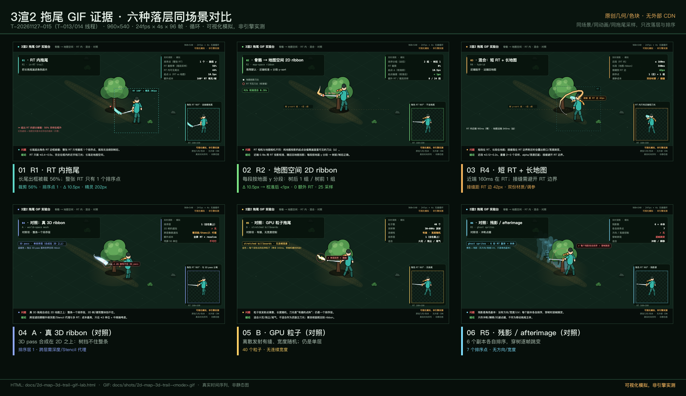
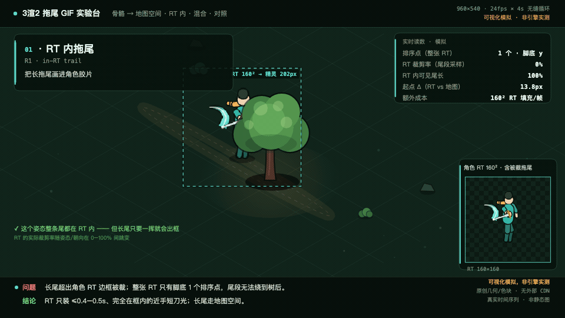
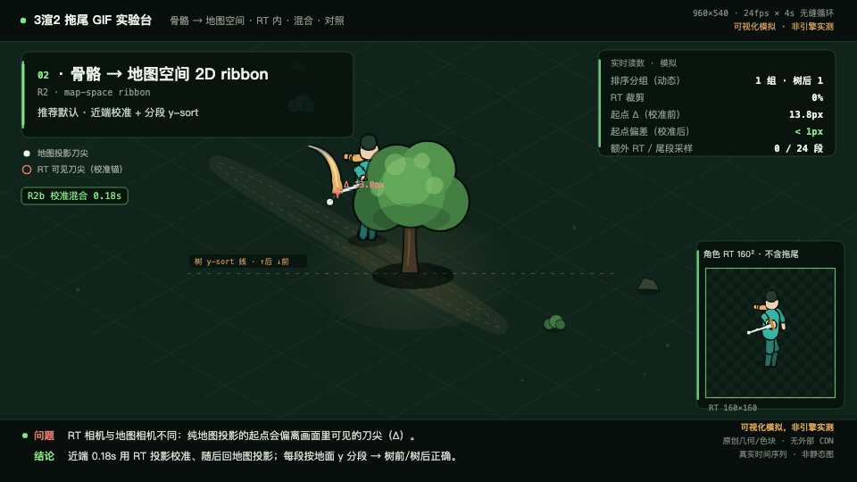

# 2D 地图里的 3D 拖尾：方案、可行性与分档推荐

- 任务：T-20261127-013；后续 T-20261127-014（同一线程）
- 日期：2026-11-27
- 场景：类似《幻唐志》《梦幻西游》手游的俯视/等轴 2D 地图；角色移动 / 技能拖尾；移动端；多人同屏
- 性质：技术调研，不写游戏代码、不改现有项目；不复制参考游戏素材、UI、品牌
- 标注约定：〔官方〕引擎/平台官方文档；〔厂商〕厂商博客或宣传口径；〔社区〕非官方实现/文章；〔推断〕本文工程判断；〔待实测〕必须用 PoC 验证
- 交互版：`docs/2d-map-3d-trail-options-交互版.html`
- 3渲2 深挖：`docs/2d-map-3d-trail-3to2-pipeline.md`（骨骼绑定/RT 边界/校准/排序/引擎映射/PoC）
- 说明：本文不假设《幻唐志》《梦幻西游》的具体内部实现；只把它们当作“俯视/等轴 2D 地图 + 移动端 + 多人”的场景约束

---

## 0. 结论先行

**在纯 2D y-sort 地图里，最稳的路线不是“把 3D ribbon 塞进 3D pass”，而是“3D 采样 → 屏幕空间投影 ribbon → 按 2D 规则排序/遮挡”。** 真 3D mesh 只给主角/技能/少量高价值单位；同屏大量单位用投影 ribbon 或 sprite 序列；低端机用单 quad/精灵；Viewport/Stencil 只在“3D 角色层已经存在 + 遮挡复杂 + 中高端机型”时才值得。

> **如果角色是 3渲2（3D 模型先渲染到 RT，再作为 2D 精灵放进地图），默认答案要改：拖尾应放在「地图空间」，而不是角色 RT 内。** 采样骨骼世界变换 → 地图投影 → 2D 分段 ribbon（R2 = 本文 H + F 的 3渲2 变体）；角色 RT 只保留 ≤0.4–0.5s 的近手短刀光（R1），长拖尾不进 RT；独立 3D pass + 深度/Stencil（R3）只在“同一屏内跨层/逐像素遮挡”是硬需求时考虑。完整论证见第 2A 节和 `docs/2d-map-3d-trail-3to2-pipeline.md`。

### 0.1 推荐分档（先看这张表）

| 档位 | 推荐方案 | 不建议 | 关键理由 |
|---|---|---|---|
| **3渲2 角色 · 主角/技能长拖尾（>0.5s 或 >1m）** | **R2 地图空间骨骼 ribbon**（H + F 的 3渲2 变体） | 把长尾塞进角色 RT（R1） | RT 边框会裁尾；角色精灵只有一个排序点，无法逐树遮挡；RT 尺寸随尾长膨胀〔推断〕 |
| **3渲2 角色 · 近手短刀光（≤0.4–0.5s，完全在 RT 框内）** | **R1 RT 内短拖尾**；需要长尾时 **R4 混合** | 为短刀光单开全屏 3D pass | 复用角色已有 RT/pass，边际成本主要是填充与 RT 尺寸；还能被角色手臂/武器自遮挡〔推断〕 |
| **3渲2 角色 · 跨层/逐像素遮挡（桥下、屋檐、拱门）** | **R3 独立 3D pass + 深度/Stencil 代理** | 纯 2D 分段硬扛 | 2D y-sort 表达不了“同一屏内多层”；但只有 ≤3 单位 + 中高端才值得〔推断〕 |
| 主角 / 技能 / 坐骑 / 冲刺（同屏 1–3 个） | **H 混合投影 ribbon**（3D 采样 + 2D 屏幕空间网格 + 风格化材质）；武器/刀光用 **F 骨骼/挂点驱动**；有 3D 角色层时可用 **A 真 3D ribbon** | 裸 B GPU 粒子（软、贵、难排序）、裸 E Viewport（ROI 低） | 少量单位可以承担更高成本；投影网格能进入 y-sort，风格可完全 2D 化〔推断〕 |
| 同屏 10–50 玩家 / NPC | **C 2D/2.5D 投影 ribbon**，合批成 1 个动态 mesh；必要时 **G sprite 序列** | A 真 3D mesh、B GPU 粒子、E Viewport | 移动端首要风险是 overdraw 与 draw call，不是顶点数；C 最便宜且排序正确〔推断〕 |
| 低端机 / Compatibility 渲染器 | **G 单 quad + 滚动 UV / 2–4 帧 flipbook**，或 C 的 8–12 段精简版 | Godot GPUParticles3D trails（Compatibility 不支持）、全屏后处理 | 少一层透明、少一次 RT、少一次采样就是收益〔官方〕〔推断〕 |
| 必须“真 3D 观感”又要 2D 风格 | **H + 竖向 curtain + 地面影子 + 卡通/色阶材质**；仍不满足时再考虑 A + 深度代理 | 直接上 PBR 3D ribbon、bloom 堆叠 | 3D 感来自截面、朝向、光影与影子，不是“有 z 轴”〔推断〕 |
| 何时才值得 Viewport/Stencil（E） | 已有 3D 角色层；遮挡是逐对象且大量；需要统一深度/后处理/描边；目标中高端；团队能维护多相机/RT | 纯 2D Canvas 项目、低端机、同屏 50 单位 | 一个全屏 RT + resolve 的带宽成本，通常比拖尾几何本身更贵〔推断〕〔待实测〕 |

### 0.2 五个硬结论

1. **正交俯视下，抬高 z 不会产生屏幕位移。** 正俯视正交相机里，z 只影响深度/遮挡；3D 感来自 ribbon 的截面、朝向、明暗、描边和地面影子。只有等轴/斜俯视/透视相机才会把“高度”映射到屏幕 y。〔官方投影公式 + 推断〕
2. **2D 精灵默认不写深度，3D pass 的拖尾无法逐棵树/逐栋楼自动遮挡。** 纯 2D Canvas 里，3D mesh 与 Sprite 不在同一个排序系统；必须选：投影成 2D、深度/Stencil 代理、Viewport 分层合成，或按遮挡物切段。〔推断；需按引擎/项目验证〕
3. **移动端先算 overdraw，再算顶点。** 50 条 160×40px 的拖尾就能覆盖约 35% 的 720p 屏幕；两层就是 70% 覆盖。顶点/三角形通常只有几千个，真正的成本在透明填充率、混合带宽和全屏 RT。〔推断；Arm/Qualcomm 均把 overdraw/带宽列为主要风险〕〔厂商〕
4. **拖尾是纯本地 cosmetic。** 只同步移动/技能事件，不同步拖尾顶点或粒子；远端用插值后的可视位置本地重建；传送、重生、重连必须清历史，否则会拉出一条跨地图的长带。〔推断〕
5. **风格化要在网格和材质阶段做，不要靠后处理补救。** 3D ribbon 想贴合手绘/像素风，需要无光照/ramp、色阶量化、抖动、硬边/描边、屏幕像素宽度；soft additive glow 和 bloom 会把风格拉回“写实特效”。〔推断〕

### 0.3 先问五个问题（决定架构，而不是先选引擎 API）

| 问题 | 如果答“是” | 如果答“否” |
|---|---|---|
| 1. 地图是 2D Canvas/2D Renderer，还是 3D 场景里的面片？ | 纯 2D：优先 C/H；A 需要 SubViewport/深度代理 | 3D 场景：A 可行，配合 alpha scissor 深度预写/排序轴 |
| 2. 角色是 2D sprite/序列帧，还是 3D mesh/RT sprite？ | 2D 角色：C/G 最自然 | 3D 角色：H/A/F 可共享 3D 采样与骨骼 |
| 3. 遮挡是整层（地面/建筑层）还是逐对象（树/柱/屋檐）？ | 逐对象：需要 y-sort 投影、Stencil 或 Viewport | 整层：普通 2D 层排序即可 |
| 4. 同屏人数与目标机型？是否必须 60fps？ | 50 人 + 低端 + 60fps：C/G，严格限段限长 | 1–3 人 + 中高端：H/A 可上更高保真 |
| 5. 角色是不是 3渲2（3D 模型渲染到 RT 再当 2D 精灵）？ | 是：默认 **R2 地图空间骨骼 ribbon**；短刀光 R1/R4；跨层遮挡才 R3 | 否：回到 Q1–Q4 的纯 2D 路线 |

> 一句话决策：**纯 2D 地图 + 多人 → 先做 C；主角/技能 → 升级到 H；低端 → G；只有“已经有 3D 层且遮挡是硬需求”才上 E。**
>
> **3渲2 角色一句话：长拖尾 → R2；近手短刀光 → R1/R4；跨层像素级遮挡 → R3；冲刺残影 → R5；低端/50 人 → R2 精简或 R5。**

---

## 1. “3D 拖尾”到底指什么

同一个词在项目里常指三件不同的事，先对齐再选型：

| 含义 | 数据 | 呈现 | 典型方案 |
|---|---|---|---|
| 真 3D 几何 | 世界空间 3D 位置历史 | 三角带/管状 mesh，参与 3D 深度/光照 | A、B、E |
| 3D 数据、2D 呈现 | 3D 位置/骨骼采样 | 投影到屏幕，2D 网格/Line2D，进入 y-sort | C、H |
| 3D 观感 | 2D 位置 + 高度/影子/截面 | 2D 伪 3D 条带、残影、精灵 | C、D、G |
| 3渲2 角色 | 3D 骨骼/挂点 + 角色 RT | 3D 模型先渲染到 RT，再作为 2D 精灵 | R1（RT 内）、R2（地图空间）、R3（独立 pass） |

### 1.1 三种项目架构，可行性完全不同

| 架构 | 3D 拖尾可行性 | 推荐 | 主要风险 |
|---|---|---|---|
| 纯 2D Canvas/2D Renderer（Sprite + Tilemap） | 3D mesh 无法直接与 Sprite 逐对象排序 | C/H；A 仅在 SubViewport/Stencil 代理下 | 排序/遮挡、RT 成本 |
| 2.5D 混合（2D 地图 + 3D 角色/RT 角色） | 角色层已有 3D 相机/深度，但拖尾默认不应塞进角色 RT | **R2 地图空间骨骼 ribbon（H + F）**；短刀光 R1/R4；必要时 R3 | 角色 RT 相机与地图相机不同；精灵单排序点；RT 边框 |
| 全 3D 场景 + 2D 美术面片（billboard/quad） | A 可行，配合 alpha scissor 深度预写/排序轴 | A + 风格化材质；H 作为低配 | 透明排序、alpha test 成本、相机对齐 |

〔推断〕这张表比“引擎支持什么 API”更重要：同一个 TrailRenderer，在纯 2D Canvas 里和在 3D 场景里，排序成本差一个量级。

---

## 2. 方案详述（7 种 + 1 种混合）

评分口径见第 3 节；这里先讲每条路线的数据流、强项和风险。

### A. 真 3D Ribbon Mesh（世界空间历史 → 三角带）

- **数据流**：按时间/距离采样角色或挂点的世界位置 → 环形缓冲保留 N 个点 → 用速度方向/相机方向/世界上方向算左右顶点 → 生成三角带；宽度、UV、颜色沿长度插值。
- **网格**：每段 2 个顶点、1 个 quad（2 个三角形）；16/32/64 段分别约 32/64/128 顶点。可加厚成双面/管状，成本 ×2。
- **强项**：真正的 3D 形状、可受光/可投影、可做扭曲/翻转/管状；技能刀光、龙卷、冲刺尾焰的表现上限最高。
- **弱项**：在纯 2D 地图里排序/遮挡最难；透明 pass 的 overdraw 与普通粒子一样；相机对齐/地面对齐要逐效果调。
- **适用**：主角、技能、坐骑、少量高价值单位；已有 3D 角色层的项目。
- **引擎**：
  - Unity：`TrailRenderer`（内置，Time / Min Vertex Distance / Width / Color / Alignment View|TransformZ）；自定义 `Mesh` + `MeshFilter/MeshRenderer`；`LineRenderer` 可作为窄条带替代。〔官方〕
  - Godot 4.6：`ArrayMesh`/`ImmediateMesh` 自建；`RibbonTrailMesh` + `GPUParticles3D.trail_enabled` 是“粒子拖尾”路线，不是独立角色拖尾节点；独立 `Trail3D` 节点从 **4.8+** 才有（4.6 无此页面）。〔官方〕
  - Unreal：Niagara **Ribbon Renderer**（Tessellation、Facing、UV0/UV1、Shape）；也可用 Mesh Renderer 自建。〔官方〕
  - Three.js：自定义 `BufferGeometry` + `ShaderMaterial`；`TubeGeometry` 可做管状；`Line2` 是屏幕/世界宽度条带，不是真 3D 截面。〔官方〕
- **风险**：把 `RibbonTrailMesh` 直接挂到移动节点上不会自动“拖尾”，它本身是直的 ribbon；需要粒子系统的 mesh skinning 或自建历史采样。〔官方 + 推断〕

### B. GPU 粒子拖尾（stretched billboard / particle trails）

- **两种子模式**：
  1. **拉伸 billboard**：每个粒子按速度拉长成 quad；便宜、连续感靠发射率，粒子少时像“点状光带”。
  2. **粒子拖尾/ribbon trail**：每个粒子生成一条历史带（Unity Trail 模块、Godot `trail_enabled`、Unreal Niagara Ribbon、Cocos TrailModule）；连续感更好，但顶点/填充成本更高。
- **强项**：GPU 模拟、CPU 压力低；适合火焰/能量/魔法尾迹；参数化发射/颜色/噪声成熟。
- **弱项**：软边、additive、glow 与手绘/像素风冲突；大量半透明 quad 的 overdraw 很高；逐对象排序/遮挡仍要解决；Cocos GPU 渲染器不支持 TrailModule。〔官方〕
- **适用**：技能特效、短时爆发、氛围粒子；不适合作为 50 个 NPC 的移动拖尾主力。
- **引擎**：
  - Unity：ParticleSystem（Trail 模块：Mode Particle/Ribbon、Ratio、Lifetime、Min Vertex Distance、World Space、Die With Particles、Ribbon Count）；VFX Graph 用 **Particle Strip** + GPU Event/Output ParticleStrip Quad 或 ShaderGraph Strip。〔官方〕
  - Godot 4.6：`GPUParticles3D.trail_enabled` + `RibbonTrailMesh`/`TubeTrailMesh`；材质必须开 `BaseMaterial3D.use_particle_trails`；仅 Forward+/Mobile，不支持 Compatibility。〔官方〕
  - Unreal：Niagara Ribbon；Tessellation Automatic/Custom/Disabled，Facing Screen/Custom/Custom Side Vector。〔官方〕
  - Cocos：ParticleSystem TrailModule（Mode 仅 Particles、Space 仅 World/Local、TextureMode 仅 Stretch；TrailMaterial 仅 `builtin-particle-trail`）。〔官方〕
  - Three.js：`Points`/`InstancedMesh` + 自定义 shader；无内置粒子拖尾，需自建。〔官方 + 推断〕
- **性能提示**：30 个粒子/单位 × 20 单位 × 64×64px ≈ 2.46M px，约等于 720p 的 267% 覆盖；这还没算软边和叠加。〔推断/估算〕

### C. 2D/2.5D 伪 3D 拖尾（投影 ribbon）

- **数据流**：采样 2D/3D 位置（可带高度 h）→ 用地图相机/等轴公式投影到屏幕 → 在屏幕空间生成左右偏移的条带 → 用 2D 渲染器绘制，按脚底 y 排序。
- **视觉**：宽度沿长度渐变、颜色渐变、地面影子、竖向“帘幕”或高光边，能做出“有厚度”的 3D 观感；不是真 3D 截面/光照。
- **强项**：天然进入 y-sort，树/建筑/角色遮挡最容易做对；可合批、零 RT、低 overdraw；风格完全可控（手绘/像素/描边/色阶）。
- **弱项**：没有真实深度/光照；相机旋转/透视变化大时需要重新投影；复杂 3D 扭曲/管状表现有限。
- **适用**：同屏大量玩家/NPC、2D 地图主力；也可作为主角的低配 fallback。
- **引擎**：
  - Unity：2D `SpriteRenderer`/自定义 2D mesh + `TransparencySortMode.CustomAxis`；`LineRenderer` 也能做屏幕条带，但要注意它属于 3D Renderer，排序要单独处理。〔官方 + 推断〕
  - Cocos：自定义 2D assembler（社区 SuperTrail 是参考：环形缓冲、动态合图、宽度/透明度/颜色渐变、零 GC 声明；非官方）；或 `MeshRenderer` 自建。〔社区〕
  - Godot：`Line2D`（2D 折线，`width_curve`、`gradient`、joint/cap 模式）或 `MeshInstance2D` + `ArrayMesh`；`CanvasItem.y_sort_enabled` 排序。〔官方〕
  - Three.js：`Line2` + `LineGeometry`（任意宽度，`worldUnits`）或自定义 `BufferGeometry`；2D 正交相机 + `renderOrder`。〔官方〕
- **风险**：屏幕空间宽度会让远近单位看起来一样粗；需要按相机缩放/距离做宽度补偿。投影公式必须和地图相机一致，否则“脚底”和“影子”会错位。〔推断〕

### D. Afterimage / 残影 / 屏幕后处理

- **数据流**：保留过去 N 帧的渲染结果（feedback buffer），或复制 N 份角色 mesh/sprite，按时间衰减 alpha；也可加速度线/径向模糊。
- **强项**：实现便宜、观感强烈，适合冲刺/瞬移/受击闪避；不需要历史曲线。
- **弱项**：不是拖尾，缺少方向/宽度/UV 控制；全屏 feedback 在移动端有带宽成本；mesh 副本会增加 draw call 与 overdraw；和 2D 手绘风格容易割裂。
- **适用**：冲刺/瞬移/技能爆发的“残影”层，不适合作为移动拖尾主体。
- **引擎**：Three.js `AfterimagePass`（damp 参数）；Unity 可用后处理/多 mesh 副本；Godot 4.6 无内置 afterimage，需多 sprite/mesh 或 SubViewport feedback。〔官方 + 推断〕

### E. 独立 Viewport / Stencil / 深度合成

- **数据流**：把 3D 拖尾（或整个 3D 角色层）渲染到透明 RT → 在 2D 场景中按某个排序层合成；或用 Stencil/自定义深度把 2D 遮挡物写成遮罩，让 3D 拖尾在遮挡物后被裁剪。
- **强项**：能解决“3D 拖尾被 2D 树/建筑正确遮挡”的硬问题；可统一 bloom/描边/色彩空间；适合已有 3D 角色层的项目。
- **弱项**：全屏 RT + resolve 的带宽/内存成本；一个 RT 只能对应一个排序层，拖尾要在多棵树之间前后穿插时，单 RT 不够；Stencil 需要额外的遮挡物 pass；移动端低端机不友好。
- **适用**：主角/技能、遮挡复杂的 2.5D 场景、中高端机型；不适合 50 个 NPC。
- **引擎**：
  - Unity：`RenderTexture` + 多相机/相机 Stacking、URP Renderer Feature、Shader Graph/HLSL Stencil；`TransparencySortMode.CustomAxis` 只负责 2D Renderer 内部排序，3D pass 需单独处理。〔官方 + 推断〕
  - Godot：`SubViewport` + `ViewportTexture`（官方明确支持“在 2D 游戏中渲染 3D 物体”）；4.5+ 材质 Stencil（写 Stencil 的材质总在透明 pass）。〔官方〕
  - Unreal：Custom Depth/Stencil、Translucency Sort Policy `SortAlongAxis`、TranslucencySortPriority、Scene Capture/RT。〔官方〕
  - Cocos：RenderTexture + 多相机；3D Stencil 需自定义 pass/材质（未在 3.8 手册中查到现成组件，需验证）。〔推断/待实测〕
  - Three.js：`WebGLRenderTarget` + 第二个场景/相机；`WebGLRenderer({stencil:true})` + 材质 stencil 操作；`renderOrder`。〔官方 + 推断〕
- **关键限制**：纯 2D Canvas 里没有“3D 深度”可测试；要让 Stencil 生效，必须先用 3D 代理面片/独立 pass 把遮挡物写进深度/Stencil，或者把 3D 层整体 RT 化。〔推断〕

### F. 骨骼 / 武器挂点驱动

- **数据流**：从角色骨骼/武器 socket 取世界位置（可加朝向/长度）→ 采样历史 → 生成 ribbon（3D 或投影 2D）→ 按技能事件开关/换材质。
- **强项**：刀光、鞭、链、披风、坐骑尾迹的“源头”正确；和动画/技能时间轴天然对齐；可只给武器做 1 条高价值 ribbon。
- **弱项**：依赖骨骼/挂点命名与动画事件；多武器/多皮肤要配置；仍是“采样 + ribbon”的壳，排序问题不变。
- **适用**：技能、武器、坐骑；与 H/A 组合，而不是独立替代移动拖尾。
- **引擎**：Unity `Transform`/Socket、`TrailRenderer` 挂在武器节点；Godot `BoneAttachment3D`/`Marker3D` + 自建 mesh；Unreal Skeletal Mesh Socket + Niagara Ribbon；Cocos 节点挂点 + custom assembler；Three.js `Object3D`/`Bone` + `getWorldPosition`。〔官方 + 推断〕

### G. Sprite 序列 / 动画拖尾

- **数据流**：沿移动路径放置固定形状的 streak/flipbook（4–8 帧），或单 quad 滚动 UV；按寿命淡出。
- **强项**：最便宜、最稳、最贴合手绘/像素风；1 个 quad、1 层透明、1 个 draw call 级别；低端机友好。
- **弱项**：形状固定、不能随速度/宽度动态变化；美术成本高；不是真 3D；相机旋转时可能穿帮。
- **适用**：低端机 fallback、同屏大量单位、像素/手绘项目的主力或兜底层。
- **引擎**：所有引擎的 Sprite/Quad/粒子 billboard 都能做；Unity SpriteRenderer/ParticleSystem、Godot Sprite2D/GPUParticles2D、Cocos Sprite、Three.js Sprite/Plane、Unreal Paper2D/UMG。〔官方 + 推断〕

### H. 混合投影 Ribbon（推荐主力）

> **H = A 的 3D 采样 + C 的屏幕空间网格 + 2D 风格化材质 + 2D y-sort 合成。** 它不是第 8 个“新引擎功能”，而是一条架构路线。

- **数据流**：骨骼/角色/挂点 3D 位置 → 投影（等轴/透视公式）→ 屏幕空间条带（宽度按像素/距离补偿）→ 2D 材质（无光照、色阶、描边、抖动）→ 与 Sprite 同一 y-sort。
- **增强 3D 感**：
  - 主 ribbon 在高度 h；
  - 地面影子 ribbon（低透明度、偏移）；
  - 可选的竖向 curtain（从地面到 h 的半透明面），制造“体积”；
  - 头部高光/尾部收窄/速度拉伸；
  - 角色脚底 y 作为排序键，影子跟随地面。
- **强项**：视觉接近真 3D，排序/遮挡按 2D 规则解决；合批友好；风格统一；不需要全屏 RT。
- **弱项**：实现比 C 多一层投影/高度逻辑；真实光照/折射/管状扭曲有限；相机大幅旋转时要重算投影。
- **适用**：主角、技能、坐骑；同屏 10–20 个高价值单位；也可作为“真 3D 观感 + 2D 风格”的推荐答案。
- **引擎**：Unity 自定义 2D mesh/LineRenderer + Shader Graph；Godot `Line2D`/`MeshInstance2D` + `ShaderMaterial`；Cocos custom assembler；Three.js `Line2`/`BufferGeometry` + `ShaderMaterial`；Unreal 可用 Niagara 采样 + 2D 材质/Paper2D（较少见，需自建）。〔推断〕

---

## 2A. 3渲2 / RT 角色：拖尾放在哪一层（R1–R5）

> 本节是 T-20261127-014 的补充。完整变换链、校准公式、RT 预算、引擎 API 与 PoC 见 `docs/2d-map-3d-trail-3to2-pipeline.md`。原 A–H 方案保留不变；R1–R5 是“角色已经是 3渲2”时的落层选择，不与 A–H 冲突。

### 2A.0 什么是 3渲2（本文口径）

3D 蒙皮模型 + 骨骼动画 → 角色相机渲染到 RT（透明背景）→ RT 作为 2D 精灵/Quad 放进 2D 地图 → 与地图一起 y-sort/图层合成。角色每帧的“外观”是一张图，但骨骼/挂点仍然存在；拖尾既可以画进这张图（R1），也可以只取骨骼数据、在地图层画（R2）。

### 2A.1 五种落层

| 代号 | 做法 | 对应原方案 | 最关键优点 | 最关键缺点 |
|---|---|---|---|---|
| **R1** | 拖尾画在角色 RT 内（同一 3D 相机/pass） | A/F 的局部版 | 与可见武器尖绝对贴合；可被手臂/身体自遮挡；不增加 2D draw call/额外 pass | RT 边框裁剪；角色精灵单排序点；RT 分辨率/尺寸绑定 |
| **R2** | 采样骨骼世界变换 → 地图投影 → 2D 分段 ribbon | **H + F** | 逐树/建筑遮挡正确；无额外 RT；风格/性能可控；50 单位可行 | 需要校准 RT 相机与地图相机的偏差；无真实深度/自遮挡 |
| **R3** | 独立 3D pass + Viewport/Stencil/深度代理 | E + A | 真 3D、可像素级跨层遮挡 | 成本最高；2D 精灵不写深度，需要代理；单 RT 只能一层 |
| **R4** | 短段 RT（R1）+ 长段地图（R2） | R1 + R2 | 近端贴手 + 远端排序兼得 | 接缝/双份材质/调参成本高 |
| **R5** | RT 残影/精灵副本 afterimage | D | 最便宜、冲刺观感强 | 不是真拖尾；无方向/宽度控制 |

### 2A.2 变换链（一句话版）

```text
bone local → bone global（相对 skeleton）→ model root → character map root（x,y + 高度 z）
  → 地图投影 → 2D ribbon（R2）
  → 或 RT 相机投影 → RT 像素 → 精灵 → 地图屏幕（R1 / 校准锚点）
```

〔官方〕Godot 的 `Skeleton3D.get_bone_global_pose()` 返回“相对 skeleton”的变换，不是世界变换；要再乘 skeleton/model/character 变换，或直接用 `BoneAttachment3D.global_transform`。Unity 用骨骼 `Transform.position`/`Camera.WorldToScreenPoint`；Unreal 用 `GetSocketTransform(..., RTS_World)`；Cocos 用 `Camera.worldToScreen`；Three.js 用 `Bone.getWorldPosition` + `Vector3.project(camera)`。详见深挖文档 §1/§10。

### 2A.3 三个决定性问题

| 问题 | 结论 |
|---|---|
| **拖尾有多长？** | 超过角色 RT 框（通常 >0.5m / >0.4–0.5s）就不要塞 RT；RT 面积按平方涨，裁剪率也会暴露。 |
| **要不要逐树遮挡？** | 要 → R2（分段 y-sort）；不要且短 → R1；同一屏跨层 → R3。角色精灵是一个排序点，RT 内拖尾永远无法逐树穿插。 |
| **和可见武器尖对得齐吗？** | 只用地图投影会有偏差；用 RT 相机投影做近端锚点、按年龄衰减回地图投影（R2b）。校准后 origin 目标 ≤2px @1080p（待实测）。 |

### 2A.4 校准：近端贴合，远端回地图

设 `A_rt` 是骨骼过 RT 相机后映射到精灵/地图屏幕的位置，`A_map` 是同一骨骼过地图投影的位置，`Δ = A_rt - A_map`。对每个采样点按年龄 `age` 衰减：

```text
w = clamp(1 - age / T_blend, 0, 1)       // T_blend = 0.12–0.25s
p_screen = P_map · C · p_bone + Δ · w
```

起点完全贴合可见武器尖，0.2s 后完全回到地图空间；`Δ` 要低通/按姿态平滑，镜像/换手时同步镜像。不要用 GPU readback 做校准；运行时相机矩阵投影即可。完整推导/排查清单见深挖文档 §3。

### 2A.5 RT 边界与分辨率

- 角色 RT 只包角色 + 10–20% padding；**不要为长拖尾扩角色 RT**。
- 256² RGBA8 ≈ 0.25MB；512² ≈ 1MB；1024² ≈ 4MB；加深度/MSAA 再乘 1.75–7 倍。10 个 512² RT ≈ 10MB 颜色（不含深度/MSAA），50 个不可行。〔推断/估算〕
- 动态改 RT 尺寸会重分配/清屏/断合批；需要时用固定档位（128/192/256/384），只给主角升档。
- 像素风：RT 与 2D ribbon 都按整数倍/整数像素宽度/NEAREST；手绘/卡通：匹配 RT 的超采样倍率与描边宽度，局部放大对比。

### 2A.6 排序与自遮挡

- **R2 的排序键是采样点的地面 y**，不是 ribbon 抬高后的屏幕 y；在树/建筑排序线处切段/分带（通常 2–5 带），不是逐段一个节点。
- **树冠/桥/拱门**是 y-sort 的盲区：用 canopy overlay 层、地图 layer/region、2D 遮罩；只有“同一屏多层 + 像素级正确”才上 R3 的深度/Stencil 代理。
- **自遮挡**：R1 天然正确；R2 需要短段 R1（R4）、角色剪影遮罩，或接受刀光在身体上方。
- UI 永远单独 CanvasLayer，不被拖尾盖住。

### 2A.7 什么时候才把拖尾放进角色 RT（R1）

同时满足 4 条才考虑：

1. 拖尾短（≤0.4–0.5s 或 ≤0.5m），完全落在角色 RT 框内（裁剪率 ≤5%）；
2. 需要“被角色手臂/身体/武器自遮挡”或“与可见武器尖绝对贴合”；
3. 同屏高价值单位 ≤3（不要给 50 个 NPC 各开一份 RT）；
4. 不需要逐树/逐建筑穿插（或这些遮挡可以用 R4 的长段解决）。

任一不满足 → R2；低端/50 人 → R2 精简/R5。

### 2A.8 什么时候才上独立 3D pass / Stencil（R3）

同时满足 4 条：

1. 遮挡无法用 y 线/图层/2D 遮罩表达（桥下、拱门、屋檐、多层地形）；
2. 必须像素级正确，而不是“大致前后”；
3. 同屏高价值单位 ≤3；
4. 目标中高端，且能接受额外 RT/pass/代理资产维护。

任一不满足 → R2 + 分段 y-sort/图层/遮罩。

### 2A.9 默认推荐（3渲2 版）

| 场景 | 默认 | 备选 |
|---|---|---|
| 3渲2 主角/技能长拖尾 | **R2 + F**（地图空间骨骼 ribbon，分段 y-sort） | R2b 校准；R4 混合 |
| 近手短刀光 | **R1**（≤0.4–0.5s） | R2（更便宜/更好排序） |
| 主角武器技能（近端要贴手、远端要入地图） | **R4** | R2b |
| 同屏 10–50 玩家/NPC | **R2 精简**（12–24 段/30Hz/1 层） | R5/G |
| 低端机 | **R2 8–12 段** 或 **R5/G** | 关闭 NPC 拖尾 |
| 桥下/拱门/多层地形像素级遮挡 | **R3** | R2 + 图层/遮罩 |
| 冲刺/瞬移 | **R5** | R2 短尾 |

> 一句话记忆：**3渲2 长尾进地图（R2），短刀光进 RT（R1），近端贴手用混合（R4），跨层遮挡才上 3D pass（R3），冲刺残影用 R5。**

---

## 3. 权重评分矩阵

### 3.1 维度与默认权重

分数 1–5，5 最好；“实现复杂度”5 = 最简单。加权分 = Σ(分数 × 权重) / Σ权重，范围 0–5。**这些是工程判断，不是实测数据；PoC 必须重新打分。**〔推断〕

| 维度 | 默认权重 | 说明 |
|---|---:|---|
| 视觉质量 | 18 | 3D 感、可塑性、与角色/场景的匹配 |
| 移动端性能 | 20 | overdraw/fill rate、顶点/段数、draw call、CPU 更新、GC/内存 |
| 实现复杂度 | 10 | 5 = 最简单；含美术/工具/维护 |
| 2D/3D 融合与排序 | 15 | 与 y-sort/图层/建筑/树木/UI 的前后关系 |
| 像素/手绘风格契合 | 10 | 无光照、色阶、描边、抖动、硬边的可控性 |
| 多人同屏扩展 | 10 | 50 单位时的合批/限流/优先级 |
| 网络/回放友好 | 5 | 是否纯 cosmetic、能否本地重建、重连/回放 |
| 低端机降级 | 7 | 能否退到单 quad/精灵/关闭 |
| 引擎支持 | 5 | 内置组件/文档/跨引擎移植 |

### 3.2 方案评分（1–5）

| 方案 | 视觉 | 性能 | 复杂度 | 融合 | 风格 | 多人 | 网络 | 低端 | 引擎 |
|---|---:|---:|---:|---:|---:|---:|---:|---:|---:|
| A 真 3D Ribbon Mesh | 5 | 3 | 3 | 2 | 3 | 3 | 5 | 3 | 4 |
| B GPU 粒子拖尾 | 4 | 3 | 4 | 2 | 2 | 3 | 5 | 2 | 5 |
| C 2D/2.5D 投影 Ribbon | 3 | 5 | 4 | 5 | 5 | 5 | 5 | 5 | 5 |
| D Afterimage/残影 | 3 | 4 | 4 | 3 | 3 | 3 | 5 | 4 | 5 |
| E Viewport/Stencil 合成 | 5 | 2 | 2 | 5 | 4 | 2 | 5 | 1 | 3 |
| F 骨骼/挂点驱动 | 5 | 4 | 4 | 4 | 4 | 4 | 5 | 4 | 4 |
| G Sprite 序列 | 2 | 5 | 4 | 5 | 5 | 5 | 5 | 5 | 5 |
| H 混合投影 Ribbon | 5 | 4 | 3 | 5 | 5 | 4 | 5 | 4 | 4 |

> 评分理由（摘要）：A 的融合分低，是因为纯 2D Canvas 里 3D pass 不能逐对象 y-sort；若项目已是 3D 场景 + 2D 美术面片，A 的融合分可升到 4，默认加权约 +0.30。E 的融合分高，但性能和低端分最低。G 视觉分低，是因为它做不出真正的动态 3D 体积，不是“不好看”。

### 3.3 三套权重下的结果

| 方案 | 默认（均衡） | 主角/技能 | 同屏大量 | 低端机 |
|---|---:|---:|---:|---:|
| A 真 3D Ribbon | 3.36 | 3.48 | 3.22 | 3.15 |
| B GPU 粒子 | 3.16 | 3.16 | 3.08 | 2.99 |
| C 2D/2.5D 投影 | **4.54** | 4.42 | **4.66** | **4.74** |
| D 残影 | 3.57 | 3.49 | 3.58 | 3.69 |
| E Viewport/Stencil | 3.32 | 3.53 | 3.08 | 2.66 |
| F 骨骼/挂点 | 4.23 | 4.29 | 4.17 | 4.10 |
| G Sprite 序列 | 4.36 | 4.17 | 4.54 | 4.66 |
| H 混合投影 | 4.38 | **4.48** | 4.30 | 4.18 |

权重预设：

- 默认：18 / 20 / 10 / 15 / 10 / 10 / 5 / 7 / 5
- 主角/技能：25 / 15 / 8 / 15 / 12 / 8 / 4 / 8 / 5
- 同屏大量：12 / 25 / 10 / 15 / 8 / 15 / 5 / 7 / 3
- 低端机：8 / 30 / 10 / 10 / 8 / 12 / 2 / 15 / 5
- 3渲2 角色：22 / 18 / 8 / 18 / 14 / 8 / 4 / 6 / 2（视觉/融合/风格略升，引擎支持降权）

> **3渲2 补充**：上表是“角色形态无关”的评分。若角色是 3渲2，R2 = H + F；在 3渲2 权重下，H 4.50、C 4.48、F/G 4.26，R2 仍是第一。R1 只用于短刀光、R3 只用于跨层遮挡，都不参与全局排序；它们应作为“R2 的局部补丁”评估，而不是替代方案。

### 3.4 怎么读这张矩阵

- **C 是“2D 地图 + 多人”的基线最优**：它不一定最好看，但排序、性能、风格、降级都最稳。
- **H 是“主角/技能”的最优**：比 C 多一层 3D 采样/投影/风格化，换来接近真 3D 的观感，同时保留 2D 排序。
- **A 不是“更强所以更该用”**：在纯 2D Canvas 里，A 的融合分只有 2；只有当项目已有 3D 场景/深度/相机层，A 才进入候选。
- **E 是“遮挡/后处理硬需求”的工具**，不是默认方案；它的性能/低端分最低，且单 RT 无法解决多遮挡层次。
- **B 的分数低，不代表不能做技能特效**：短时、少量、发光的技能用 B 很合适；它不适合作为“50 个单位移动拖尾”的主力。
- **G 是兜底，不是失败**：低端机/像素风/同屏爆量时，G 的观感往往比“缩水 3D”更统一。

---

## 4. 2D 地图里的关键难点

### 4.1 相机 / 投影：z 高度如何映射

- **正交正俯视**：屏幕位置只由 x/y 决定，z 只影响深度。把拖尾抬高 20px，屏幕上看不出来；3D 感必须来自 ribbon 的截面/朝向/明暗/影子。〔推断，基于正交投影〕
- **等轴/斜俯视（常见 2:1）**：高度会投影到屏幕 y。常用公式（具体以项目相机为准）：
  - `screenX = (x - y) * tileW / 2`
  - `screenY = (x + y) * tileH / 2 - z * heightScale`
  - 其中 `tileW:tileH = 2:1` 是常见等轴比例；`heightScale` 是“世界高度 → 屏幕像素”的换算。〔推断/通用公式〕
- **透视相机**：z 还会改变屏幕大小/视差；拖尾在角色身后时可能和脚底错位，需要相机对齐或按深度缩放宽度。〔推断〕
- **3渲2 角色相机 vs 地图相机**：角色 RT 常用 3/4 透视，地图常用俯视/等轴正交；同一骨骼在两条链上的屏幕方向/长度不同。R2 用地图投影做主体，用 RT 相机投影做近端锚点校准（Δ 按年龄衰减回地图空间）；否则会出现“拖尾从脚/头飘出”或与画面里可见刀尖错位。详见 `2d-map-3d-trail-3to2-pipeline.md` §3/§6。〔推断/待实测〕
- **Ribbon 朝向**（三种，按效果选）：
  | 朝向 | 效果 | 成本/风险 |
  |---|---|---|
  | 地面贴合（ground-aligned） | 像地面扬尘/速度线，最容易与 2D 地图融合 | 3D 感弱；贴地可能穿模 |
  | 屏幕对齐（camera-aligned） | 永远面向相机，宽度稳定 | 正交下像一条平面带；缺少体积 |
  | 竖向/双面 curtain | 从地面到高度 h 的“帘幕”，体积感最强 | 2 层透明，overdraw ×2；边缘要描边 |
- **建议**：H 用“主 ribbon + 地面影子 + 可选 curtain”；A 用“相机对齐 + 地面影子”；纯 2D 地图不要指望“抬高 z”本身产生 3D 感。

### 4.2 排序 / 遮挡：四种解法与代价

先明确：**y-sort 是 2D 渲染器的规则，不是 3D 深度规则。** Godot 的 `CanvasItem.y_sort_enabled` 只对 CanvasItem 生效，且只在相同 `z_index` 内比较；Unity 的 `TransparencySortMode.CustomAxis` 只作用于 2D Renderer 的 2D 对象；Unreal 的 `SortAlongAxis` 是半透明排序策略。〔官方〕**跨 2D/3D 的统一逐对象排序，三个引擎都没有开箱即用的保证；这一句是工程推断，必须在目标版本用 PoC 验证。**〔推断/待实测〕

| 解法 | 做法 | 适用 | 代价 | 结论 |
|---|---|---|---|---|
| 1. 投影成 2D（C/H） | 3D 位置投影到屏幕，生成 2D 条带，按脚底 y 进入 y-sort | 纯 2D 地图、同屏多人 | 无真实深度/光照；投影要跟相机一致 | **默认推荐** |
| 2. 深度/Stencil 代理 | 遮挡物用 3D 代理/alpha scissor 写深度或 Stencil；3D 拖尾测试 | 3D 场景 + 2D 美术面片；遮挡物可代理 | 额外 pass；alpha test 破坏 early-Z；纯 2D Canvas 不适用 | 只有 3D 层已存在时 |
| 3. Viewport 分层合成 | 3D 拖尾渲染到透明 RT，在某个 2D 排序层合成 | 主角/技能；需要统一 bloom/描边 | 全屏 RT + resolve；单 RT 只能对应一层 | 中高端、少量单位 |
| 4. 按遮挡物切段 | 用 2D 遮罩/射线把拖尾切成前后段 | 少量固定遮挡物 | 实现脆、维护贵、运动时跳变 | 最后手段 |
| 5. 角色 RT 内拖尾（R1） | 拖尾与角色同一 RT，随角色精灵一个排序点 | 3渲2 短刀光、自遮挡 | RT 边框裁剪；无法逐树遮挡；RT 尺寸/分辨率绑定 | 只做 ≤0.4–0.5s 短尾；长尾走 R2 |

**3渲2 补充**：角色 RT 精灵的排序键通常是脚底 y，整张图一个排序点；拖尾在 RT 内就无法“尾段绕到树后”。R2 把拖尾挪到地图 2D 层，按每段采样点的**地面 y** 排序，并在树/建筑的排序线处分带（通常 2–5 带，不是逐段一个节点）。树冠/桥/拱门是 y-sort 盲区，用 canopy overlay/地图 layer/2D 遮罩；只有“同一屏多层 + 像素级正确”才上 R3 的深度/Stencil 代理。详见深挖文档 §5。

补充规则：

- **角色与拖尾的层序**：拖尾通常在角色之后、地面之前；如果拖尾从角色脚底发出，角色应压在拖尾上；如果是背后的能量尾迹，拖尾在角色后。用“脚底 y / 排序组”统一决定，不要一个效果一个规则。〔推断〕
- **多单位**：按脚底 y 排序，而不是按屏幕包围盒中心；否则高个子/大坐骑会插错层。注意“合批”和“逐单位 y-sort”天然冲突：合并成一个大 mesh 就没有逐单位排序键，树一插进来就会错；更实际的是按 y 分桶/分段合批。〔推断〕
- **UI**：永远单独 `CanvasLayer`/Screen Space Overlay；拖尾不能盖 UI，也不该被 UI 遮罩裁剪。〔官方 + 推断〕
- **透明叠加**：同一像素上多层拖尾 + 角色 + 地面光效，会快速推高 overdraw；给拖尾设“最多 2 层”预算（主带 + 影子/curtain 二选一）。〔推断〕
- **Stencil 注意**：Godot 4.5+ 写 Stencil 的材质总在透明 pass，仍受透明排序限制；Unity/Unreal 的 Stencil 需要自定义 shader/pass；不要让 Stencil 成为“以为免费”的遮挡方案。〔官方〕

### 4.3 风格：3D 写实拖尾 vs 2D 手绘/像素

| 问题 | 做法 | 不要做 |
|---|---|---|
| 光照割裂 | 无光照/Unlit、2–3 阶 ramp、固定方向高光 | PBR 高光、环境反射、真实阴影 |
| 颜色割裂 | 从地图色板取 4–8 色；沿长度量化；尾部用同色降明度 | 全彩渐变 + 大面积 bloom |
| 边缘割裂 | 1–2px 深色描边/硬边 alpha；像素风用 1px 对齐 | 软边、羽化、景深模糊 |
| 体积感 | 竖向 curtain + 地面影子 + 头部高光；宽度按速度拉伸 | 只靠“抬高 z” |
| 像素风 | 屏幕像素宽度、2–4 色阶、Bayer 抖动、关闭抗锯齿 | 亚像素宽度、平滑渐变 |
| 手绘风 | 笔刷纹理、硬边 + 少量内发光、色阶 | 写实 soft particle |

〔推断〕这张表是“风格契合”评分的依据：C/H/G 得分高，是因为它们能在网格/材质层直接做这些；A/B 需要额外材质工作，E 需要后处理统一。

### 4.4 性能：overdraw 是第一风险

**估算公式**（几何/填充的粗略上界，不含纹理透明区、软边、MSAA）：

- `coverage = units × trailLengthPx × trailWidthPx / screenPx`
- `overdraw ≈ coverage × transparentLayers`
- 顶点：`verts ≈ units × segments × 2`（真 3D 双面/curtain ×2）
- 三角形：`tris ≈ units × segments × 2`
- draw call：逐单位 ≈ `units`；合批后 ≈ 1（同材质/同图集，且没有遮挡物插在单位之间；否则按 y 分桶，通常 2–5）

720p（1280×720 = 921,600 px）示例：

| 单条拖尾屏幕尺寸 | 1 单位覆盖 | 10 单位覆盖 | 50 单位覆盖 | 50 单位 × 2 层 |
|---|---:|---:|---:|---:|
| 80×24 px | 0.2% | 2.1% | 10.4% | 20.8% |
| 160×40 px | 0.7% | 6.9% | 34.7% | 69.4% |
| 240×60 px | 1.6% | 15.6% | 78.1% | 156.2% |

> 结论：**同样的“50 条拖尾”，长度/宽度翻倍就会从“可接受”变成“填满屏幕”。** 先限屏幕面积，再谈段数。〔推断/估算〕

几何与内存（估算）：

| 段数/条 | 顶点/条 | 三角形/条 | 50 条顶点 | 50 条三角形 | 50 条缓冲内存（pos+uv+color ≈36B/顶点） |
|---:|---:|---:|---:|---:|---:|
| 16 | 32 | 32 | 1,600 | 1,600 | ≈58 KB |
| 32 | 64 | 64 | 3,200 | 3,200 | ≈115 KB |
| 64 | 128 | 128 | 6,400 | 6,400 | ≈230 KB |

> 顶点/内存通常不是瓶颈；**draw call、每帧 mesh 上传、透明填充率**才是。50 条独立 mesh = 50 draw calls；合批成 1 个动态 mesh = 1 draw call——**但前提是 50 条拖尾在绘制序列里连续**。一旦树/建筑按 y 插在单位之间，合批会被打断；这时要么按 y 分桶（每桶一个 mesh），要么接受更多 draw calls。**“1 draw call”是理想上界，不是保证。**〔推断/估算〕

其他成本：

- **GPU 粒子**：30 粒子/单位 × 20 单位 × 64×64px ≈ 2.46M px ≈ 720p 的 267% 覆盖；软边/additive 更贵。〔推断/估算〕
- **全屏 RT（Viewport/Afterimage）**：720p RGBA8 ≈ 3.7 MB；加深度 ≈ 2.8 MB；MSAA 4× 约 4 倍颜色带宽；每帧 resolve/采样是额外带宽。〔推断/估算〕
- **CPU 采样**：50 单位 × 30Hz × 3 float ≈ 4.5k float/s，本身很小；真正的 CPU 成本在每帧重建 mesh、GC、材质实例、排序。〔推断〕
- **低端机**：Godot Compatibility 渲染器不支持粒子 trails；Unity 低端机要避免 soft particle/深度纹理；所有引擎都要限段、限长、限数量、距离剔除。〔官方 + 推断〕

**降级顺序（建议）**：

1. 降低同时可见的拖尾数量（远处/非玩家/NPC 关闭）；
2. 缩短寿命/长度（时间制，不是帧数制）；
3. 降低段数（32 → 16 → 8）；
4. 去掉第二层（curtain/影子/glow）；
5. 切到 C 的简化版或 G 的单 quad/精灵；
6. 只保留玩家/技能，其他单位关闭。

### 4.5 多人 / 网络 / 回放

- **只同步移动/技能事件**：位置、速度、朝向、状态、技能触发；拖尾顶点、段数、颜色、粒子都不进网络包。〔推断〕
- **远端重建**：用网络插值后的可视 Transform 采样，而不是原始 10–20Hz 网络位置；否则拖尾会抖/折线。〔推断〕
- **采样频率**：视觉 60fps，拖尾采样 30Hz（每 2 帧）或按距离（4–6cm）采样；时间制寿命保证 30/60fps 长度一致。〔推断〕
- **传送/重生/重连**：清空历史，带一个 `respawnEpoch`/`teleportId`，避免跨地图长带；死亡/隐身时停止发射并让旧段自然消失。〔推断〕
- **回放**：记录位置时间线/技能事件即可重建；如果要逐帧一致，记录拖尾采样种子或采样点，但不要为此增加常态网络负担。〔推断〕
- **反作弊/性能**：拖尾是客户端 cosmetic，服务端不依赖；提供“关闭他人拖尾/低特效”选项，既省性能也避免视觉噪音。〔推断〕

---

## 5. 引擎映射表（四层）

| 引擎 | 数据/采样层 | 网格层 | 材质/风格层 | 合成/排序层 |
|---|---|---|---|---|
| **Unity** | C# 采样 `Transform`/Socket；`TrailRenderer` 内置 Time/Min Vertex Distance；`ParticleSystem` Trail；VFX Graph GPU Event/Particle Strip；Jobs/Burst 可批量化 | `TrailRenderer`；`Mesh`+`MeshFilter/MeshRenderer`；`LineRenderer`；ParticleSystem Trail；VFX Graph Output ParticleStrip Quad/ShaderGraph Strip | Shader Graph/URP Unlit、ramp、quantize、outline；Trail 材质；VFX 输出材质；Stencil 用 Shader Graph/HLSL | 2D Renderer `TransparencySortMode`（Perspective/Orthographic/Custom Axis）；3D 透明排序；`RenderTexture`/相机 Stacking；URP Renderer Feature；Scene Overdraw/Frame Debugger |
| **Cocos Creator 3.x** | 节点世界 Transform 采样/环形缓冲；TrailModule 跟粒子；自定义 2D assembler 零 GC（社区 SuperTrail） | ParticleSystem TrailModule（Mode 仅 Particles、TextureMode 仅 Stretch）；`MeshRenderer` 自定义网格；2D 自定义 assembler | TrailMaterial 仅 `builtin-particle-trail`；Mesh 用自定义 effect；2D 材质/动态合图 | 节点树/siblingIndex、2D 合批；3D 深度；RenderTexture/多相机；3D Stencil 需自定义 pass（待验证） |
| **Godot 4.6** | `_process`/`_physics_process` 采样；`Curve3D`/`Path3D` 可选；环形 `PackedVector3Array` | `ArrayMesh`/`ImmediateMesh` 自建；`RibbonTrailMesh`+`GPUParticles3D.trail_enabled`（Forward+/Mobile，需 `use_particle_trails`）；`Line2D`（2D）；`Trail3D` 仅 4.8+；`TubeTrailMesh` | `StandardMaterial3D`/`ShaderMaterial`；无光照/ramp/quantize/outline；4.5+ Stencil；2D CanvasItem 材质 | `CanvasItem.y_sort_enabled`（同 `z_index`）；`z_index`；`SubViewport`+`ViewportTexture`（官方支持 3D in 2D）；`CanvasLayer` UI；`render_priority` |
| **Unreal** | Niagara 发射器；Ribbon ID/Link Order；骨骼 Socket/骨骼采样；Blueprint 采样 | Niagara Ribbon Renderer（Tessellation、Facing Screen/Custom/Custom Side Vector、Shape、UV0/UV1）；Mesh Renderer | `DefaultRibbonMaterial`/自定义 Unlit/Toon；材质参数/动态实例 | Translucent Sort Policy `SortAlongAxis`（官方称适合 2D）；`TranslucencySortPriority`；Custom Depth/Stencil；Paper2D/UMG；后处理 |
| **Three.js** | JS 环形缓冲 `Vector3`；`CatmullRomCurve3`；骨骼 `getWorldPosition` | `Line2`+`LineGeometry`（任意宽度/`worldUnits`）；自定义 `BufferGeometry` ribbon；`TubeGeometry`；`Points`/`InstancedMesh` | `LineMaterial`（linewidth/worldUnits/resolution）；`ShaderMaterial`（UV/色阶/描边/抖动）；`SpriteMaterial` | `renderOrder`/`depthTest`/`depthWrite`；透明排序；`OrthographicCamera`；`WebGLRenderTarget`；`AfterimagePass`；WebGL Stencil（需开启 stencil + 材质操作） |

### 5.1 移植契约（跨引擎不返工）

把拖尾拆成四个可替换层，引擎只换实现，不换接口：

1. **数据契约 `TrailSample`**：`{ t, position, direction, width, color, uv }`；固定时间/距离采样；环形缓冲；最大点数；`respawnEpoch`。
2. **网格契约 `TrailMeshBuilder`**：`append(sample)`、`trim(now)`、`rebuild()`；段数上限、宽度曲线、UV 模式（Stretch/Tile）、颜色 ramp；输出顶点/索引/包围盒。
3. **材质契约 `TrailMaterial`**：无光照/色阶数、描边宽度、抖动开关、alpha 模式（blend/clip）、UV 滚动；不同风格只换材质，不换网格。
4. **合成契约 `TrailCompositor`**：排序键（脚底 y/层/优先级）、遮挡模式（none/2D clip/depth proxy/stencil/viewport）、每档预算（段数/寿命/层数/数量）。同一份数据在 Unity 用 `sortingOrder`、Godot 用 `y_sort_enabled`、Three.js 用 `renderOrder`，行为一致。

> 配置建议：`tier`（hero/crowd/low）、`segments`、`lifetime`、`minDistance`、`widthCurve`、`colorRamp`、`layers`、`maxVisible`、`samplingHz`、`occlusionMode` 全部数据驱动；不要把参数硬编码在特效脚本里。〔推断〕

### 5.2 3渲2 专用映射（RT / 骨骼 / 投影 / 2D 合成）

| 引擎 | 角色 RT | 骨骼/挂点世界变换 | 地图投影 | 2D ribbon 与排序 | 关键坑 |
|---|---|---|---|---|---|
| **Unity 6 / URP** | `RenderTexture` + `Camera.targetTexture`；`SpriteRenderer`/`RawImage`/Quad 显示 | `Animator.GetBoneTransform`/Socket `Transform.position` | `Camera.WorldToScreenPoint`（左下原点，z=相机距离）；`WorldToViewportPoint` 归一化 | 自定义 2D mesh + `MeshRenderer.sortingOrder`，或 `SpriteRenderer` 分带；`TransparencySortMode`/`SortingGroup` | 2D Renderer 与 3D 相机两套排序；`LineRenderer` 属 3D，别混进 2D y-sort |
| **Cocos Creator 3.8** | `RenderTexture.reset({w,h})` + `Camera.targetTexture`；`SpriteFrame.texture = rt` | `SkeletalAnimation`/joint 节点；`node.worldPosition` | `Camera.worldToScreen`（左下原点、z 归一化；社区实测） | 自定义 2D assembler / `Graphics` / `Sprite` 分带；节点树/siblingIndex 排序 | GPU 粒子渲染器不支持 TrailModule；RT 采样 `SAMPLE_FROM_RT`/UV 翻转 |
| **Godot 4.6** | `SubViewport` + `Camera3D` + `ViewportTexture` 给 `Sprite2D` | `Skeleton3D.get_bone_global_pose`（相对 skeleton）；`BoneAttachment3D.global_transform` | `Camera3D.unproject_position`（Viewport 2D）；地图 2D 用 `Camera2D`/canvas transform 或等轴公式 | `Line2D`/`MeshInstance2D` + `ArrayMesh` 分带；`CanvasItem.y_sort_enabled`/`z_index` | 4.6 无 `Trail3D`（4.8+）；粒子 trails 仅 Forward+/Mobile；`Line2D` 别逐段一个节点 |
| **Unreal 5.x** | `SceneCaptureComponent2D` + `UTextureRenderTarget2D`（`TextureTarget`）；5.4+ `bRenderInMainRenderer` | `GetSocketTransform(..., RTS_World)` | `UGameplayStatics::ProjectWorldToScreen`（玩家相机）；自定义地图相机需 `FSceneView` 自己算 | Niagara Ribbon + Paper2D/UMG；`TranslucencySortPolicy`/`TranslucencySortPriority` | 半透明排序策略与 2D 排序不是一套；R3 需 Custom Depth/Stencil 代理 |
| **Three.js** | `WebGLRenderTarget` + `setRenderTarget`；`rt.texture` 给 `SpriteMaterial`/Plane | `Bone.getWorldPosition`/`Object3D.getWorldPosition` | `Vector3.project(camera)` → NDC → 像素；或正交等轴公式 | `BufferGeometry`/`Line2` 分带；`renderOrder` 手动排序 | 无内置 y-sort；`Sprite` 永远面向相机；RT 的 Y 翻转/alpha |

> 完整 API 引用、校准公式与验收见 `2d-map-3d-trail-3to2-pipeline.md` §1/§3/§10。

---

## 6. 分档推荐与参数

> 参数是“起点范围”，不是万能值；按相机缩放、角色尺寸、目标机型调。〔推断/待实测〕

### S0 主角 / 技能 / 坐骑（同屏 1–3 个）

- **方案**：H 混合投影 ribbon；武器/刀光用 F 挂点；已有 3D 角色层时可把主 ribbon 换成 A。
- **参数**：32–64 段；寿命 0.5–0.8s 或长度 3–5m；头宽 0.35–0.6m，尾宽 0；采样 60Hz 或每 4–6cm；主带 + 地面影子（curtain 与影子二选一，避免 3 层）；无光照 + 4–6 色阶 + 1–2px 描边。
- **预算**：≤2 draw calls；≤2 层透明；屏幕覆盖 ≤5%（单角色）；GPU 增量 ≤2ms（中端 60fps，待实测）。
- **为什么不是 A**：纯 2D 地图里 A 的排序成本高；H 用同样的 3D 采样，但合成走 2D，观感差距小于维护差距。

### S0′ 3渲2 角色：主角 / 技能 / 长拖尾

- **方案**：**R2 地图空间骨骼 ribbon**（H + F 的 3渲2 版）；近手短刀光用 **R1**（≤0.4–0.5s，完全在 RT 框内）；近端要绝对贴手、远端要入地图时用 **R4**；**R3** 仅在跨层/像素级遮挡时评估。
- **参数**：32–48 段；寿命 0.5–0.8s；头宽 0.35–0.6m；60Hz 或每 4–6cm 采样；校准 `T_blend` 0.12–0.25s；R1 短段 0.12–0.2s；主带 + 地面影子（curtain/影子二选一，≤2 层）。
- **预算**：R2 分带 2–5 draw calls；屏幕覆盖 ≤5%（单角色）；**不为长尾扩角色 RT**；R1 角色 RT ≤256/384 档；origin 偏差 p95 ≤2px @1080p（待实测）；GPU 增量 ≤2ms（中端 60fps，待实测）。
- **为什么不是 R1**：长尾超过角色 RT 框就会被裁，且角色精灵单排序点无法逐树遮挡；RT 放大按面积平方涨，50 单位不可行。R1 只保留给“短、贴手、要自遮挡”的刀光。

### S1 同屏 10–50 玩家 / NPC

- **方案**：C 投影 ribbon；合批成 1 个动态 mesh（同材质/同图集）；必要时 G。
- **参数**：12–24 段；寿命 0.25–0.4s；宽 0.2–0.35m；采样 30Hz；1 层；按距离/屏幕尺寸剔除；最多 32 条可见（玩家/技能优先）。
- **预算**：1–4 draw calls（按 y 分桶；理想 1）；屏幕覆盖 ≤15%（50 单位，720p 基准）；峰值透明层 ≤3（含角色/地面）；无逐单位材质实例。
- **为什么不是 H**：H 的 3D 采样/投影/描边对 50 单位是重复开销；C 的 2D 条带在远距离/小屏幕上观感差距很小。

### S2 低端机 / Compatibility

- **方案**：G 单 quad + 滚动 UV 或 2–4 帧 flipbook；或 C 的 8–12 段精简版。
- **参数**：寿命 0.2–0.3s；宽 0.2m；1 层；无描边/无 glow；30fps 目标；最多 8 条；只保留玩家/技能。
- **预算**：≤1 draw call（合批）；≤1 层透明；零全屏 RT；稳态 GC ≈ 0。
- **注意**：Godot Compatibility 不支持 GPUParticles3D trails；Unity 低端机避免 soft particle/深度纹理；Cocos GPU 渲染器不支持 TrailModule。〔官方〕

### S3 “必须真 3D 观感” / 遮挡复杂

- **方案**：A + 深度/Stencil 代理 + 排序组；或 E（Viewport）在主角色层合成。
- **参数**：32–64 段；1–3 个单位；3D 场景/角色层；alpha scissor 遮挡物写深度；Stencil 只给关键遮挡物。
- **预算**：额外 1 个 pass/RT；全屏 RT 只给主角色，不要给 50 单位；中高端机型。
- **结论**：如果项目是纯 2D Canvas，**不要为了“真 3D”三个字上 E**；H 的观感/成本比更好。

### 6.1 何时才值得上 Viewport/Stencil（判定清单）

同时满足以下 4 条才考虑：

1. 已有 3D 角色层/3D 相机/深度，而不是纯 2D Canvas；
2. 遮挡是逐对象（树、柱、屋檐、建筑），且 2D 投影/切段无法接受；
3. 需要统一的后处理（bloom/描边/色彩空间）或真实深度；
4. 目标机型中高端，且同屏高价值单位 ≤3。

**3渲2 注意**：角色有 RT/3D 相机，不代表地图有可用的深度/Stencil；2D 树/建筑仍然不写深度。R3 必须为遮挡物做深度/Stencil 代理，成本要单列；不要把“角色是 3D 的”误判成“遮挡可以自动解决”。〔推断〕

任一不满足 → 用 H/C；低端 → G。〔推断〕

---

## 7. PoC / 验收计划

### 7.1 四个小样（3–4 个方案，不写生产代码）

| PoC | 引擎 | 对比方案 | 场景 | 主要验证 |
|---|---|---|---|---|
| P1 | Godot 4.6 | C（`Line2D`/`MeshInstance2D`）、A（`ArrayMesh` 3D + SubViewport）、B（`GPUParticles3D` trails） | 等轴地面 + 1 棵树 + 1/10/50 个移动单位 | 排序/遮挡、overdraw、draw call、GC、Compatibility 降级 |
| P2 | Unity（URP） | TrailRenderer（View/TransformZ）、ParticleSystem Trail、H（自定义 2D mesh + Shader Graph） | 2D 地图 + 树/建筑 + 1/10/50 单位 | 真机 GPU/CPU、2D/3D 排序、Frame Debugger、风格 A/B |
| P3 | Three.js（可选） | `Line2` vs 自定义 `BufferGeometry` ribbon | 正交等轴相机 + 50 个单位 | Web 端 draw call/填充率、分辨率适配、Afterimage 对比 |
| **P4** | **Godot 4.6 / Unity URP** | **R1（角色 RT 内短尾）vs R2（地图空间骨骼 ribbon）vs R2b（RT 锚点校准）**；可选 R3（独立 pass + 深度代理） | **3渲2 角色 RT（256/384/512）+ 骨骼/武器挂点 + 1 棵树 + 墙/桥 + UI + 1/10/50 单位** | **RT 裁剪率、origin 偏差 px、遮挡正确率、RT 显存/带宽、1/10/50 FPS/draw call/overdraw、风格一致性** |

### 7.1.1 GIF 证据（T-20261127-015）

上面 P4 的三个 3渲2 落层已做成**可循环的动态对比**，同一场景/动画/武器尖采样，只改拖尾落在哪一层：



- 实验台：`docs/2d-map-3d-trail-gif-lab.html`（Canvas 2D，自写 3D → 160² 离屏 RT → 2D 精灵；六模式可切换，`file://` 可跑，无外部 CDN）
- GIF：`docs/shots/2d-map-3d-trail-{rt,map,hybrid,true3d,gpu,afterimage}.gif`（960×540 · 24fps · 96 帧 · 4s 循环 · 0.77–1.19MiB）
- 完整条件、逐段读数、能证明/不能证明的边界：见 `docs/2d-map-3d-trail-3to2-pipeline.md` §12.6

| GIF | 落层 | 动态里看到的关键现象 | 模拟读数（hero 帧） |
|---|---|---|---|
| `2d-map-3d-trail-rt.gif` | R1 · RT 内 | 长尾出框被裁 + 整张精灵 1 个排序点，尾段跟着一起穿树 | 裁剪 56% · 排序点 1 · Δ 10.5px |
| `2d-map-3d-trail-map.gif` | **R2 · 地图空间** | 近端校准贴刀尖，金带在树的排序线处切成树后/树前 | Δ 10.5px → 校准后 <1px · 2 组 · 0 额外 RT |
| `2d-map-3d-trail-hybrid.gif` | R4 · 混合 | 青色近段在 RT、金色长段在地图；接缝贴到 RT 边就断 | 接缝距 RT 边 42px（另一姿态 −2px） |
| `2d-map-3d-trail-true3d.gif` | A · 真 3D | 整条一个 3D 合成层，树冠挡不住 | 排序层 1 |
| `2d-map-3d-trail-gpu.gif` | B · GPU 粒子 | 点阵有缝、宽度随机，仍是单层 | 40 粒子 |
| `2d-map-3d-trail-afterimage.gif` | R5 · 残影 | 6 份副本各自排序，穿树逐帧跳变 | 7 个排序点 |

> **边界**：可视化模拟，非引擎实测。没有测 RT pass/带宽/draw call/overdraw，也没有树冠 overlay、桥/拱门、多层地形；Δ 的 10.5px 只属于这组模拟相机，不能当项目验收值。动态证据用来判断“方向对不对、失败模式长什么样”，最终数值仍要按 §7.2/§7.3 在目标引擎和机型上跑 P4。




### 7.2 测试矩阵（建议 18–22 个 run）

| 变量 | 取值 |
|---|---|
| 同屏单位 | 1 / 10 / 50 |
| 角色管线 | 纯 2D 精灵 / 3渲2 RT（P4） |
| RT 尺寸 | 256 / 384 / 512（仅 3渲2） |
| 校准 | 无 / R2b RT 锚点校准 |
| 段数 | 16 / 32 / 64 |
| 分辨率 | 720p / 1080p |
| 设备档 | 低 / 中 / 高（实机，不用模拟器） |
| 拖尾寿命 | 0.3 / 0.5 / 0.8s（3渲2 加测 1.5s / 3m / 5m） |
| 朝向 | 0° / 90° / 180° / 270°（+ 镜像，仅 3渲2） |
| 网络 | 本地 / 100ms 延迟 + 10Hz 更新（仅远端） |

关键组合（每方案）：

1. 1 单位 × 16/32/64 段 × 中端；
2. 10 单位 × 16/32/64 段 × 中端；
3. 50 单位 × 16/32/64 段 × 中端；
4. 50 单位 × 32 段 × 低端/高端；
5. 10 单位 × 32 段 × 低端/高端；
6. 1 单位 × 64 段 × 低端/高端；
7. 50 单位 × 32 段 × 100ms/10Hz 网络；
8. 传送/重生/重连各 1 次；
9. P4：R1 vs R2 × 1 单位 × 0.3/0.8/1.5s × 中端；
10. P4：R1 vs R2 × 10 单位 × 0.8s × 中端；
11. P4：R2 × 50 单位 × 0.3/0.8s × 中端/低端；
12. P4：R2b × 1 单位 × 4 朝向 × 2 zoom（origin 偏差）；
13. P4：树冠/桥下/墙/UI 各 1 次；传送/重连各 1 次；
14. P4：R3（若做）× 1 单位 × 桥下/拱门 × 高端。

每个 run：预热 10s → 采样 60s；记录 p50/p95 帧时间、GPU 时间（RenderDoc/Arm Graphics Analyzer/Snapdragon Profiler/Xcode GPU Capture）、draw calls、顶点/三角形、overdraw 覆盖（Scene Overdraw/工具）、内存、GC、截图/录屏。

### 7.3 验收口径（不是“看起来更好”）

| 项 | 建议门槛（需按项目标定） | 证据 |
|---|---|---|
| 60fps 中端 | p95 ≤ 16.6ms；拖尾增量 GPU ≤ 2ms；CPU 更新 ≤ 1ms | 真机 profiler + 60s 采样 |
| 30fps 低端 | p95 ≤ 33.3ms；12 段/0.25s/1 层；无全屏 RT | 低端实机 |
| Draw calls | 同屏合批 ≤1；主角 ≤2；无逐单位材质实例 | Frame Debugger/RenderDoc |
| Overdraw | 50 单位拖尾覆盖 ≤15% 屏幕；峰值透明层 ≤3 | Scene Overdraw/GPU 工具 |
| 遮挡 | 10/10 用例正确（树/建筑/墙/UI）；UI 永不被盖 | 截图/录屏逐例 |
| 风格 | 5 个关键色抽样 ΔE2000 ≤ 5；描边 1–2px；手绘/像素模式无 soft additive glow | 像素采样 + 3 人盲评 |
| 内存 | 50 单位拖尾缓冲 ≤256KB；稳态 GC ≈ 0 | profiler/分配日志 |
| 网络/回放 | 远端跟随插值位置；传送无长带；回放可重建 | 延迟模拟 + 录屏 |
| **3渲2 · RT 裁剪率** | **R1 在最长拖尾下 ≤5%**（超出 RT 的屏幕长度/总长度） | 截图/像素测量 |
| **3渲2 · Origin 偏差** | **校准后 p95 ≤2px @1080p / ≤1.5px @720p**；4 朝向 × 2 镜像无 >1px 跳变 | RT marker vs 地图 marker 像素采样 |
| **3渲2 · 遮挡正确率** | **R2 ≥9/10（树前/树后/树冠/墙/桥/UI）**；R3 若做则 10/10 | 逐例截图/录屏 |
| **3渲2 · RT 预算** | **角色 RT 只包角色；10 单位不因拖尾扩 RT；50 单位不用 R1** | profiler + RT 尺寸表 |

> ΔE/描边/覆盖是“建议门槛”，不是行业标准；先定基线，再逐版对比。〔推断〕

### 7.4 Kill criteria（什么时候停）

- 50 单位低端机 C 仍 >33.3ms → 切 G/减少可见数量，不再优化 3D。
- H 在中端机 60fps 下增量 GPU >2ms 且降段仍不达标 → 降到 C。
- E 的 RT 成本 >1.5ms 或不能解决逐对象遮挡 → 放弃 E，改 H + 切段/遮罩。
- 任何方案在目标低端机出现持续 GC/每帧 mesh 重建 → 先修池化/环形缓冲，再谈观感。
- 风格盲评 <2/3 认为“和地图一致” → 先改材质/色阶/描边，不加特效层。
- 3渲2 R1 在最长拖尾下裁剪率 >5% → 该效果不适合 RT 内，改 R2/R4。
- 3渲2 R2b 校准后 origin p95 >4px 且换装/换向后跳变 → 先修锚点/校准，不进入美术量产。
- 3渲2 R2 在 50 单位低端机 p95 >33.3ms → 降段/关 NPC/切 R5，不再堆 3D。
- 3渲2 R1 为拖尾把角色 RT 扩大 >1 档 → 直接改 R2；不要用 RT 尺寸换尾长。

---

## 8. 来源（访问日期：2026-11-27）

| # | 来源 | 用途 | 类型 |
|---:|---|---|---|
| 1 | [Godot 4.6 RibbonTrailMesh](https://docs.godotengine.org/en/4.6/classes/class_ribbontrailmesh.html) | 直 ribbon、sections/section_segments/curve；用于粒子拖尾 | 〔官方〕 |
| 2 | [Godot 4.6 GPUParticles3D](https://docs.godotengine.org/en/4.6/classes/class_gpuparticles3d.html) | `trail_enabled`/`trail_lifetime`、mesh skinning、`use_particle_trails` | 〔官方〕 |
| 3 | [Godot 4.6 3D Particle trails](https://docs.godotengine.org/en/4.6/tutorials/3d/particles/trails.html) | 粒子拖尾仅 Forward+/Mobile，不支持 Compatibility；Ribbon/Tube 设置 | 〔官方〕 |
| 4 | [Godot latest Using Trail3D](https://docs.godotengine.org/en/latest/tutorials/3d/using_trail_3d.html) | Trail3D 4.8+；4.6 无此节点（4.6 页面 404） | 〔官方〕 |
| 5 | [Godot 4.6 StandardMaterial3D / Stencil](https://docs.godotengine.org/en/4.6/tutorials/3d/standard_material_3d.html) | Godot 4.5+ Stencil；写 Stencil 的材质在透明 pass | 〔官方〕 |
| 6 | [Godot 4.6 Line2D](https://docs.godotengine.org/en/4.6/classes/class_line2d.html) | 2D 折线、width_curve、gradient、joint/cap | 〔官方〕 |
| 7 | [Godot 4.6 CanvasItem](https://docs.godotengine.org/en/4.6/classes/class_canvasitem.html) | `y_sort_enabled`：同 z_index 内按 Y 排序 | 〔官方〕 |
| 8 | [Godot 4.6 Viewports](https://docs.godotengine.org/en/4.6/tutorials/rendering/viewports.html) | SubViewport 渲染 3D 到 2D 的官方用例 | 〔官方〕 |
| 9 | [Unity Trail Renderer](https://docs.unity3d.com/Manual/class-TrailRenderer.html) | Time/Min Vertex Distance/Width/Color/Alignment View·TransformZ | 〔官方〕 |
| 10 | [Unity Particle System Trails module](https://docs.unity3d.com/Manual/PartSysTrailsModule.html) | Mode Particle/Ribbon、Ratio、World Space、Ribbon Count、Color/Width over Trail | 〔官方〕 |
| 11 | [Unity URP 2D Renderer Data](https://docs.unity3d.com/6/Documentation/Manual/urp/2DRendererData-overview.html) | Transparency Sort Mode：Perspective（等轴）/Orthographic（俯视）/Custom Axis | 〔官方〕 |
| 12 | [Unity 等轴自定义排序轴](https://docs.unity3d.com/6000.3/Documentation/Manual/tilemaps/work-with-tilemaps/isometric-tilemaps/renderer/sort-sprites-custom-sorting-axis.html) | Custom Axis (0,1,0) / z=-0.26 示例 | 〔官方〕 |
| 13 | [Unity VFX Graph Output ParticleStrip ShaderGraph](https://docs.unity3d.com/Packages/com.unity.visualeffectgraph@17.3/manual/Context-OutputShaderGraphStrip.html) | Particle Strip 输出、Tiling Mode Stretch/Repeat/Custom | 〔官方〕 |
| 14 | [Unity Scene view Overdraw](https://docs.unity3d.com/cn/current/Manual/ViewModes.html) | Scene Overdraw 可视化 | 〔官方〕 |
| 15 | [Unreal Niagara Ribbon Effect](https://dev.epicgames.com/documentation/en-us/unreal-engine/how-to-create-a-ribbon-effect-in-niagara-for-unreal-engine) | Ribbon Renderer、DefaultRibbonMaterial | 〔官方〕 |
| 16 | [Unreal UNiagaraRibbonRendererProperties](https://dev.epicgames.com/documentation/unreal-engine/API/Plugins/Niagara/UNiagaraRibbonRendererProperties?application_version=5.4) | Tessellation/Facing/UV/Shape；仅经搜索结果核对 | 〔官方，摘要〕 |
| 17 | [Unreal ETranslucentSortPolicy](https://dev.epicgames.com/documentation/unreal-engine/API/Runtime/Engine/Engine/ETranslucentSortPolicy__Type?application_version=5.3) | SortAlongAxis 适合 2D；TranslucencySortPriority | 〔官方，摘要〕 |
| 18 | [Cocos Creator 3.8 Trail Module](https://docs.cocos.com/creator/3.8/manual/en/particle-system/trail-module.html) | Mode 仅 Particles、Space 仅 World/Local、TextureMode 仅 Stretch | 〔官方〕 |
| 19 | [Cocos Creator 3.8 Particle Renderer](https://docs.cocos.com/creator/3.8/manual/en/particle-system/renderer.html) | TrailMaterial 仅 builtin-particle-trail；GPU 渲染器不支持 TrailModule | 〔官方〕 |
| 20 | [Three.js Line2](https://threejs.org/docs/pages/Line2.html.md) | 任意宽度、world units；LineMaterial resolution | 〔官方〕 |
| 21 | [Three.js LineGeometry](https://threejs.org/docs/pages/LineGeometry.html.md) | 折线几何、setFromPoints | 〔官方〕 |
| 22 | [Three.js AfterimagePass](https://threejs.org/docs/pages/AfterimagePass.html.md) | 残影后处理、damp | 〔官方〕 |
| 23 | [Three.js afterimage 示例](https://threejs.org/examples/webgl_postprocessing_afterimage.html) | EffectComposer + AfterimagePass 用法 | 〔官方〕 |
| 24 | [Arm Mali Graphics Debugger Overdraw](https://community.arm.com/arm-community-blogs/b/graphics-gaming-and-vr-blog/posts/new-mali-graphics-debugger-v1-2-features-improve-fragment-performance) | overdraw 定义/可视化；仅经搜索摘要核对 | 〔厂商博客〕 |
| 25 | [Arm GPU Best Practices](https://support.arm.com/documentation/101897/0304/Fragment-shading/Basic-fragment-shader-optimizations?lang=en&rev=0304-10) | 透明/overdraw/带宽优化；仅经搜索摘要核对 | 〔厂商文档〕 |
| 26 | [Qualcomm Adreno Mobile Best Practices](https://docs.qualcomm.com/bundle/publicresource/80-78185-2/topics/mobile_best_practices.md) | 移动端 render pass/带宽/透明合成 | 〔厂商文档〕 |
| 27 | [Unity Learn: Material & Shader Best Practices](https://learn.unity.com/tutorial/additional-material-shader-best-practices-7339) | 透明粒子/overdraw/简化 shader；仅经搜索摘要核对 | 〔厂商教程〕 |
| 28 | [SuperTrail（Cocos 3.8 2D 拖尾）](https://github.com/soidaken/SuperTrail) | 自定义 assembler、合批、环形缓冲、零 GC 声明；许可证未在 README 标明，使用前核实 | 〔社区〕 |
| 29 | [Godot 4.6 Skeleton3D](https://docs.godotengine.org/en/4.6/classes/class_skeleton3d.html) | `get_bone_global_pose` 返回相对 skeleton 的变换，不是世界变换 | 〔官方〕 |
| 30 | [Godot 4.6 BoneAttachment3D](https://docs.godotengine.org/en/4.6/classes/class_boneattachment3d.html) | 动态复制/覆盖骨骼 3D 变换；可直接取全局变换 | 〔官方〕 |
| 31 | [Godot 4.6 Camera3D](https://docs.godotengine.org/en/4.6/classes/class_camera3d.html) | `unproject_position(world_point)` 返回 Viewport 2D 坐标 | 〔官方〕 |
| 32 | [Godot 4.6 SubViewport](https://docs.godotengine.org/en/4.6/classes/class_subviewport.html) | 3D 渲染到 2D 的 RT；`render_target_update_mode` | 〔官方〕 |
| 33 | [Unity 6 Camera.WorldToScreenPoint](https://docs.unity3d.com/6000.0/Documentation/ScriptReference/Camera.WorldToScreenPoint.html) | 世界→屏幕像素；左下原点；z=相机距离 | 〔官方〕 |
| 34 | [Unity 6 Camera.targetTexture](https://docs.unity3d.com/6000.0/Documentation/ScriptReference/Camera-targetTexture.html) | 相机渲染到 RenderTexture | 〔官方〕 |
| 35 | [Unity 6 RenderTexture](https://docs.unity3d.com/6000.0/Documentation/ScriptReference/RenderTexture.html) | RT 资产/尺寸/格式 | 〔官方〕 |
| 36 | [Unity 6 SortingGroup](https://docs.unity3d.com/6000.0/Documentation/ScriptReference/Rendering.SortingGroup.html) | 2D 多部件统一排序 | 〔官方〕 |
| 37 | [Unreal USceneCaptureComponent2D](https://dev.epicgames.com/documentation/unreal-engine/API/Runtime/Engine/Components/USceneCaptureComponent2D?application_version=5.4) | 角色 RT：`TextureTarget`、`CompositeMode`、`bRenderInMainRenderer` | 〔官方/搜索摘要〕 |
| 38 | [Unreal SceneComponent GetSocketTransform](https://dev.epicgames.com/documentation/en-us/unreal-engine/python-api/class/SceneComponent) | `GetSocketTransform(..., RTS_World)` 取挂点世界变换 | 〔官方/搜索摘要〕 |
| 39 | [Cocos Creator 3.8 RenderTexture](https://docs.cocos.com/creator/3.8/manual/en/asset/render-texture.html) | RenderTexture + `Camera.targetTexture` + `SpriteFrame.texture` | 〔官方/搜索摘要〕 |
| 40 | [Three.js Vector3.project](https://threejs.org/docs/pages/Vector3.html.md) | 世界→NDC；再转像素 | 〔官方〕 |

> 说明：部分厂商页面在当前网络环境下只能通过搜索摘要核对，已在表中标注“摘要”；正式立项前建议在可访问网络/真机环境复核原文与版本号。游戏名称/商标归各自权利人；本文未复制任何游戏素材、UI 或品牌资产。3渲2 专用的 28 条来源（含 Cocos Camera、Three WebGLRenderTarget/Sprite、Unreal ProjectWorldToScreen、Arm/Qualcomm）见 `2d-map-3d-trail-3to2-pipeline.md` §13。

---

## 附录 A：一句话记忆

- **纯 2D 多人 → C；主角/技能 → H；低端 → G；有 3D 层且遮挡硬需求 → A/E；B 只做爆发特效；D 只做残影点缀。**
- **3渲2 长尾 → R2（地图空间骨骼 ribbon）；短刀光 → R1；近端贴手 → R4；跨层像素级遮挡 → R3；冲刺残影 → R5。**

## 附录 B：最小伪代码（语言无关）

```text
每帧:
  t = now
  if t - lastSample >= sampleInterval or distance >= minDistance:
      history.push({t, pos: sampleSource.worldPosition(), dir: velocity, width: widthCurve(t)})
      lastSample = t
  while history.front.t < t - lifetime: history.popFront()
  if respawnEpoch changed: history.clear()

  if mode == PROJECTED_2D:
      screenPts = history.map(p => projectIso(p.pos, p.height))
      mesh = buildRibbon(screenPts, widthPx, colorRamp, segmentsMax)
      drawInYSort(mesh, sortKey = feetY, layer = trailLayer)
  else if mode == TRUE_3D:
      mesh = buildRibbon3D(history, cameraAligned, width)
      drawIn3DPass(mesh, depthTest = true, depthWrite = false)
```

3渲2 的 R2b（地图空间 + RT 锚点校准）核心差异：

```text
每帧:
  boneWorld = characterRoot * modelRoot * skeleton * boneGlobalPose(socket)
  A_map = mapProject(boneWorld)
  A_rt  = spriteMap(rtProject(boneWorld))   // RT 像素 → 精灵 → 地图屏幕
  delta = A_rt - A_map
  history.push({t, boneWorld, A_map, delta, groundY: mapProject(x, y, 0).y})
  while history.front.t < now - lifetime: history.popFront()
  if epochChanged: history.clear()

  for s in history:
      w = clamp(1 - (now - s.t) / T_blend, 0, 1)   // T_blend = 0.12–0.25s
      s.screen = mapProject(s.boneWorld) + s.delta * w
      s.sortY  = mapProject(s.boneWorld.x, s.boneWorld.y, 0).y

  bands = splitByOccluderLines(history, occluderYs)  // 通常 2–5 带
  for band in bands:
      mesh = buildRibbon(band.samples, widthPx(zoom), colorRamp)
      drawInYSort(mesh, sortKey = band.sortY, layer = trailLayer)

  // 可选 R4：age ≤ T_short 的样本另画在角色 RT 内
```

## 附录 C：术语

- **y-sort**：按角色/物件脚底 Y 决定 2D 绘制先后；Godot `CanvasItem.y_sort_enabled`，Unity `TransparencySortMode.CustomAxis`，Unreal `SortAlongAxis`。
- **overdraw**：同一像素在一帧被着色/混合多次；透明拖尾/粒子/UI 是常见来源。
- **ribbon**：沿路径生成的带状网格（左右顶点 + 三角带）。
- **curtain**：从地面到拖尾高度的竖向半透明面，用来伪造体积。
- **RT**：RenderTexture/ViewportTexture，离屏渲染目标。
- **cosmetic**：只影响表现、不影响判定的客户端效果。
