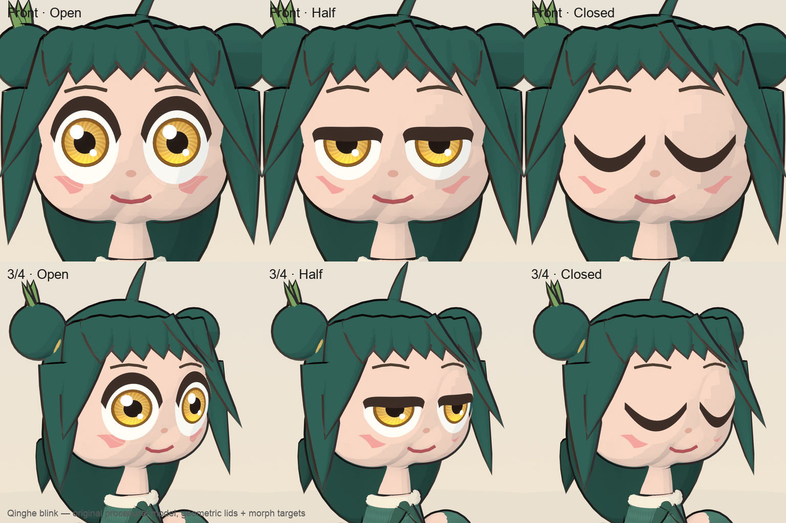
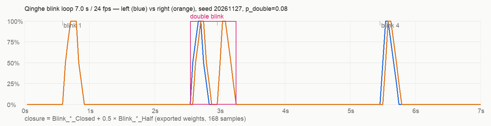
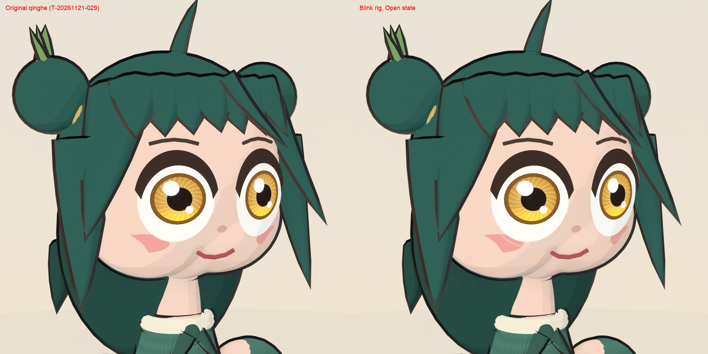
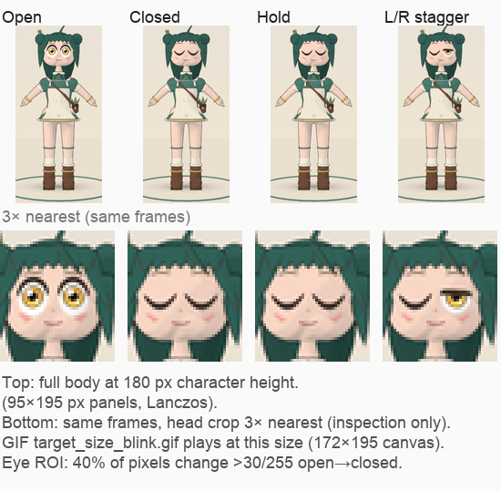

# 眨眼动画（Blink）— 原创角色能力测试

> 任务 T-20261125-011。在**原创**青禾（qinghe）模型上实测一次完整眨眼管线：
> 几何眼睑 + 形态键 + 24 fps 循环 + GLB morph 导出 + Godot 4.6 / Blender 3.4.1 验证。
> 未使用任何参考游戏/IP 素材；模型、眼睑、动画、渲染均由本仓库生成。



## 0. 结论（先看这里）

- **能做**：在“平面贴片眼”的二次元模型上补齐可动眼睑，做到 80–90% / 10–20% 的上下眼睑闭合、保留瞳孔与高光、无穿模、GLB 带 6 个 morph targets、Godot 4.6 可识别、24 fps 7 s 循环（4 次眨眼、1 次双眨、左右 1 帧错开）。
- **不能直接做**：qinghe/taoyao 都**没有眼睑骨、眼睑几何或表情形态键**，眼是贴在脸椭球上的分层 decal。必须新建眼睑几何；只换一张“闭眼贴图”会在半闭帧露馅，也没有可动画路径。
- **精度边界**：眼睑是贴脸椭球的两层曲面片（skin + lash），不是有眼窝/结膜/泪阜的生产级眼睑；轮廓线壳（`Qinghe_Outline`）不包含新眼睑，闭眼线靠睫毛带本身；没有眉/颊联动、眼神/look-at、口型。
- **验证**：27/27 项自动检查通过（`blink_validation.json`），Godot 导入 6 个 blend shapes + 6 条 blend-shape 轨道，Blender 回导后帧 1→17 顶点最大位移 73.9 mm。
- **最重要的一条经验**：形态键直接 Open→Closed 会因**椭球弦垂**在中间态下陷 5.2 mm，把 8.2 mm 处的高光/瞳孔露出来。要加**投影 Half 关键态**并按 Open→Half→Closed 驱动，中间态间隙仍 ≥9.43 mm。

### 关键数字

| 项 | 数值 |
|---|---|
| 模型 | qinghe，22 骨（root + 21 deform），约 103.5k tris，单 join 网格 21 材质 |
| 新增眼睑 | 522 verts / 392 quads / 2 材质（Skin + Lash），刚性绑 `head` |
| 删除的原静态睫毛 | 56 faces（左右各 28） |
| 覆盖率（中央列） | 上眼睑 **81.98%**，下眼睑 **18.02%** |
| 眼睑离面偏移 | 上 10.8 mm，下 10.5 mm；高光 decal 8.2 mm |
| 形态键 | `Blink_Open`(basis) + `Blink_Half` + `Blink_Closed` + 左右 `_Half`/`_Closed` 共 7 keys / 6 targets |
| 闭眼保持 | 2/1/1/1 帧（四次眨眼） |
| 节奏 | 24 fps，168 帧（7.0 s），seed **20261127**，4 次眨眼（含 1 次双眨），左右 1 帧错开 ×2 |
| 双眨概率 | 生成器 p=0.08；200 个 7 s 窗口实测 **7.03 对/100 次眨眼** |
| GLB | 7,331,952 B；6 morph targets；1 个 weights 通道；168 采样；3 张贴图；22 joints |
| Godot 4.6 | 6 blend shapes、6 条 TYPE_BLEND_SHAPE 轨道、clip 7.0 s、22 骨 |
| 渲染 | 1024² 关键帧（32 samples），512²×168 循环（16 samples），180 px 全身目标尺寸测试 |
| Open 状态保真 | 与原 `face_closeup` 均值绝对差 **1.42/255**（p99=12） |
| 180 px 可读性 | 眼部 ROI **40.2%** 像素变化 >30/255（均值差 46.3/255） |

## 1. 资产结构检查（先 inspect，再动手）

用 Blender 3.4.1 headless 打开 `agent-probes/blender-anime-girl/qinghe.blend`：

- `Qinghe`：**一个 join 网格**，21 个材质槽；眼睛是 `face_patch` 贴片，按脸椭球解析式投影：
  - 眼白 offset 4.5 mm，虹膜 6.2 mm，瞳孔 7.4 mm，高光 8.2 mm；
  - 上睫毛是 `face_band`（椭圆 rx 0.0445 / rz 0.0555，内缩 0.86，宽 9.5 mm），offset 6.4 mm；
  - 眉 offset 4.5 mm，z≈1.195–1.204；刘海尖端 ≥1.20。
- `QingheRig`：22 骨，**无 eye/lid/brow 骨**，`head` 骨刚性驱动整张脸和眼 decal。
- 无 shape keys、无面部动画、无表情骨/混合形状。
- `Qinghe_Outline`：反壳描边，**跳过 decal 材质**（含 Lash）。
- 另一个探针 `taoyao.blend` 同样是单网格 + decal 眼（Skin/EyeWhite/Lash/…），结构限制相同。

因此路线确定为：**新建几何眼睑（skin 帘 + 可动睫毛带 + 下睑带）→ 形态键 → 动画 → GLB**，而不是换贴图。

## 2. 眼睑设计

### 2.1 参考系与参数

脸椭球（与建模脚本相同）：

```
FACE_C = (0, 0, 1.145)      FACE_R = (0.141, 0.131, 0.138)
face_y(x,z) = -0.131 * sqrt(1 - (x/0.141)² - ((z-1.145)/0.138)²)
eye centre = (±0.055, 1.135)    eye white: rx 0.041, rz 0.051
lash ellipse: rx 0.0445, rz 0.0555, inner 0.86, width 0.0095
```

闭眼线（上下睑缘）用一条两端升到眼角的抛物线：

```
meet(u) = 1.0995 + 0.0355 * u²        # u = cos(a) ∈ [-0.984, 0.984]
```

- 中央列：上眼睑从眼顶 1.1905 闭合到 1.0995 → 覆盖 **81.98%**；下眼睑从眼底 1.0795 升到 1.0995 → **18.02%**。
- 两端自动收在眼角附近（canthus），所以靠近眼角时覆盖率会自然趋向 50/50——这是几何决定的，不是 bug。中央 ±60% 眼宽范围满足 80–90 / 10–20。

### 2.2 网格

每只眼：

| 部件 | 行 | 列 | 说明 |
|---|---|---|---|
| 上眼睑 skin 帘 | 4 行（r0 顶边 → r3 睫毛上缘） | 29 | 顶边固定 `min(睫毛上缘+2 mm, 1.1920)` |
| 上睫毛带 | r3 → r4 | 29 | **Open 状态复刻原 `face_band` 的每根顶点** |
| 下眼睑带 | 4 行 | 29 | Open 时是眼下 0.8 mm 的细条，Closed 时升起与上睑相接 |

- 列参数沿用原 `face_band` 的 `a = 0.18 … π-0.18`，29 列。
- Open 时睫毛带下缘使用原内缩映射 `x_in = cx + u·rx·0.86`，与原睫毛逐点重合；**Closed 时下缘 x 展开到 `x_out = cx + u·rx`**，左右到眼角，保证盖住眼白 ±0.041 的全部角部。
- 下睑顶边与 Closed 睫毛下缘使用同一 `u`/`x_out`/`meet(u)`，避免出现“白缝”。
- 眼睑整体刚性权重组 `head`（权重 1）+ Armature modifier，随头骨运动。
- 上睑 offset 10.8 mm、下睑 10.5 mm（高光在 8.2 mm，中间混合态仍 ≥9.43 mm，见 §3.2）。

### 2.3 不穿模的边界

- 眼睑顶边 `TOP_CAP = 1.1920`；眉管下缘约 1.1949，留 2.9 mm。
- 刘海尖端 ≥1.20；眼睑最外 x=±0.0988，侧发/鬓发在 ±0.14 以外。
- 原静态睫毛 56 faces 被删除，由新睫毛带替代；Open 状态逐点复刻，因此外观不变（见 §7 Open parity）。
- 没有眼窝/结膜，眼睑是“盖在 decal 前方”的帘；闭眼时把眼白/虹膜/瞳孔/高光整体遮住，而不是缩放眼球。

## 3. 形态键

### 3.1 键表

| 键 | 作用 | 动到的顶点 |
|---|---|---|
| `Blink_Open`（basis） | 睁眼；也在 glTF 里作为 base mesh | 0（参考） |
| `Blink_Half` | 双眼半闭（投影到完整偏移面） | 406 |
| `Blink_Closed` | 双眼全闭 | 406 |
| `Blink_Left_Half` / `Blink_Left_Closed` | 仅左眼 | 203 / 203 |
| `Blink_Right_Half` / `Blink_Right_Closed` | 仅右眼 | 203 / 203 |

- 左右独立键是为 **1 帧错开** 和未来单眼眨/眨眼同步服务；左右键互不污染（验证：`left_key_moved_right_verts=0`，反向也为 0）。
- 全部 6 个 target 放在**同一个网格对象** `Qinghe_BlinkLids` 上，因此 Blender→glTF 只产生一个 weights 通道/一个动画 clip。若拆成两个对象，不同 action 容易导出成多个 clip。
- glTF 的 morph target 名写在 `mesh.extras.targetNames`（Blender 3.4 exporter 行为）；Godot 4.6 正确读取了 6 个名字。

### 3.2 为什么需要“投影 Half”而不是简单中点

脸是凸椭球。Open 与 Closed 的同一顶点在 z 上相差最多 ~74 mm；把两个 3D 位置线性平均，弦会落进椭球内部：

| 顶点状态/混合 | 相对脸面的最小偏移 |
|---|---|
| Open / Half / Closed 关键态 | 10.5 mm |
| Open→Half 中间（50%） | **9.429 mm** |
| Half→Closed 中间（50%） | **9.428 mm** |
| 直接 Open→Closed 中间（反例） | **5.573 mm** ← 低于高光 8.2 mm |
| 眼白 decal offset | 4.5 mm |
| 高光 decal offset | 8.2 mm |

直接做 0→1 的 Closed 权重，在中间帧高光/瞳孔会从眼睑里“穿出来”（本项目第一版就复现了：射线检测在高光像素上打到了 `EyeHighlight` 而不是眼睑）。修正：

1. `Blink_Half` 的每个顶点取 Open/Closed 的 (x,z) 中点后，**重新投影到脸椭球并保持完整偏移**（不是简单 y 平均）。
2. 动画按 **Open → Half → Closed → Half → Open** 驱动（`Blink_*_Half` 与 `Blink_*_Closed` 交叉淡化）。
3. 中间混合最小间隙 9.43 mm > 高光 8.2 mm，留 1.2 mm 余量；引擎深度精度（24-bit）足够。

### 3.3 闭眼配方（引擎侧）

```text
closure = Blink_*_Closed + 0.5 * Blink_*_Half      # 0..1
```

只驱动 `Blink_*_Closed` 0→1 也能“闭”，但会走弦垂路径；推荐按 §5 的关键帧同时驱动 Half/Closed。全局 `Blink_Half`/`Blink_Closed` 保留给离散状态（截图/低端状态机）。

## 4. 节奏设计



- **24 fps，168 帧 = 7.0 s**；`seed=20261127`（从日期 seed 20261125 向上扫描得到，满足“4 次眨眼 + 恰好 1 次双眨 + 左右错帧”的演示条件，固定可复现）。
- 4 次眨眼：帧 **14 / 61 / 71 / 131**；其中 61 与 71 是双眨（间隔 0.42 s）。
- 每次：close 3/3/2/2 帧，hold **2/1/1/1** 帧（满足 1–2 帧），open 3/3/4/4 帧。
- 左右 1 帧错开：第 2 次（帧 61，右眼 +1）和第 4 次（帧 131，右眼 +1）；导出权重在 12 个帧上可测到 L/R 差 >0.2。
- 双眨概率：生成器 `P_DOUBLE=0.08`（5–10% 区间）。200 个 7 s 窗口统计：640 次眨眼、45 对双眨 = **7.03 对/100 次眨眼**，45/200 窗口内出现双眨。演示 clip 是**按固定 seed 选出的含双眨窗口**，不是把设计概率提到 25%。
- 节奏生成器在 `tools/blender_blink/blink_schedule.py`（纯 stdlib，可 `--seed` / `--stats`）。

时间轴读的是 **GLB 里实际导出的 weights 采样**（168 采样），不是 Blender 理论曲线。

## 5. 动画曲线（Blender / glTF）

每个单眼 blink profile（`start` 已含 L/R offset）：

```
f0 = start                  Half 0, Closed 0
f1 = start + max(1, c//2)   Half 1, Closed 0     # 投影 Half
f2 = start + c              Half 0, Closed 1     # 全闭
f3 = start + c + hold       Half 0, Closed 1     # 保持 1–2 帧
f4 = f3 + max(1, o//2)      Half 1, Closed 0     # 开眼经过 Half
f5 = f3 + o                 Half 0, Closed 0
```

- Blender action：`Blink_Loop_24fps`，4 条 fcurve（左右 × Half/Closed），帧 1–168，Bezier auto-clamped。
- 导出时 `export_force_sampling=True`，每帧采样 → glTF 168×6 weights，单一通道。
- 首尾都是 0（循环无跳变）。

## 6. 导出（GLB）

命令：

```bash
/Applications/Blender.app/Contents/MacOS/Blender -b -P tools/blender_blink/build_blink.py
```

关键导出参数（Blender 3.4.1）：

```python
bpy.ops.export_scene.gltf(
    filepath=GLB, export_format='GLB', use_selection=True,
    export_animations=True,
    export_nla_strips=False,                     # 合并 active actions 成 1 个 clip
    export_nla_strips_merged_animation_name='Blink_Loop',
    export_morph=True, export_morph_normal=True, export_morph_tangent=False,
    export_apply=False,                          # 有形态键时不能 apply
    export_skins=True, export_yup=True,
    export_frame_range=True, export_force_sampling=True,
    export_anim_single_armature=True)
```

GLB 实际结构（`inspect_glb.py` / `blink_validation.json`）：

| 项 | 值 |
|---|---|
| meshes | `QingheMesh`（20 primitives）、`QingheBlinkLidsMesh`（2 primitives）、`QingheMesh.001`（outline，1 primitive） |
| morph targets | 每 primitive 6 个；名字 `Blink_Half, Blink_Closed, Blink_Left_Half, Blink_Left_Closed, Blink_Right_Half, Blink_Right_Closed` |
| skin | 1 个，22 joints |
| animation | `Blink_Loop`，1 个 weights 通道，168 采样，时间 0.0417–7.0 s |
| 材质 | 22 个 Principled（原 20 + Lash + Outline），3 张嵌入贴图（iris/dress/apron） |

### 6.1 材质转换坑

.blend 内的 EEVEE toon 材质是 `Diffuse → Shader-to-RGB → Ramp × MixRGB → Emission`。导出 GLB 前要换成 Principled 变体。**不要把 Emission 节点的颜色当成底色**——它的 Color 是**连着 MixRGB 的**，`default_value` 是白色。正确顺序：

1. 有 Image Texture → 直接当 Base Color；
2. `MIX_RGB (MULTIPLY)` 的 **Color2** 才是卡通底色；
3. 未连线的 Emission 颜色（Lash/Brow 等 `mat_emit`）；
4. Principled Base Color / `diffuse_color` 兜底。

第一版按 1→Emission 顺序导出，Skin/Hair 全白；修正后 Skin `baseColorFactor = [0.930, 0.672, 0.546, 1]`（sRGB #F7D6C3 的线性值），Hair/Jade 等也正常。

## 7. 验证

### 7.1 自动检查

`python3 tools/blender_blink/validate_blink.py` → `blink_validation.json`：**27/27 PASS**，包括：

- GLB：6 targets、22 joints、3 textures、Skin 非白、动画 7.0 s / 168 采样 / 6 维 weights、权重 0–1、首尾 0、闭眼权重到 1；
- 节奏：4 次眨眼、1 次双眨、hold 1–2 帧、有 L/R 错帧、双眨率 5–10%；
- 眼睑：覆盖率 81.98/18.02、混合态间隙 9.43 mm > 高光 8.2 mm、左右键隔离、56 faces 替换；
- 回导：Blender 回导 6 targets + action 1–168，帧 1→17 最大顶点位移 **73.9 mm**，>1 mm 的顶点 1320 个；
- Godot：`blend_shapes=6`、`blend_shape_tracks=6`、`bones=22`、`ANIM Blink length=7.0`；
- 媒体：MP4 168 帧、180 px 目标尺寸可读性、Open 保真 <5/255。

复跑：

```bash
/Applications/Blender.app/Contents/MacOS/Blender -b -P tools/blender_blink/build_blink.py
/Applications/Blender.app/Contents/MacOS/Blender -b -P tools/blender_blink/render_blink.py -- --mode stills
/Applications/Blender.app/Contents/MacOS/Blender -b -P tools/blender_blink/render_blink.py -- --mode anim
/Applications/Blender.app/Contents/MacOS/Blender -b -P tools/blender_blink/render_blink.py -- --mode target
python3 tools/blender_blink/make_media.py
/Applications/Blender.app/Contents/MacOS/Blender -b -P tools/blender_blink/reimport_check.py
python3 tools/blender_blink/validate_blink.py
```

### 7.2 Godot 4.6

```text
MESH_INSTANCE ... surfaces=2 blend_shapes=6 names=[Blink_Half, Blink_Closed,
  Blink_Left_Half, Blink_Left_Closed, Blink_Right_Half, Blink_Right_Closed] skeleton=..
ANIM Blink length=7.0 tracks=6 blend_shape_tracks=6
SKELETON Skeleton3D bones=22
```

- Godot 里 clip 名显示为 **`Blink`**（glTF 名 `Blink_Loop`）。运行时手动设置 blend shape 也已验证：`SET_BLEND Qinghe_BlinkLids Blink_Left_Closed idx=3 value=1.0`。直接播放 `AnimationPlayer` 即可；也可手动：
  ```gdscript
  var mi := get_node("QingheRig/Skeleton3D/Qinghe_BlinkLids") as MeshInstance3D
  var i := mi.find_blend_shape_by_name("Blink_Left_Closed")
  mi.set_blend_shape_value(i, 1.0)
  ```
- 未在 Godot 里做实机 GPU 回放录像（本机 headless 导入验证，渲染验收走 Blender 3.4.1 EEVEE）；这是下一棒 `game-engineer`/`game-qa-lead` 可以补的运行时项。

### 7.3 Open 保真



原 `face_closeup`（1440²，3/4 机位）下采样到 1024² 与新 Open 对比：均值绝对差 **1.424/255**，p99 = 12。差异来自新睫毛带前移 4.6 mm 的轻微透视差 + EEVEE 采样噪声，肉眼不可见。

### 7.4 目标尺寸



全身渲染 360×450 → 裁切缩放，**角色高 180 px**（面板 95×195）。第 1 帧（睁）与第 17 帧（闭）眼部 ROI（32,19)–(62,36)：

- 205 个像素变化 >30/255（**40.2%** ROI），均值差 **46.3/255**，最大 218；
- 180 px 下眨眼可读。对应 GIF：`target_size_blink.gif`（172×195 画布，进度条仅用于保留 GIF 帧）。

## 8. 常见坑（按踩坑顺序）

1. **decal 眼没有眼窝/眼睑**：换闭眼贴图只能做一个离散状态，半闭帧、单眼眨、与表情叠加都做不了。必须建几何或至少有可动画的 lid 网格。
2. **形态键中点会陷进脸**：Open/Closed 的 z 差越大，弦垂越深。本项目 5.57 mm 弦垂 < 高光 8.2 mm → 高光穿出。用**投影 Half + 分两段驱动**，或加更多中间键；不要只放大整体 offset 硬顶（会浮空/视差）。
3. **参数化不一致会露眼白**：睫毛内缘用 `x_in = 0.86·x_out`、下睑用 `x_out`，在眼角处同一屏幕 x 的 `meet(u)` 差 5–9 mm，闭眼时出现白缝。闭眼接触边必须使用同一映射。
4. **原静态睫毛要替换，不能叠**：否则闭眼时原睫毛留在原位，出现“双眼皮/双睫毛”。本项目删除 56 faces，并把原 band 的顶点公式复刻进新睫毛带。
5. **左右眼错帧需要左右独立 shape keys 或独立对象**；放在同一对象上用一个 weights 通道最省事（6 targets），Godot 直接可用。
6. **不要让眼球/高光跟着缩放**：眼睑只做遮挡；高光是独立 decal，权重保持 0。半闭时高光被自然盖住，而不是变形。
7. **深度余量**：眼睑与高光只差 2.6 mm；混合路径最大下陷 ~1.07 mm，仍留 1.2 mm。再小的 offset（如 9 mm）就会在 24-bit 深度/斜视角下打架。
8. **眉毛/刘海**：顶边 1.192 < 眉下缘 1.1949；刘海尖端 ≥1.20。给不同角色做时先量这三个数，再定顶边。
9. **Blender 3.4 glTF 的动画分组**：`export_nla_strips=False` 才会把多个 active action 合并成一个 clip；名字用 `export_nla_strips_merged_animation_name`。形态键 action 挂在 **Key datablock**（不是对象）上。
10. **morph target 名字**在 `mesh.extras.targetNames`（非 primitive.targets[].name）；Godot 4.6 读取正确。
11. **材质导出**：见 §6.1，Emission 连线陷阱会把整只角色导成白色。
12. **GIF**：PIL 会**丢掉完全相同的帧**，静态段会让 168 帧变成几十帧且时长错；要么加时间码/进度条让每帧不同，要么接受丢帧。GIF 时间单位 10 ms，24 fps 用 40/50 ms 交替（每 6 帧 1 个 50）才能精确 7.000 s。
13. **闭眼保持**：1–2 帧就够；0 帧会像“闪一下”，3+ 帧像昏睡。24 fps 下 close 2–3 / hold 1–2 / open 3–4 是安全区间。
14. **本机渲染路径**：Blender 4.2 EEVEE Next 在 Intel HD 6000 上 SIGSEGV；3.4.1 EEVEE Legacy 正常。4.2 的 Cycles CPU 会把 Shader-to-RGB 卡通节点渲成深色，不要用。
15. **描边壳**：新眼睑不在原 Outline 反壳里；因为闭眼线由深色睫毛带承担，正面/3/4 看不出。若要求统一轮廓，需要给眼睑单独做 outline 或把眼睑并入原角色网格。

## 9. 复用到其他角色（检查清单）

1. Inspect：列出眼睛是 decal / 球体 / 有眼窝，是否有 lid 骨/形态键；量眼中心、rx/rz、decal 各层 offset、眉/刘海最低点。
2. 定闭眼线：中央覆盖率 80–90%，两端收到眼角；用 `meet(u)` 二次曲线即可。
3. 建上睑帘 + 睫毛带、下睑带；Open 复刻原睫毛；接触边同一参数化；刚性绑 head。
4. 检查 4 个间隙：`Open/Half/Closed` 关键态、两段混合中点，全部 > 高光 offset + 1 mm。
5. 建 6 个 targets（全局 Half/Closed + 左右 Half/Closed）；Half 必须重投影。
6. 写节奏（24/30 fps、3–5 次/6–8 s、hold 1–2 帧、L/R 1 帧错开、seed 可复现）。
7. 导出 GLB，检查 `extras.targetNames`、单 weights 通道、时长、材质底色。
8. 回导 Blender + 导入 Godot；验证 target 名、轨道数、骨骼数、帧 1→closed 顶点位移。
9. 渲染：关键帧 1024²、循环 512²、180 px 全身；计算 Open 保真与目标尺寸可读性指标。
10. 写文档 + 发送媒体；不要只发路径。

## 10. 未做 / 下一步

- **眉/颊联动**：当前眉、颊无形态键；如需可在 Qinghe（52k verts）加 `Brow_Down` / `Cheek_Up` 键，或做单独眉网格。
- **眼神/look-at、扫视（saccade）**：眼是 decal，无眼球旋转；需要新建眼球+虹膜或做 UV 偏移方案。
- **口型/表情**：无 jaw/mouth 骨；本任务范围外。
- **眼睑细节**：无结膜、泪阜、双眼皮褶、睫毛毛发；闭眼线偏粗（继承原睫毛厚度）。生产级需要眼窝拓扑 + 睫毛 card。
- **轮廓统一**：眼睑不参与 Outline 反壳（见坑 15）。
- **运行时**：Godot 仅做 headless 导入验证；未做 GPU 回放录像/60 fps 变体。建议 `game-engineer` 在 Godot 里跑 60 fps 插值 + 相机 3 m 距离检查 z-fighting，`game-qa-lead` 按 180 px/60 px 两档验收。
- **taoyao 变体**：结构相同（decal 眼），未重复搭建；同一脚本改眼中心/尺寸即可，但需另测刘海/发饰间隙。

## 11. 文件与复跑

```text
agent-probes/blink-test/
├── qinghe_blink.blend            4.45 MB，含 6 shape keys + action
├── qinghe_blink.glb              7.33 MB，6 targets + 7 s clip
├── blink_face_loop.mp4           512×512 / 24 fps / 7.0 s，131,946 B
├── blink_face_loop.gif           320×320 / 168 帧 / 7.000 s
├── blink_face_contact.png        前后 × 睁/半/闭 2×3（1024² 源）
├── blink_keyframes.png           Open/Half/Closed/双眨错帧
├── blink_timeline.png            GLB 导出权重的节奏图
├── target_size_strip.png         180 px 全身 + 3× 头部 nearest
├── target_size_blink.gif         172×195，180 px 角色高
├── open_parity.png               原 face_closeup vs 新 Open
├── blink_schedule.json           固定 seed 的节奏
├── blink_report.json             建模/键/间隙/导出数字
├── reimport_check.json           Blender 回导验证
├── blink_validation.json         27 项自动检查
├── media_metrics.json            GIF/MP4/目标尺寸指标
├── godot_import_check.txt        Godot 4.6 headless 导入日志
├── renders/                      六张 1024² 关键帧
├── anim/                         168 张 512² 中间帧（可再生，不入库）
└── target_size/                  168 张 360×450 中间帧（可再生，不入库）

tools/blender_blink/
├── blink_schedule.py             纯 stdlib 节奏生成器（--seed / --stats）
├── build_blink.py                眼睑 + 形态键 + action + GLB
├── render_blink.py               stills / anim / target 三模式
├── make_media.py                 contact sheet / mp4 / gif / 目标尺寸 / 指标
├── inspect_glb.py                GLB JSON 解析
├── reimport_check.py             Blender GLB 回导 + 形态键驱动验证
└── validate_blink.py             27 项聚合验收
```

授权：全部为仓库内原创程序化资产；无第三方模型/贴图/付费素材、无 IP 参考图。眼睑与动画由本任务脚本生成。

## 12. 给下一棒的 handoff

- **game-engineer**：Godot 60 fps 回放 + 相机距离/深度精度；把 6 targets 接进角色状态机（idle 随机眨眼 + 对话单眼眨）；如果要在移动端降级，至少保留 `Blink_Left_Closed`/`Blink_Right_Closed` 两个 target。
- **game-qa-lead**：按 180 px 与 60 px 两档验收；检查 3/4 与侧面无白缝、无高光穿出；对照 `blink_validation.json` 逐项复核。
- **game-art-director**：审闭眼线弧度是否够“青禾”（当前 U 形较深、睫毛偏粗）；如需更柔和的闭眼可调 `MEET_C/MEET_K`（`build_blink.py` 顶部常量）并重跑。
