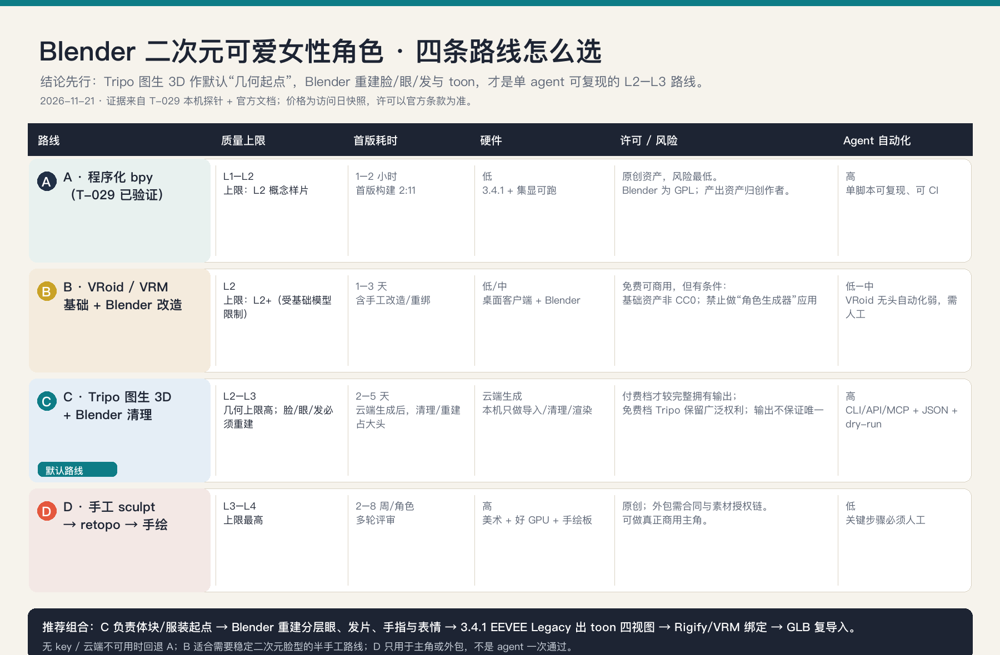
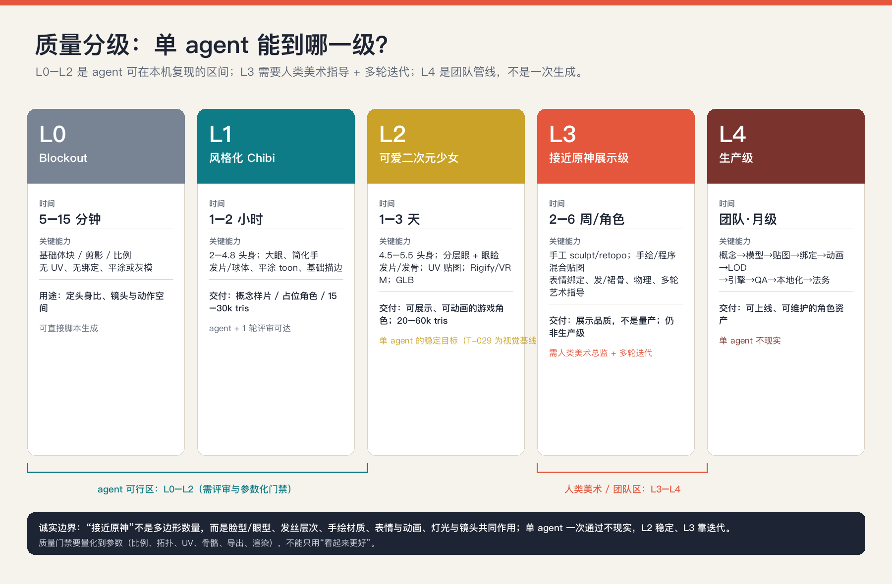

# Blender 二次元可爱女性角色管线（T-20261121-030）

> **一句话结论**：单 agent 在本机可稳定做到 **L2（可爱二次元少女：toon + 分层眼 + 发片 + UV + 基础绑定 + GLB/VRM）**；要摸到 **L3（接近《原神》的展示品质）**，必须采用 **Tripo 图生 3D 提供体块/服装起点 → Blender 重建脸/眼/发/材质 → 多轮 Art Director 评审**，并且接受“2–6 周/角色、关键步骤人工”。**L4 生产级是团队·月级管线，不是一次 prompt 能通过的事情。**
>
> **默认路线**：原创正交三视图 → **Tripo P2/H3.1 图生 3D** → Blender 3.4.1 清理/重拓扑/UV/分层眼/发片/toon/Rigify 或 VRM → GLB/VRM + 四视图/角色卡。**无 key 回退**：T-029 已跑通的程序化 bpy 基线（L1–L2），或人工 VRoid/VRM 基础。
>
> **本机硬约束**：Intel HD 6000 / 1536 MB 显存；**Blender 4.2.9 的 Workbench 与 EEVEE Next 在本机 SIGSEGV（默认立方体也崩）**；最终出图固定 **Blender 3.4.1 EEVEE Legacy**。4.2.9 只建议做 GLB 复导入/资产检查，或 Cycles CPU 后备（toon 节点不成立）。
>
> **边界**：本文只做调研与能力设计，不安装软件、不写游戏代码、不修改 agent 定义、不复制《原神》或任何 IP 的角色/服装/脸/Logo/素材。所有“Tripo 生成质量”除非注明实测，均属**官方文档/厂商声明**，不是本机验证结论。**访问日期：2026-11-21。**





---

## 0. 先读：五个判断

| # | 判断 | 依据/含义 |
| --- | --- | --- |
| 1 | **Tripo 适合做“几何起点”，不适合直接交付二次元脸** | P2 原生四边面、H3.1 高精度、自动绑骨（可输出 VRM 骨骼命名）都很适合管线；但单张图的脸/眼/发通常是“像但不对”，必须重建分层眼、眼睑、发片和嘴/眉。 |
| 2 | **“接近原神”是生产管线差距，不是模型面数差距** | 脸型/眼型、手绘/混合材质、发丝层次、表情绑定、头发/裙摆物理、动画与镜头共同决定观感；单 agent 一次通过不现实。 |
| 3 | **本机 4.2.9 不能用于最终出图** | T-029 实测 Workbench/EEVEE Next 均 SIGSEGV；3.4.1 EEVEE Legacy 稳定（1440×1800、32 spp、6 张板 87.2 s）。 |
| 4 | **许可比工具能力更容易埋雷** | Tripo 免费档 Tripo 保留广泛权利、付费档才较完整拥有输出；Meshy 免费档 CC BY 4.0（需署名）；MB-Lab 默认输出 AGPL 传染；VRoid 基础资产非 CC0 且禁止做“角色生成器”应用。 |
| 5 | **Agent 化要用“门禁”而不是“感觉”** | 比例、拓扑、UV、材质、骨骼、导出、渲染、许可、成本全部量化；生成→渲染→独立评审→参数修正，最多 3 轮，fail-closed。 |

---

## 1. 证据、边界与“可达 vs 生产级”

### 1.1 已有本机证据（T-029 探针）

T-029 已用原创角色“青禾”跑通程序化 bpy 基线，证据在 `agent-probes/blender-anime-girl/` 与 `docs/agent-capabilities/blender-anime-probe.md`。与本任务直接相关的实测：

| 项 | 实测结果 |
| --- | --- |
| 3.4.1 / EEVEE Legacy | ✅ 6 张板（四视图 + 特写 + 剪影）1440×1800，32 spp；87.2 s，首帧后 8–9 s/帧 |
| 4.2.9 / Workbench | ❌ SIGSEGV，默认立方体也崩 |
| 4.2.9 / EEVEE Next | ❌ SIGSEGV |
| 4.2.9 / Cycles CPU | ⚠️ 320×400 / 8 spp / 26.4 s 成功；Shader-to-RGB 不成立，角色整体变深 |
| Freestyle | ⚠️ 320×400 / 8 spp 单球：visibility 51.4 s + 渲染 6.8 s，不实用 |
| 资产 | 103,558 tris / 22 骨 / 7,015,008 B GLB；无统一 UV、无表情/手指/发骨 |
| Tripo | 网络经代理可达；无 key，API 返回 401，未生成 |

> 这些数字是本文“本机可行性”与“L2 基线”的事实来源；不把 T-029 的 L2 概念样片说成生产资产（其生产就绪度自评仅 2.0/10）。

### 1.2 本文的“可达”与“生产级”

| 说法 | 本文含义 |
| --- | --- |
| **可达风格化** | 用本机 + 免费/低成本工具 + agent 脚本，能在 1–3 天做出可展示、可动画、可进引擎的角色；允许手绘/人工修正；不承诺量产一致性。 |
| **接近原神（L3）** | 静态展示/短镜头能读出“高质量二次元”的层次；需要人类美术指导、手工 sculpt/retopo/贴图/表情、多轮迭代；仍不是上线量产级。 |
| **生产级（L4）** | 团队管线、版本管理、LOD、QA、动画/表情库、引擎集成、法务/素材溯源、可维护性；以“人月”计。 |
| **原神级** | 本文把它视为 **L4 的产品结果**，不是某个开源模型/一次 Tripo 生成的直接输出；不复制其任何资产。 |

### 1.3 本次未验证项（必须诚实标注）

- **Tripo 实际生成质量**：本机无 `TRIPO_API_KEY`，未跑图生 3D；本文的 Tripo 能力来自官方 v3 文档与定价页。
- **Tripo P2 对二次元脸/发的实际表现**：厂商定位“游戏角色/实时管线”，但没有本机 A/B；引入前必须用原创参考图跑 3–5 个 seed 做盲评。
- **Auto-Rig Pro / Hair Tool**：未安装、未实测；只核对了购买页价格与许可描述。
- **Blender 4.2.9 的崩溃根因**：只记录现象与栈（`DRW_state_set`/`DRW_state_reset`/`DRW_render_to_image`），不推断为单一驱动问题。
- **法律意见**：本文是工程/许可核对，不是律师意见；商用前按官方条款与法务确认。

---

## 2. 路线对比：四条路，三种角色

> 任务要求给 2–3 条路线；这里给 **3 条可日常使用的主路线 + 1 条高上限路线**。推荐组合不是“四选一”，而是 **C 打底、A 回退、B 补脸/发、D 只给主角**。

| 维度 | A · 程序化 bpy | B · VRoid/VRM + Blender | C · Tripo 图生 3D + Blender（默认） | D · 手工 sculpt→retopo→手绘 |
| --- | --- | --- | --- | --- |
| **质量上限** | L1–L2（概念样片/占位） | L2（受基础模型与预设限制） | L2–L3（几何上限高，脸/眼/发需重建） | L3–L4（上限最高） |
| **首版时间** | 1–2 小时（T-029 构建 2:11） | 1–3 天（含改造/重绑） | 2–5 天（云端生成通常数十秒–数分钟；清理占大头） | 2–8 周/角色 |
| **硬件** | 低；3.4.1 + 集显可跑 | 低–中；桌面客户端 + Blender | 云端生成；本机只做清理/渲染 | 高；美术 + 好 GPU + 手绘板 |
| **许可风险** | 最低；原创资产 | 中；基础资产非 CC0，禁止做生成器应用 | 中；免费档权利受限，付费档才较完整拥有 | 低–中；原创/外包合同 |
| **Agent 自动化** | 高；单脚本可复现/可 CI | 低–中；VRoid 无头自动化弱 | 高；CLI/API/MCP + JSON + dry-run | 低；关键步骤必须人工 |
| **最大风险** | 有机形体/脸侧视/拓扑弱 | 风格同质化、衍生风险、手工瓶颈 | 风格漂移、拓扑/UV 非最终、成本、key/代理 | 周期与人力；不是 agent 路线 |
| **适用** | 无 key 回退、L0/L1、参数化批量 | 需要稳定二次元脸型的半手工路线 | 默认：体块/服装/道具/多方案探索 | 主角、关键 NPC、外包验收 |

### 2.1 推荐决策树

```text
需要角色
├─ 只要 L0/L1 占位/剪影 → A（程序化），当天出
├─ 有 Tripo key 且能接受云端/费用
│   ├─ 游戏实时资产 → P2（四边面、低面数）+ Blender 清理
│   └─ 展示/高精度 → H3.1（高面数）+ 重拓扑 + 手绘/程序贴图
├─ 无 key / 云端不可用 → A 基线；或人工 B（VRoid/VRM）
└─ 主角/宣传级 → C 打底 + D 的人工 sculpt/retopo/表情/材质
```

### 2.2 为什么默认 C，而不是“纯 Tripo 一键出角色”

- Tripo 的**几何/服装体块**比程序化球体拼接更有机，能显著缩短 blockout→中模的时间；
- P2 的**原生四边面**和可控面数（48–25,000 quads）比 H 系列的高模三角面更适合游戏管线；
- 自动绑骨 v3.0 支持 **VRM 骨骼命名**，可作为临时骨架/动画验证；
- 但二次元的“对味”主要来自**脸型、眼型、发片走向、材质层次**，这些在单张图生成里最容易漂；所以 Blender 端的“重建”不是可选项，而是质量门禁的一部分。
- 单图输入时背面/侧面是模型猜测，**多视图输入**通常更稳；Tripo 也可能给出半写实比例，清理时必须按 §3.1 重定比例，不能直接接受。

---

## 3. 角色制作管线（C 默认，A/B 变体）

### 3.1 二次元比例与脸型规格（建议值，不是行业标准）

> 下列是**本项目建议参数**，用于 agent 首版与 Art Director 评审；来源是 T-029 实测 + 通用二次元/Chibi 教学经验。不同年龄/风格要重新定标。

| 项 | L1 Chibi | L2 可爱少女（默认） | L3 展示级 |
| --- | --- | --- | --- |
| 头身比 | 2–4 头身 | **4.5–5.5 头身**（T-029 为 4.8） | 5.5–7 头身（按年龄/风格） |
| 头宽/头高 | 头宽略大于头高或接近 | 头高 : 头宽 ≈ 1.05–1.15 | 更接近 1.0–1.1，下颌更明确 |
| 眼线位置 | 头高中部或更低 | **头顶→下巴的 45–52% 高度**（偏低显幼） | 45–50%，眼型更细长 |
| 眼宽/间距 | 眼宽大，间距约 1 眼宽 | 眼宽 ≈ 头宽 1/4–1/3；**两眼间距约 1 眼宽** | 眼宽略收，内眼角/外眼角层次更清楚 |
| 鼻 | 点或省略 | 小三角/短竖线，位于眼线到下巴的 1/3 左右 | 鼻梁/鼻头有体积，但仍简化 |
| 嘴 | 小点/短弧 | 小弧线，位于鼻下到下巴的 1/3 左右 | 有唇线/口角，表情可动 |
| 下颌/下巴 | 圆润、短 | **软下颌 + 小尖下巴**，侧脸有明确下巴点 | 下颌角/颧骨更明确，但仍风格化 |
| 脖子 | 短/可省略 | 细，长度约 0.5–0.8 头宽 | 有胸锁乳突肌/斜方肌暗示 |
| 手 | 掌+拇指/合并指 | 掌 + 4 指 + 拇指，**至少 2 段指骨** | 完整手指骨、指甲/关节褶皱 |
| 脚 | 楔形/靴块 | 靴/鞋块面 + 脚踝，脚趾可简化 | 脚趾/鞋底/绑带细节 |

**硬门禁建议**：头身比与眼线位置写入 `manifest.json`；首版渲染必须出**正面/侧面/3-4/背面**四视图；侧视眼白/虹膜不得浮贴在脸侧（T-029 的 P1 缺陷）。

### 3.2 参考图与 Tripo 输入（质量从这里开始）

**参考图规范（原创）**：

| 项 | 要求 |
| --- | --- |
| 视图 | 正交 front / side / back（至少 front；多视图更好），同一角色、同一 A-pose、同一光照 |
| 分辨率 | 1024×1024 起；Tripo 建议 ≥256×256，实际用 1024–2048 更稳 |
| 背景 | 干净纯色/透明；主体完整、少遮挡；不要复杂场景/文字/Logo |
| 姿态 | A-pose 或自然站姿；手臂不要贴死躯干；头发不要遮住肩线 |
| 风格 | 平涂/轻阴影、清晰轮廓；不要把多角度参考拼成一张“设定集” |
| 版权 | **必须原创**；不把《原神》/任何 IP 的图当输入；保留生成/参考图来源记录 |
| 文件 | PNG/JPEG/WebP；Tripo 单图上限 20 MB；模型上传上限 150 MB |

**Tripo 参数建议**：

| 目标 | 模型 | 关键参数 | 备注 |
| --- | --- | --- | --- |
| 游戏实时资产 | `P2-20260801` | `quad=true`、`face_limit` 8k–25k、`texture=true`、`pbr=true` | P2 原生四边面；quad 输出强制 FBX；48–25,000 quads |
| 低模/移动端 | `P1-20260311` | `face_limit` 5k–20k、`texture=true` | P1 不支持 quad；50–20,000 faces |
| 高精度展示 | `v3.1-20260211`（H3.1） | `face_limit` 100k–300k、`texture_quality=detailed`、`pbr=true` | H3.1 三角形上限：Standard 1.5M / Ultra 2M，quad 150k；不要直接进实时管线 |
| 可复现 | 任意 | `model_seed`、`texture_seed` 固定 | 同 seed + 同输入 → 同几何/贴图 |
| 后续要 rig/retopo | 任意 | **不要设 `export_orientation`** | 官方警告：后续处理可能朝向错误但仍返回 success |
| 需要真实尺寸 | 任意 | `auto_size=true` | 输出以米为单位；仍建议在 Blender 复核 |
| 去烘焙光 | 任意 | `delight=true`（texture v3.5） | 参考图有强阴影时用；否则保留原阴影 |

> **不要**把 Tripo 参考图直接当“最终贴图”：生成的 PBR 贴图可作底色/材质参考，但二次元脸/发/服装的色块、边缘、阴影通常要重画或程序化重做。

### 3.3 Tripo 调用：CLI 优先，REST 兜底

#### 3.3.1 认证与网络（本机）

- 官方 API Base：`https://openapi.tripo3d.ai/v3`
- 认证头：`Authorization: Bearer {api_key}`
- API key 在 Tripo Console 的 API Keys 页创建（<https://developers.tripo3d.ai/en/keys>），**只显示一次**；推荐环境变量 `TRIPO_API_KEY`，区域用 `TRIPO_REGION`（`ov` 国际 / `cn` 中国大陆，CLI 文档）。
- **本机直连超时，必须走系统代理** `http://127.0.0.1:7897`：

```bash
export HTTPS_PROXY=http://127.0.0.1:7897
export HTTP_PROXY=$HTTPS_PROXY
# 无 key 时探测（不要打印 key）
curl -sS -m 20 -o /tmp/tripo_probe.json -w '%{http_code}\n' \
  -X POST https://openapi.tripo3d.ai/v3/generation/image-to-model \
  -H 'Content-Type: application/json' -d '{}'
# 2026-11-21 实测：HTTP 401，{"code":2,... "Authentication required"}
```

#### 3.3.2 CLI（推荐给 agent）

Tripo CLI 要求 **Node.js 20+**；本机 Node v22.19.0 满足，但**本次未安装**（任务要求不安装软件）。设计 skill 时应先 `tripo doctor`，再决定是否安装/登录。

```bash
# 安装（需用户确认；agent 不要静默安装）
npm install -g tripo-cli

# 设备码登录；不要把 key 贴进聊天
tripo login --region ov     # 国际站
tripo login --region cn     # 中国大陆站（支付宝）

# 环境/鉴权/余额检查；余额 0 是 warning，不是安装失败
tripo doctor

# 干跑：不创建任务、不扣 credits
tripo make refs/front.png --model tripo-p2 \
  -p quad=true -p face_limit=20000 -p texture=true -p pbr=true \
  --json --dry-run

# 生成（P2 quad 会输出 FBX）
tripo make refs/front.png --model tripo-p2 \
  -p quad=true -p face_limit=20000 -p texture=true -p pbr=true \
  --json

# 独立 UV（≤80k 等效三角；20 credits；按 CLI 文档的 mesh uv 子命令）
tripo mesh uv tripo-out/<task>/model.fbx

# H3.1 高精度（多图输入按 CLI 支持；不支持则走 REST multiview）
tripo make refs/front.png refs/side.png refs/back.png \
  --model tripo-v3.1 -p texture=true -p pbr=true -p face_limit=150000 --json

# 已有模型：重拓扑 + UV、纹理 + 绑骨（均为 CLI 文档示例用法）
tripo make tripo-out/<task>/model.fbx --then 'decimate:20000,uv'
tripo make tripo-out/<task>/model.fbx --then 'texture,rig'

# 超时恢复：不要重复 make（可能已扣费）；用 task watch 续等
tripo task watch <task-id> --download

# 费用/余额
tripo balance
tripo usage
```

CLI 输出：`tripo-out/<任务>/` 下有模型、`task.json`、可选 `preview.png`；`--json` 便于 agent 读取。**0.9.0 起 PBR 默认关闭**，需要时显式 `-p pbr=true`。

CLI 还提供 `--for game-mobile/game-pc/film/ar-web/anim/toy/print` 七个场景预设，默认模型为 P2；也可以用 `npx -y tripo-cli mcp` 作为 MCP server 接入 agent。**预设只省参数，不替代本 skill 的门禁/评审。**

#### 3.3.3 REST 最小客户端（无 CLI 或需要精细控制）

| 步骤 | 端点 | 说明 |
| --- | --- | --- |
| 上传图 | `POST /v3/files`（multipart） | 返回 `file_token`；图 ≤20 MB；模型 ≤150 MB；大文件用 `POST /v3/files/presign` |
| 建任务 | `POST /v3/generation/image-to-model` | `input` 可为 `file_token`/URL/task_id；`model` 必填 |
| 多视图 | `POST /v3/generation/multiview-to-model` | 多张参考图；适合正/侧/背 |
| 轮询 | `GET /v3/tasks/{task_id}` | `queued/running/success/failed/cancelled`；每 1–2 s；建议 5 min 超时 |
| Webhook | 你的 HTTPS 端点 | 任务完成/失败回调；支持签名校验与重试；适合长任务 |
| 转换 | `POST /v3/models/convert` | GLB/GLTF/FBX/OBJ/STL；quad 强制 FBX |
| 重拓扑 | `POST /v3/mesh/decimate` | v3.0 支持 quad + `smart_uv`；10–40 credits |
| Smart UV | `POST /v3/mesh/uv` | ≤80k 等效三角；返回 UV atlas 预览；20 credits |
| 绑骨 | `POST /v3/animations/rig` | v3.0 humanoid 推荐；`rig_type=biped`；骨骼命名可选 `vrm`/`mixamo`/`unity`/`unreal` |
| 动捕重定向 | `POST /v3/animations/retarget` | v3.0 11 个 biped 预设；v1.0 90+；批量最多 5 |
| 绑骨检查 | `POST /v3/animations/rig-check` | 免费；先检查 `riggable` 与推荐 `rig_type` |

**最小客户端设计（agent 可调用）**：

```text
preflight:
  检查 TRIPO_API_KEY（不打印）、TRIPO_REGION、HTTPS_PROXY、余额、tripo-cli 是否存在
  ├─ 无 key / 无预算 → 降级 A，不得伪造结果
  └─ 有 key → 继续
submit:
  dry-run 估算 credits → 用户确认预算（单次上限可配）
  上传/提交 → 记录 task_id、model、seed、输入 hash、开始时间
poll:
  每 1–2 s GET task；最多 5 min；429 按 Retry-After/X-RateLimit-Reset 退避
  失败/取消 → 记录 error_code；失败任务 credits 会退回
download:
  下载 model_url → 校验文件头/大小/可导入 → 记录 credits_consumed
  → 交给 Blender 清理；不把 preview.png 当验收图
```

**成本（H 系列标价，2026-11-21；1 credit = $0.01）**：

| 项 | credits | USD |
| --- | --- | --- |
| Image to 3D（无贴图） | 20 | $0.20 |
| Image to 3D（标准贴图） | 30 | $0.30 |
| HD / 8K Ultra 贴图加项 | +10 / +20 | +$0.10 / +$0.20 |
| HD Geometry / Quad Mesh / Smart Low-poly | +20 / +5 / +10 | +$0.20 / +$0.05 / +$0.10 |
| Auto Rig | 25 | $0.25 |
| Animation Retarget | 10/条 | $0.10/条 |
| Retopology | 10–40 | $0.10–$0.40 |
| Smart UV | 20 | $0.20 |
| Format Convert | 5–10 | $0.05–$0.10 |

> P 系列可能按同一 credit 体系计价，但官方定价页当前展示 H 系列；**提交前用 `--dry-run`/控制台确认**，不要把上表当作 P2 的最终报价。失败/取消任务 credits 退回；成功才扣。

**限额/错误**：默认每类别并发 10；生成端点限额更低；超限 HTTP 429（错误码 1007 限流 / 2000 并发）；轮询建议 1–2 s、总超时 5 min；网络 5xx 时任务可能已创建，先 `balance` 看 frozen，再用 `task watch` 恢复，**不要重复提交**。

### 3.4 Blender 导入与清理（3.4.1）

1. **导入**：P2 quad 用 FBX（quad 强制 FBX）；H3.1 用 GLB；统一单位/朝向/原点，删除背景/地面/相机/灯光（如 Tripo 带了）。
2. **体检**：面数、三角/四边比、非流形、孤立点、法线、UV、材质、贴图、骨骼/命名；记录到 `import_report.json`。
3. **清理**：合并重复部件、焊接、重算法线、删除内部面；按角色部件分组（head/body/hair/eyes/clothes/accessories）。
4. **重拓扑**：
   - 游戏资产目标 10k–30k tris（L2）；P2 quad 可作基础，再用 Blender 的 Quadriflow/手动 retopo 修环线；
   - 面部/眼周/肩/肘/膝/手指必须有可变形环线；不要直接用 voxel remesh 当最终拓扑（T-029 的 103k tris 就是反例）；
   - 保留四边面比例 ≥80%（变形区更高），非流形 = 0。
5. **UV**：面部/身体/头发/服装分材质与 UV 岛；Tripo Smart UV 可作起点；Blender Smart UV Project 兜底；面部独立 1K–2K，身体/服装 1K–2K，发片可 512–1K；避免重叠（镜像/眼球除外）。
6. **比例复核**：按 §3.1 调整头身/眼线/肩宽/腿长；不要把 Tripo 的写实比例直接当二次元。
7. **重建脸/眼/发**：见 §3.5–§3.6；这是 C 路线质量的分水岭。
8. **材质/toon**：见 §3.8；GLB 导出前准备 Principled 变体。
9. **绑定/导出**：见 §3.9–§3.11。

### 3.5 眼睛：分层几何，不要“贴纸”

**推荐结构**（从内到外）：

1. **眼球**：两个球体/椭球，嵌入眼窝；眼球有体积，侧视不穿帮。
2. **眼白**：球面材质，轻微暖白；不要纯白。
3. **虹膜**：独立球面/圆盘，贴合眼球曲率；UV 或程序化径向渐变。
4. **瞳孔**：虹膜内层，深色；可加第二层“瞳孔高光”。
5. **高光**：1 大 + 1 小（或 2–3 个），位于角膜前方；发光材质；不要贴死在虹膜平面。
6. **眼睑/睫毛**：上眼睑厚度 + 下眼睑细线；睫毛用发片/几何片，不用纯贴图；这是侧视成立的关键。
7. **眉毛/腮红**：可贴图/几何片；注意描边遮罩，避免脏线。
8. **表情**：眨眼/笑/惊讶用 shape keys 或眼睑骨；VRM 用 BlendShapeProxy；至少做 blink/smile/angry/sad 四组。

**T-029 的教训**：平面 decal 在正/3-4 好看，但正侧面会看到眼白/虹膜浮贴在脸侧。**门禁**：侧视 90° 和 3-4 视角都不得出现悬浮/穿插；眼睑必须包住眼球边缘。

### 3.6 头发：发片 > 发丝，先剪影后层次

| 方案 | 适用 | 优点 | 风险 |
| --- | --- | --- | --- |
| **块面发片（mesh cards）** | L2 游戏资产（默认） | 可控、便宜、易绑骨、GLB 友好 | 硬边、发丝感弱；需要好的发片走向 |
| **曲线/发丝 groom** | L3 展示/渲染 | 层次自然 | 面数/绑定/导出复杂；本机渲染慢 |
| **alpha hair cards** | 头发/刘海/呆毛 | 省面数、层次快 | 排序/透明/描边问题；移动端慎用 |
| **Hair Tool（付费）** | 快速生成发片/曲线 | 效率高 | 4.2+；需购买；3.4 兼容不保证 |

**做法**：

- 先做 4–6 个**大块发片**（刘海、侧发、后发、双马尾/丸子、呆毛），确定剪影；
- 再在发片内加 2–3 层**细发片/发丝贴图**；发片根部收进头皮，避免“头盔”；
- 统一头发 UV（发片可共享纹理）；颜色用渐变/阴影贴图，不要全平涂；
- 加 **2–4 根发骨**（前发/侧发/后发/马尾）+ VRM spring bone（如导出 VRM）；至少让走路/转身有轻微摆动；
- 描边遮罩：发片内侧/刘海与脸接触处减弱描边，避免黑边糊脸。

### 3.7 服装、手、脚：块面优先，别让布料模拟拖垮管线

- **服装**：blockout（衬衫/裙/外套/围裙/腰带/鞋）→ 贴合身体 → Solidify/厚度 → 关键褶皱 sculpt/贴图 → 绑定。实时资产不做布料模拟；裙摆/飘带用 2–4 根骨或 spring bone。
- **层次**：内衣/衬衫/外套/配饰按材质拆；领口/袖口/裙摆加滚边，提升“完成度”而不加面数。
- **手**：掌 + 4 指 + 拇指；每指至少 2 段骨（L2），L3 做 3 段 + 指甲/关节。握拳/张开至少两个姿态验证权重；不要把所有手指刚性绑在手骨上（T-029 的 P1 缺陷）。
- **脚/鞋**：靴/鞋块面 + 脚踝；脚趾可简化，但走路时脚掌要能弯；鞋底/绑带/鞋跟是低成本高辨识细节。

### 3.8 UV、贴图与材质

#### 3.8.1 UV/贴图规格

| 项 | L1 | L2 | L3 |
| --- | --- | --- | --- |
| UV | 可无/简单投影 | 0–1 无重叠；面部独立 | 精细分岛；UDIM 可选 |
| 贴图 | 512–1K 平涂 | 1K–2K（脸 2K） | 2K–4K；手绘/混合 |
| 材质数 | 5–10 | 8–15 | 15–30（按部件） |
| 纹理密度 | — | ≥512 px/m（脸更高） | ≥1024 px/m（近景） |
| PBR | 不需要 | 可选（引擎用） | 是（toon + PBR 混合） |

#### 3.8.2 贴图来源与许可

| 方式 | 工具 | 许可/风险 | 建议 |
| --- | --- | --- | --- |
| 程序化 | Blender Shader/UV + Python | Blender GPL 不影响产出 | 默认：色块/渐变/图案/描边 |
| 手绘 | **Krita**（GPL-3.0，免费） | 产出归你；笔刷/素材逐个确认 | 脸/眼/发/服装细节 |
| 本地生成 | ComfyUI（GPL-3.0）+ SD 模型 | **模型权重许可各自不同**；SDXL 为 OpenRAIL++-M，SD1.5 为 CreativeML OpenRAIL-M；商用前读模型卡 | 仅做概念/底色；不默认“开源=可商用” |
| 商业软件 | Substance 3D Painter（订阅） | 付费；导出贴图可用 | 有预算时替代 Krita/Blender |
| 生成式 3D 贴图 | Tripo texture / Meshy retexture | 按 SaaS 条款；付费档权利更完整 | 作底色，二次元化仍需重画 |

> **禁止**：把有版权的角色图/游戏截图/他人贴图直接投影到模型；不要用“参考图”当 UV 贴图。所有参考图/贴图在 `CREDITS.md` 记录来源与许可。

#### 3.8.3 材质拆分

- 皮肤、头发、眼白/虹膜/高光、服装主色/辅色、金属/皮革、描边，各一材质；
- 同一材质尽量共享纹理；眼球/高光用 emission（EEVEE）；
- GLB 前把 toon 节点换成 Principled 近似（Base Color/Roughness/Emission），或烘焙 cel 色阶到贴图；否则引擎里会丢失 toon 效果。

### 3.9 Toon/cel 着色与描边

#### 3.9.1 EEVEE Legacy（本机 3.4.1，最终出图）

```text
Diffuse BSDF → Shader to RGB → ColorRamp（CONSTANT，3–4 段）
→ Multiply 基础色 → Emission（或 Principled Emission）
```

- **Shader to RGB 仅 EEVEE**（官方手册明确 “EEVEE Only”）；Cycles 不成立，T-029 已实测变深。
- 使用**单主光 + 弱补光/环境**，让色阶断点干净；世界背景用低强度纯色/渐变。
- 视图变换用 **Standard**，避免 AgX 把高饱和二次元色压灰。
- 阴影色不要只用“变暗”，用**偏紫/偏蓝的色相偏移**，更接近动画上色。
- 轮廓光/边缘光可选；不要破坏平涂。

#### 3.9.2 描边

| 方法 | 适用 | 本机结论 |
| --- | --- | --- |
| **Inverted hull（推荐）** | 实时/GLB 可带 | 复制/加 Solidify，负厚度外扩、翻转法线、Backface Culling、深色 Emission；T-029 用 3.8 mm |
| Freestyle | 静帧线稿 | 320×400/8 spp 单球 visibility 51.4 s，本机不实用 |
| Workbench | 快速检查 | 4.2.9 Workbench 崩溃；3.4.1 可用但非最终 |
| 引擎后处理 | 游戏运行时 | 更适合移动端；GLB 可不带描边壳，引擎做屏幕空间描边 |

**参数建议**：1.3–1.6 m 角色，描边 2–4 mm；眼/嘴/眉/腮红/发际线接触处用顶点组/材质遮罩剔除；描边壳会让几何翻倍，移动端要 LOD 或引擎端描边。描边宽度是世界单位，会随相机距离变化；需要稳定线宽时用引擎后处理。

### 3.10 绑定

| 方案 | 成本 | 适用 | 备注 |
| --- | --- | --- | --- |
| **Rigify（内置，免费）** | 免费 | L2/L3 基础 | `Basic Human` 不含脸/手指；需要脸/手指时选完整 `Human` metarig（以 Rigify 版本/生成结果为准）；1 unit = 1 m，人身高约 2 units |
| **Tripo Auto Rig** | 25 credits | 快速验证/临时骨架 | `v3.0-20260909` 推荐 humanoid；骨骼命名可选 `vrm`/`mixamo`/`unity`/`unreal`；11 个 v3.0 biped 预设，v1 90+ |
| **VRM Humanoid** | 免费（VRM Add-on） | 需要 VRM/虚拟主播/跨平台 | 人形骨骼映射 + 表情/spring bone；Blender 3.4 走 legacy 安装，4.2+ 走扩展 |
| **Auto-Rig Pro（付费）** | $50 Full（2026-11-21 Gumroad） | 需要快速人形绑定/重定向 | 替代：Rigify；购买前确认 4.2/3.4 兼容与 EULA |
| **手工骨架** | 人力 | L3/L4、特殊比例/多臂/尾 | 最可控，最慢 |

**权重门禁**：

- 每顶点 ≤4 骨影响（GLB/引擎友好）；归一化；无零权重顶点；
- 左右对称命名（`.L/.R`）；肩/肘/膝/手指有正确环线；
- 测试姿态：A-pose → T-pose → 抬臂/屈肘/抬腿/屈膝/转头/眨眼；检查腋下/肘/膝/裙摆穿插；
- 至少 1 段 idle + 1 段 walk 验证蒙皮；动作验收用现有 `animation-retarget-kit/`。

### 3.11 动画与表情

- **Tripo**：v3.0 biped 预设 `idle/walk/run/dive/climb/jump/slash/shoot/hurt/fall/turn`；v1 90+；批量最多 5 条；适合做**临时验证**，不建议直接当最终动画。
- **重定向**：用仓库现有 `animation-retarget-kit/` 或 Blender 的 Rokoko/Mixamo 流程；Mixamo 动作商用/再分发按 Adobe 条款确认，不要把账号内动作包直接开源分发。
- **表情**：至少 blink/smile/angry/sad 四组 shape keys；VRM 导出映射到 BlendShapeProxy；L3 加口型/眉/眼睑组合。
- **头发/裙摆**：2–4 根骨或 VRM spring bone；走路/转身不穿模；不要用布料模拟替代实时绑定。

### 3.12 导出 GLB / VRM

**GLB（游戏引擎默认）**：

1. 应用修改器（描边壳可选保留或导出两版：带/不带）；
2. 材质换 Principled 近似；贴图打包；
3. 检查单位/朝向（glTF +Y up；Blender 导出器会转换）；
4. 导出 `GLB`，勾选蒙皮/动画/贴图；
5. 复导入校验：mesh 数、skin 数、joint 数、贴图数、动画数、面数、尺寸；
6. 记录 `export_report.json`。

**VRM（跨平台/虚拟主播）**：

1. 安装 VRM Add-on（3.4 legacy / 4.2+ extension）；
2. 映射 Humanoid 骨骼；检查 T-pose；
3. 设置表情 BlendShapeProxy、spring bone（头发/裙摆）、材质（MToon）；
4. 填写许可元数据（商用/修改/再分发/署名）；
5. 导出 `.vrm`；用 VRM 查看器/引擎复导入验证。

> **注意**：Tripo 的 `rig_type=vrm` 只是**骨骼命名约定**，输出仍是 GLB/FBX，不是带 MToon/表情/spring bone 的 `.vrm`；要 VRM 文件仍需 Blender VRM Add-on 做材质/表情/元数据。

---

## 4. 工具、版本与许可表

> 价格/版本为 **2026-11-21 访问快照**；商用前以官方页面/条款为准。优先开源/免费，付费项给替代。

| 工具 | 版本/兼容 | 许可 | 成本 | 在管线中的角色 | 替代/备注 |
| --- | --- | --- | --- | --- | --- |
| **Blender 4.2 LTS** | 本机 4.2.9；LTS 官方维护至 2026-07（截至 2026-11 已过期） | GPL（软件）；**产出资产不因 Blender 而 GPL**（官方手册） | 免费 | 建模/材质/绑定/导出 | 本机 GPU 渲染崩溃；用 3.4.1 出图 |
| **Blender 3.4.1** | 本机 3.4.1（2022-12-20 build）；已 EOL | GPL | 免费 | **本机最终 EEVEE Legacy 渲染** | 固定版本出图；不要追新 |
| **Rigify** | Blender 内置（3.4/4.2） | GPL | 免费 | 人形 metarig/绑定 | `Basic Human` 无脸/手指；需要脸/手指时选完整 Human metarig |
| **VRM Add-on for Blender** | 2.93–4.1 legacy；4.2+ extension | **MIT OR GPL-3.0-or-later**（`LICENSE_MAIN.txt`） | 免费 | VRM 导入/导出 | 3.4 需按旧版安装路径固定版本 |
| **VRoid Studio** | 2.x（2026 仍更新） | 专有免费软件；模型可商用但**基础资产非 CC0**；**禁止做角色生成器应用** | 免费 | 半手工二次元基础/VRM | 无头自动化弱；需人工；不要批量重组其网格 |
| **MB-Lab** | 1.8.1 final；Blender 4.0+ | 代码 GPL-3；数据库/默认输出 **AGPL-3** | 免费 | 人形基础（不推荐） | 默认输出会传染 AGPL；闭源商用不要用 |
| **CharMorph** | MB-Lab 后继；Blender 4.x | 按 base 不同（CC0/CC-BY/AGPL） | 免费 | 可选基础 | 逐个 base 查 license；不要默认安全 |
| **Auto-Rig Pro** | 2.93–5.x（第三方 2026 汇总；未本机实测） | 付费 EULA（以购买页为准） | **$50 Full**（Gumroad） | 快速人形绑定/重定向 | 替代：Rigify（免费） |
| **Hair Tool** | 4.2+（新版）；3.4 需旧版 | 付费；Standard/Studio 均可商用；公司收入 >$180k 需 Studio | **$52**（Gumroad） | 发片/曲线快速生成 | 替代：手工发片 + 曲线 |
| **Krita** | 5.x | **GPL-3.0** | 免费 | 手绘贴图/概念 | 替代：Blender Texture Paint |
| **Substance 3D Painter** | 订阅版 | 商业订阅 | 付费 | PBR/手绘贴图 | 免费替代：Krita + Blender |
| **ComfyUI** | 最新 | **GPL-3.0** | 免费 | 本地图像生成/概念 | 需 GPU；本机 Intel HD 不适合 |
| **SD 模型（SDXL/SD1.5/anime finetune）** | 各自版本 | **按模型卡**：SDXL OpenRAIL++-M；SD1.5 CreativeML OpenRAIL-M；anime finetune 可能更严 | 免费/付费 | 概念/底色 | 不默认“开源=可商用”；保留模型卡/许可 |
| **Tripo API/CLI** | API v3；CLI Node 20+ | SaaS 条款；免费档权利受限，付费档较完整 | 按 credits；1 credit=$0.01；image-to-3D 20–30，rig 25 | **默认图生 3D/重拓扑/UV/绑定/动画** | 无 key 回退 A；本机需代理 |
| **TripoSR** | 官方仓库 | **MIT** | 免费 | 单图重建（研究/概念） | ~6 GB VRAM；A100 <0.5 s；无 rig/PBR/quad；本机 Intel 不适合 |
| **Meshy** | Web/API（Meshy 7.1） | 免费档 **CC BY 4.0（需署名）**；付费档 private + full commercial | 免费 100 credits/月；API image-to-3D 20–35 credits；rig 5；animation 3/条 | 替代图生 3D/贴图/绑定 | 质量/风格需 A/B；API 与 Web 计费不同 |
| **Rodin / Hyper3D** | Rodin 2.5 | 免费档预览/基础；付费档商用（按条款） | Creator **$30/mo**（年付 $24/mo）；Business **$120/mo** | 高精度图生 3D 替代 | 商业授权按档位确认；未本机实测 |
| **Freestyle** | Blender 内置 | GPL | 免费 | 静帧线稿 | 本机 51 s/小球，不实用 |
| **glTF/VRM 导出** | Blender 内置/VRM Add-on | 同 Blender/VRM Add-on | 免费 | GLB/VRM | 导出后必须复导入 |

### 4.1 图生 3D / 基础模型横向对比

> 质量列为**定位/厂商声明**，不是本机盲测；速度/成本为访问日文档快照。真正选型必须用自己的原创参考图做 A/B。

| 方案 | 质量定位 | 成本 | 速度 | 许可/权利 | 可控性 | Agent 自动化 | 适合 |
| --- | --- | --- | --- | --- | --- | --- | --- |
| **Tripo P2 / H3.1** | P2：游戏低模/原生四边面；H3.1：高精度 | image-to-3D 20–30 credits（$0.20–$0.30）+ 加项；rig 25；retopo 10–40 | 云端异步；官方示例约 90 s | 付费档较完整拥有；免费档 Tripo 保留广泛权利；输出不保证唯一 | 高：seed/面数/quad/贴图/重拓扑/UV/rig/VRM 命名 | 高：CLI/API/MCP/JSON/dry-run | 默认管线；游戏体块/服装/道具 |
| **TripoSR** | 单图快速重建；研究/概念级 | 免费 | A100 <0.5 s；本机 6 GB VRAM 起 | **MIT**（代码/权重/示例） | 低：单图、无 quad/PBR/rig | 高（脚本）但能力有限 | 快速概念；不适合最终游戏资产 |
| **Meshy 7.1** | 中高；有 rig/animation/retexture/UV | Web 免费 100 credits/月；API image-to-3D 20–35 credits；rig 5；anim 3/条 | 云端异步 | 免费 CC BY 4.0（需署名）；付费 private + full commercial，官方称输出归你 | 中高：重贴图/UV/rig/动画 | 高：API/CLI | Tripo 的 A/B 替代；需要内置动画时 |
| **Rodin 2.5** | 高精度（厂商定位） | Creator $30/mo（年付 $24）；Business $120/mo（年付 $96） | 云端异步 | 免费档预览/基础；付费档商用（按条款）；Business 含 ChatAvatar 商用许可 | 中高：多图/HD/quad/API | 中高：API/MCP | 高精度道具/角色备选 |
| **VRoid Studio** | 二次元基础人形；风格偏通用 | 免费 | 人工分钟–小时 | 免费可商用但有条件；基础资产非 CC0；**禁止做角色生成器应用** | 高（手工滑杆/绘制） | 低（无头/批处理弱） | 需要稳定脸型的半手工路线 |
| **程序化 bpy（T-029）** | L1–L2 概念/占位 | 免费 | 1–2 小时 | 原创资产 | 很高（代码） | 很高（脚本/CI） | 无 key 回退、批量、L0/L1 |

**结论**：Tripo 是当前最贴合“agent 默认管线”的 SaaS：P2 四边面 + 可控面数 + retopo/UV/rig/VRM 命名 + CLI/JSON；但**脸/眼/发的艺术质量仍需 Blender 重建**。Meshy/Rodin 适合做 A/B 与备选；TripoSR 只适合概念验证；VRoid 适合人工基础；程序化是保底。

---

### 4.2 许可结论（工程视角）

1. **Blender 软件 GPL，不代表你的模型/贴图/GLB 是 GPL**；官方手册明确“GPL 只适用于 Blender 应用，不适用于你用 Blender 创作的作品”。
2. **MB-Lab 默认输出 AGPL-3**：代码 GPL-3，数据库 AGPL-3，默认生成模型作为衍生作品也是 AGPL-3；闭源游戏/资产不要用。渲染的 2D 图/视频不算衍生作品，但 3D 模型本身算。
3. **VRoid**：官方允许个人/企业商用创建模型（无特殊条款时），但 pixiv 提供的基础网格/服装/预设**不是 CC0**；禁止用其网格/贴图做“角色生成器”应用（个人自用例外）。Agent 不应批量重组 VRoid 资产。
4. **Tripo**：付费用户一般拥有输入/输出及基于输出的知识产权；**免费用户 Tripo 保留广泛使用权**；输出**不保证唯一**；付费用户数据不被用作训练。商用角色优先付费档，并做法务确认。
5. **Meshy**：免费档 CC BY 4.0（需署名）；付费档 private + full commercial，官方写明 “You own the output”。
6. **Rodin**：付费档（Creator/Business）提供更完整导出/使用；Business 含 ChatAvatar 商用许可；免费档用于预览/基础探索。不要把“免费可试”当“免费商用”。
7. **付费 Blender 插件**：Auto-Rig Pro/Hair Tool 的 EULA 以购买页为准；公司收入阈值/席位限制要遵守。
8. **生成式模型权重**：SDXL/SD1.5/anime finetune 的许可各不相同；保留模型卡、版本、来源；不要只写“AI 生成”。

---

## 5. 质量分级 L0–L4

> 目标不是“评分好看”，而是**每一级有可验收的交付物、技术与时间**。L2 是单 agent 的稳定目标；L3 是展示品质；L4 是团队管线。

| 级别 | 名称 | 时间（本机/单 agent） | 几何/资产 | 脸/眼/发 | 材质/绑定 | 交付/验收 | 现实性 |
| --- | --- | --- | --- | --- | --- | --- | --- |
| **L0** | Blockout | 5–15 分钟 | 基础体块/剪影；1–5k tris | 无脸/眼细节 | 灰模/平涂；无绑定 | 三视图/剪影；比例通过 | agent 可直接脚本生成 |
| **L1** | 风格化 Chibi | 1–2 小时 | 2–4.8 头身；15–30k tris；简单 UV | 大眼贴片/球体；发片/球体 | 平涂 toon + 基础描边；可无绑定或 15–22 骨 | 四视图 + 25% 缩略图 + GLB 复导入 | agent + 1 轮评审可达（T-029 视觉基线；面数需降） |
| **L2** | 可爱二次元少女 | **1–3 天**（C 路线 2–5 天含生成） | 4.5–5.5 头身；20–60k tris；UV 0–1 | **分层眼 + 眼睑/睫毛；发片 + 发骨；手指 2 段骨** | toon/cel + 倒壳描边；Rigify/VRM；blink/smile 等 4 组表情 | `.blend` + `.glb`/`.vrm` + 四视图/特写 + 角色卡 + QA 报告 | **单 agent 稳定目标**（需独立评审，不能自评） |
| **L3** | 接近原神展示级 | **2–6 周/角色**（含人工） | 80–150k tris（展示）；手工 retopo/UV | 手工 sculpt 脸/眼型；发丝层次/发片混合；完整表情/口型 | 手绘/程序混合贴图；toon+PBR；发/裙物理；多轮灯光/镜头 | 展示级 turnaround/短镜头；与参考 A/B；仍非量产 | 需人类美术总监 + 多轮迭代；单 agent 一次通过不现实 |
| **L4** | 生产级 | 团队·月级 | LOD/多套服装/变体；引擎预算 | 表情库/动画库/口型/多语言 | 引擎 shader/材质变体/性能/QA | 可上线、可维护、可本地化；资产溯源/法务 | 团队管线，不是 agent 任务 |

### 5.1 “原神级”差在哪（诚实评估）

- **脸/眼**：二次元脸是“低信息量但极高精度”的造型；眼型、眼睑厚度、虹膜层次、眉毛/嘴的微差都会“像/不像”。单张图生成很难一次对。
- **头发**：需要剪影、发片走向、发丝层次、发骨/物理；不是多几根曲线就行。
- **材质**：不是纯 cel；高质量二次元常是 toon + 手绘渐变 + 边缘光 + 少量 PBR 的混合，需要美术判断。
- **绑定/表情**：脸/眼/口型/手指/头发/裙摆全要动；生产级还要 LOD、表情库、动画库。
- **管线**：概念→模型→贴图→绑定→动画→引擎→QA→本地化，任何一环都可能返工；**单 agent 一次性通过是幻想，但“C 打底 + 多轮迭代”可以把 L2 做稳、把 L3 做成展示品质。**

---

## 6. Agent 化：把管线封装成 `game-artist` 可调用的 toolkit

> 目标：把“会做一次”变成“可重复、可验收、可回退”的 skill。**主 Agent 只编排；实现由 game-artist worker 执行；独立 Art Director/QA 签字。**

### 6.1 结构

```text
skills/blender-anime-character/
├── SKILL.md                 # 触发条件、输入输出、流程、门禁
├── presets/
│   ├── chibi_l1.yaml
│   ├── cute_l2.yaml
│   ├── near_genshin_l3.yaml
│   ├── tripo_game_p2.yaml
│   └── tripo_quality_h31.yaml
├── scripts/
│   ├── preflight.py         # Blender/GPU/Tripo CLI/key/proxy/预算
│   ├── refs_check.py        # 参考图正交/分辨率/背景/来源
│   ├── tripo_gen.py         # CLI 包装：dry-run→提交→轮询→下载
│   ├── import_clean.py      # 导入/体检/合并/法线/部件分组
│   ├── retopo_uv.py         # 重拓扑/UV/texel density
│   ├── face_eyes_hair.py    # 分层眼/眼睑/发片/发骨（辅助）
│   ├── toon_outline.py      # Shader-to-RGB/倒壳/遮罩
│   ├── rig_export.py        # Rigify/VRM/GLB/复导入
│   ├── render_turnaround.py # 四视图/特写/剪影/25%
│   └── qa_report.py         # 门禁→report.json
└── templates/
    ├── manifest.schema.json
    └── report.schema.json
```

### 6.2 输入/输出契约

**输入**：

- brief：角色年龄/气质/配色/服装/道具/目标级别（L1/L2/L3）/目标引擎（Godot/Unity/UE/Three.js/VRM）；
- 原创参考图：front/side/back（至少 front）+ 来源声明；
- 预算：Tripo 单次 credits 上限、总预算；
- 禁区：不得使用的 IP/元素/颜色/品牌；
- 输出目录、是否允许云端、是否允许安装 CLI（需用户确认）。

**输出**：

```text
out/
├── manifest.json          # 角色规格/seed/模型版本/输入 hash/许可
├── character.blend        # 可编辑场景（toon 材质/灯光/相机/骨架）
├── character.glb          # 游戏引擎（带/不带描边两版可选）
├── character.vrm          # 可选（VRM Add-on）
├── renders/
│   ├── front.png / side.png / back.png / three_quarter.png
│   ├── face_closeup.png
│   ├── silhouette.png
│   └── contact_sheet.png  # 2×2 + 25% 缩略图
├── report.json            # QA 门禁逐项通过/失败
└── CREDITS.md             # 参考图/贴图/模型/插件许可
```

### 6.3 预设（建议初值）

```yaml
# cute_l2.yaml（默认）
proportion:
  head_ratio: 4.8          # 4.5–5.5
  eye_line: 0.49           # 头顶→下巴的 45–52%
  eye_spacing: 1.0         # 以眼宽为单位
  head_width_ratio: 1.08   # 头高/头宽
mesh:
  target_tris: 35000       # 20k–60k
  quad_ratio_min: 0.80
  non_manifold_max: 0
uv:
  face_texture: 2048
  body_texture: 2048
  texel_density_min: 512   # px/m
rig:
  max_influences: 4
  bones_target: 60–120
  expressions: [blink, smile, angry, sad]
toon:
  color_steps: 3
  outline_mm: 3.0
  view_transform: Standard
render:
  resolution: 1440x1800
  samples: 32
  engine: BLENDER_EEVEE    # 3.4.1
```

```yaml
# near_genshin_l3.yaml（展示级；需人工）
proportion:
  head_ratio: 6.0–7.0
  eye_line: 0.47
mesh:
  target_tris: 120000
  retopo: manual
textures:
  face: 4096
  body: 4096
  style: handpaint+mixed
rig:
  face_rig: true
  hair_bones: true
  skirt_bones: true
  expressions: [blink, smile, angry, sad, surprised, mouth_open]
outline: engine_post_process_or_hull
```

### 6.4 质量门禁（fail-closed）

| 门禁 | 指标 | L1 | L2 | L3 | 失败动作 |
| --- | --- | --- | --- | --- | --- |
| 比例 | 头身比/眼线/剪影覆盖 | 2–4.8 / 45–55% / 8–20% | 4.5–5.5 / 45–52% / 8–20% | 5.5–7 / 44–50% | 回退调整，不进入材质 |
| 拓扑 | tris / 四边比 / 非流形 / 孤立点 | ≤30k / ≥70% / 0 / 0 | 20–60k / ≥80% / 0 / 0 | 80–150k / ≥85% / 0 / 0 | retopo/清理后重跑 |
| UV | 0–1 / 重叠 / texel | 可简 / 镜像/眼例外 / ≥256 | 0–1 / 仅镜像/眼 / ≥512 | 0–1 / 仅镜像/眼 / ≥1024 | 重新展开/修岛 |
| 材质 | 缺失贴图 / 材质数 / toon 色阶 | 0 / ≤12 / 3 | 0 / ≤15 / 3–4 | 0 / ≤30 / 4 | 修材质/打包 |
| 绑定 | 命名/权重/影响数/测试姿态 | 可选 | 左右对称 / 无零权重 / ≤4 / 通过 | 全脸/手指/发/裙 / ≤4 / 通过 | 重绑/修权重 |
| 导出 | GLB 复导入 / skin/joint/贴图/动画 | 通过 | 通过；1 skin；贴图内嵌 | 通过；LOD/变体 | 修导出设置 |
| 渲染 | 四视图/特写/剪影/25% | 4 张 | 6 张；无崩溃；侧视眼不穿帮 | 6+；短镜头/灯光 | 重渲/修资产 |
| 许可 | 参考图原创/插件/模型/贴图来源 | 有记录 | 有 `CREDITS.md` | 法务复核 | 阻止发布 |
| 成本 | Tripo credits / dry-run 预算 | 记录 | 不超预算 | 不超预算 | 停止/改用 A |

**门禁语义**：任何 P0 项失败 → `report.json` 标红 → 不进入下一阶段；不允许“看起来更好”替代参数。Art Director/QA 独立签字，实现者不能自评。

### 6.5 迭代循环

```text
Brief → 参考图 → Tripo（dry-run→生成）→ 导入体检
→ 比例/拓扑/UV 门禁 → 脸/眼/发/材质 → toon → 绑定
→ 四视图 + 特写 + 剪影 + 25% → Art Director 独立评审
→ 参数修正（一次只改一层）→ 重跑受影响门禁 → 最多 3 轮
→ QA 放行 / 打回 / 降级（L3→L2）
```

**规则**：

- 每一轮冻结 `manifest.json`（模型版本、seed、输入 hash、脚本版本）；
- A/B 必须同相机/同光照/同分辨率；参考 vs 实现并排；
- 一次只改一个变量（比例/眼/发/材质/绑定），否则无法归因；
- 3 轮不过 → 降级或换路线（C→A/B），不要无限烧 credits；
- **kill criteria**：脸/眼连续 2 轮不达标、预算超限、许可不明、参考图版权不明 → 停。

### 6.6 凭据与安全

- **只从环境变量/团队 secret 读取**：`TRIPO_API_KEY`、`TRIPO_REGION`；推荐 `teamai env exec --` 注入；
- **禁止**写入源码、`.blend` 文本块、日志、截图、聊天、`task.json`、Git；
- CLI 优先设备码登录（`tripo login`），不要让用户把 key 贴进聊天；CI 才用 env；
- 代理 `HTTPS_PROXY/HTTP_PROXY=http://127.0.0.1:7897` 只放环境，不写死；
- 轮换 key；怀疑泄露立即在 Console 删除并重建；
- 交付前扫描 `git diff`/日志/截图，确认无 key 字符串（不要把 key 当普通字符串打印）。

### 6.7 无 key / 云端失败降级

| 情况 | 降级 |
| --- | --- |
| 无 `TRIPO_API_KEY` | A 程序化基线（T-029 脚本可复用）；或人工 B（VRoid/VRM）；标记 `tripo=skipped`，不伪造生成结果 |
| 网络/代理失败 | 重试 1 次；失败则 A/B；记录错误码 |
| 余额不足 | 停止；给出预算/充值建议；不自动扣费 |
| Tripo 质量不达标 | 保留 GLB 作体块参考，Blender 重建；或换 Meshy/Rodin 做 A/B（同样要许可/预算） |
| 本机渲染崩溃 | 3.4.1 出图；或云渲染；不要用 4.2.9 Workbench “凑合” |

---

## 7. 本机可行性（Intel HD 6000）

### 7.1 本机事实（2026-11-21）

| 项 | 值 |
| --- | --- |
| GPU | Intel HD Graphics 6000；VRAM 动态最大 1536 MB；Metal GPUFamily macOS 1 |
| 显示 | 1440×900 |
| Blender | 3.4.1（build 2022-12-20）；4.2.9（`/Applications/Blender-4.2.app`） |
| Node | v22.19.0（满足 Tripo CLI 的 Node 20+） |
| Tripo CLI | **未安装**（本文不安装） |
| `TRIPO_API_KEY` | **未设置**；无任何 key 写入 |
| 代理 | 需显式 `HTTPS_PROXY=http://127.0.0.1:7897`；无 key 探测返回 401 |

### 7.2 引擎选择：3.4.1 vs 4.2.9

| 任务 | 选择 | 理由 |
| --- | --- | --- |
| 最终 toon 四视图/特写 | **3.4.1 EEVEE Legacy** | 本机实测稳定；Shader to RGB 可用；8–9 s/帧（1440×1800/32 spp） |
| GLB 复导入/资产检查 | 3.4.1 或 4.2.9 | 两者均可；4.2 只做数据检查，不出图 |
| 4.2.9 GPU 渲染 | **禁用** | Workbench/EEVEE Next SIGSEGV；默认立方体也崩 |
| 4.2.9 Cycles CPU | 仅后备 | 能跑，但 toon 节点失效；需换 Principled/烘焙 |
| VRM Add-on | 3.4 legacy / 4.2+ extension | 3.4 固定旧版安装；4.2 从扩展平台装 |
| Rigify | 两者内置 | 3.4/4.2 都可；注意 1 unit=1 m |
| 编辑/雕刻 | 3.4.1 | 本机 4.2 GPU 路径不稳；雕刻/权重用 3.4.1 更稳 |

### 7.3 Headless 与 BlenderMCP

- **批量/可复现**：`/Applications/Blender.app/Contents/MacOS/Blender -b -P scripts/xxx.py`（3.4.1）；后台运行，适合 CI/agent worker。
- **交互检查**：本机 BlenderMCP 已连接，可用于看场景/材质/姿态；但**最终出图仍用 3.4.1 headless**，避免 4.2 GPU 崩溃。
- **渲染时间**：3.4.1 EEVEE Legacy 1440×1800/32 spp，首帧含 shader 编译约 53.5 s，稳态 8–9 s/帧；四视图+特写+剪影约 87 s（T-029）。L3 的 4K/多灯光/多发丝会显著变慢，建议云渲染或分通道。
- **建模限制**：1536 MB 显存不适合高模 sculpt/大量细分/4K 贴图同时开；Tripo 生成在云端，Blender 只做清理/中低模，是本机最现实的组合。

### 7.4 哪些步骤必须人工/云端

| 步骤 | 本机 agent | 人工/云端 | 说明 |
| --- | --- | --- | --- |
| Tripo 生成 | 可调用（有 key） | 云端 | 需代理/预算/许可 |
| 体块/服装中模 | 可脚本/清理 | — | 本机可 |
| 脸型/眼型/发片走向 | 辅助 | **人工美术** | L2 也建议 Art Director 定标 |
| 高模 sculpt/精细 retopo | 受限 | 人工/云 | 显存/笔刷/时间 |
| UV/贴图 | 可脚本+手绘 | 手绘（Krita） | 本机可 |
| toon/描边 | 可脚本 | 评审 | 3.4.1 可 |
| 绑定/权重 | 可脚本 | 人工修权重 | 手指/脸/发关键 |
| 表情/动画 | 可脚本/重定向 | 人工评审 | 质量门禁 |
| 4K/多灯光展示渲染 | 慢 | 云渲染 | 本机 1536 MB 不够 |

---

## 8. 验收清单（可直接给 QA）

- [ ] 参考图原创，有来源/许可记录；未使用 IP 角色/服装/Logo。
- [ ] 四视图（front/side/back/3-4）+ 特写 + 剪影 + 25% 缩略图；侧视眼不穿帮。
- [ ] 头身比/眼线/头宽/眼距在预设范围；剪影可读。
- [ ] tris/四边比/非流形/孤立点达标；变形区有环线。
- [ ] UV 0–1、无意外重叠；texel density 达标；贴图无缺失/打包。
- [ ] 材质数/色阶/描边遮罩达标；toon 在 3.4.1 正确；GLB 的 Principled 近似不崩。
- [ ] 骨骼命名/左右对称；权重归一化、≤4 影响、无零权重；测试姿态通过。
- [ ] 表情 ≥4 组；头发/裙摆有骨或 spring bone；idle/walk 验证。
- [ ] GLB 复导入通过：mesh/skin/joint/贴图/动画/尺寸/朝向；VRM（如有）通过查看器。
- [ ] 渲染无崩溃；记录引擎/分辨率/spp/耗时。
- [ ] `report.json` 全绿；Art Director + QA 独立签字。
- [ ] `CREDITS.md` 含 Blender/插件/模型/贴图/参考图/生成服务许可；无 key 泄露。

---

## 9. 来源（访问日期均为 2026-11-21）

### 9.1 Tripo 官方（API/计费/条款/CLI）

| # | 来源 | URL | 用途 |
| --- | --- | --- | --- |
| 1 | Tripo Developers 首页/文档入口 | <https://developers.tripo3d.ai/en> | v3 API、能力、定价入口 |
| 2 | Quick Start | <https://developers.tripo3d.ai/en/docs/quick-start> | 认证、任务、文件、模型版本 |
| 3 | Authentication | <https://developers.tripo3d.ai/en/docs/authentication> | `Authorization: Bearer`、key 创建/安全建议 |
| 4 | Image to 3D — H Series | <https://developers.tripo3d.ai/en/docs/generation-image-to-model/standard> | H3.1 参数/面数/贴图/seed/朝向 |
| 5 | Image to 3D — P Series | <https://developers.tripo3d.ai/en/docs/generation-image-to-model/p> | P1/P2、quad、面数、贴图、朝向 |
| 6 | Multiview to 3D | <https://developers.tripo3d.ai/en/docs/generation-multiview-to-model/standard> | 多视图输入 |
| 7 | Models & Versions | <https://developers.tripo3d.ai/en/docs/models-and-versions> | P2/H3.1 定位与推荐 |
| 8 | Task Lifecycle | <https://developers.tripo3d.ai/en/docs/task-lifecycle> | 状态机/轮询/超时 |
| 9 | Task Query | <https://developers.tripo3d.ai/en/docs/task-query> | `GET /v3/tasks/{task_id}`/output |
| 10 | Files | <https://developers.tripo3d.ai/en/docs/files> | 图片 ≤20 MB、模型 ≤150 MB、file_token |
| 11 | Files Presign | <https://developers.tripo3d.ai/en/docs/files-presign> | 大文件上传 |
| 12 | Billing | <https://developers.tripo3d.ai/en/docs/billing> | credits/冻结/余额/用量 |
| 13 | Rate Limits | <https://developers.tripo3d.ai/en/docs/rate-limits> | 并发/429/退避 |
| 14 | Webhooks | <https://developers.tripo3d.ai/en/docs/webhooks> | 回调/签名/重试 |
| 15 | Auto Rig | <https://developers.tripo3d.ai/en/docs/animations-rig> | v3.0、biped、vrm 骨骼命名 |
| 16 | Animation Retarget | <https://developers.tripo3d.ai/en/docs/animations-retarget> | 11 个 v3 预设、v1 90+、批量 5 |
| 17 | Rig Check | <https://developers.tripo3d.ai/en/docs/animations-rig-check> | 免费预检 |
| 18 | Retopology | <https://developers.tripo3d.ai/en/docs/mesh-decimate> | v3.0 quad + smart_uv、10–40 credits |
| 19 | Smart UV | <https://developers.tripo3d.ai/en/docs/mesh-uv> | ≤80k 等效三角、UV atlas |
| 20 | Convert Format | <https://developers.tripo3d.ai/en/docs/models-convert> | GLB/GLTF/FBX/OBJ/STL；quad→FBX |
| 21 | Tripo CLI | <https://developers.tripo3d.ai/en/docs/cli> | Node 20+、`make`/`--json`/`--dry-run`/`--for` |
| 22 | Tripo MCP & CLI | <https://developers.tripo3d.ai/en/mcp> | MCP/插件/设备码登录 |
| 23 | API Pricing | <https://developers.tripo3d.ai/en/pricing> | 1 credit=$0.01；各任务 credits |
| 24 | Terms of Service | <https://developers.tripo3d.ai/en/terms> | 最后更新 2025-07-11；免费/付费用户权利 |

### 9.2 竞品/基础模型

| # | 来源 | URL | 用途 |
| --- | --- | --- | --- |
| 25 | TripoSR | <https://github.com/VAST-AI-Research/TripoSR> | MIT、单图、6 GB VRAM、无 rig |
| 26 | TripoSR LICENSE | <https://raw.githubusercontent.com/VAST-AI-Research/TripoSR/main/LICENSE> | MIT 原文 |
| 27 | Meshy Web App Pricing | <https://docs.meshy.ai/webapp/pricing> | 免费 100 credits、CC BY 4.0、付费 private |
| 28 | Meshy API Pricing | <https://docs.meshy.ai/api/pricing> | image-to-3D 20–35、rig 5、anim 3 |
| 29 | Rodin Pricing | <https://hyper3d.ai/pricing> | Free/Creator $30/Business $120、商用描述 |
| 30 | VRoid Studio | <https://vroid.com/en/studio> | 免费、VRM 导出、模型自有 |
| 31 | VRoid Guidelines | <https://vroid.com/en/studio/guidelines> | 商用条件、基础资产非 CC0、禁止生成器应用 |
| 32 | VRoid FAQ（beta 商用） | <https://vroid.pixiv.help/hc/en-us/articles/7747406742425-Can-I-use-the-models-created-with-VRoid-Studio-old-beta-for-commercial-purposes> | 商用 FAQ 交叉核对 |

### 9.3 Blender/插件/材质

| # | 来源 | URL | 用途 |
| --- | --- | --- | --- |
| 33 | Blender 4.2 LTS Release Notes | <https://developer.blender.org/docs/release_notes/4.2/> | 2024-07-16 发布、维护至 2026-07 |
| 34 | Blender 4.2 EEVEE | <https://developer.blender.org/docs/release_notes/4.2/eevee/> | EEVEE Next |
| 35 | Blender 4.2 Manual — Shader to RGB | <https://docs.blender.org/manual/en/4.2/render/shader_nodes/converter/shader_to_rgb.html> | “EEVEE Only”、toon 用法 |
| 36 | Blender 3.4 Manual — EEVEE | <https://docs.blender.org/manual/en/3.4/render/eevee/index.html> | Legacy 渲染 |
| 37 | Blender 4.2 Manual — Freestyle | <https://docs.blender.org/manual/en/4.2/render/freestyle/index.html> | 线稿渲染 |
| 38 | Blender 4.2 Manual — Rigify | <https://docs.blender.org/manual/en/4.2/addons/rigging/rigify/basics.html> | Basic Human 无脸/手指、1 unit=1 m |
| 39 | Blender 4.2 Manual — License | <https://docs.blender.org/manual/en/4.2/getting_started/about/license.html> | GPL 只适用软件、不适用作品 |
| 40 | VRM Add-on for Blender | <https://github.com/saturday06/VRM-Addon-for-Blender> | MIT OR GPL-3.0-or-later |
| 41 | VRM Add-on LICENSE_MAIN | <https://raw.githubusercontent.com/saturday06/VRM-Addon-for-Blender/main/LICENSE_MAIN.txt> | 双许可原文 |
| 42 | VRM Add-on Installation | <https://vrm-addon-for-blender.info/en-us/installation/> | 2.93–4.1 legacy / 4.2+ extension |
| 43 | VRM 1.0 | <https://vrm.dev/en/vrm1/> | VRM 格式/许可元数据 |
| 44 | MB-Lab | <https://github.com/animate1978/MB-Lab> | 1.8.1 final、Blender 4.0+ |
| 45 | MB-Lab license.txt | <https://raw.githubusercontent.com/animate1978/MB-Lab/master/license.txt> | 代码 GPL-3 / 数据与输出 AGPL-3 |
| 46 | CharMorph | <https://github.com/Upliner/CharMorph> | MB-Lab 后继；按 base 查许可 |
| 47 | Auto-Rig Pro | <https://artell.gumroad.com/l/autorigpro> | $50 Full；EULA 以页面为准 |
| 48 | Hair Tool | <https://bartoszstyperek.gumroad.com/l/hairtool> | $52；Standard/Studio 可商用；>$180k 需 Studio |
| 49 | Krita | <https://krita.org/en/> | 免费开源绘画 |
| 50 | Krita (KDE repo, GPL-3.0) | <https://github.com/KDE/krita> | GPL-3.0 |
| 51 | ComfyUI | <https://github.com/comfyanonymous/ComfyUI> | GPL-3.0 |
| 52 | SDXL model card | <https://huggingface.co/stabilityai/stable-diffusion-xl-base-1.0> | OpenRAIL++-M |
| 53 | 二次元/Chibi 经验参考 | <https://tips.clip-studio.com/en-us/articles/4863> | 2–3 头身 chibi、眼位偏低（仅作经验对照） |
| 54 | Inverted hull 教程（第三方） | <https://www.strayspark.studio/blog/how-to-get-anime-toon-look-blender> | 倒壳描边参数/限制 |
| 55 | 本仓库 T-029 探针 | `docs/agent-capabilities/blender-anime-probe.md`、`agent-probes/blender-anime-girl/` | 本机实测：3.4.1 成功、4.2.9 崩溃、Freestyle 慢、GLB 验证 |
| 56 | 本仓库重定向工具 | `animation-retarget-kit/`、`docs/ANIMATION_RETARGET_PIPELINE.md` | 动画/重定向 |

### 9.4 许可/价格快照说明

- 价格为 2026-11-21 访问页面所见，可能变化；Tripo 的 P 系列价格未单独列出，使用前以控制台/`--dry-run` 为准。
- 第三方教程（#53/#54）只用于工艺参考，不作为官方规范；具体参数以本项目 A/B 为准。
- 本文不构成法律意见；商用前请按各官方条款与法务确认，尤其 Tripo 免费/付费差异、VRoid 基础资产、MB-Lab AGPL、SD 模型权重。

---

## 10. 交付物与下一步

| 交付 | 路径 | 状态 |
| --- | --- | --- |
| 本报告 | `docs/agent-capabilities/blender-anime-pipeline.md` | ✅ |
| SKILL 草案 | `docs/agent-capabilities/blender-anime-skill-draft.md` | ✅ |
| 路线对比图 | `docs/shots/blender-anime-routes.png` | ✅ 原创图表 |
| 质量分级图 | `docs/shots/blender-anime-quality-tiers.png` | ✅ 原创图表 |
| 参考实现 | `agent-probes/blender-anime-girl/`（T-029） | 已有；L2 基线/渲染/GLB 校验 |

**建议的下一步（按优先级）**：

1. **补 Tripo key，做 A/B**：用 T-029 的正交三视图 × P2/H3.1 × 3 seeds，记录 credits/task id/耗时；对比“Tripo 直出 / Tripo+Blender 重建脸眼发 / 程序化基线”。
2. **把 §6 的脚本清单落成 skill**：先做 `preflight`、`tripo_gen`、`import_clean`、`qa_report` 四个；其余复用 T-029 的构建/渲染/校验脚本。
3. **Art Director 定标**：用 `cute_l2.yaml` 的参数做 3 个原创角色，做 25% 缩略图盲评；确定“可爱但不像 IP”的色板/眼型/发型语言。
4. **QA 建 golden**：以 T-029 的 GLB 复导入、四视图、剪影、渲染耗时作为 L2 基线；把 §6.4 门禁写进 CI/worker。
5. **L3 只做展示样片**：不要承诺量产；先做 1 个主角的 2–6 周迭代，验证“Tripo 打底 + 人工 sculpt/retopo/表情”的成本。
