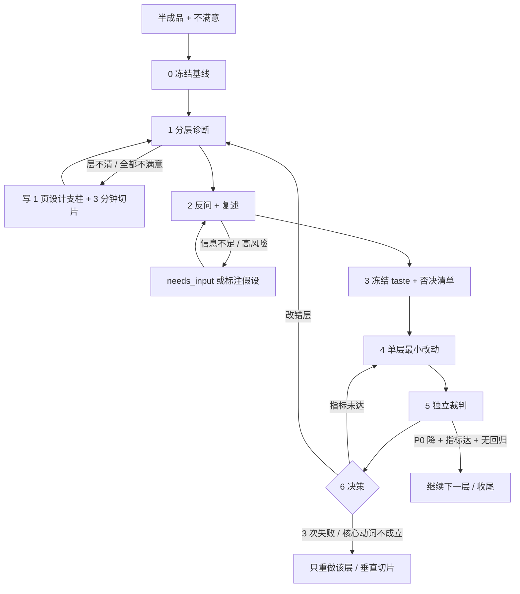

# AI 半成品游戏抢救手册：4 招拆成可执行 SOP

> **一句话结论**：半成品不是“推倒重来”，而是**先分清坏在哪一层 → 问清意图 → 冻结 taste/否决清单 → 只改这一层 → 让没参与的 AI 独立裁判 → 用证据决定继续/回滚**。
>
> 来源：B 站《AI给的半成品差点意思？4招妙手回春！》，UP @TP制造好游戏，嘉宾 Rinorsi（@云诺羲），时长 3:51，案例《烬谷盗火录》。视频地址 <https://www.bilibili.com/video/BV1AVs461EFQ>（短链 <https://b23.tv/VmLeMCN>）。**访问日期：2026-11-21**。
>
> 边界：本文只做调研、SOP 与模板，**不修改任何游戏代码/资产**；不复制《烬谷盗火录》的画面、素材或 UI；视频原话与本文推断逐条区分。

---

## 0. 结论（先读）

1. **“只改一层”是整套方法的核心。** 半成品最常见的死法不是缺功能，而是一次同时重做玩法、画面、剧情，导致无法判断哪一步有效、也失去已有资产。
2. **先诊断，后动手。** 视频里的案例是“玩法成熟 ✓ / 2D 表现 ✗（美术占 80–90%、画风难统一）→ 换成更擅长的 2.5D”，改的是**表现层**，不是规则层。
3. **先问再生成。** 第一个问题不是“要什么风格”，而是“**第一眼希望玩家有什么感觉？**”；感受要再拆成手段和约束，否则“精致/高级”无法执行。
4. **否决清单比喜欢清单更像 taste。** 喜欢通常抽象、可被任何作品满足；否决带着具体方案、原因、证据和替代方案，能直接约束下一次生成。
5. **独立裁判要“程序独立”+“证据优先”。** 让没参与的 AI 先写看到了什么、再写 ≥3 个失败项、最后才打分；禁止开场表扬、禁止无证据评分、禁止实现者自评。
6. **AI 裁判不能判断“好不好玩”。** 它擅长可检查项（可读性、对比度、状态正确、崩溃、回归）；“手感/乐趣”要用视频说的“找五六个人玩一圈”或仓库的真人 playtest 验证。

### 快速开始（10 分钟版 vs 完整版）

| 场景 | 做什么 | 不做什么 |
| --- | --- | --- |
| 单个小问题（一张卡看不清、一个按钮错位） | 第 0–4 步 + 一页 taste 摘要 + 同机位 before/after | 不写长文档，不重做系统 |
| 一个新的半成品 demo | 第 0–6 步全跑；先 1 页支柱 + 3 分钟切片 | 不先堆内容/美术量 |
| 用户说“就是感觉不对” | 先做第 1 步（分层）与第 2 步（反问），必要时找 5–6 人试玩 | 不让 AI 猜“哪里不对”后直接大改 |
| 已经改了两轮还不对 | 停下来复盘：是否改错层；是否 3 次单层失败；再决定换层/只重做该层 | 不继续加码同一个错误方向 |

---

## 1. 取证：视频到底说了什么

> 取证方式：B 站 view/reply API 读取简介与置顶评论；yt-dlp 下载 480p（7.9 MB），ffmpeg 每 5 秒抽帧看烧录字幕与画面。B 站字幕接口在未登录时为空，因此时间点为**抽帧定位，误差约 ±5 秒**；视频为 AI 合成配音（画面 disclaimer：“TP 与受访者声音均为 AI 合成 · 内容来自作者本人访谈”）。

| # | 视频观点（转述/短引） | 视频里的具体说法与案例 | 时间点（约） | 本文验证/推断 |
| --- | --- | --- | --- | --- |
| 1 | **先分清不满意的是哪块** | “玩法、画面、剧情，哪块不满意就只改哪块”“第一步不是动手改”；案例：接手时是 2D，判断“玩法成熟 ✓、2D 表现 ✗（美术占 80–90%，画风很难统一）→ 换成更擅长的 2.5D” | 0:45–1:25 | **仓库验证**：与 T-018/T-019 吻合。Gridbound 核心循环可玩，但美术评审 5.0/10，失败项集中在卡面/单位/UI 可读性；只改视觉/UI 后指标提升，规则未动。见 §6。 |
| 2 | **开工前，先让 AI 问清楚** | “答完问题再开工，别让它先交一大堆”；十问第一题：“**第一眼希望玩家有什么感觉？**”作者回答：“我希望是，可爱，但不安”；还问“不喜欢什么样的”“可以告诉它参考什么” | 1:25–1:40 | **推断**：感受先行，但感受必须继续拆成手段（轮廓/色板/音效/交互）与约束（2D、分辨率、工期）；否则仍是形容词。对应模板 `ai-clarify-questions.md`。 |
| 3 | **否掉的东西留下来，就是你的 taste** | 案例：AI 方案“3D 低模角色 + 墨线描边 + 骨骼动画”，他的做法是 2D + 序列帧；“完全不如 2D 加序列帧做出来的强”；“每次‘不成功’都有价值”；置顶评论给出完整 taste 文档（3 段） | 1:40–2:15；3:10 | **视频观点 + 本文强化**：否决清单必须带**原因/证据/替代/重审条件**，否则只是情绪；见 §4 与 `ai-taste-doc.md`。 |
| 4 | **让 AI 互相挑刺，找中立裁判** | “AI 最大的问题：谄媚”“它肯定会说，你说得对”；流程：**开发者 AI 先做完一小段 → 玩家 AI 去体验、写报告 → 第三个 AI 当裁判**；案例：开发者 AI 认为“献祭让玩家变强也让敌人变强，有风险收益”，玩家 AI 反驳“我发现不献祭更容易通关，我就不献祭了”，随后改为“献祭不删，改到让人想献祭（神谕改变打法，贪得越多，夺回的火越多）”；“自己说不出来哪里不好 → 交给五六个人玩一圈” | 2:15–3:15 | **推断**：三个角色 = 生产者 / 体验者 / 裁判；独立性是**程序独立**，同模型仍有共同盲区。AI 裁判适合可验证项；“乐趣/手感”交真人。见 §5。 |

### 1.1 置顶评论里的 taste 文档（公开，作者允许参考）

置顶评论（rpid `324450717360`）下由 UP 主分 3 条发布完整版。视频里给出的**精简 5 条**是：

1. **感受 → 手段 → 约束**：先说清想让玩家感到什么。
2. **“精致、高级”不是规格**，要拆成具体关系。
3. **参考作品写清：取什么、为什么、什么不取。**
4. **每个新内容：强化了哪条支柱？删掉会失去什么？**
5. **评审先说看到了什么，再说哪个设计导致了问题。**

完整版还包含：理解意图（先定位“太糙”到底指素材精度/动作过程/视觉语言/因果）、分析参考（美术观察与玩法观察）、组织整体（用少量设计支柱约束取舍）、默认偏好（视觉/玩法/演出/完整性）、评审与取舍、表达与教学、输出要求（先结论，区分用户要求/事实/推断/建议）。

> **本文的处理**：只提炼结构，不整段复制。`docs/templates/ai-taste-doc.md` 是压缩成“一页 worker 可粘贴版”的原创模板，并在文首注明参考来源。

---

## 2. 半成品抢救 SOP（7 步）



### 第 0 步：冻结现状（没有基线就没有“改好了”）

保存以下内容，后续所有判断都以它为对照：

- 构建版本/commit、随机种子、分辨率、**目标显示尺寸**（玩家实际看到的尺寸）与 25% 缩略图；
- 3 张图：全景、问题局部 100%、关键交互态；
- 1 段 10 秒左右的录屏（含问题发生瞬间）；
- 性能：平均 FPS 不够，至少记录 **p95 帧时间/最差帧**；
- 用户原话（“太糙/不够爽/不知道在干嘛”），不要先翻译成方案；
- 现有资产/规则/剧情中**明确要保留**的东西。

> 仓库落点：`docs/shots/`、`docs/迭代记录.md`、对应 demo 的 `TECH.md`。没有 before 证据的“优化”一律不算验收。

### 第 1 步：分层诊断（只选一层）

先问三个问题：

1. **玩家实际看到/做了什么？**（证据，不是评价）
2. **哪个具体设计导致了它？**（因果）
3. **如果只动这一层，最坏会损失什么？**（取舍）

#### 症状 → 层 → 只改该层的动作

| 症状（用户原话/观察） | 先补的证据 | 层 | 只改该层的动作 | 不要动 |
| --- | --- | --- | --- | --- |
| “不知道下一步做什么” | 首次游玩录屏，首次操作时间 | 玩法/引导（若目标缺失）或 UI（若目标有但看不见） | 加一个明确目标 + 一个可感知反馈；或把目标放到视线中心 | 不要先重画场景 |
| “有操作，但没选择/无聊” | 3 分钟重复动作、选择次数 | **玩法** | 改**一个**核心动词的风险/收益或反馈节奏；做单变量规则测试 | 不要加内容量/换皮 |
| “看不清/糊/不高级” | 目标尺寸截图 + 25% 缩略 + 对比度/字号 | **画面** | 对比度、字号阶梯、剪影、焦点、色板、材质统一 | 不要改规则/数值 |
| “风格杂/像拼的” | 同屏 3 个元素的线宽/色相/材质 | **画面（一致性）** | 统一线宽/材质/色板/字体；建立 1 个视觉母版 | 不要重做玩法 |
| “不知道发生了什么/为什么死” | 死亡前 3 秒录屏 | **反馈**（画面 + 玩法边界） | 预警、命中反馈、状态文案、因果提示 | 不要先改数值 |
| “剧情跳/人物没动机” | 关键情节点 3 句话复述 | **剧情** | 补因果节拍、角色目标、关键台词；先改 3 个节点 | 不要换美术 |
| “卡/掉帧/加载慢” | p95 帧时间、draw call、加载分阶段 | **性能/技术** | profile → 定位热点 → 降负载/批处理/分级 | 不要先砍内容 |
| “操作不跟手/有延迟” | 输入到反馈的帧数 | **手感/技术** | 输入缓冲、动画取消窗口、帧时间 | 不要改美术方向 |
| “UI 信息找不到/重复” | 任务完成路径、信息出现次数 | **UI/信息** | 信息层级、去重、状态机、空态 | 不要改玩法 |
| “AI 做的不是我想要的” | 反问记录、taste 文档 | **需求层** | 先补 taste/反问，再生成 | 不要继续盲生成 |
| “整体都差” | 能否用一句话说清“玩家重复做什么” | **设计支柱缺失** | 写 1 页支柱 + 3 分钟垂直切片，再重新诊断 | 不要直接重写全部 |
| “这里有个 bug/崩了一次” | 复现步骤 | **技术** | 复现 → 修复 → 回归 | 不要重做 |

> 视频只给了“玩法/画面/剧情”三层；**性能/技术、手感/反馈、UI/信息**是本文为仓库 demo 增加的诊断层。它们经常伪装成“画面不好”，但根因不同。

#### 什么情况**不要**推倒重来

- 核心动词已被至少 3 个目标玩家理解，并能重复玩 3 分钟；
- 失败项集中在**一层**，且可用参数/局部替换/局部重画解决；
- 现有资产、规则、剧情中至少有一项明确值得保留；
- 你有 before/after 证据，能证明问题在收窄；
- 问题是单点 bug，不是系统性设计缺失。

#### 什么情况**才考虑**重做（而且优先只重做该层）

- 目标玩家 3 分钟后说不出“我在玩什么/为什么继续”；
- 核心动词缺失，或每次修改都在改规则而不是改表现；
- 同一层做了 3 次**单层**迭代仍无改善；
- 平台/性能/版权/工期是硬约束，当前方案不可解；
- 目标玩家/品类已经改变（这时是新产品，不是抢救）。

> **“全都不满意”通常不是四个问题，而是缺一条设计支柱。** 先停下来写 1 页“玩家是谁、重复做什么、为什么继续、什么不能牺牲”，做一个 3 分钟切片再诊断；不要用“全重做”代替诊断。

### 第 2 步：先问清楚（开工前）

把 `docs/templates/ai-clarify-questions.md` 贴给 worker。最少问清 7 项：

1. **目标玩家/场景**：谁、在什么设备、单次多久、为什么玩？
2. **第一眼感受**：希望玩家第一眼感到什么？用 3 个具体场景说明。
3. **核心动词**：玩家重复做的一个动作是什么？失败/成长如何改变它？
4. **参考**：1–3 个作品；每个写“取什么/为什么/不取什么”。
5. **非目标**：这次明确不做什么（玩法/内容/平台/美术）。
6. **验收**：目标尺寸/25% 缩略/性能下，哪些可观察指标？阈值多少？
7. **约束/禁忌**：时间、预算、性能、版权、品牌、不可妥协项。

**Worker 在实现前必须先复述 5 行**：

```text
我理解你要的是：____
这次只改的层：____
我不改的：____
验收口径：____
主要风险/假设：____
```

- **能问就问**：交互式任务，答完再开工；不要“先交一大堆”。
- **不能问就标注**：异步 worker 必须把假设写成“假设 + 依据 + 置信度”；高风险（改玩法/叙事方向、引入新资产/依赖、版权）→ 返回 `needs_input`，不要硬做。
- **视频的第一题是感受，不是风格**：“可爱，但不安”还要继续拆成轮廓/色板/音效/镜头/交互，才能变成规格。

### 第 3 步：冻结 taste 与否决清单

用 `docs/templates/ai-taste-doc.md`。本次任务只冻结 **3–5 条不可妥协项 + ≥3 条已否决方案**，不要把所有偏好都塞进 prompt。

**为什么否决清单比“喜欢清单”更能传递 taste？**

| 维度 | 喜欢清单 | 否决清单 |
| --- | --- | --- |
| 具体性 | “要精致/高级/有设计感” | “不要 3D 低模 + 墨线描边 + 骨骼；目标尺寸下不如 2D 序列帧” |
| 因果 | 只给结果 | 带原因和证据，AI 能推广到新方案 |
| 边界 | 告诉 AI 往哪走 | 告诉 AI **哪些 trade-off 不能做** |
| 可测试 | 难验收 | 新方案可逐条对照“是否踩了旧否决” |
| 差异化 | 容易变成通用参考 | 你的取舍是别人抄不走的 taste |
| 成本 | 一条抽象偏好要反复解释 | 一行否决阻止一整条错误分支 |

**否决条目的最小 schema**：

```text
日期 | 层 | 被否方案 | 否决原因（证据） | 保留/替代 | 重审条件
```

例（通用示例，不是《烬谷盗火录》素材）：

```text
2026-11-21 | 画面 | 把角色改成 3D 低模 + 描边 + 骨骼动画 | 目标尺寸 1280×720 下轮廓/表情辨识不如 2D 序列帧，成本更高 | 保留 2D 序列帧，先统一线宽/色板 | 镜头可自由旋转或需要 8 方向时重审
```

**写作规则**：

- 每条否决必须写“为什么”和证据（截图/数值/试玩反馈）；只写“不喜欢”等于没写。
- 形容词必须拆成关系：不是“更高级”，而是“标题与背景对比 ≥7:1、信息层级 3 档、同屏材质不超过 2 种”。
- 区分 **硬否决**（不可妥协）与 **暂缓**（本阶段不做）；暂缓要写重审条件。
- 否决清单是 append-only：不删旧条目，标记“已被替代/过期”，保留时间与原因。
- 项目明确要求优先于通用偏好；不要把某款游戏的画风/系统机械套过来。

### 第 4 步：单层最小改动

- **Scope lock**：列出本次允许改的文件/场景/资产；写清“不改清单”。
- **一个假设、一个指标、一个时间盒**：例如“只改卡面字号/对比，目标名称对比度 ≥7:1，时间盒 2 小时”。
- **不做顺手重构**、不加新功能、不改其他层的行为；需要改第二层 → 拆 follow-up，不混在一个任务里。
- **保留回滚点**：commit/tag/备份；改动前先跑一次 smoke。
- **同机位证据**：before/after 使用相同分辨率、相机、种子、交互态。

> 仓库分工：视觉文件归 `game-artist`，玩法/性能文件归 `game-engineer`；并行前先声明文件所有权。不要让工程师顺手改美术方向，也不要让美术顺手改规则。

### 第 5 步：独立裁判

**三角色协议**（对应视频的开发者 AI / 玩家 AI / 第三个 AI）：

1. **生产者**（game-artist / game-engineer）：按 scope lock 做完一小段，提交构建与证据，**不写“我觉得很好”**。
2. **体验者**（fresh context 的 player AI 或真人）：只体验/阅读，写“我看到了什么、哪里卡住、我为什么继续/退出”，不改代码。
3. **裁判**（未参与制作）：拿到匿名化构建/截图/录屏 + rubric + taste 文档；**先写 ≥3 个失败项与证据，再打分**；给 verdict 与“未评估项”。

**裁判 prompt 必须包含的 6 条规则**：

1. 先描述实际看到/玩到什么（文件、时间码、截图区域、像素/数值）。
2. 再列失败项（P0/P1/P2），每项必须有证据、影响、最小修复方向。
3. 按 rubric 逐维打分；没有证据的维度标“证据不足”，不得猜。
4. 最后给 `APPROVE / CONCERNS / REJECT`，并单列“未评估项”。
5. **禁止**开场表扬、用“高级/不错”代替证据、用平均分掩盖 P0。
6. **禁止**修改代码/资产；裁判只判断，不实现。

**盲评与反谄媚**：

- A/B 对比时匿名标签、随机顺序、隐藏作者；裁判先分别打分，再揭晓。
- 不问“这好不好？”，改问“哪些问题会阻止放行？”；要求裁判给出反方证据。
- 同模型裁判仍有共同盲区：用不同角色/不同上下文/不同模型，最好再叠一次真人试玩。
- 如果裁判找不出任何问题，视为**无效评审**，不是“通过”。

**评分锚点（通用）**：1–2 不可用；3–4 原型；5–6 可玩 demo；7–8 可外放；9–10 标杆。每个项目必须显式写门槛（如外放 7.0）。

**按层选裁判**：

| 层 | rubric 维度（示例） | 证据 |
| --- | --- | --- |
| 画面/UI/VFX | 目标尺寸可读性、25% 缩略、层级、一致性、VFX 时机、合规与原创 | 同机位截图、局部 100%、视频抽帧、对比度/字号 |
| 玩法 | 核心动词清晰度、选择深度、反馈闭环、难度曲线、重玩 | 3 分钟录屏、选择次数、试玩记录 |
| 剧情 | 因果、动机、节奏、世界观一致性、传达 | 关键节点复述、台词/演出录屏 |
| 性能 | p95 帧时间、最差帧、加载、内存、稳定性 | profile、日志、设备参数 |
| UI/信息 | 任务完成率、状态清晰、错误预防、空态 | 任务路径录屏、状态矩阵 |

### 第 6 步：决策（继续/回滚/换层/停止）

| 裁判结果 | 动作 | 记录 |
| --- | --- | --- |
| P0 数量下降 + 目标指标达标 + 无回归 | 继续下一层或收尾 | 更新 before/after 与残留问题 |
| 指标持平，但方向有证据 | 允许**一次**更聚焦的单层改动 | 写清为什么再试一次 |
| 指标变差或出现 P0 回归 | 回滚该次改动，重新诊断 | 保留失败记录，进入否决清单 |
| 改了两轮仍无改善 | 检查是否改错层；换层诊断 | 不要继续加码 |
| 同一层 3 次单层迭代失败 | 只重做该层（或做垂直切片），不是全盘重写 | 写重做范围与保留资产 |
| 核心动词在目标玩家处不成立 | 停止修补；重做 3 分钟垂直切片 | 这是产品问题，不是美术问题 |
| 证据不足/无法判断 | 设计成本最低的区分实验（A/B、单变量） | 不要凭感觉拍板 |

---

## 3. 角色映射：本仓库什么时候用谁

| 场景 | 角色 | 输入 | 输出 | 不能做什么 |
| --- | --- | --- | --- | --- |
| 画面/UI/VFX 评审 | `game-art-director` | 目标尺寸截图、25% 缩略、before/after、taste 文档、rubric | P0–P2 + 参数 + `APPROVE/CONCERNS/REJECT` | 不改代码/资产 |
| 功能/回归/放行 | `game-qa-lead` | 构建、smoke、验收口径、证据包 | 可复现 bug、基线数据、放行/打回 | 不定美术方向 |
| 美术+QA 签字后的对抗审查 | `game-red-team` | 已签字构建、证据包、文档 | 可复现的质量/证据/性能/逻辑/文档问题 | 不直接修 |
| 玩法/剧情意图与体验 | `game-designer` | 设计规格、构建、试玩记录 | 体验缺口、优先级、验收口径 | 不写代码/不做独立美术评审 |
| 实现 | `game-artist` / `game-engineer` | brief、scope lock、taste 文档 | 可运行改动 + 自测 + before/after | 不自我批准 |
| 最终拍板 | 人类 owner / 主 Agent | 裁判报告 + 证据 | 继续/回滚/停止 | 不被单一分数绑架 |

**推荐顺序**：

```text
Game Designer 规格 → Art Director brief（若涉及视觉）→ Game Artist 实现
→ Game Engineer 技术/性能 → Game QA 验收 → Art Director 独立复评
→（可选）Red Team 对抗 → 人类 owner 决策
```

- 一任务一角色；**实现者不能同时是裁判**。
- 裁判任务 JSON 必须写 `independent_of`，并拿到匿名化/同机位证据；不能看生产者的自评草稿。
- 视觉任务用 `game-art-director` 复评；功能/回归用 `game-qa-lead`；两者都签字后才用 `game-red-team` 做“找茬”。
- **“好不好玩/手感”**：AI 裁判只能给可检查代理指标；最终用 5–6 名目标玩家试玩（视频做法）或仓库的真人 playtest。

---

## 4. 落到 dispatcher：task JSON / prompt 建议（只给建议，不改代码）

### 4.1 建议新增字段

| 字段 | 类型 | 作用 | 必填 |
| --- | --- | --- | --- |
| `layer` | `visual`/`gameplay`/`narrative`/`performance`/`feel`/`ui` | 本次只改哪一层；禁跨层 | 是 |
| `taste_doc` | path | 项目 taste 文档路径/锚点 | 视觉/玩法任务必填 |
| `clarify_questions` | string[] | 开工前必须回答的问题 | 新任务必填 |
| `clarify_answers` | object | 回答；未回答的写 `assumptions` | 异步任务必填 |
| `scope_lock` | path[] | 允许改的文件/场景/资产 | 是 |
| `reject_log` | object[] | 本次必须遵守的已否决方案（≤10 条） | 视觉/玩法必填 |
| `judge` | object | 独立裁判配置（agent/independent_of/blind/rubric/threshold/evidence） | 视觉/玩法/发布任务必填 |
| `acceptance` | string[] | 可观察指标/阈值 | 是 |
| `baseline` | path[] | 第 0 步证据 | 是 |
| `rollback` | string | 回滚方式（revert scope_lock paths） | 是 |

### 4.2 task JSON 示例

```json
{
  "id": "T-20261121-XXX",
  "layer": "visual",
  "taste_doc": "docs/templates/ai-taste-doc.md#gridbound",
  "clarify_questions": [
    "目标尺寸与 25% 缩略下，玩家第一眼必须读到什么？",
    "这次明确不改哪些规则/系统？",
    "验收指标与阈值是什么？"
  ],
  "clarify_answers": {
    "target": "1920×1080 + 480×270 缩略；费用/攻血/效果一眼可读",
    "non_goals": ["不改卡池/规则/AI/棋盘拓扑"],
    "acceptance": ["卡名对比度 ≥7:1", "描述 ≥4.5:1 且 ≥10px", "悬停 0 裁切"]
  },
  "scope_lock": [
    "godot-card-tactics/scripts/card_view.gd",
    "godot-card-tactics/scripts/hud.gd"
  ],
  "reject_log": [
    {"layer": "visual", "idea": "整体换皮/重画所有卡框", "why": "成本高且会破坏已验证的阵营色骨架", "alt": "保留 CC0 卡框，只改层级/对比/字号", "revisit": "卡框资产更换时"}
  ],
  "judge": {
    "agent": "game-art-director",
    "independent_of": ["game-artist"],
    "blind": true,
    "rubric": "docs/art-review/gridbound-art-review.md#1-分数表",
    "evidence": ["1920x1080", "480x270", "before_after", "mp4"],
    "pass_threshold": 7.0,
    "problems_first": true
  },
  "acceptance": [
    "P0 数量下降且无新增 P0",
    "卡名对比度 ≥7:1",
    "目标尺寸/缩略图同机位 before/after"
  ],
  "baseline": ["docs/shots/before_1920.png", "docs/shots/before_480.png"],
  "rollback": "revert scope_lock paths"
}
```

### 4.3 Prompt 注入顺序（建议）

1. 任务目标 + **非目标**；
2. `layer` + `scope_lock` + “不改清单”；
3. `taste_doc` 摘要（≤40 行，把否决清单放前面）；
4. `clarify_answers` 或“假设 + 置信度”；
5. `reject_log`（≤10 条，带原因）；
6. `baseline` + `acceptance`；
7. **裁判 prompt 不注入生产者**；裁判任务单独入队，拿匿名证据。

### 4.4 建议的 worker 行为

- `layer` 缺失 → 先返回分层诊断与证据，不写代码。
- `clarify_questions` 未答且风险高 → 返回 `needs_input`，列 1–3 个问题；不硬做。
- `baseline` 缺失 → 先拍 before，再改。
- 判断“需要改第二层” → 拆 follow-up（parent/child），不在本任务混改。
- 裁判输出**只读**：生产者不能修改裁判报告；有异议 → 再找一个裁判或做区分实验。
- `git_publisher` 只提交 `commit_paths` 声明的路径；裁判文档一并提交。
- 验收 **fail closed**：缺 before/after、缺独立裁判、越界改动 → 直接打回。

---

## 5. Dry-run：用 Gridbound 卡面演示“只改一层”

> 真实仓库案例：`godot-card-tactics/`（Duelyst 式卡牌战棋，CC0 资产、原创规则/UI）。T-018 独立美术评审 5.0/10；T-019 按 P0 整改。以下数字来自 `docs/art-review/gridbound-art-review.md` 与 T-019 结果。

### 5.1 诊断（第 1 步）

| 用户/评审原话 | 证据 | 层 | 决策 |
| --- | --- | --- | --- |
| “卡面看不清、不够高级；单位跟格子融在一起” | 总评 5.0/10；卡名 11px、亮斑处 **1.62:1**；描述 8px、**4.22:1**；11 个单位中 **9 个**中位对比 <3:1；攻击格 ΔL* **0.0**；悬停中卡底部超出 **16px** | **画面/UI（表现层）** | 只改卡面/单位/UI/VFX；**不改卡池、规则、AI、棋盘拓扑** |

**为什么不是玩法层**：费用/攻血徽章可读、核心循环能走通、玩家能完成出牌-走位-攻击；失败项是“同一规则下的可读性/层级”，不是“没有选择/没有反馈闭环”。所以不应趁机重做规则。

### 5.2 反问（第 2 步）

- 目标玩家/场景：卡牌战棋玩家，1920×1080 与 25% 缩略图、B 站/商店页截图。
- 第一眼感受：**“一眼读懂费用/攻血/效果，像成熟卡牌游戏”**；不是“更华丽”。
- 核心动词：出牌 → 走位 → 攻击 → 结束回合。
- 参考：成熟卡牌游戏的**信息层级**（取：费用/攻血/效果三档；不取：具体画风/品牌资产）。
- 非目标：不改卡池/规则/AI/棋盘；不引入版权素材；不使用 Duelyst 品牌。
- 验收：卡名 ≥7:1、描述 ≥4.5:1 且 ≥10px、悬停 0 裁切、25% 下费用/攻血可辨、无新增 P0。

### 5.3 Taste/否决（第 3 步）

本次冻结的否决项（示例）：

| 层 | 被否方案 | 原因 | 保留/替代 | 重审条件 |
| --- | --- | --- | --- | --- |
| 画面 | 整体换皮/重画所有卡框 | 成本高，且会破坏已验证的阵营色骨架 | 保留 CC0 卡框，只改层级/对比/字号 | 卡框资产整体更换时 |
| 画面 | 加更多纹理/光效来“显得高级” | 会与文字争注意力，目标尺寸下更糊 | 先做对比/留白/字号阶梯 | 可读性达标后 |
| 画面 | 把卡面做成 3D/写实 | 目标尺寸/缩略图下辨识与成本不划算 | 2D 卡面 + 清晰层级 | 视角/平台变化时 |

### 5.4 单层最小改动（第 4 步）

- **Scope lock**：`card_view.gd`（字号/对比/描边/悬停）、HUD 状态文案、VFX 时长/命中帧；**不碰**规则/AI/卡池/棋盘拓扑。
- 一个假设：放大字号 + 提高对比 + 去掉过重描边，能在不换皮的前提下解决可读性。
- 时间盒：1 轮；同机位 before/after；先跑 smoke。

### 5.5 证据（第 5 步）与结果

| 指标 | Before（T-018） | After（T-019） |
| --- | --- | --- |
| 卡名对比度 | 1.62:1 → 整改前 1.83:1 | **10.20:1** |
| 描述对比度 | 4.22:1 → 4.97:1 | **7.20:1** |
| 悬停裁切 | 16px（1280）/24px（1920） | **0** |
| 攻击格 ΔL* | 0.0 | **+7.8**（环+箭头+24%） |
| 单位中位对比 ≥3:1 | 2/11 | **11/11** |
| 外放 P0 | 3 项 | 0 项（内部可玩） |

**独立裁判**：`game-art-director` 按 T-018 同一 rubric 复评，先列失败项再打分；结论是内部可玩成立，但仍有残留：`<1.5:1` 占比 2/11、系统字体未内置、未做 5 人盲测、悬停详情面板未实现 → **下一轮只做这些残留项，不推倒重来**。

### 5.6 反事实：如果抱怨的是“战斗无聊”

- 分层诊断 → **玩法层**（不是画面）：症状是“有操作但没选择/重复 3 分钟无新决策”。
- 动作：`game-designer` 加一个单变量规则测试（例如给一个风险/收益取舍），3 分钟切片 + 5–6 人试玩；**不要**先改卡面。
- 如果这时改卡面，就是典型的“改错层”：画面变好，但“无聊”不会消失，还会浪费一轮预算。

---

## 6. 反例：半成品抢救的 10 个失败模式

| 反例 | 症状 | 后果 | 正确做法 |
| --- | --- | --- | --- |
| 一上来“推倒重来” | 觉得哪都不对，直接新建工程 | 丢掉已验证的核心/资产，无法归因 | 先分层；只重做失败层；保留可用资产 |
| 把“精致/高级”当规格 | brief 只有形容词 | AI 加纹理/光效，越做越糊 | 拆成对比度、字号、层级、材质数量等可测关系 |
| 让实现 AI 自评 | “我觉得已经很好” | 谄媚/盲区，P0 被放过 | 独立裁判 + rubric + 证据；实现者不签字 |
| 裁判只看总分 | 平均 6.8 就放行 | P0 被平均分掩盖 | **先列 P0/P1/P2**，再打分；P0 未清不放行 |
| 没有 before 基线 | 只发 after 截图 | 无法证明改好了，也无法回滚 | 第 0 步：同机位、同尺寸、同种子 |
| 一次改多层 | 玩法+画面+剧情一起动 | 不知道哪步有效，回归难定位 | scope lock；一层一个假设；跨层拆 follow-up |
| 否决只写“不喜欢” | 没有原因/证据 | 下一次 AI 还会提同样的方案 | 每条否决带原因、证据、替代、重审条件 |
| 用 AI 裁判判断“好不好玩” | 让模型给“乐趣分” | 分数不可信，误导方向 | AI 判可检查项；乐趣用真人试玩 |
| 机械套用参考 | 视频说 2.5D，就所有项目都 2.5D | 忽略本项目目标/约束 | 参考写“取什么/为什么/不取什么”；项目要求优先 |
| 指标平均化 | 平均 FPS 60，但关键帧卡顿 | 掩盖最差体验 | 记录 p95/最差帧、关键事件停顿、25% 缩略可读性 |

---

## 7. 验收清单（可直接贴进 task JSON `acceptance`）

- [ ] 第 0 步基线已保存：目标尺寸 + 25% 缩略 + 10s 录屏 + 种子 + p95 帧时间。
- [ ] 只声明了**一层**，并写了症状、证据、因果。
- [ ] `clarify_questions` 已答，或假设已标注依据/置信度；高风险无回答 → `needs_input`。
- [ ] taste 文档含 3–5 条不可妥协项，每条有测试方法。
- [ ] 否决清单 ≥3 条，每条有原因/证据/替代/重审条件。
- [ ] `scope_lock` 列出允许改的文件；“不改清单”明确。
- [ ] 单层改动只有一个假设、一个指标、一个时间盒。
- [ ] 没有越界改动（diff/资产审计通过）。
- [ ] before/after 同机位、同尺寸、同种子。
- [ ] 独立裁判 ≠ 实现者；盲评；先问题后分；证据完整；verdict + 未评估项。
- [ ] P0 数量/目标指标与 before 对比；残留问题记录在案。
- [ ] 决策已记录（继续/回滚/换层/只重做该层/停止）。
- [ ] 涉及“乐趣/手感”时，有 5–6 名目标玩家试玩或等价真人证据。
- [ ] 版权/商标/资产来源检查通过；未复制参考游戏素材/品牌。

---

## 8. 模板与配套文件

| 文件 | 用途 | 直接粘贴到 worker prompt？ |
| --- | --- | --- |
| `docs/templates/ai-taste-doc.md` | 一页 taste + 否决清单 | 是（截取项目段） |
| `docs/templates/ai-clarify-questions.md` | 开工前 7 问 + 5 行复述 | 是 |
| `docs/templates/ai-judge-prompt.md` | 独立裁判 prompt + rubric 骨架 | 是（发给裁判 agent） |
| `docs/ai-half-finished-rescue-playbook-交互版.html` | triage 向导 / 否决清单编辑器 / 裁判 rubric 预览 | 浏览器打开，无需服务器 |
| `docs/shots/ai-rescue-playbook-hero.png` | 交互版首页实拍（结论先行 + 抢救循环） | 否（展示/验收证据） |
| `docs/shots/ai-rescue-playbook-tools.png` | 交互版工具实拍（triage / taste 编辑器 / 裁判 rubric） | 否（展示/验收证据） |

> **v1.1（T-20261121-041）新增**：交互版、2 张实拍截图、交互自测（12 症状 / 2 条示例否决 / 5 套 rubric（视觉 7 维）/ 0 控制台错误）。正文 SOP 与 v1.0（T-028）一致；本版只补交付物与证据，不改方法结论。

---

## 9. 来源与取证记录

### 9.1 视频

| 项 | 内容 |
| --- | --- |
| 标题 | 《AI给的半成品差点意思？4招妙手回春！》 |
| UP 主 | TP制造好游戏（mid 600477837） |
| 嘉宾 | Rinorsi（@云诺羲） |
| 案例 | 《烬谷盗火录》（仍在打磨，未正式上线） |
| 时长 | 3:51（231s） |
| 发布 | 2026-11-19 |
| 地址 | <https://www.bilibili.com/video/BV1AVs461EFQ>；短链 <https://b23.tv/VmLeMCN> |
| 访问日期 | 2026-11-21 |
| 取证方式 | view API 取标题/简介/时长/发布；reply API 取置顶评论（rpid 324450717360）及 3 条子回复；yt-dlp 下载 480p 视频；ffmpeg 每 5s 抽帧确认烧录字幕/案例画面。未登录，B 站字幕接口为空，时间点误差 ±5s。 |

### 9.2 视频简介原文（4 个方法）

> 1. 先分清不满意的是哪块：玩法、画面、剧情，哪块不满意就只改哪块
> 2. 开工前，先让 AI 问清楚你要什么
> 3. 否掉的东西留下来：攒成否决清单，就是你的 taste
> 4. 让 AI 互相挑刺：怕 AI 谄媚，就找一个中立的 AI 当裁判

### 9.3 关键帧证据（抽帧定位）

| 时间（约） | 画面/字幕 |
| --- | --- |
| 0:05 | 接手时 2D 版 vs 改完后 2.5D 版；“朋友间的游戏接力 · 他接的是第三棒” |
| 0:35 | “拿到手的肯定是一个半成品” |
| 0:50 | “玩法成熟 ✓ / 2D 表现 ✗；2D 美术占 80–90%，画风很难统一 → 换成更擅长的 2.5D” |
| 1:05 | 方法一标题：“先分清不满意的是哪块；玩法、画面、剧情，哪块不满意就只改哪块；第一步不是动手改” |
| 1:25 | “十问 · 第一题：第一眼希望玩家有什么感觉？”回答：“我希望是，可爱，但不安” |
| 1:35 | 方法二标题：“开工前，先让 AI 问清楚；答完问题再开工，别让它先交一大堆” |
| 1:40–1:50 | 方法三：“AI 给的方案你不满意，一般怎么跟它说？”；AI 方案“3D 低模角色 + 墨线描边 + 骨骼动画” vs 他的“2D + 序列帧”；“完全不如 2D 加序列帧做出来的强” |
| 2:05 | taste 文档滚动；方法三：“每次‘不成功’都有价值” |
| 2:20 | 方法四：开发者 AI 先做完一小段 → 玩家 AI 去体验、写报告 |
| 2:35–2:50 | “AI 最大的问题：谄媚”“它肯定会说，你说得对”；开发者 AI：“献祭让玩家变强，也让敌人变强，这样就有风险收益了”；玩家 AI：“那我发现不献祭更容易通关，我就不献祭了呗？” |
| 3:05 | 改法：“献祭不删，改到让人想献祭；献祭给能改变打法的神谕，贪得越多，夺回的火越多”；“自己说不出来哪里不好 → 交给五六个人玩一圈” |
| 3:10 | taste 精简 5 条（感受→手段→约束；精致/高级不是规格；参考写清取/为什么/不取；新内容强化哪条支柱；评审先看到什么再原因） |
| 3:20–3:30 | 三版对比：接手时·前一棒 / 他这一棒·改到一半 / 作者最终版；“四招”总结；Q&A |

### 9.4 仓库内证据

| 文件 | 用途 |
| --- | --- |
| `docs/art-review/gridbound-art-review.md` | T-018 独立美术评审：5.0/10、P0、量化指标 |
| `docs/task-plans/game-demos.md` T-018/T-019 | 评审/整改任务记录与结果 |
| `docs/procedural-generation-teardown-交互版.html` | 交互讲义设计系统参考（CSS 变量/组件类） |
| `docs/task-plans/research-docs.md` T-20261121-028 | 本任务记录 |

### 9.5 观点与推断的边界

- **视频观点**：4 个方法、2D→2.5D 案例、3D 低模 vs 2D 序列帧、开发者/玩家/裁判三角色、献祭案例、5–6 人试玩、taste 精简 5 条——均来自视频简介、置顶评论或抽帧。
- **本文推断**：把“玩法/画面/剧情”扩成 6 层诊断；把否决清单 schema 化；把“独立裁判”落成 rubric/盲评/证据规则；把 dispatcher 字段与注入顺序作为建议；用 Gridbound 做仓库 dry-run。这些是方法迁移，不是视频原话。
- **未验证**：视频未给出 taste 文档的量化阈值；本文示例阈值（如 7:1/4.5:1）来自仓库既有评审口径，具体项目应按目标尺寸重新标定。
- **未复制**：未使用《烬谷盗火录》的任何截图/素材/UI；文中案例仅转述方法与结果。

---

*文档版本：2026-11-21（T-20261121-028）· 2026-11-22（T-20261121-041 补交互版/截图/复测）· 只做调研/模板，不改游戏代码。*
