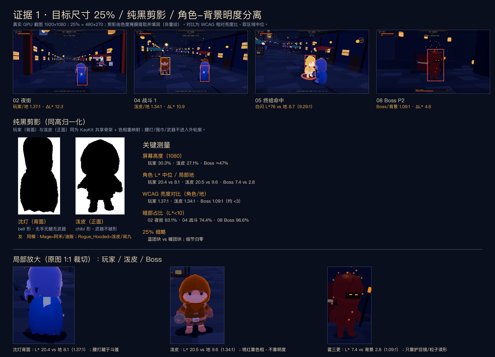
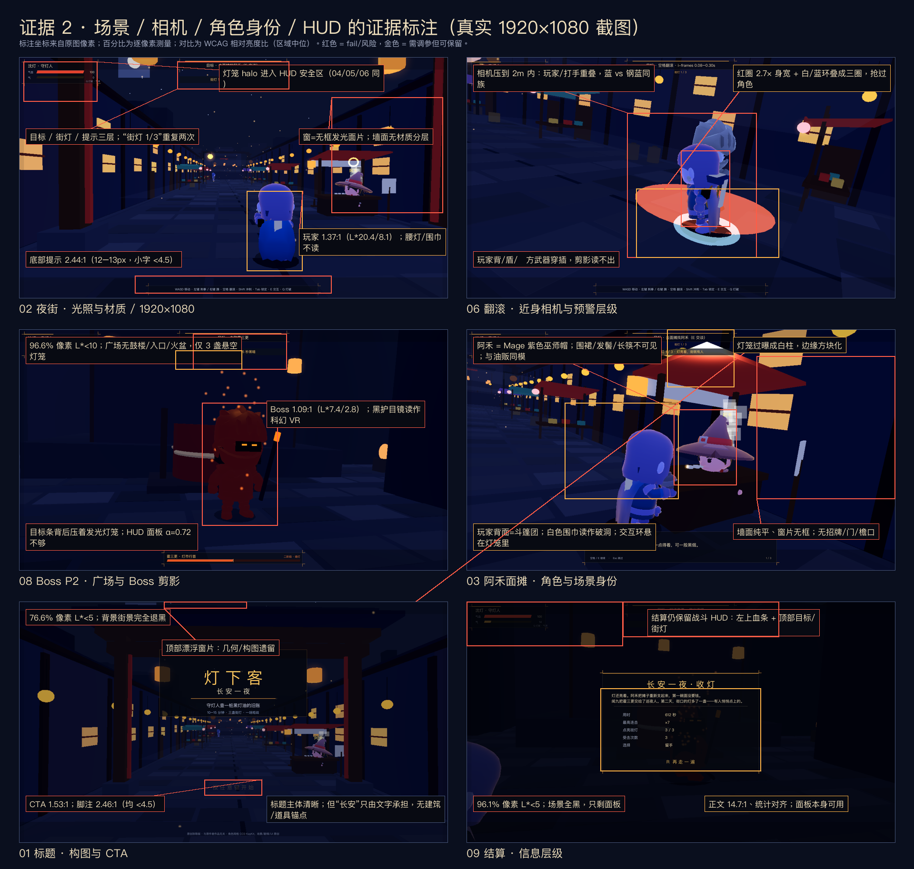
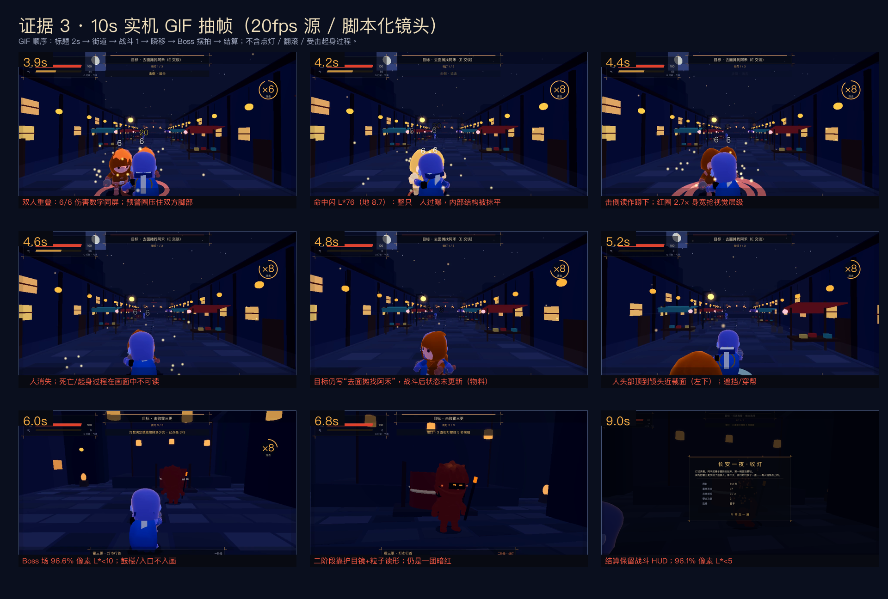

# 《灯下客 · 长安一夜》美术评审（T-20261121-043）

> 对象：T-20261121-025 交付的 `godot-changan-action/` 可玩 vertical slice（3 场战斗 + 三盏街灯 + 短 Boss，10–15 分钟）。
> 评审任务：T-20261121-043（T-025 follow-up）｜日期：2026-11-22｜阶段：内部可玩 vertical slice / 非商店页。
> 目标尺寸：1920×1080 实际截图 + 25%（480×270）缩略；内部渲染 1280×720、3D scale 0.65、GL Compatibility、Intel HD 6000。
> 边界：独立评审，未改 `godot-changan-action/` 代码/资产/文档；不复制原游戏/IP 素材；只读代码常量用于解释根因，不用代码替代画面判断。
> 代表证据：`docs/art-review/changan-action/01_readability_silhouettes.png`、`02_scene_hud_issues.png`、`03_gameplay_contact_sheet.png`；测量脚本 `docs/art-review/changan-action/measure_changan.py`。

## 一句话结论

**4.1 / 10 · 原型上沿 / 可玩 demo 下沿 · CONCERNS（内部可玩可接受）；按外放硬门槛 = REJECT。**
有效的是：夜街灯笼走廊的纵深与冷暖骨架、中文 HUD 的基本可读性、完整的战斗/任务状态与克制的性能预算。失败的是第一眼：**玩家/泼皮在纯黑剪影下是同一套身体，Boss 在 25% 只剩暗红团块**，角色/局部背景的亮度对比只有 **1.09–1.53:1**，Boss 是暗红一团；命中闪把敌人整只拉到 L*76、抹平结构；近身相机压到 2m、预警圈约 2.7× 身宽并三环叠加；HUD 被灯笼光斑穿透，结算仍保留战斗 HUD。**P0（剪影/明度/相机）未完成前，不可作为公开 demo 或商店页素材。**

## 证据：实际看了什么、怎么测

| 项 | 内容 |
| --- | --- |
| 输入 | 目标：1920×1080 + 25% 缩略；内部 1280×720、`scaling_3d/scale=0.65`、MSAA 0、无 FXAA、无阴影/glow/SSAO/SSR；Intel HD 6000、目标 30/20 fps。阶段：内部可玩。目标受众/美术 pillars/art bible：**NOT ASSESSED（未提供独立文档）**，本评审按任务 brief 的 6 个重点执行。 |
| 实际画面 | `godot-changan-action/docs/shots/01_title…09_results`（9 张真实 GPU 1920×1080）；`docs/gameplay.mp4`（1280×720 / 20fps / 10s / 200 帧）与 `gameplay.gif`（960×540 / 12fps）；GIF 以 4fps 与 10fps 抽帧看动作；25% 缩略全部 9 张；4× 局部：玩家背、泼皮、Boss、HUD、标题、面摊、窗墙；`06` 另做红色预警圈/蓝色角色 bbox 像素测量。 |
| 量化 | 逐像素 CIE L*、WCAG 相对亮度对比、L* 直方图、色度掩膜剪影（填洞/最大连通域）、屏幕 bbox 高度、字号/点击区、GIF 帧时序。所有数字可由 `measure_changan.py` 复现；角色对比取区域中位，UI 文本取 p99/中位。 |
| 只读代码 | `project.godot`、`hud.gd`（字号/颜色/α）、`world.gd`（环境/雾/灯/窗/emission）、`main.gd`（相机 4.2m/FOV 60、Boss 3.8m/FOV 55）、`CREDITS.md`、`assets_manifest.csv`；未改任何文件。 |
| 未评估 | 音频（无音频）、真实手感/长局、76 个 clip 全量、色盲模拟、掌机/电视安全区、4K/超宽、最终导出包字体、本地化行长、移动端。 |
| 自报与画面 | T-025 的 smoke 83/83、600 帧无 SCRIPT ERROR、37.4/25.0 fps 与 CC0 清单成立；本评审不重跑工程逻辑，只核对画面与自报数据的一致性。**证据物料是脚本化镜头（真实渲染），其中 4.8s 目标文本与战斗状态不同步、5.2s 镜头近裁面穿帮，属于展示物料问题，不直接判为玩法 bug。** |

### 1. 目标尺寸 + 剪影 + 局部（图 1）



- **25%（480×270）**：四张缩略里玩家是蓝色团块、泼皮是暖色团块、Boss 是暗红团块；三者的高度分别约为 81px / 73px / 127px，腰灯、武器、表情、领口全部不可读。最独立的是阿禾的尖帽；Boss 仅剩一条亮护目镜。
- **纯黑剪影**：玩家背面是 **167×327px 的 bell 形**，头/肩/斗篷连成一体，无手、无腿、无武器；泼皮正面是 **180×293px 的 chibi 形**，臂/腿可见但武器不破形。二者同源 KayKit 共享骨架（41 骨）与色相 shader。
- **角色 vs 局部地**：玩家 02 `L* 20.4 vs 8.1` → **1.37:1**；玩家 04 `24.6 vs 9.6` → **1.53:1**；泼皮 `20.5 vs 9.6` → **1.34:1**；Boss 08 `7.4 vs 2.8` → **1.09:1**。均低于“非文字元素 3:1”的参考线；可读性主要靠色相（蓝/锈红）而非明度。
- **命中闪**：05 的敌人整只 **L* 76.3（p90 91.1） vs 地 8.7**；与地的对比 9.29:1 很亮，但内部结构被抹平，像一只发光的黄白色气球。
- **Boss**：屏幕高度约 47%，但脸的黑护目镜是纯黑长条 + 两个橙色方块，读作科幻 VR 眼镜；角、披风、铁尺都不破形；只剩“红团 + 护目镜 + 橙点”。

### 2. 场景 / 相机 / 身份 / HUD 标注（图 2）



- **夜景暗部**：L*<10 的像素占比：02 夜街 **83.1%**、04 战斗 **74.4%**、08 Boss **96.6%**、09 结算 **96.1%**、01 标题 **94.4%**；L*40–100 只有 **0.5–7.8%**，且几乎全是 emissive 灯笼/窗/护目镜。画面不是“黑得高级”，是中间调缺失导致的平。
- **材质**：墙、地面、摊位、木梁在 25% 与 100% 读不出木/石/布/纸/金属差异；窗是无框的发光面片（03 右侧墙最明显），部分窗片浮在墙外；灯笼是过曝的黄色圆盘/白柱，没有纸骨、没有檐口；街灯灯头是一颗发光球。
- **场地**：08 的“鼓楼广场”在画面内看不到鼓楼、入口、火盆或围栏，只有 3 盏悬空灯笼 + 黑墙；广场的“场”没有建立。02 的牌楼只有两根红柱 + 直梁，既没有三间/檐口/匾额，也有鸟居既视感。
- **相机**：06 的 SpringArm 被压到很近：玩家与打手的头/身体重叠，蓝色玩家与钢蓝打手同族；红色预警椭圆约 2.7× 身宽（x≈756–1384），与白色翻滚环、蓝色环叠成三层，视觉层级压过角色本身；5.2s 帧里敌人头部顶到镜头近裁面（左下），画面被吞。
- **角色身份**：阿禾 = Mage 紫色尖帽；围裙/发髻/长筷在 100% 都不可见，与油贩（同一 Mage 网格）只差色相；泼皮与闻九同用 Rogue_Hooded。玩家腰灯被斗篷完全遮挡，白色围巾在背面读作一块破洞。
- **HUD**：目标条（17px）、街灯进度（12px）、教学提示（15px）是三层；02 把“街灯 1/3”重复了两次；04 的操作提示同时出现在顶部 toast 与底部常驻条；06 的顶部目标写成开发口径“空格翻滚 · i-frames 0.08–0.30s”；09 结算仍保留左上血条、顶部目标和街灯数。灯笼光斑会进入左上 HUD 与顶部目标条（04/05/06/08）。
- **标题**：76.6% 像素 L*<5，背景街景完全退黑；“按任意键开始” **1.53:1**、底部署名 12px **2.46:1**；y=0–22 有一条贴边浅蓝面片（疑似窗片几何），在 1920 标题构图里读作穿帮。

### 3. 10s GIF 抽帧（图 3）



GIF 的真实顺序是：标题 2s → 街道 → 战斗 1 → 瞬移 → Boss 摆拍 → 结算；**没有点灯、翻滚、受击起身过程**。具体问题：
- 3.9s 双人重叠，6/6 伤害数字同屏叠在头顶；4.2s 命中闪白化；4.4s 击倒读作蹲下；4.6s 敌人直接消失，死亡/起身不可读。
- 4.8s 已结束战斗，目标仍写“去面摊找阿禾”；这是脚本化镜头状态不同步。
- 5.2s 敌人头顶近裁面；6.0/6.8s Boss 摆拍，96.6% 像素 L*<10，二阶段只靠护目镜与橙点；9.0s 结算保留 HUD。
- 作为对外物料，它没有承担“展示战斗/点灯/Boss 机制”的职责；对 25% 读者只剩灯笼和色块。

## 分数表（权重合计 100%）

| 维度 | 权重 | 当前 | 外放门槛 | 目标 | 关键证据 |
| --- | ---: | ---: | ---: | ---: | --- |
| 1. 轮廓 / 剪影 | 15% | **3.5** | 7.0 | 8.0 | 纯黑剪影：玩家 167×327 bell 形，无手腿武器；泼皮 180×293，武器不破形；25% 只剩蓝/暖团块；Mage=阿禾/油贩、Rogue_Hooded=泼皮/闻九 |
| 2. 色彩与明度 | 12% | **4.5** | 7.0 | 8.0 | 冷夜蓝 + 暖灯金骨架统一；但 L*<10 占 74–97%、L*40–100 仅 0.5–7.8%，中间调缺失；窗/灯笼是发光面而非材质 |
| 3. 材质语言 | 10% | **3.0** | 6.5 | 8.0 | 木/石/布/纸/金属在 25% 与 100% 不可区分；窗无框、灯无骨、灯笼过曝成白柱；角色贴图是唯一有材质层的地方 |
| 4. 光照与氛围 | 10% | **5.0** | 7.0 | 8.0 | 灯笼走廊 + 月光 + 雾/星有夜街氛围（02/07 成立）；无实时影/接触光池/轮廓光；Boss 场 96.6%<L*10，无场地光 |
| 5. 构图与镜头 | 10% | **4.5** | 7.0 | 8.0 | 02 一点透视成立；06 近身相机重叠、5.2s 近裁面；08 广场空、无鼓楼；01 顶部贴边面片；HUD 压在灯笼上 |
| 6. 角色与动画 | 15% | **3.5** | 7.0 | 8.0 | 2 头身共享骨架；攻击/终结存在；命中闪抹平结构、击倒读作蹲下、GIF 无翻滚/起身、无武器拖尾 |
| 7. UI 可读性 | 10% | **5.0** | 7.0 | 8.0 | 正文 13.05–14.68:1 通过；CTA 1.53:1、脚注 2.46:1、底部提示 2.44:1；目标/街灯/提示重复；结算留 HUD；系统字体跨平台 |
| 8. 风格统一性 | 8% | **5.0** | 7.0 | 8.0 | 金/纸/夜蓝一致；巫师尖帽、科幻护目镜、现代括号 UI 与唐风街市冲突；牌楼/窗/灯三套语言 |
| 9. 模块化 / 系统可读性 | 10% | **4.0** | 7.0 | 8.0 | 色相键是有效变体系统；但只换色不换形；友/敌同模；任务环/锁定菱形/血条仍可读；道具在 25% 归零 |
| **合计** | **100%** | **4.1** | **7.0** | **8.0+** | 原型上沿/可玩 demo 下沿；内部可玩，外放未达 |

### 可保留的优点（最多 4 条，不抵消失败项）

1. **夜街纵深是全场最强的视觉**：02/07 的灯笼节奏、暖冷对比、雾与星点把“长安灯市”的氛围立住了，构图也能一眼读出街的走向。
2. **HUD 的骨架干净**：气血/气/连击/目标/街灯/锁定/对话都有，正文对比 13–14.7:1，金色/纸白的古意远比默认引擎 UI 好。
3. **工程与许可纪律好**：CC0 KayKit + manifest + CREDITS + 无参考游戏素材；54 盏 emissive 灯笼压在 ~198 draw calls / 56.6k tris、3 盏实光，37.4/25.0 fps，是能被美术继续加料的底座。
4. **战斗系统齐全**：终结、hitstop、伤害数字、连击、锁定、预警、击倒/起身、三盏街灯影响 Boss 黑暗时长——系统已经在，缺的是把系统翻译成可读形状。

### 外放硬门槛（默认口径）

| 门槛 | 结果 | 证据 |
| --- | --- | --- |
| 25% / 纯黑剪影可辨主要角色、动作、武器；阵容不是同一人换色 | **FAIL** | 三团块同形；武器/腰灯不破形；友/敌同模；见图 1 |
| 角色 vs 背景明度/轮廓分离（参考 ≥3:1 或 ΔL*≥20） | **FAIL** | 1.09–1.53:1；ΔL* 4.6–12.3 |
| 接触影 | **PASS（有但粗糙）** | 每个角色有 blob shadow；尺寸/位置未跟地形细化，见 04/06 |
| UI 小字 ≥4.5:1、点击 ≥32px | **FAIL** | CTA 1.53、脚注 2.46、底部提示 2.44；点击区未实测（无触屏目标） |
| 8 向 / 4 动作在 GIF 可读 | **N/A（3D 无 8 向）/ FAIL（动作）** | GIF 无翻滚/受击起身；击倒不可读；命中闪抹平 |
| 干净舞台 / hero 截图（非工具 UI） | **FAIL** | 08 Boss 场无玩家/无建筑；01 黑；无一张“角色 + 灯笼 + 三灯 + Boss”的 hero |
| 目标机型帧率 | **PASS（有保留）** | 37.4 avg / 25 min；宿主负载高时 min 3–7，发布前需干净机复测 |
| 无悬空/穿模/滑步 | **FAIL** | 5.2s 近裁面、06 穿插、01 顶部贴边面片 |
| 原创/许可/IP 边界 | **PASS（有 2 条备注）** | CC0 + manifest 完整；未发现参考游戏素材；系统 CJK 字体不随包（发布需 OFL 字体或法务确认） |

**结论**：内部可玩验收可通过；外放/商店素材按上表判 **REJECT**。

## Top 5 gaps（P0 → P1，五段式）

### P0-1 · 角色剪影 / 阵营 / 武器：现在是“同一套 KayKit 换色”

- **问题**：玩家、泼皮、打手、Boss 在 25% 与纯黑剪影下不可区分；武器、腰灯、围巾、面具都不进入外轮廓；友/敌共用同一网格（Mage：阿禾/油贩；Rogue_Hooded：泼皮/闻九）。
- **证据**：图 1；玩家剪影 167×327、泼皮 180×293；屏幕高度 30.3% / 27.1% / Boss ≈47%；亮度对比 1.09–1.53:1；`CREDITS.md` 明确“共享 41 骨 / 76 clip + 色相重映射”；05 命中闪整只 L*76。
- **根因**：共享骨架 + `character_tint` 只改色相；道具尺寸/位置都在身体轮廓内（腰灯被斗篷遮住、泼皮的环刃约 0.25m）；没有按职业设计破形件；补光把侧面压平；受击闪用全身 albedo overlay。
- **改法（参数）**：
  1. **沈灯**：把腰灯改为背部/肩侧灯杆（1.35m，灯头 Ø0.22m，emission 2.0，halo 0.32m / α0.25），从背面能看到灯头高出肩线 **≥0.30m**；斗篷从“整片 skirt”改为短披肩 0.38m + 两条 0.55m 分叉围巾尾；加 0.05m 肩线。保留 0.80 缩放。
  2. **泼皮**：身高 ×0.90、肩宽 ×1.15、躯干前倾 −8°，右手武器 0.65m（环刃/木棍，刃面 0.18m），右肩破围巾尾 0.35m，破下摆；让武器在 25% 至少占 **9px**。
  3. **油贩**：去掉尖帽；加 Ø0.35×0.45m 油桶背包、Ø0.65m 宽斗笠、2 个挂瓶；**阿禾**改头巾 + 0.14m 发髻 + 0.45×0.60m 围裙前片；两人不再同模。
  4. **打手**：肩宽 ×1.25、肩甲外扩 0.12m、1.6m 大锤；颜色从钢蓝改为铁灰 `#5A6472` + 锈红边，避免与玩家蓝同族。
  5. **霍三更**：身高 2.1m、角展 0.7m、肩袍宽 1.3×、铁尺 1.4m / 0.08m 方截面；面具改骨/木 `#D8CBB4`，眼缝 `#120D0A` + 余烬眼 `#FF7A2A`；删掉黑色 VR 护目镜式长条。二阶段给肩/袍 fresnel 余烬边（0.5），不要只飘点。
  6. **命中闪**：从全身 albedo → additive fresnel/rim（α0.35、0.10s、保留眼/武器），全屏白闪面积 **≤35%** 且 ≤0.10s。
- **验收**：6 角色 25% 阵容（玩家/泼皮/油贩/打手/阿禾/Boss）中 **≥5 个**不靠颜色可辨；纯黑剪影每人 **≥2 个**破形件伸出身体轮廓 ≥0.20m；同姿态归一化后玩家 vs 各敌剪影 IoU **<0.75**；角色/局部背景 **≥3:1 或 ΔL*≥20**；命中闪覆盖 ≤35% 角色面积。

### P0-2 · 夜景明度 / 材质 / 场地：不是“夜”，是“黑底 + 发光贴片”

- **问题**：74–97% 像素在 L*10 以下，画面缺少中间调；Wood/stone/cloth/paper/metal 在 25% 读不出；窗无框、灯笼无骨、Boss 广场没有场地建筑；把亮度全押在 emissive 上。
- **证据**：直方图（02 83.1%、04 74.4%、08 96.6%、09 96.1% <L*10；L*40–100 仅 0.5–7.8%）；03 右侧墙的无框窗片；07 街灯球与白柱；08 的 3 盏悬空灯笼 + 黑墙；图 2。
- **根因**：为 Intel HD 6000 关掉阴影/glow/SSAO/SSR，只剩 ambient + 3 实光；程序化材质只有 base color + emission，没有材质特征线；灯笼用大 halo 与高 emission 代替纸材质；鼓楼/入口/火盆没有进入相机可见区。
- **改法（参数）**：
  1. **明度目标**：L*0–10 像素 **≤65%**，L*15–40 **≥12%**，L*40–60 **≥4%**；环境色 `#2A3A5C` / 0.55，月光 `#9FB6E8` / 1.2，玩家补光 `#FFC27A` / range 9 / 1.6，雾 `#1A2440` / 0.0045；角色加 fresnel 轮廓光 0.35–0.55（不新增实光）。
  2. **材质 5 条 ramp（deep/shade/base/light/highlight）**：木 `#24140C/#3E2517/#5C3A24/#7A5130/#9C7044`；石 `#10192C/#1C2A42/#2B3D5C/#40597C/#5A79A0`；纸 `#C98A3A/#FFC35C/#FFE9B0`；布 `#6E1E1C/#A6322C/#D15443`；金属 `#2A2A30/#555A66/#9AA3B2`。每条带 1 个特征线：石缝 1px + 2px 倒角、木纹短划、纸骨 6×2px / α0.35、布缝/下垂、金属 1px specular 边。
  3. **窗**：外框 3px `#1A120C` + 2×3 格心，纸面 emission 0.35 / `#F2C879`，内凹 0.02m；禁止无框面片。
  4. **场地**：牌楼改 3 间 + 0.12m 起翘檐 + 匾额；远景 6 个 8–12m 屋顶剪影；面摊加 1.9m 柜台、面锅、蒸汽、0.6×2.2m 原创建店招；鼓楼 12×9×6m 放在 Z≈90，鼓 Ø2.4m + 2 个火盆；雾里能看到层次。
  5. **光池**：3 盏街灯 + 6 个摊位下加 additive 光池贴片（Ø3.6m、α0.16），不新增实光；灯笼 emission 0.65、halo 0.32m / α0.20，加纸骨，避免大面积 >L*60。
- **验收**：上述直方图目标；25% 下至少读出 3 种材质；Boss 镜头帧内 ≥2 个建筑/道具锚点；标题/任意 5 个机位顶部 10% 无悬空面片；角色/背景 ≥3:1；draw calls ≤220、tris ≤65k、Intel 1280×720 avg≥30 / min≥20。

### P0-3 · 战斗可读性 / 相机 / 反馈层级：预警圈比角色更响

- **问题**：近身时相机压到 2m 内、玩家与打手重叠；红预警圈 ~2.7× 身宽，和白色/蓝色环叠三圈；命中闪过曝；5.2s 镜头近裁面；伤害数字互相叠；结算界面仍显示战斗 HUD。
- **证据**：06（玩家/打手重叠；红圈 x≈756–1384 / 身宽 ~230px；白/蓝环叠加）；05（敌人 L*76 vs 地 8.7）；GIF 3.9–5.2s（6/6 数字同屏、近裁面）；图 2/3。
- **根因**：相机 4.2m（Boss 3.8m）、肩偏移 0.34m，没有遮挡淡出/多人拉远；telegraph 尺寸与 alpha 过大；命中闪是全身 overlay；HUD 没有按状态隐藏。
- **改法（参数）**：
  1. **相机**：常态距离 4.6m、目标高 1.55m、FOV 60、过肩 0.45m；Boss 5.2m / FOV 58；玩家屏幕高 **24–28%**（当前 30.3%）；2.2m 内有第二个 actor 时后拉 0.6m + 抬高 0.25m；贴墙最小 2.4m；遮挡物（墙/摊位/牌楼）在相机-玩家之间时淡出到 α0.25 / 0.15s。
  2. **预警**：圈直径 **1.6× 敌宽**（当前 2.7×），填充 α0.10、边 3px / α0.55 / `#FF6A3D`；同屏最多 1 个地面圈；翻滚环只留脚下白色 0.6m / α0.25；锁定菱形 18px、名字 16px、离头 0.35m。
  3. **命中**：additive rim 闪 α0.35 / 0.10s；1.05× 缩放冲击 0.06s；火花 0.6m（8–12 粒）；伤害数字 28px、`#FFF4DC` + 2px `#1A0F0A` 描边、上浮 +0.45m、同屏 ≤3；hitstop 保留 2/4/6/8f。
  4. **HUD 状态**：结算/对话时隐藏气血/气/连击/目标/街灯；只在战斗态显示战斗 HUD。
- **验收**：5s 25% GIF 能读出“起手→命中→击倒→起身”；相机 5 分钟自动扫图 0 帧进入几何体；同屏玩家/目标 bbox 重叠 ≤40%；锁定目标 ≥90% 帧在画面内；同屏 1 个预警圈；命中闪 ≤35% 面积 / ≤0.10s；结算画面 0 个战斗 HUD 元素。

### P1-4 · HUD / 字号 / 对比 / 安全区：信息在，层级不在

- **问题**：标题 CTA 1.53:1、法律脚注 2.46:1、底部操作提示 2.44:1；目标/街灯/教学三层重复；“i-frames 0.08–0.30s”是开发口径；灯笼光斑穿透 HUD；结算保留战斗 HUD。
- **证据**：图 2；测量输出 CTA/脚注/提示三行；02 的“街灯 1/3”重复；04 顶部 toast 与底部条重复操作；06 顶部目标出现 “i-frames”；09 左上血条与顶部目标仍在。
- **根因**：HUD 用 1280 设计坐标 + 半透明面板、没有安全区/状态机；把教学文案当目标；没有字体规范；结算没有 HUD 可见性规则。
- **改法（参数）**：
  1. **安全区**：顶部 10%、底部 8%、左右 6% 不放文字；顶部 0–120px 加 0→0.35 黑渐变 scrim；面板 α≥0.82；任何灯笼/窗 >L*60 进 HUD 时，文本处实际对比仍 ≥4.5。
  2. **层级**：目标只保留 1 行 17px + 进度 12px；删除重复“街灯 1/3”toast；教学 toast 同时最多 1 条、≤6s；底部常驻操作条只在首次 60s 或暂停/帮助出现；把“i-frames 0.08–0.30s”改为“翻滚 · 无敌 0.08–0.30 秒”或移除。
  3. **对比/字号**：CTA `#FFD27A` 24px、alpha 1.0、1px `#120D0A` 描边 → ≥4.5:1；脚注 12px 改 `#A8B0C7` / α0.9 → ≥4.5；小字最小 12px@1280（18px@1080）；标题用 OFL 宋体（如 Noto Serif SC）+ 正文字体（Noto Sans SC），随包带 OFL 许可；或明确系统字体回退策略。
  4. **结算**：结果页只留结果面板；隐藏气血/目标/街灯/连击；R 键提示保留。
- **验收**：所有小字实测 ≥4.5:1、标题 ≥7:1、CTA ≥4.5:1；目标信息重复 0 次；10 个随机机位无“HUD 文字压 >L*60 发光体”且对比仍过线；结算页战斗 HUD 元素 = 0；标题 CTA 在 1920 可读。

### P1-5 · 长安身份 / 风格一致 / 展示物料：唐风只由标题字承担

- **问题**：牌楼像鸟居，窗是无框面片，阿禾戴欧洲巫师尖帽，Boss 戴科幻护目镜，HUD 是现代括号；全片没有檐口/瓦/牌匾/幡/鼓楼；GIF 是状态跳切，5.2s 近裁面、4.8s 目标未同步；1920 截图是 1280 UI ×1.5 + 3D 0.65 放大，灯边有台阶。
- **证据**：图 1/2/3；01 的牌楼与顶部面片；03 的尖帽/窗墙；08 的护目镜/空广场；GIF 抽帧；`project.godot` 的 0.65/无 AA；`CREDITS` 的资产来源。
- **根因**：程序化几何停在“占位可玩”，没有形状语言/材质特征；默认 KayKit 剪影带进了欧洲奇幻；展示工具优先覆盖状态而非叙事；截图工具复用了性能档。
- **改法（参数/规则）**：
  1. **4 条建筑形状规则**：檐口起翘 0.12m；简化斗拱 2 级（0.12m）；窗 2×3 格心；幡 0.6×2.2m（原创建店名：灯市/面/茶/酒）；加柱基 0.6m 黑石、石缝 1px + 2px 倒角。
  2. **3 个地标**：牌楼（3 间 + 匾额 + 檐）、面摊（柜台/锅/蒸汽/招幡）、鼓楼（12×9×6m + 鼓 Ø2.4m + 2 火盆）；远景 6 个 8–12m 屋顶剪影，保证 08 有场地锚点。
  3. **道具/服装**：删巫师尖帽、科幻护目镜、鸟居式直梁；Boss 改骨/木半面具 + 方铁尺；阿禾改头巾/发髻/围裙；玩家用灯杆破形；HUD 的现代括号改为 1px 金线 + 印章方块，金色面积 ≤10%，朱砂 ≤5%。
  4. **展示**：1920 静帧用 **3D scale 0.90–1.0 或 2× 超采样** + FXAA（仅截图），默认性能档不变；重录 12–15s GIF：0.5s 标题 → 3s 对话+战斗（刺拳/踢/终结）→ 1s 翻滚/受击/起身 → 3s 点灯 → 3s Boss P1/P2 → 1s 结算；禁止状态跳切/近裁面/目标不同步。
- **验收**：6 张静帧每张 ≥2 个唐风锚点（檐口/格心窗/幡/瓦/匾/灯笼骨）；街市无巫师帽/VR 护目镜；GIF 在 25% 能读出 5 个动作且 0 穿帮；1920 灯边无台阶（100% 检查）；新 25% 阵容图 5/6 可辨。

### P2 · 打磨（不阻断外放，放在 P0/P1 之后）

- **P2-6 氛围**：加 1 层暗角（四角 α0.18）、0.03 胶片颗粒；3 盏街灯的 emission 以 0.4–1.6Hz 抖动 ±8%；12 个浮尘粒子；不新增实光，draws +2 以内。验收：100% 不糊字、25% 不脏；对比与 L* 目标不回退。
- **P2-7 打击**：终结技加 2 片 0.12s 武器拖尾（宽 0.18m、α0.35）、脚下 0.5m 尘环、12 粒定向火花；连击数字 1.08× 弹一下。验收：不遮挡角色剪影；同屏 ≤3 个伤害数字；60fps 设计值下不丢帧。
- **P2-8 UI/字体**：标题字加 1 枚朱砂印章（0.22m 见方、≤5% 面积）；5 个 28px 线性图标（血/气/街灯/锁定/连击）；章节卡 1.2s 淡入淡出；对话头像用原创剪影（不用参考游戏角色）。验收：图标 ≥3:1、点击区 ≥32px；中文行长 ≤22 字；无新外部素材。
- **P2-9 展示**：1 张 3/4 hero（玩家 + 三盏亮灯 + 鼓楼 + Boss 剪影）、1 张 25% 海报、12–15s trailer；固定 seed/固定时段（灯全亮、Boss P2 前 1s）。验收：hero 在 25% 仍能读角色/三灯/Boss；不出现工具 UI/调试文字；不复制参考游戏镜头/素材。

## 整改 brief（按负责人；可直接交 game-artist）

| 负责人 | 优先级 | 交付 | 参数 / 验收 |
| --- | --- | --- | --- |
| **game-artist · 角色/资产** | P0-1, P1-5 | 沈灯灯杆/短披肩、泼皮武器与破形、油贩油桶/斗笠、阿禾头巾/发髻/围裙、打手铁灰+重锤、Boss 骨面具/角/方铁尺；友敌拆模 | 剪影破形 ≥0.20m；25% ≥5/6 可辨；同姿态 IoU <0.75；角色/地 ≥3:1 或 ΔL*≥20；见 P0-1 |
| **game-artist · 场景/材质** | P0-2, P1-5 | 5 条材质 ramp + 特征线；窗框/格心；牌楼 3 间/檐/匾；面摊/建招；远景屋顶剪影；鼓楼/火盆；灯笼纸骨 | L*<10 ≤65%、L*15–40 ≥12%；25% 3 种材质可读；08 有鼓楼 + 2 火盆；顶部 10% 无悬空面片 |
| **game-artist · 光照/VFX** | P0-2, P0-3 | 环境/月光/补光/雾参数；fresnel 轮廓光；3 盏街灯 + 6 摊光池；命中 additive rim；预警圈重设；火花/伤害数字池 | 角色/地 ≥3:1；预警 ≤1.6× 敌宽；命中闪 ≤35% / 0.10s；≤3 数字同屏；draws ≤220 / tris ≤65k |
| **game-artist · UI** | P1-4 | HUD 安全区/scrim；目标单行 + 进度；提示态；CTA/脚注/操作条对比；结算隐藏 HUD；OFL 字体 | 小字 ≥4.5、标题 ≥7；重复 0；10 机位无发光体压字；结算 0 战斗 HUD；CTA ≥4.5 |
| **game-artist · 动画** | P0-3 | 受击/击倒/起身在 25% 可读；终结的蓄力-命中-跟随；翻滚轮廓；武器/灯杆次级运动 | 5s GIF 5 动作可读；击倒不是“蹲下”；起身前 0.5s 无敌姿态可见；无滑步/穿模 |
| **game-engineer · 相机/工具/性能** | P0-3, P1-5 | 相机遮挡淡出、双人拉远、最小距离；截图 0.9–1.0 / 2× 超采样 + FXAA 仅截图；GIF 重录脚本；性能复测 | 5 分钟扫图 0 穿模；玩家屏高 24–28%；截帧无台阶；avg≥30 / min≥20、draws/tris 预算内；不改美术方向 |
| **Art Director · 复评** | 全部 | 1 张 25% 六人阵容 + 1 张纯黑剪影对比 + 1 张 Boss hero + 1 张 HUD 安全区测试 | 按本文件“验收图与指标”逐条复测；P0 未过不签外放 |
| **QA · 独立验收** | 发布前 | 回归 smoke + 真实 GPU + 新 GIF/静帧 + 性能 | 不代替美术签字；按外放门槛表逐项 PASS/FAIL |
| **game-artist · 打磨** | P2-6~8 | 暗角/颗粒/灯闪/浮尘；拖尾/尘环/火花；印章/图标/章节卡 | draws +≤2/项、无新实光、无新外部素材；不遮挡剪影/不回退对比 |
| **Art Director · 展示** | P2-9 | hero、25% 海报、trailer | 25% 读角色/三灯/Boss；固定 seed；0 调试文字；不复制参考素材 |

**不要做**：不要换成写实/西幻风；不要新增实时阴影/SSAO/glow 来“提质感”；不要用提高饱和度掩盖剪影；不要把 4× 放大当验收；不要在 gameplay 屏继续堆 HUD；不要复制参考游戏任何角色/场景/UI/素材；不要用未记录许可的字体/贴图/模型。

## 验收图与指标（可复现）

```bash
# 1) 复现本评审测量（L* / 直方图 / 角色对比 / UI 对比）
python3 docs/art-review/changan-action/measure_changan.py

# 2) 重拍 1920 静帧（不改默认性能档；截图用 0.9–1.0 scale / FXAA）
godot --path godot-changan-action --resolution 1920x1080 -s tools/screenshot_changan.gd

# 3) 抽帧 / 25% / 对比图
ffmpeg -y -i godot-changan-action/docs/gameplay.mp4 -vf "fps=4,scale=480:-1,tile=5x5" -frames:v 1 /tmp/changan_contact.png
```

| 验收项 | 通过线（可测） |
| --- | --- |
| 25% 六人阵容 | 玩家/泼皮/油贩/打手/阿禾/Boss 中 ≥5 个不靠颜色可辨；武器/腰灯在 25% ≥9px（1080 基准） |
| 纯黑剪影 | 每人 ≥2 个破形件伸出轮廓 ≥0.20m；玩家 vs 各敌同姿态 IoU <0.75 |
| 明度/对比 | L*<10 ≤65%、L*15–40 ≥12%；角色/局部地 ≥3:1 或 ΔL*≥20；单帧 L*40–100 ≥4% |
| UI | 小字 ≥4.5:1、标题 ≥7:1、CTA ≥4.5；目标信息重复 0；结算 0 战斗 HUD；10 机位无发光体压字 |
| 相机 | 5 分钟扫图 0 帧进入几何体；玩家屏高 24–28%；锁定目标 ≥90% 帧在画面内；玩家/目标 bbox 重叠 ≤40% |
| 战斗 | 5s 25% GIF 读出击中/击倒/起身/翻滚；命中闪 ≤35% 面积 / ≤0.10s；≤3 伤害数字同屏；预警 ≤1 圈 |
| 场地/材质 | 25% 读出 ≥3 种材质；Boss 镜头内 ≥2 个建筑锚点；6 张静帧每张 ≥2 个唐风锚点；0 悬空面片 |
| 展示 | 1920 静帧 100% 灯边无台阶；GIF 12–15s 无状态跳切/近裁面/目标不同步；有 1 张 hero（角色+Boss+三灯） |
| 性能 | Intel HD 6000 1280×720 avg≥30 / min≥20；draws ≤220 / tris ≤65k / 实光 ≤4；干净机复测 |
| 许可 | CC0 清单随包；系统字体不随包或换 OFL 字体并带 license；无参考游戏素材 |

## 风险

- **性能**：轮廓光 shader 便宜，但 6 个光池 + 屋顶/幡/鼓楼会加 6–12 draw calls；必须每次量 draws/tris/实光，保持 ≤220/≤65k/≤4；不达标按 TECH §9.3 降档（halo → scale 0.55 → 补光改 ambient）。
- **道具/挂点**：灯杆、油桶、角、铁尺可能穿模；每个挂点要在 44 个 clip 中抽检（跑/攻击/倒地/起身/Boss 三连/冲锋）。
- **相机淡出**：透明物件排序可能引入新穿插；遮挡淡出需要 0.15s 且只淡材质不改碰撞，单独 5 分钟扫图回归。
- **命中闪减弱**：手感可能变软；用 hitstop + 火花 + 1.05× 缩放补偿，不用全屏白闪。
- **字体**：完整 CJK 字体 ~10–20MB；需子集化 + OFL license；系统字体跨 Windows/macOS 行宽不同。
- **素材边界**：KayKit 是 CC0 但轮廓很通用；若后续接 Tripo，必须原创四视图 + 记录 job ID/商用许可；绝不拿参考游戏画面做图生 3D 输入。
- **证据重拍**：改渲染档后 UI 实际像素尺寸/对比会变，必须重跑 `measure_changan.py` 并更新本文件数字；不能复用旧截图当整改后证据。
- **叙事/玩法**：本评审不判断剧情与数值；GIF 4.8s 的目标不同步是物料问题，若自然流程也有，需 QA/engineer 另立 bug。

## 仍不足（即使 P0/P1 完成）

- 共享 KayKit 骨架与 2 头身比例仍在；“剪影 kit”只能缓解，真正解决需要原创网格（Tripo → Blender → GLB）或至少重新拓扑/绑骨的一套主力+3 敌型。
- 无音频：打击感的一半无法评估；本评审对“命中重量”只能看停顿/火花/数字，**NOT ASSESSED**。
- 无实时阴影/SSAO：接触影仍是 blob，墙面与人物关系会继续偏平；在 30fps Intel 预算下这是结构性限制。
- 3D 0.65 内部渲染：默认玩法画面仍偏软；静帧可以超采样，但不能代表实机清晰度。
- “长安”的文化细节目前只到灯笼/窗/匾级别；要真正有辨识度需要檐口/瓦/幡/店招/鼓楼的整套形状语言与至少 2 个 hero 场景。
- 角色动画是通用 clip 的组合，缺武器拖尾、次级运动、面部/眨眼；Boss 半面具/铁尺的挂点仍需逐 clip 检查。
- 色盲、掌机/TV 安全区、4K/超宽、最终导出字体/本地化行长、真实长局手感均 **NOT ASSESSED**。
- 参考游戏（Opus 5.5 长安城动作游戏）的镜头/演出水准不在本 slice 的能力范围内；本作应明确“原创低多边形夜街动作”定位，不以对标其画面为承诺。

## Verdict

**CONCERNS（内部可玩档）｜外放 / 商店素材：REJECT。**
保留并继续加料的基础成立：夜街氛围、HUD 骨架、完整战斗系统、干净的 CC0/许可与性能纪律。外放前必须完成 **P0-1（剪影/阵营/武器）、P0-2（明度/材质/场地）、P0-3（相机/反馈/结算 HUD）**；P1-4/P1-5 至少一轮。重拍 1920 静帧 + 25% 六人阵容 + 新 GIF 后由 Art Director 独立复评；P0 未过不签外放。
