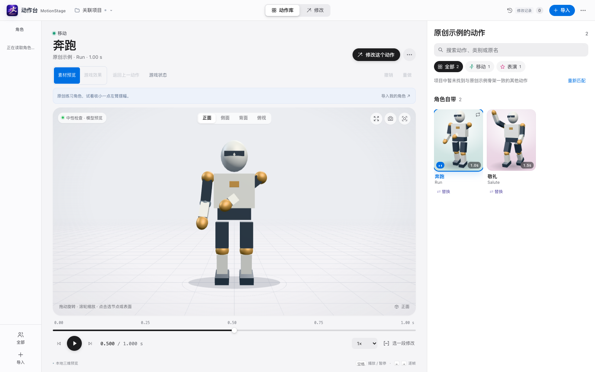
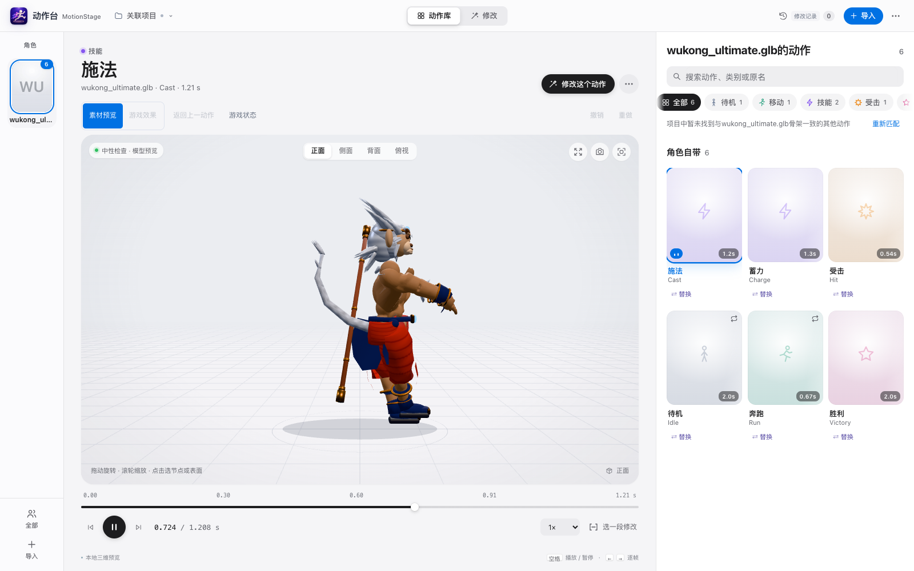

# 鬼灭「无限城」AI 3D 动作游戏 + MotionStage 拆解

> **一句话结论**：作者不是“让 AI 一次做完游戏”，而是把任务拆成四类——**许愿（清楚且 AI 擅长）→ 找工具（清楚但 AI 不擅长）→ 问它（说不清但 AI 擅长）→ 一版一版试（说不清且 AI 不擅长）**；MotionStage 是第三类里“让 AI 给自己造一个反馈界面”的产物，本质是**动作审阅/候选管理工具**，不是建模、动捕、重定向或引擎。
>
> 来源：B 站《7.9万人玩过的鬼灭游戏，我是怎么用 AI 做出来的｜附开源动作工具【B站AI创造公开赛】》，UP @AI大航海时代，时长 6:52，发布 2026-11-10，<https://www.bilibili.com/video/BV1DtW56XEB5>（短链 <https://b23.tv/MsgL53G>）。开源工具：<https://github.com/jbang2004/motion-stage>（MIT，本次阅读/实测版本 v4.6.0，commit `54390522b1f2345b08632b01fe5e6071150c253f`）。**访问日期：2026-11-21**。
>
> 边界：本文只研究**流程与开源工具**，不复制鬼灭角色、场景、Logo、音频、UI 或游戏素材；视频只抽帧阅读，未把任何视频/游戏画面放入仓库。本文区分“作者自述”“视频字幕/画面”与“本文实测”，不能把同人作品的热度当作 IP 授权。

---

## 0. 结论（先读）

1. **三个坑的本质是任务类型错配，不是“AI 不行”。**
   - 模型：AI 直接手搓精细人物 → 像橡皮泥；换 **Tripo 图生 3D + 减面 + 绑骨**。
   - 动作：AI 手 K 动作 → 呆板且“说不清哪一帧别扭”；换 **Mixamo 真人动捕**，再补一个**逐帧、点选身体部位、带截图**的反馈界面（MotionStage）。
   - 打击感/审美：不是生成问题，是判断问题；**没有捷径，只能小步迭代 + 同帧并排 + 人来做最终决定**（视频里单点迭代出现 16 版，全项目 18 版）。

2. **MotionStage 的定位是“动作审阅 + 候选管理 + 轻量修正”，不是生产工具链的全部。**
   - 它会冻结模型 SHA、片段、时间点、相机和截图，把“哪块骨头/哪一帧”变成结构化任务；
   - 它靠 Agent（当前对话或本机 Codex/Claude Code/DeepSeek）产出候选 GLB，再做同帧并排/叠影对比；
   - 它自带 `rotation_flips / foot_slip / limb_extension` 三类动作检查，适合做导入前的动作 QA 门禁。

3. **对我们最直接的落地点是 `godot-changan-action` 的动作 QA 门禁和逐帧美术评审。**
   - 规格里的 11 个动作（idle/walk/run/sprint/jab/kick/roll/hit/knockdown/getup/victory）可以先过 MotionStage 的脚滑/旋转翻转/膝肘弹直检查，再进 Godot；
   - 它**不能**替代 Tripo（模型）、Mixamo（动捕）、Blender（清理/重定向/烘焙）、Godot（运行时 IK/布料/状态机/打击停帧/相机震动）；
   - 它**不能**判断“好不好玩/打击感够不够”，只能把对比做清楚，最终仍由 Art Director/QA/真人试玩决定。

4. **本次实测（macOS + Node 22.19.0 + MotionStage 4.6.0）已验证：**
   - GLB 导入、动作库分类、动作匹配、`motion-check`、`practice` 本地修正、`motion-register → preview → adopt → export-action` 全链路可用；
   - 用本仓库原创 `godot-wukong-ultimate/assets/models/wukong_ultimate.glb` 实测：29 骨骼 / 6 片段，`Run` 被检出 2 处脚滑（左脚 0.4768、右脚 0.4269，接触期 0.30s/0.267s），另有 8 条四元数符号翻转提示；
   - `export-action` 导出的 GLB 2.0 为 3.26 MB，1 mesh / 31 nodes / 1 skin / 6 clips，buffer 内嵌，无外部 URI；
   - FBX 链路**未端到端验证**：本机同时有 Blender 3.4.1 与 4.2.9，但 MotionStage `doctor` 对两者都报 `available:false`（手动 `--version` 正常），因此本文不把 FBX 当成已验证能力。

5. **IP 结论：只学流程与 MIT 工具。** 鬼灭角色/场景/Logo/音频/UI 一律不复用；“非官方同人、不作商业用途”不等于获得授权。MotionStage 的 MIT 许可要保留 `LICENSE` 与版权声明，第三方运行时（Three.js/Draco/Basis 等）保留各自许可。

---

## 1. 取证与可信度

### 1.1 视频元数据（yt-dlp，2026-11-21）

| 项 | 值 |
| --- | --- |
| 标题 | 7.9万人玩过的鬼灭游戏，我是怎么用 AI 做出来的｜附开源动作工具【B站AI创造公开赛】 |
| UP | AI大航海时代 |
| 时长 | 411.6 s（6:52） |
| 发布 | 2026-11-10 |
| 播放/点赞（访问时） | 369,415 / 6,200（会变，仅记录访问时快照） |
| 简介要点 | 国庆许愿“一座能逛的无限城”；一个月、18 个版本；7.9 万人玩过；讲三个坑；MotionStage 开源；非官方同人、不作商业用途；旁白为 AI 配音 |
| 字幕 | B 站未登录接口无字幕；yt-dlp 无自动字幕；以下时间点来自**烧录字幕抽帧**，误差约 ±2–4 s |

**取证方式**：yt-dlp 读取元数据并下载 480p/360p；ffmpeg 每 8 秒出接触表，关键段每 2 秒抽帧；人工阅读烧录字幕与画面。没有做音频转写，因此本文引用的是**字幕文字**，不是逐字口播稿。

### 1.2 作者自述 vs 本文验证

| 说法 | 出处 | 状态 | 本文处理 |
| --- | --- | --- | --- |
| 一个月、18 个版本、7.9 万人玩过 | 视频简介 + 0:08/0:16 画面 | **作者自述**，未独立核实 | 作为案例背景，不当作质量/工期基准 |
| 三个坑：模型、动作、打击感 | 视频 1:12–5:44 标题卡/字幕 | **视频叙事**；三条命名是本文归纳 | 见 §2，逐条标注时间点 |
| 动作台由 AI 当天下午搭出来 | 2:56–3:04 字幕 | **作者自述** | 作为“问它”案例；不推断具体实现耗时 |
| MotionStage 为 MIT | 仓库 `skill/LICENSE`、README | **已核实** | 见 §3.7 |
| MotionStage 能导出 GLB、不能导出 FBX | 文档/CLI/源码 + 本次实测 | **已验证 GLB 导出**；FBX 未实测 | 见 §3.4/§3.5 |
| 真人动捕比 AI 手摆自然 | 2:26–2:34 画面对比 | **作者演示 + 本文认同为合理经验** | 不作为量化结论；仍是“同任务换工具”的案例 |
| 7.9 万热度 = IP 可用 | — | **错误推论** | 见 §5，热度不等于授权 |

> 说明：视频里的“16 版”和“18 版”口径不同。16 版出现在打击感/单点迭代段落（约 5:30），18 版出现在全项目四格图（约 5:38）。不要混成“某个动作改了 18 版”。

---

## 2. 视频流程：从“许愿”到“一版一版试”

### 2.1 时间线（按烧录字幕整理）

| 时间 | 画面/字幕 | 在讲什么 |
| --- | --- | --- |
| 0:00–0:24 | 無限城 EP.02；7.9 万人玩过；18 个版本；v2.2.0；四个角色可任选两个对战 | 案例规模与结果 |
| 0:24–0:56 | 动作台开源；X 上出现一批个人做的游戏；竹林夜雨（也让 AI 做了一个中国武侠的） | 2026 年 AI 游戏创作潮的背景 |
| 0:56–1:12 | 第一次走进无限城“被惊到”；逛着逛着“无聊” | 场景成立 ≠ 玩法成立；能逛但没事做 |
| 1:12–2:16 | 第 1–2 轮；“坑一”；AI 在 Blender 里用代码；橡皮泥一样的人物；一个把图片变成 3D 模型的网站；上传参考图、生成、减面；Tripo 帮角色绑好骨头 | 模型坑：AI 直接建模不可控 → 图生 3D + 减面 + 绑骨 |
| 2:24–2:34 | “坑二”；“AI 手摆” vs “真人动捕”；Mixamo 动作库；好不好还得一个个挑、一处处改 | 动作坑：AI 手 K 不自然 → 真人动捕；但仍需逐条挑 |
| 2:42–2:50 | 第 3 轮；满屏聊天记录；“哪块骨头，只能在聊天框里打一大段字”；“我要怎样逐个预览模型和动作并反馈修改意见最好？” | 反馈坑：文字描述无法定位帧/骨骼 → 反过来问 AI“我该怎么给你提意见” |
| 2:56–3:20 | 第 3 轮继续；“当天下午，它就给我搭了个台子”“这个台子我一直用到现在”；开源动作台 MotionStage（MIT）；“模型和动作，你得先在 Tripo” | 工具诞生：AI 造反馈界面；MotionStage 不生成模型/动作 |
| 3:36–4:08 | Claude Code 命令、几分钟后给链接；让它跑两步；一句话“左手穿进身体了”；这句话连同那一刻、镜头和截图；本机 Codex/Claude Code 后台领任务 | 使用流程：本地服务 → 逐帧 → 点身体部位 → 一句话 + 截图 → Agent 领任务 |
| 4:16–4:24 | 改后在右，停在同一帧、同一角度；换成你自己的游戏，关联项目 | 候选对比：同帧/同机位；可接入自己的项目 |
| 4:32–5:44 | “坑三”；2×2 四格图；许愿/找工具/问它/一版一版试；16 版、18 版；“好不好看，得你说了算” | 审美/打击感：没有捷径，人来拍板 |
| 5:52–6:52 | 游戏与动作台链接；留言/彩蛋 | 收尾与行动号召 |

### 2.2 三个坑（本文归纳）

> 视频用“坑一/二/三”标题卡推进，但没有在简介里给出三条的正式命名；下表标签是按字幕与案例归纳，便于我们复用。

| 坑 | 作者原做法 | 为什么会坑 | 作者的绕法 | 时间点 | 我们能复用什么 |
| --- | --- | --- | --- | --- | --- |
| **坑一：模型** | 让 AI 直接操作浏览器/Blender，用代码“手搓”精细人物 | 形体像橡皮泥，比例、布线、绑定不可控；生成结果无法直接进游戏 | **Tripo 图生 3D**：原创参考图 → 生成 → 减面 → 绑骨；再进 Blender 清理 | 1:12–2:16 | 我们已定的 `原创参考图 → Tripo → Blender 清理/拓扑/UV/绑骨/toon → GLB` 与其一致；MotionStage 不参与生成 |
| **坑二：动作** | 让 AI 手 K 动作（“AI 手摆”） | 真人动捕明显更自然；更麻烦的是“看得出别扭，却说不清是哪一帧、哪块骨头” | **Mixamo 真人动捕** + 自建 **MotionStage**：逐帧暂停、点身体部位、截图、一句话提交；Agent 产出候选，同帧对比 | 2:24–4:08 | 用 Mixamo/Blender 做动作来源；用 MotionStage 做逐帧反馈/候选管理；不让 AI 凭文字猜骨骼 |
| **坑三：打击感/审美** | 继续用大段文字许愿“更酷、更凌厉、更有打击感” | 这些词没有可执行参数；AI 不知道你脑子里的“对”是什么 | **一版一版试**：小步改、同帧并排、人来决定；单点迭代到 16 版，全项目 18 版 | 4:32–5:44 | 用 `Art Director`/`QA` 做独立判断；MotionStage 只提供对比与证据；不让 AI 自评“好看” |

### 2.3 四格图：把任务放进正确的格子（视频 4:32–5:44）

视频借“乔哈里视窗”画了一个 2×2：横轴 **AI 擅长 / AI 不擅长**，纵轴 **我想得清楚 / 我说不清楚**。

| 格子 | 任务类型 | 视频里的例子 | 正确动作 | 我们的对应 |
| --- | --- | --- | --- | --- |
| **许愿** | 清楚 + AI 擅长 | 一座能逛的无限城；场景/氛围/代码脚手架 | 把参考、约束、验收讲清楚，先要一个小切片 | Godot 场景/系统代码、工具脚本、文档、批量检查 |
| **找工具** | 清楚 + AI 不擅长 | 精细人物 → Tripo；自然动作 → Mixamo；清理/绑定 → Blender | 停止“硬许”，选专用工具，定义输入/输出/许可 | Tripo、Mixamo、Blender、Godot；MotionStage 的 GLB 上下游 |
| **问它** | 说不清 + AI 擅长 | “我要怎样逐个预览模型和动作并反馈修改意见最好？”→ 当天搭出动作台 | 让 AI 设计**反馈界面/工作流**，而不是让它猜结果 | 让 AI 写 QA 脚本、生成状态预览、搭逐帧评审面板 |
| **一版一版试** | 说不清 + AI 不擅长 | 打击感、命中反馈、镜头、特效、节奏 | 小步、同帧、留证据、人来拍板；设轮次上限 | 打击感/演出迭代；Art Director + QA + 真人试玩 |

> 这套四格图比“AI 能不能做”更有用：**同一件事放错格子，就会表现为“AI 很笨”或“越改越乱”。**

### 2.4 作者实际用到的工具链（从画面可确认）

```text
参考图/许愿
  ├─ 场景/建筑/氛围：AI 生成（许愿格）
  ├─ 精细人物：Tripo 图生 3D → 减面 → 绑骨（找工具）
  ├─ 动作：Mixamo 真人动捕（找工具）
  ├─ 清理/修改：Blender + AI Agent（找工具 + 问它）
  ├─ 反馈/对比：MotionStage（问它；AI 当天搭出）
  └─ 运行时：浏览器（B 站 Toy）；MotionStage 仓库 real-case 记录作者的游戏为 Three.js
```

注意：MotionStage 自身用 Three.js 预览；**这不等于它导出 Three.js 代码**——它导出的仍是 GLB。

### 2.5 哪些交给 AI、哪些换工具、哪些只能人肉试

| 类别 | 具体事项 | 结论 |
| --- | --- | --- |
| **AI 直接做** | 场景/氛围生成、代码脚手架、工具 UI、批量重命名/检查、文档、调试、把反馈整理成任务 | 许愿/问它格；要给参考和验收 |
| **换工具** | 精细模型（Tripo）、自然动作（Mixamo）、清理/拓扑/绑骨/重定向/烘焙（Blender）、最终运行时（Godot/Three.js）、动作审阅（MotionStage） | 找工具格；不要再让 LLM 用文字硬怼 |
| **AI 辅助但人要拍板** | 动作候选、镜头/特效方案、打击感调整、UI 排版 | 问它 + 一版一版试；AI 不做最终审美 |
| **只能人肉试** | 手感、乐趣、打击感、节奏、可读性、IP 原创性、真人 playtest | 一版一版试格；用同帧对比和试玩记录，不用“看起来更好”结案 |

---

## 3. MotionStage 研究（MIT）

### 3.1 一句话定位

**MotionStage（动作台）是一个本地浏览器里的 3D 动作审阅与候选管理工具：选角色/动作 → 暂停到某一帧 → 点身体部位 → 写一句修改要求 + 截图 → 交给 Agent 产出候选 GLB → 同帧/同机位并排对比 → 采用/继续改/不用 → 导出或接入游戏。**

它**不生成**模型或动作，**不做**任意重定向、IK、布料、状态机或最终审美判断。

### 3.2 技术栈与安装（已核实）

| 项 | 内容 |
| --- | --- |
| 版本 | v4.6.0（`release.json`），commit `54390522…`（2026-11-20） |
| 运行时 | Node.js 22+；浏览器需 WebGL2 |
| 依赖 | **零 npm 依赖、无构建步骤**；Three.js 0.186.1 随包 vendored |
| 界面 | 简体中文；本地 HTTP 服务只监听 `127.0.0.1` |
| 安装 | `git clone https://github.com/jbang2004/motion-stage.git`；`node skill/scripts/start.mjs`；macOS 可双击 `Open MotionStage.command` |
| 工作区 | 独立练习默认 `~/motion-stage-workspace/`；项目模式用 `--project <game>`，数据在 `<项目>/.motion-studio/` |
| Agent 接入 | CLI + stdio MCP；当前对话或本机 Codex CLI / Claude Code / DeepSeek Harness；任务保存后需 Agent 领取 |
| FBX | 需要本机 **Blender 4.2+** 做导入转换（本次未端到端验证，见 §3.5） |
| 包体 | 发行包约 2.09 MB / 211 文件；解包约 6.5 MB |

启动（本次实测）：

```bash
git clone --depth 1 https://github.com/jbang2004/motion-stage.git /tmp/motion-stage
cd /tmp/motion-stage/skill
node scripts/start.mjs          # 自动选端口并打开浏览器；--no-open 只打印地址
```

### 3.3 能力矩阵（源码/文档核实 + 本次实测）

| 能力 | 具体表现 | 对我们的意义 |
| --- | --- | --- |
| **动作库** | 角色 rail、动作卡缩略图、中文分类（待机/移动/攻击/技能/防御/受击/跳跃/倒地/表演/其他）、搜索、角色自带 vs 匹配动作 | 把 Mixamo/Tripo 导出的片段集中看清；分类只是名字提示，不是质量结论 |
| **逐帧反馈** | 暂停到秒/帧、选时间范围、点选身体部位或表面、多个“标记当前画面”、截图随任务冻结 | 解决“说不清哪一帧、哪块骨头”的核心痛点 |
| **任务包** | 冻结模型 SHA、clip、秒数、审查 FPS、相机、显示模式、缩放、截图；任务状态/租约/needs-input | 反馈可复现；资产变了旧任务会失效，不会拿旧反馈改新模型 |
| **候选对比** | 同一时刻/同一镜头；并排、叠影、洋葱皮；根运动锁定/原地看动作；采用/继续改/不用 | 把“好不好看”变成可对照的证据；仍由人拍板 |
| **本地微调** | 指定骨骼、片段、时间范围，按摆幅系数或轴向角度做确定性变换；仅支持可读的 LINEAR 四元数轨道 | 适合小修（收一点摆臂/张开一点），不适合大改或 IK 约束 |
| **动作检查** | `rotation_flips`、`foot_slip`、`limb_extension`；30 fps 关节采样；识别原地动作的 treadmill；支持 baseline 对比 | 直接对应我们的脚滑/膝肘弹直/旋转翻转 QA |
| **动作库/匹配** | 扫描项目 GLB/动作包；按节点名、父链、rest 矩阵做绑定检查；完全相同曲线去重；不兼容的明确标 `incompatible` | 可在导入前发现“骨架对不上”；它**不是**任意重定向器 |
| **版本/撤销** | 不可变输入 SHA、模型 revision、undo/redo、checkpoint、任务血缘 | 符合我们“每轮迭代留证据/可回滚”的要求 |
| **游戏接入** | 关联项目；`motion-stage.states.json` 离线状态预览；运行时预览本地服务协议；只记录接入，不直接写游戏文件（`export-action` 输出除外） | 可用于 Godot 的角色状态预览；不能替代 Godot 内验证 |
| **Agent 执行** | 当前对话领取；或本机 Codex/Claude/DeepSeek 后台 worker；不自动唤醒对话 | 与我们的 dispatcher/角色分工可对接；仍要人确认领任务 |

### 3.4 输入/输出与引擎可达性

| 目标 | 能否直接 | 实际路径 | 注意 |
| --- | --- | --- | --- |
| **GLB** | ✅ 直接 | 导入 GLB；候选/导出均为自包含 GLB（buffer 内嵌） | 首选交换格式 |
| **Godot 4** | ✅ 间接 | GLB 导入 Godot 4.6；`export-action` 输出合并后的角色 GLB | 没有 `.tres`/`AnimationPlayer` 导出；循环、root motion、事件、过渡要在 Godot 配 |
| **Blender** | ✅ 间接 | GLB 导入 Blender | 没有 `.blend` 往返；Blender 工程仍是权威源时，改完要重新导出 GLB |
| **Three.js** | ✅ 直接 | GLB + GLTFLoader；工具本身也是 Three.js | 运行时材质/光照/描边需自己在 Three.js 复现 |
| **FBX** | ⚠️ 仅导入 | FBX 经 Blender 4.2+ 转 GLB 后使用 | **没有 FBX 导出**；本次未端到端验证 |
| **glTF（.gltf）** | ⚠️ 项目路径可读 | 项目目录/动作包注册可读 glTF；直接导入以 GLB 为主 | 依赖外部文件时要注意自包含 |
| **通用 JSON** | ❌ 不是公开动画格式 | CLI 帮助里出现 `MOTION.json`，但文档未把它定义为通用动画交换格式；工作区 JSON 是记录 | 不要假设它是 Godot/Unity 通用动作 JSON |
| **VRM** | ⚠️ 未文档/未验证 | 可尝试 VRM→GLB | 骨骼名、表情/形态键、材质要单独验；不要假设支持 |
| **UE uasset / Unity Prefab** | ❌ | 需先在对应 DCC 导出 | 文档明确不支持直接导入 |

> **结论**：把 **GLB 当作唯一交换格式**。Godot、Blender、Three.js 都能吃 GLB；MotionStage 不提供 FBX/JSON 导出，也不要为了它把管线改成 FBX。

### 3.5 本次本机实测（macOS / Node 22.19.0 / v4.6.0）

| # | 操作 | 结果 | 证据 |
| --- | --- | --- | --- |
| 1 | `start.mjs` 启动 | 成功，`http://127.0.0.1:61187`；练习角色 + Run/Salute 可播 | `docs/shots/motionstage-action-library.png` |
| 2 | 导入本仓库原创 `wukong_ultimate.glb` | 成功：3.17 MB、31 nodes、29 骨骼、6 片段（Idle/Run/Cast/Charge/Hit/Victory） | CLI `inspect`；`docs/shots/motionstage-wukong-glb.png` |
| 3 | `actions` | 6 个角色自带、0 个匹配；分类为待机/移动/技能/受击/表演 | CLI 输出 |
| 4 | `motion-check --clip Run` | 2 个 warning（左脚滑 0.4768、右脚滑 0.4269，接触期 0.30s/0.267s）；8 条 `quat_sign_flip` info；无旋转翻转/膝肘弹直 warning | `/tmp/t032-wukong-check.json` |
| 5 | `practice`（MIT 练习角色） | 生成候选 GLB；121 个采样；左腕离中线最小距离 0.0898 → 0.4981；其他肢体曲线未变 | `practice-report.json` |
| 6 | `register → preview → adopt → export-action` | 全部成功；preview 87 tracks；导出 GLB 2.0 3.26 MB，1 mesh/31 nodes/1 skin/6 clips，buffer 内嵌、无外部 URI | `/tmp/t032-export-idle.glb` |
| 7 | FBX 导入 | **未验证**；`doctor` 对 Blender 3.4.1 与 4.2.9 均报 `available:false`，手动 `--version` 正常 | 已知限制，不当作可用能力 |
| 8 | 修改模式截图 | 未成功：无头/有头 Chromium 点击“修改这个动作”时主线程卡住（SwiftShader/旧 Intel GPU），未取得该面板截图 | 不伪造；以 CLI + 动作库截图为准 |

**实测结论**：
- GLB 链路、动作检查、候选导出是**可用**的；
- 它对“脚滑”的检测是**基于关节位置和名称提示**的，脚节点按名字猜（`foot.L/foot.R`），接触窗口自动按高度判定；结果应作为**线索**，用 `--feet` 和显式 `--options` 接触窗口复核；
- 本仓库的 `wukong` Run 确实能被检出脚滑，说明这个门禁对我们不是纸面能力；
- 不要把 `quat_sign_flip` info 当 bug：LINEAR 轨道在 glTF 参考实现里按最短路径插值，画面通常不受影响；只有按分量插值的导入器才可能绕远路。

### 3.6 它不能做什么（边界）

| 不能做 | 说明 | 我们该用什么 |
| --- | --- | --- |
| 生成模型/动作 | 文档明确“模型和动作你得先在 Tripo”；不是生成式工具 | Tripo / Mixamo / Blender |
| 任意重定向 | 只支持直接兼容骨架或经检查的显式名称映射；rest/比例/层级不兼容会拒绝 | `docs/ANIMATION_RETARGET_PIPELINE.md` + `animation-retarget-kit` / Blender |
| 完整曲线编辑器 | 有轨道读取/检查、时间轴、局部确定性变换；没有 DCC 式曲线图编辑器 | Blender 的 Graph Editor / 自研曲线工具 |
| IK / 布料 / 握持约束 | 预览不复现运行时 IK、布料、战斗混合 | Godot 运行时 + QA |
| 打击停帧/相机震动/VFX/音效 | 这些是引擎/演出层，不是骨骼动画 | Godot + 音频/VFX |
| 最终审美判断 | 只提供同帧对比和候选，采用/拒绝由人点 | Art Director / QA / 真人试玩 |
| 自动改游戏 | 不写游戏文件；`export-action` 只写你指定的输出 GLB | 按 `docs/task-routing.md` 的角色分工接入 |

### 3.7 许可与合规

| 项 | 内容 |
| --- | --- |
| 主许可 | **MIT**，Copyright (c) 2026 MotionStage contributors（`skill/LICENSE`） |
| 覆盖范围 | 独立包代码、文档、模板、原创分段练习人偶/动作 |
| 第三方运行时 | Three.js 0.186.1（MIT）、meshoptimizer（MIT）、Draco（Apache-2.0）、Basis Universal（Apache-2.0）、ktx-parse/zstddec（MIT）等；各自许可保留 |
| 检查定义 | `rotation_flips/foot_slip/limb_extension` 改编自 scenario-labs/skills 的 `bx_anim.py`（MIT） |
| 不包含 | 私人游戏角色、商用动作包、在线字体、遥测/云 API 客户端 |
| 我们的义务 | 若复制/修改/再分发：保留 MIT 版权与许可文本；保留第三方 notices；不要移除来源；不要把鬼灭素材打包进去 |
| 截图说明 | 本文两张截图均为我们在本机运行 v4.6.0 时截取：第一张是 MIT 原创练习人偶；第二张是本仓库原创 `wukong_ultimate.glb`。不包含鬼灭游戏画面 |

### 3.8 截图（本机实测）

**图 1：动作库主界面（MIT 原创练习人偶，Run 片段）。** 可见角色 rail、动作库分类、缩略图、时间轴/逐帧、0.25×–1.5×、正面/侧面/背面/俯视、修改入口。



**图 2：导入本仓库原创 `wukong_ultimate.glb`。** 工具识别出 6 个片段（Cast/Charge/Hit/Idle/Run/Victory）与 29 骨骼；动作卡按待机/移动/技能/受击/表演分类。缩略图仍在后台渲染，因此部分是占位图。



> 截图归属：MotionStage UI 为 MIT 工具界面；图 1 人偶为 MotionStage 随包原创练习资源（MIT）；图 2 角色为本仓库原创 `godot-wukong-ultimate` 资产。两张图均不含鬼灭游戏画面/角色/素材。

---

## 4. 接入方案：`godot-changan-action` + Blender 二次元管线

### 4.1 目标管线

```text
原创参考图
  → Tripo 图生 3D（模型/绑骨）
  → Blender 4.2（清理/重拓扑/UV/权重/toon/动作修正/重定向/烘焙）
  → GLB（自包含；每角色一个，clips 命名稳定）
  → MotionStage（动作 QA 门禁 + 逐帧美术评审 + 候选对比）
  → Godot 4.6 GL Compatibility（导入 GLB；状态机/IK/布料/打击停帧/相机/VFX）
  → 真机 30fps+ / QA / Art Director 复评
```

关键原则：**Blender 是权威源，GLB 是交换格式，MotionStage 是审阅层，Godot 是运行时。** 不要因为 MotionStage 能改 GLB 就把 Blender 源丢掉；MotionStage 的候选如果来自 GLB 直改，Blender 源会落后，必须回写或重导。

### 4.2 MotionStage 可用的具体环节（按优先级）

| 优先级 | 环节 | 具体做法 | 产出/验收 |
| --- | --- | --- | --- |
| **P0** | **动作 QA 门禁** | 对 `godot-changan-action` 的 11 个动作（idle/walk/run/sprint/jab/kick/roll/hit/knockdown/getup/victory）逐个跑 `motion-check`；用实际脚骨名 `--feet`，必要时用 `--options` 指定接触窗口；与 baseline 对比 | 0 个新增 warning；脚滑/旋转翻转/膝肘弹直不恶化；报告存 `docs/qa-review/` |
| **P0** | **逐帧美术评审** | 在接触帧/命中帧暂停，点手/脚/躯干，写一句“左手穿进身体/脚踝塌陷/摆臂太僵”，附截图；交给 `game-artist` 产出候选 GLB；同帧/同机位并排 | Art Director/QA 看同一帧；一次只改一层；采用/拒绝有记录 |
| **P1** | **动作匹配/替换** | 把 Mixamo/Blender 导出的候选片段注册为动作包，先 `preview` 看目标角色是否兼容；不兼容就不要硬套 | 兼容才预览；不兼容走 Blender 重定向/烘焙 |
| **P1** | **动作库整理** | 用中文分类/搜索管理 idle/walk/run/attack/dodge/hit/knockdown/getup；卡片缩略图仅作索引 | 不把缩略图当验收证据 |
| **P1** | **游戏状态预览** | 在项目根目录提供 `motion-stage.states.json`，把 Idle/Walk/Run/Attack/Dodge/GetUp 映射到 clip；可选装备挂点 | 离线预览动作与装备；不替代 Godot 运行时 |
| **P2** | **运行时预览协议** | 若 changan 有本地预览服务，按 `motion-stage.preview.json` + 目录/消息协议接入，复现装备/材质/实时布料 | 需要工程投入；MVP 可先不做 |
| **P2** | **接入记录** | `export-action` 导出合并 GLB；`integrate` 记录改了哪些游戏文件与实际游戏验证 | 不把“导出成功”当“游戏里通过” |

#### 对 11 个动作的具体检查建议

| 片段 | 重点检查 | MotionStage 能做什么 | 还需要什么 |
| --- | --- | --- | --- |
| idle | 呼吸循环、脚底接触、肩颈 | 旋转翻转/脚滑/循环边界目视 | Godot 循环点、布料 |
| walk/run/sprint | **支撑脚滑步**、左右步速一致、原地/根运动 | `foot_slip` + treadmill 识别；对比 baseline | 游戏位移速度匹配、脚踝姿态、地面高度 |
| jab/kick | 打击帧姿态、肘/膝弹直、穿模 | `limb_extension`、逐帧点击看姿态 | 命中判定、hitstop、相机震动 |
| roll | 翻滚接触、根运动、起止 | 帧步进/同帧对比/根运动锁定 | i-frames、碰撞、状态过渡 |
| hit | 受击方向、重心、回弹 | 逐帧对比/旋转检查 | 受击状态机、击退 |
| knockdown/getup | 倒地接触、起身支撑、穿地 | 脚/手接触目视 + 关节检查 | 碰撞、无敌帧、起身取消 |
| victory | 节奏/表演/循环 | 逐帧/并排 | 演出、镜头、音效 |

> 注意：MotionStage 的脚滑检查是**关节位置**层面，不证明网格不穿地、不证明 Godot 里不滑。最终仍要在 Godot 里跑 `qa_motion_probe`/实机录像。

#### 按功能拆：动作编排 / 节奏 / 打击帧 / 相机 / 预览 / 导出

| 功能 | MotionStage 能做什么 | 不能做什么 | 我们的替代/补充 |
| --- | --- | --- | --- |
| **动作编排** | 一次审一个 clip；可试播、替换、收录；可对比同一角色的两版动作 | 没有多 clip 连招时间轴、过渡编辑、NLA；不做状态机 | Godot `AnimationTree`/状态机；Blender NLA；连招表写在设计规格里 |
| **节奏** | 秒/帧时间轴、0.25×–1.5× 播放、范围选择、同帧对比 | 没有音频波形/节拍标记；不能自动对齐音效 | Blender 时间轴/音频；Godot AnimationPlayer 与音效事件；人耳试听 |
| **打击帧** | 暂停到命中/接触帧、点身体部位、标记当前画面、写一句要求 | 不设置 hitbox、hitstop、受击框、取消窗口 | Godot 帧数据/状态机；QA 探针；真人试玩 |
| **相机** | 正面/侧面/背面/俯视固定视角；候选与基线同机位对比 | 不做电影相机、推拉摇移、镜头震动 | Godot 相机脚本；Blender 相机；Art Director 评审 |
| **预览** | 中性光照预览；可选 `motion-stage.states.json` 离线状态；可选运行时预览协议 | 不复现 toon/描边、IK、布料、战斗混合、VFX | Godot 实机预览；运行时探针；真实 GPU 截图 |
| **数据导出** | 候选 GLB；`export-action` 合并收录动作后导出角色 GLB | 无 FBX 导出、无通用 JSON、无 Godot `.tres` | 统一 GLB；Godot 导入后配循环/root motion/事件 |

### 4.3 不可用/需自建的环节

| 需求 | MotionStage 是否可用 | 替代/自建 |
| --- | --- | --- |
| 人物建模、减面、绑骨 | ❌ | Tripo + Blender |
| 动作捕捉/生成 | ❌ | Mixamo、Blender 手 K、动捕 |
| 不同 rest pose/比例的任意重定向 | ❌（只做兼容检查/显式映射） | `docs/ANIMATION_RETARGET_PIPELINE.md`、`animation-retarget-kit`、Blender |
| IK/脚部锁定/握持约束 | ❌ | Blender IK/约束烘焙；Godot Runtime IK |
| 布料/头发/裙摆模拟 | ❌ | Blender 模拟烘焙 / Godot 布料 |
| 状态机/连招/取消/无敌帧 | ❌ | Godot AnimationTree/状态机 + QA 探针 |
| hitstop/震屏/命中闪/相机 | ❌ | Godot 代码 + 参数表 |
| VFX/音效 | ❌ | Godot VFX/音频；CC0/原创 |
| 最终画面/toon/描边 | ❌（中性预览） | Godot 材质/着色器；Art Director 评审 |
| 动作曲线精细编辑 | ⚠️ 仅局部确定性变换 | Blender Graph Editor / 自研曲线工具 |
| FBX 导出 | ❌ | 统一走 GLB；不要为工具改管线 |
| 通用 JSON 导出 | ❌ | 以 GLB 为准；Godot 导入后用自己的资源 |

#### Blender 二次元能力建设的具体接口

- **T-030（Blender 二次元女性角色管线，queued）** 的产物应是 **GLB + 稳定骨骼名 + 稳定 clip 名**；MotionStage 只消费这个 GLB，不参与建模/材质/toon。
- 如果 Blender 工程使用 VRM：先导出 GLB，再在 MotionStage 验证骨骼/形态键；**VRM 不是文档承诺的输入格式**。
- 如果使用 Blender 4.2 的 FBX：优先在 Blender 里导出 GLB，避免 MotionStage 的 FBX→Blender 转换依赖；本机 `doctor` 未识别问题解决前，不要把 FBX 设为必经路径。
- **权威源规则**：Blender `.blend` 是源；MotionStage 的候选 GLB 如果被采用，必须回写到 Blender 源或明确记录“源已落后”，否则下次导出会丢改动。

### 4.4 最小验证步骤（建议 0.5–1 天）

> 现在 `godot-changan-action/` 还未生成（T-025 blocked），可先用本仓库已有的 `godot-wukong-ultimate/assets/models/wukong_ultimate.glb` 做替身；本次已按此跑通。

```bash
# 1) 准备（/tmp 试用，不污染项目）
git clone --depth 1 https://github.com/jbang2004/motion-stage.git /tmp/motion-stage
cd /tmp/motion-stage

# 2) 建独立工作区
node skill/scripts/motion-feedback.mjs init --workspace /tmp/ms-changan

# 3) 导入一个自包含 GLB（换成 changan 的角色 GLB）
node skill/scripts/motion-feedback.mjs add \
  --workspace /tmp/ms-changan --slot baseline \
  --file /Users/ks_128/Documents/modelfw_demo/godot-wukong-ultimate/assets/models/wukong_ultimate.glb

# 4) 看动作清单 + 骨骼/片段能力
node skill/scripts/motion-feedback.mjs actions --workspace /tmp/ms-changan --json
node skill/scripts/motion-feedback.mjs inspect --workspace /tmp/ms-changan --slot baseline

# 5) 跑动作检查（先 baseline，再候选）
node skill/scripts/motion-feedback.mjs motion-check \
  --workspace /tmp/ms-changan --slot baseline --clip Run
# 有明确脚骨名时：
# --feet foot.L,foot.R
# 需要接触窗口时：
# --options /tmp/contacts.json

# 6) 打开 UI 做逐帧评审
node skill/scripts/motion-feedback.mjs serve --workspace /tmp/ms-changan --port 5178
# 浏览器打开 http://127.0.0.1:5178
# 选动作 → 暂停到接触帧 → 点手/脚 → 一句话 → 保存任务
# 当前对话领取，或本机 Codex/Claude Code 后台领取

# 7) 导出候选/收录动作（只写指定输出）
node skill/scripts/motion-feedback.mjs export-action \
  --workspace /tmp/ms-changan --action <ACTION_ID> --out /tmp/shendeng.glb
```

**验收期望**：
- `actions` 能列出 11 个片段（或当前 GLB 的片段数）；
- `motion-check` 有可读的 warning + 证据时间区间；
- UI 能暂停/点选/截图/提交；候选能在同一帧/同一镜头对比；
- `export-action` 输出的 GLB 能被 Godot 4.6 导入，clip 名不变；
- **游戏内**仍要跑 Godot 状态机/碰撞/相机/打击停帧验证，MotionStage 不等于游戏验收。

### 4.5 验收参数与门禁（建议写入 `godot-changan-action` 的 QA）

| 维度 | 门禁 | 证据 |
| --- | --- | --- |
| 脚滑 | 相对 baseline **0 新增 warning**；脚滑位移与速度不恶化（>5% 视为恶化） | `motion-check` JSON + 同帧截图 |
| 旋转翻转 | 0 个 `rotation_flips` warning；`quat_sign_flip` info 需确认导入器按最短路径插值 | JSON + Godot 导入后目视 |
| 膝肘弹直 | 0 个新增 `limb_extension` warning | JSON |
| 逐帧美术 | 接触帧/命中帧同帧对比；Art Director/QA 签字；一次只改一层 | 候选 GLB + 同帧截图 + 决定记录 |
| 循环/根运动 | 循环首尾姿态/速度连续；root motion 不被“原地看动作”掩盖 | MotionStage 根运动锁定开关 + Godot 实测 |
| 运行时 | 11 个动作在 Godot 状态机中可进入/退出；30fps+；10/10 滚过同一招；hitstop 2–8f；震屏 0.08–0.28；telegraph ≥0.35s | Godot 探针/录像/QA 报告 |

> 阈值来源：`docs/design/changan-action-remake-spec.md`/`changan-action-remake-acceptance.md` 的设计目标；不是本文实测。MotionStage 只覆盖其中与骨骼动画相关的部分。

### 4.6 与 T-028《AI 半成品抢救手册》的对应

| T-028 步骤 | MotionStage 的对应 | 仍需要人/引擎的部分 |
| --- | --- | --- |
| 先分清坏在哪一层 | 把问题定位到 clip + 秒 + 骨骼/部位；模型/动作/时间/相机分开 | 判断是蒙皮、布料、IK 还是动作本身 |
| 先问再生成 | 一句话 + 点选部位 + 截图，比大段文字更接近意图 | “第一眼希望玩家什么感觉”仍要人回答 |
| 否决清单是 taste | 采用/继续改/不用 + 原因/备注；原版保留 | 把否决理由写成可复用的 taste 文档 |
| 只改一层 | 候选冻结输入 SHA；局部时间/骨骼范围；其他肢体不动 | 避免同时改模型+动作+特效 |
| 让没参与的 AI 当裁判 | 可由独立 QA/Art Director 看同一帧候选 | AI 不能自评“好看”；乐趣要真人试玩 |
| 证据优先 | SHA/秒/相机/截图/检查报告都可追溯 | 游戏内运行结果才算运行时证据 |

---

## 5. IP 边界（硬规则）

1. **鬼灭 IP 不可复用**：角色（炭治郎/善逸/猗窝座等）、服装、场景（无限城）、Logo、音频、UI、台词、招式名，一律不进入我们的资产/截图/演示/宣传。视频里的游戏是“非官方同人、不作商业用途”，**这不等于授权**；同人热度也不构成许可。
2. **视频/游戏画面不入库**：本次只抽帧阅读，未把任何视频帧、游戏画面、角色图放进 `docs/`。`docs/shots/` 的两张图是 MotionStage UI + MIT 练习人偶/本仓库原创 wukong 资产。
3. **MotionStage 的 MIT 要保留**：复制/修改/再分发时保留 `skill/LICENSE` 的版权与许可文本；保留 `THIRD_PARTY.md` 中的 Three.js/Draco/Basis 等 notices；不要移除来源与版本。
4. **工具里的历史案例不是素材**：`skill/references/real-case.md` 提到同人角色名，只是文字记录；不复制其角色/截图/动作包。
5. **上游工具许可各自确认**：
   - Mixamo：按 Adobe 条款确认商用/再分发权限；不要把账号内动作包直接开源分发；
   - Tripo：确认生成物的商用/再分发条款；
   - Blender：GPL 不影响导出的 GLB，但插件许可要单独记录；
   - 我们的角色/场景/音效：原创或 CC0/MIT，写入 `CREDITS.md`。
6. **宣传边界**：不做“鬼灭同款/复刻”的品牌宣传；我们的项目名、角色名、UI 必须原创。

---

## 6. AI 工作流 checklist（可执行）

### 6.1 开工前 6 问

1. 这件事属于四格图的哪一格？（许愿/找工具/问它/一版一版试）
2. 我要的“感觉”能不能拆成可观察的手段？（轮廓/节奏/接触帧/镜头/音效/颜色）
3. 我有没有参考？参考里**取什么、为什么、不取什么**？
4. 这件事 AI 是“不会做”还是“说不清”？不会做→找工具；说不清→先问它/做对比。
5. 验收是什么？（同帧截图/检查 JSON/游戏内探针/真人试玩）
6. 这次只改哪一层？（模型/动作/时间/相机/VFX/UI）

### 6.2 任务路由表

| 任务 | 放哪格 | 用什么 | 验收 |
| --- | --- | --- | --- |
| 场景/系统/工具代码 | 许愿 | Claude Code/Codex + 仓库规范 | 可运行 + smoke + 截图 |
| 精细人物模型 | 找工具 | Tripo → Blender | 比例/拓扑/绑骨/许可 |
| 自然动作 | 找工具 | Mixamo/Blender/动捕 | 接触帧/脚滑/循环 |
| 动作反馈/候选对比 | 问它 | MotionStage + Agent | 同帧证据 + 采用/拒绝 |
| 打击感/演出 | 一版一版试 | Godot + Art Director/QA | 真人试玩 + 参数表 |
| 最终审美 | 人 | Art Director/QA/playtest | 独立签字，不由实现者自评 |

### 6.3 反馈前必须冻结的 5 件事

1. **模型 SHA**（或版本号）；
2. **clip 名**；
3. **秒数/帧号**（不是“大概那一帧”）；
4. **相机/视角**（正面/侧面/俯视/自由）；
5. **截图**（当前帧，含 UI/时间码更好）。

> 少任何一项，Agent 都会在错误的目标上改；MotionStage 的任务包就是把这 5 件事产品化。

### 6.4 一版一版试的版本账本

| 版本 | 改哪一层 | 改了什么（具体骨骼/时间/参数） | 证据（同帧/检查） | 决定 | 回滚点 |
| --- | --- | --- | --- | --- | --- |
| v1 | 动作 | 左臂摆幅 ×0.7，0.2–0.6s | 同帧截图 + 其他肢体未变 | 继续 | v0 |
| v2 | 时间 | 收势 0.90s 后压缩 1.375× | 时长 1.23→1.14；保留段误差 0 | 采用 | v1 |

规则：
- **一次只改一层**；同时改模型+动作+特效，无法归因。
- **同帧/同机位**对比；不要用不同阶段的截图冒充 before/after。
- **新 warning 即打回**；`quat_sign_flip` info 先确认导入器行为。
- **3 轮无改善 → 换层/换工具**；不要继续在同一方向加码。
- **AI 不自评**；采用/拒绝由人点，理由写进账本。

### 6.5 18 个版本给我们的真正教训

不是“版本越多越努力”，而是：
- 早期版本用于**找坑**（模型/动作/反馈方式）；
- 中期版本用于**换工具**（Tripo/Mixamo/MotionStage）；
- 后期版本用于**调感觉**（打击感/镜头/特效），这部分只能人肉试。
- 如果 18 版里有大量“改错层”的版本，成本会指数上升；用四格图先分类，能砍掉无效版本。

---

## 7. 来源与证据

### 7.1 一手来源（访问日期 2026-11-21）

| 来源 | URL/路径 | 用途 |
| --- | --- | --- |
| B 站视频 | <https://www.bilibili.com/video/BV1DtW56XEB5>（短链 <https://b23.tv/MsgL53G>） | 标题/简介/时长/发布日/播放点赞；烧录字幕抽帧 |
| B 站 Toy 游戏 | <https://www.bilibili.com/toy/infinity-castle/> | **未打开/未游玩**，避免使用其素材；仅按视频公开信息描述 |
| MotionStage 仓库 | <https://github.com/jbang2004/motion-stage> | 源码/文档/许可 |
| MotionStage LICENSE | `skill/LICENSE`（MIT，Copyright 2026 MotionStage contributors） | 许可义务 |
| MotionStage THIRD_PARTY | `skill/THIRD_PARTY.md` | Three.js/Draco/Basis 等第三方许可 |
| MotionStage release | `release.json` v4.6.0；commit `54390522b1f2345b08632b01fe5e6071150c253f`（2026-11-20） | 版本固定 |
| 本仓库 changan 规格 | `docs/design/changan-action-remake-spec.md`、`changan-action-remake-acceptance.md`、`changan-action-remake-priority.md` | 11 个动作、验收参数、P0/P1 |
| 本仓库重定向文档 | `docs/ANIMATION_RETARGET_PIPELINE.md`、`docs/MIXAMO_RETARGET.md` | 重定向/烘焙边界 |
| 本仓库动作 demo | `godot-mixamo-demo/`、`godot-wukong-ultimate/` | 现有 GLB/骨架/片段实践 |
| T-028 抢救手册 | `docs/ai-half-finished-rescue-playbook.md` | 分层/问意图/taste/独立裁判的对照 |

### 7.2 本次生成的本地证据（未入库，除截图外）

| 证据 | 路径 | 说明 |
| --- | --- | --- |
| 视频元数据 | `/tmp/t032-video.json` | yt-dlp JSON |
| 抽帧接触表 | `/tmp/t032-frames/sheet1-3.jpg` | 仅本地阅读，未入库 |
| 关键帧 | `/tmp/t032-key/t*.png` | 仅本地阅读，未入库 |
| MotionStage 截图 | `docs/shots/motionstage-action-library.png`、`docs/shots/motionstage-wukong-glb.png` | 已入库；MIT UI + 原创练习人偶/本仓库原创 wukong |
| wukong 动作检查 | `/tmp/t032-wukong-check.json` | 本仓库原创 GLB 的检查结果 |
| 导出 GLB | `/tmp/t032-export-idle.glb` | 3.26 MB；已验证 6 clips/内嵌 buffer |
| 练习报告 | `~/motion-stage-workspace/practice-report.json` | 本地修正的测量报告 |

### 7.3 明确限制

1. 未做音频转写；时间点来自烧录字幕抽帧，误差 ±2–4 s。
2. 未独立核实“7.9 万人玩过/18 个版本/一个月”；这些是作者自述。
3. 未游玩 B 站 Toy 游戏，未使用其任何画面/素材。
4. FBX 导入未端到端验证；MotionStage `doctor` 在本机对 Blender 3.4.1/4.2.9 均报不可用，需后续排查。
5. `export-action` 用**本仓库原创 wukong GLB** 验证，不是用 changan 资产（changan T-025 尚未生成）。
6. MotionStage 的“修改”面板截图未取得（旧 Intel GPU + SwiftShader 下点击后主线程卡住）；本文不伪造该面板截图。
7. 动作检查只采样关节位置，不证明网格无穿插、动作自然、运行时 IK/布料正确；不构成艺术验收。

---

## 附录 A：MotionStage 关键文件索引

| 文件 | 用途 |
| --- | --- |
| `skill/README.md` | 安装/用法/许可概述 |
| `skill/references/setup.md` | 安装、导入、FBX/Blender、排错 |
| `skill/references/action-library.md` | 动作库、匹配、分类、缩略图、播放/收录 |
| `skill/references/agent-workflow.md` | 任务循环、冻结身份、检查、完成门禁 |
| `skill/references/game-integration.md` | 候选/收录动作如何接入游戏 |
| `skill/references/runtime-preview.md` | `motion-stage.states.json` 与运行时预览协议 |
| `skill/references/separated-motion.md` | 动作包/版本/映射/收录/修改的底层契约 |
| `skill/references/real-case.md` | 作者真实案例（文字；不含角色资产） |
| `skill/scripts/motion-checks.mjs` | 三类动作检查实现 |
| `skill/scripts/motion-library.mjs` | 动作包/匹配/收录/导出实现 |
| `skill/LICENSE` / `skill/THIRD_PARTY.md` | MIT 与第三方许可 |

## 附录 B：本文用到的 MotionStage CLI 速查

```bash
# 启动 UI
node skill/scripts/start.mjs
node skill/scripts/start.mjs --no-open
node skill/scripts/motion-feedback.mjs serve --workspace PATH --port 5178

# 资产/动作
node skill/scripts/motion-feedback.mjs add --workspace W --slot baseline --file MODEL.glb
node skill/scripts/motion-feedback.mjs inspect --workspace W --slot baseline
node skill/scripts/motion-feedback.mjs actions --workspace W --json
node skill/scripts/motion-feedback.mjs motion-check --workspace W --slot baseline --clip Run

# 动作包/收录/导出
node skill/scripts/motion-feedback.mjs motion-register --workspace W --file params.json
node skill/scripts/motion-feedback.mjs motion-preview  --workspace W --file params.json
node skill/scripts/motion-feedback.mjs motion-adopt    --workspace W --file params.json
node skill/scripts/motion-feedback.mjs export-action   --workspace W --action ID --out out.glb

# Agent/任务
node skill/scripts/motion-feedback.mjs jobs --workspace W
node skill/scripts/motion-feedback.mjs claim --workspace W --job ID --owner current-chat
node skill/scripts/motion-feedback.mjs complete --workspace W --job ID --lease TOKEN --candidate FILE --summary "…"
```

---

*本文为 T-20261121-032 调研交付；只做研究/文档，不修改游戏代码/资产，不包含鬼灭 IP 素材。*
