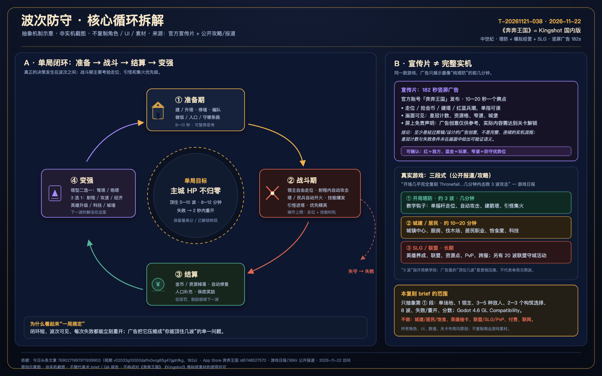
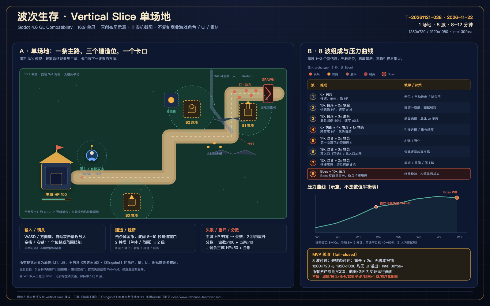

# 波次防守拆解：《奔奔王国》宣传片 + Godot Vertical Slice Brief

> **任务**：T-20261121-038 · 2026-11-22 · 只做调研与 brief，不改游戏代码
> **来源链接**：<https://m.toutiao.com/is/Xt1ba_Px_vo/> → 文章 ID `7690271997971939903`
> **结论口径**：事实 / 推断 / 未知分开标注；所有数值建议均为原创设计，不是原游戏数值。

---

## 0. 结论先行

| 问题 | 结论 | 置信度 |
| --- | --- | --- |
| 这是什么 | **《奔奔王国》**，中世纪题材 **“塔防 + 模拟经营 + SLG”** 混合手游；公开报道普遍称其为点点互动/Century Games《Kingshot》的国内版本 | 高 |
| 平台 | 微信小游戏 + iOS（App Store 可查）；海外对应《Kingshot》为 iOS/Android | 高 |
| 视频是什么 | 来源账号「奔奔王国」（疑似官方）发布的 **182 秒竖屏宣传片/广告创意**，不是完整、连续的实机流程；画面至少出现沙漠峡谷、绿色城堡、世界地图等多个场景/角色 | 中高 |
| 一句话玩法 | 玩家操控领主在窄道/城堡前自由走位、自动攻击，靠拾取金币在预设位置建塔/修墙，**波间准备、战斗期引怪进塔并集火精英**，顶住一波波叛军；开局约 3 波后转入城建/SLG | 高 |
| 为什么是“一局搞定 / 顶住几波” | 广告把前期塔防压缩成“单局能守几波”的单一问题；真实游戏的开局塔防只有约 **3 波、几分钟**，之后是城镇经营与联盟 SLG；另有 **20 波**的联盟守城活动 | 高（3 波/20 波有公开来源） |
| 本报告建议复刻什么 | 只抽象 **第 1 段：波次防守钩子**——单场地、1 领主、3–5 种敌人、2–3 个构筑选择、8 波、失败/重开/分数；Godot 4.6 GL Compatibility | 建议 |

**关键判断**：这不是一个独立小游戏或作者 devlog，而是一款商业手游的宣传/广告创意（来源账号名称与内容均指向官方）。广告里的“红蓝兵潮、皇冠计数、资源格、落石碾压”很有传播性，但**不能当作完整实机数据**；真正可复刻的是“走位 + 自动攻击 + 波间建塔 + 引怪集火”的循环。

---

## 1. 来源识别与证据链

### 1.1 链接解析

- 短链 `https://m.toutiao.com/is/Xt1ba_Px_vo/` 302 到：
  `https://m.toutiao.com/article/7690271997971939903/`
- 移动页标题（页面真实元数据）：
  **挑战者，《奔奔王国》等你来战！**
- 任务里给的标题《挑战极限，一局搞定，你能顶住几波进攻》**没有出现在页面 `seoTDK`/`og:title` 中**；它更像是分享文案/投放标题。内容仍指向同一视频与“波次防守”卖点，但不能把它当作文章正式标题。
- 页面 `articleInfo` 关键字段：

| 字段 | 值 |
| --- | --- |
| `gid` / 文章 ID | `7690271997971939903` |
| `title` | 挑战者，《奔奔王国》等你来战！ |
| `source` / `detailSource` | 奔奔王国 |
| `publishTime` | 2026-09-28 01:42:59（UTC+8） |
| `videoId` | `v02033g10000daftv0vog65g47gphfkg` |
| `videoDuration` | 182 秒 |
| `videoPlayCount` | 12,841（访问时） |
| `impressionCount` | 12,813（访问时） |
| `posterUrl` | 640×1138 竖屏封面，画面为沙漠峡谷 + 蓝金英雄 + 红衣兵列 + 资源格「5」+ 右上皇冠计数「4」 |

### 1.2 视频拿到了什么

- PC 文章页是空壳；移动页里有一段 URL-encoded JSON，包含 `articleInfo.playAuthTokenV2`。
- 把 token base64 解码后得到 ByteDance VOD 的 `GetPlayInfo` 签名查询；请求 `vod.bytedanceapi.com` 返回 `PlayInfoList`，含 360p/540p/720p/1080p 四档 mp4。
- 本报告在本地下载了 720p（720×1280，30fps，182.138s），抽取关键帧做分析；**关键帧只放本地，不入仓库**（版权原因）。
- 逐帧可见的固定元素：
  - 右上角“皇冠 + 数字”计数（随场景变化 4→22→3→19→1→42→113，**不是连续的单局波数**）
  - 底部两行免责声明：**“广告创意仅供参考，广告素材宣传内容需达到一定关卡触发相应模块出现，实际以游戏内容为准”**
  - 画面水印「奔奔王国」
- 视频里至少出现三类场景：
  1. **沙漠峡谷**：蓝金英雄、红衣兵列、木桶/岩石、资源格「5/10/50」、金币掉落；
  2. **绿色城堡**：蓝色城堡、蓝方士兵、包围城堡的红色兵潮、资源格「5/10/20/50」；
  3. **落石场景**：巨大滚石沿路碾压红兵，出现 29/37/46 等伤害数字；同一视频后段还有俯视世界地图/领地界面。
- 角色也在变：有时是蓝金国王，有时是蓝袍法师/领主。**这更像多个广告创意的拼接/剪辑，而不是一局连续实机**。

### 1.3 游戏身份

- App Store（中国区）`id6748527570`：
  - 名称：**奔奔王国**
  - 类型：模拟 / 策略；关键词「游戏、模拟、策略」
  - 评分：4.8 / 55,263 个评分（访问时）
  - 开发者署名：`Fuzhou Dian Dian Song He Technology Co., Ltd`
  - 官方介绍原文：**“《奔奔王国》是一款塔防策略与模拟经营玩法结合的中世纪题材的游戏。”**
  - 官网：<https://benbenwangguo.cn/>
- 官网页脚：`国新出审〔2025〕1261号`、`ISBN 978-7-498-15255-8`、`沪ICP备2025110934号-3`，举报邮箱 `bbwg_contact@ddhd.cn`。
- 36Kr（2025-09-04）：
  - “点点互动旗下的 SLG《Kingshot》正式‘登陆’国内市场，上线了微信小游戏版本《奔奔王国》。”
  - “游戏继承了《无尽冬日》的‘SLG+X’核心框架，并在作为差异化来源的‘X’上选择了类《Thronefall》的极简风塔防。”
  - “玩家可以通过建造城墙、箭塔等设施进行抵御，同时用摇杆操控角色走位，在攻击范围内自动释放普攻与技能。”
- 游戏日报（2025-07）：
  - “《奔奔王国》……正是今年海外 SLG 市场最大的爆款新品《Kingshot》的国内版本。”
  - “游戏开场几乎完全复刻《Thronefall》的塔防玩法操作……**在几分钟内，玩家非常轻松的就能击败敌方单位的 3 波攻击**。”
- ScoredApps 对《Kingshot》的评测（更新于 2026-09-19）：
  - “Kingshot is not the tower-defence game its adverts show: **the first minutes are**, and then it becomes a Whiteout Survival-style kingdom builder.”
  - “after the siege tutorial you are a Governor managing a town, not a lane of turrets.”

### 1.4 事实 / 推断 / 未知

| 类型 | 内容 |
| --- | --- |
| **事实** | 文章真实标题、来源账号、182s 视频、发布时间、VOD 四档清晰度、封面与免责声明。 |
| **事实** | 《奔奔王国》是塔防 + 模拟经营 + SLG；开局塔防约 3 波/几分钟；之后转城建；另有 20 波联盟守城活动（来源见 §6）。 |
| **推断** | 视频是**广告创意/剪辑**，不是连续实机：多地图、多角色、计数器跳变、免责声明都支持这一点。 |
| **推断** | 右上皇冠计数更像**金币/积分/活动货币**，不是“当前波数”；无法从画面证明其语义。 |
| **推断** | 广告里的红兵数量、落石伤害、资源格数值是**演出/投放素材**，不是可复现的真实平衡数据。 |
| **未知** | 视频中单局的失败条件、准确波数、塔的数值与升级树；广告没有给出可验证口径。 |
| **未知** | App Store HUD 图标的准确含义（如“4/4”、手形 65,000）；只能按常见 SLG 习惯推测为人口/战力/资源，不能当事实。 |

---

## 2. 机制拆解

> 下图是**抽象机制**，不是实机截图；角色、UI、塔的造型均为原创几何示意。

（矢量版：`docs/shots/wave-defense-loop.svg`）

### 2.1 一句话玩法与三层结构

**一句话**：领主在窄道/城堡前自由走位，射程内自动攻击；波间用金币在固定位置建塔/修墙，战斗中把敌人引进塔的射程、优先击杀精英；主城不倒就进入下一波，越守越强。

真实产品是“三层洋葱”：

| 层 | 内容 | 时长/作用 | 证据 |
| --- | --- | --- | --- |
| ① 开局塔防 | 单摇杆走位、自动攻击、建箭塔/城墙、引怪集火；约 3 波 | 几分钟；教学 + 留存钩子 | 36Kr、游戏日报、新手攻略 |
| ② 城建/居民 | 城镇中心、厨房、磨坊、伐木场、居民职业、饱食度、科技 | 几分钟（公开评测只称 “first minutes”，精确值未公开） | App Store 介绍、ScoredApps、攻略 |
| ③ SLG/联盟 | 英雄养成、联盟、资源点、PvP、跨服、20 波联盟守城 | 长期 | 36Kr、ScoredApps、66game |

**广告只卖第 ① 层**；本 brief 也只复刻第 ① 层。

### 2.2 核心循环

1. **准备期**：在预设建造位建/升塔、修墙、编队、补人口/饱食；根据“下一波方位/兵种/数量”提示布防。
2. **战斗期**：敌人从固定出生点沿预设路径推进；领主自由走位，射程内自动普攻/技能；塔与民兵自动开火；玩家把敌人引进塔的射程，优先处理精英。
3. **结算**：金币/资源掉落、波次奖励、为下一波做建造/升级。
4. **变强**：塔型二选一、塔升级、英雄/科技/城墙；下一波更强。

失败路径：主城/城镇失守 → 失败结算 → 重开。真实产品前期整体低惩罚、节奏快（评测称 “hands you a quick victory”）；建筑是否自动修复、居民是否自动补充，本报告未逐条核实。

### 2.3 单局结构：广告的“一局” vs 真实的“三段式”

| 结构 | 内容 | 备注 |
| --- | --- | --- |
| **广告叙事** | 一个领主 + 一条窄路 + 不断加码的红兵；皇冠计数上涨；偶尔落石/滚木清屏 | 10–20 秒一个爽点；竖屏单指可读；没有展示城建/SLG |
| **真实开局** | 剧情/选职业 → 第 1 波教学 → 首波奖励（300 面包 + 100 木材）→ 建厨房/指派厨师 → 第 2 波前建防御塔/编队 → 第 2 波 → 转城建教学 | 攻略口径：战士:弓箭手约 3:1；精英优先；引怪进塔 |
| **公开评测** | 开局几分钟塔防 → 转 Whiteout Survival 式城镇经营 | “the first minutes are” |
| **联盟活动** | 「维京人战争」20 波；每成功守一波刷新下一波；连续两波失败则停止；第 7/14/17 波只打在线成员；第 10/20 波打联盟总部 | 这是**另一个模式**，不是开局教学 |

**结论**：用户看到的“一局搞定，你能顶住几波”是广告对前期塔防的**压缩表达**；真实游戏并不是“一局无限波”，而是“3 波教学 + 城建 + 长期 SLG”，另有 20 波活动承接“守波”需求。

### 2.4 波次组成与节奏

**可观察（广告/截图）**：

- 敌人以**密集纵队/方阵**沿路推进，红衣、红盾、红色精英，和蓝方形成强对比。
- 路径是**预设的窄道/峡谷/城墙缺口**；有木桶、岩石、树木、城墙等场景物。
- 资源以**路上的金币**和**带数字的虚线资源格**（5/10/20/50/100 等）出现；英雄走过/击杀后拾取。
- 塔是**预设基座上的弩塔/炮塔**；App Store 截图里有“选择防御塔类型：弩塔 / 炮塔”的模态。
- 波次之间有**建造/升级窗口**；游戏会提示下一波的方位、兵种和数量（攻略口径）。
- 广告后段出现**落石**沿路碾压红兵，造成 29/37/46 等伤害并清出通道；这更像“环境陷阱/演出”，不是可确认的常驻机制。

**推断（用于复刻）**：

- 波次节奏应是“**短准备 → 高压战斗 → 快速结算 → 立刻下一波**”，单波 30–90 秒；广告为了留存把每波压缩到 10–20 秒一个爽点。
- 敌人 archetype 至少包括：**民兵（基础）、快跑（速度）、盾兵（护甲）、精英（高 HP/拆塔）、Boss（巨熊/巨汉）**；广告里的“落石”是环境 hazards，不是敌人。
- 难度曲线应在前 2 波教学、3–5 波引入护甲/精英、6–8 波要求构筑与资源分配；广告则用“数量碾压 + 落石清屏”制造视觉高潮。

### 2.5 难度曲线

| 阶段 | 压力来源 | 玩家应对 | 证据/说明 |
| --- | --- | --- | --- |
| 第 1 波 | 少量慢速民兵 | 走位、自动攻击、熟悉拾取 | 攻略：首波教学 |
| 第 2 波 | 数量增加 + 拆建筑 | 建厨房/防御塔，3:1 编队，引怪进塔 | 攻略明确 |
| 第 3 波 | 精英出现、建筑被拆 | 边移动边打、集火精英、放弃保不住的建筑 | 攻略明确 |
| 之后 | 城建/资源/人口/饱食 | 升级主城、资源建筑、科技 | 游戏转为经营 |
| 联盟 20 波 | 波次递进；连续两波失败即止 | 联盟驻防、在线波次、总部防守 | 66game 活动攻略 |

**设计启示**：原游戏前期整体低惩罚、快速给胜利（评测口径），让玩家愿意继续；复刻成单机 vertical slice 时，必须补一个**真实失败条件**（主城 HP），否则“顶住几波”没有张力。

### 2.6 敌人 archetype（观察 + 推断）

| archetype | 观察/证据 | 行为（推断） | 复刻用途 |
| --- | --- | --- | --- |
| 民兵 | 红衣、红盾、密集纵队 | 慢速、单体、攻击主城/塔 | 基础压力，教走位 |
| 快跑 | 广告中夹杂的轻型单位 | 高速、低 HP，迫使玩家移动 | 打破“站桩” |
| 盾兵 | 红盾/重甲外形 | 高 HP/减伤，推进慢 | 教玩家选炮塔/集火 |
| 精英 | 更大的红衣单位，出现在右侧/后排 | 高 HP、优先拆塔/建筑 | 教“优先精英” |
| Boss | App Store 截图「巨熊来袭!!」 | 大体积、范围重击、召唤杂兵 | 第 8 波终局 |
| 落石（非敌人） | 广告中滚石碾压红兵，伤害 29/37/46 | 环境陷阱/演出 | 可作为 stretch，不进 MVP |

> 广告里的红兵数量极大（几十到上百），明显是**演出规模**；真实 App Store 截图里的兵列规模小得多。复刻时不要按广告数量做性能预算。

### 2.7 玩家能力 / 升级 / 构筑

| 维度 | 原游戏（公开信息） | 复刻建议（原创） |
| --- | --- | --- |
| 移动 | 单摇杆/虚拟摇杆；领主自由走位 | WASD/方向键；手柄可选 |
| 攻击 | 射程内自动普攻 + 技能；可手动躲弹道/优先高威胁 | 自动攻击最近敌人；1 个位移/范围技能（8s CD） |
| 职业/英雄 | 开局选职业（攻略推荐战士）；英雄有霍华德、杰贝尔、狄安娜等；可升级/组队 | 不做英雄抽卡；只做 1 个通用领主 |
| 防御塔 | 弩塔（单体）/炮塔（范围）；固定基座；消耗金币；可升级 | 2 种塔 × 2 级；3 个固定建造位 |
| 城墙/路障 | 可建墙、路障、树桩；改变路径/聚怪 | 1 段可修矮墙/路障，改变敌人路径或减速 |
| 兵种 | 战士/弓箭手/骑士/矛兵；可驻塔；3:1 编队 | MVP 不做多兵种；用“民兵自动协防”抽象 |
| 科技/城建 | 主城、厨房、磨坊、伐木场、科技树 | 不做；只保留波间 3 选 1 |
| 构筑选择 | 塔型、英雄、科技、联盟 | 塔型二选一 + 2 次三选一（射程/攻速/经济） |

### 2.8 资源 / 风险 / 失败条件

- **资源**：金币（建塔/升级）、木材/粮食/石料（城建）、人口/饱食度（经营）。广告里主要可视化的是**金币与资源格**。
- **风险**：建错塔/位置、金币不够、精英拆塔、主城被磨血；真实前期整体低惩罚，但具体修复/补偿规则未核实。
- **失败**：
  - 开局：攻略没有强调“单波失败即结束”，更像教学战；
  - 联盟活动：**连续两波防守失败** → 维京人停止进攻（活动结束）；
  - 广告：没有展示失败条件，只展示“顶住更多波”的正反馈。
- **复刻建议**：主城 HP 归零 = 失败；英雄死亡不结束（5 秒复活，扣 10 金币），避免一次走位失误直接抹掉 10 分钟。

### 2.9 为什么是“一局搞定 / 顶住几波”

1. **单局闭环短**：准备 → 战斗 → 结算 → 变强，几分钟就能走完一轮。
2. **波次是天然的进度条**：玩家只需要回答“还能不能再守一波”。
3. **广告把多变量压成单变量**：城建、资源、英雄、联盟都不展示，只留下“红兵来了 → 你守不守得住”。
4. **真实游戏的 3 波教学**正好适合做“一局”的骨架；20 波联盟活动则提供了“长局”的想象空间。
5. **低惩罚 + 快速重开**让“再来一局”成本很低；这是广告和前期留存能成立的关键。

### 2.10 机制表（复刻取舍）

| 机制 | 证据 | 设计作用 | 复刻取舍 |
| --- | --- | --- | --- |
| 固定路径波次 | 攻略/截图/广告 | 可预期、可布防、可做数值曲线 | ✅ 保留：1 条主路 + 1 个卡口 |
| 自由走位 + 自动攻击 | 36Kr/游戏日报/截图 | 低操作门槛，保留动作感 | ✅ 保留：WASD + 自动索敌 |
| 固定建造位 | 九游攻略 | 降低摆放复杂度，强调资源分配 | ✅ 保留：3 个建造位 |
| 波间建造/升级 | 攻略 | 真正的策略决策 | ✅ 保留：8–10 秒准备 + 2 次三选一 |
| 引怪进塔/集火精英 | 攻略 | 把“走位”变成战术 | ✅ 保留：塔射程 + 精英优先 |
| 下一波预告 | 九游攻略 | 让布防有信息依据 | ✅ 保留：HUD 显示波次/兵种/数量 |
| 前期低惩罚/快速胜利 | ScoredApps 评测 | 降低前期挫败、保证留存 | ⚠️ 部分保留：波间回 5 HP，但不白送 |
| 城建/居民/饱食 | App Store/攻略 | 长线经营 | ❌ 不做（超出 slice） |
| 英雄抽卡/养成 | App Store 截图 | 商业化/长线 | ❌ 不做 |
| 联盟/PvP/20 波活动 | 36Kr/66game | 长线社交 | ❌ 不做 |
| 广告落石/滚木 | 视频 120–150s | 清屏爽点/环境陷阱 | ⚠️ Stretch：可作为一次性陷阱，不进 MVP |

---

## 3. 体验与表现

### 3.1 镜头 / 场地

- **竖屏 9:16**：广告 720×1280；App Store 截图 1242×2688。完全为单手握持设计。
- **固定 3/4 俯视/等距**：没有自由镜头；主城、路径、下一波方向始终在画面内。
- **单屏信息**：一条主路 + 一个卡口 + 一个主城；场景物（岩壁、木桶、树、城墙缺口）天然形成“漏斗”。
- **两种主视觉**：
  - 沙漠峡谷：暖沙色 + 红色岩壁 + 蓝金英雄；高对比；
  - 绿色城堡：绿色草地 + 蓝色城堡 + 红色兵潮；更接近 App Store 实机截图。
- **世界地图**：视频末尾出现俯视领地/世界地图，说明广告也在为 SLG 长线做铺垫。
- **规模差异**：广告的兵潮是“屏幕级”的，真实截图是“小队级”的；复刻以真实截图的规模做性能预算。

### 3.2 UI / HUD

| 元素 | 观察 | 语义（推断） | 复刻建议 |
| --- | --- | --- | --- |
| 左上头像 + 绿条 | 国王头像 + 绿色条 | 英雄 HP/等级 | 保留：HP 条 + 等级 |
| 手形图标 + 数字 | 65,000 / 95,000 | 战力/领导力/人口容量 | 不照搬；用“波次/金币”替代 |
| 人头图标 4/4 | 4/4 | 人口/小队/生命？**未知** | 不复刻该图标语义 |
| 木材/金币条 | 24.5K / 13,760 | 木材/金币 | 保留金币；木材可做 stretch |
| 右上皇冠计数 | 4→22→3→19→1→42→113 | 金币/积分/活动货币 | 用“金币”或“分数”，不要叫波数 |
| 建造模态 | 弩塔 / 炮塔 | 塔型二选一 | 保留 2 选 1 |
| 资源格 | 虚线绿框 + 数字（5/10/20/50…） | 可拾取资源/奖励 | 保留：金币拾取或波次奖励 |
| 浮字 | +198、+659,786、29/37/46 | 资源/战力/伤害 | 保留：伤害数字 + 金币飘字 |
| 波次预告 | 攻略称会提示方位/兵种/数量 | 布防信息 | 保留：顶部/侧边小条 |

**原则**：广告 UI 是“图标 + 大数字 + 高对比”，几乎不依赖阅读；复刻也应保持“3 秒可读”，不要做复杂面板。

### 3.3 命中 / 受击 / 奖励反馈

- **塔**：弩塔发射细长光束/箭线；炮塔有更大的弹道/爆炸；命中时有闪光/数字。
- **英雄**：自动攻击有短促的打击特效；受击有闪白/击退（广告中可见轻微位移）。
- **敌人**：红兵被击中有硬直/散开；落石碾压时有大量伤害数字和清屏感。
- **奖励**：金币从敌人身上弹出、落地、被英雄吸附；资源格被踩过/拾取后消失。
- **建筑**：被拆时冒烟/晃动；真实游戏是否波间自动修复未核实；复刻建议为“花金币修复”。
- **可读性**：红=敌方、蓝金=玩家、绿=可交互/资源；不依赖小字；数值大、颜色亮、层级少。
- **血腥度**：无血腥；卡通化 3D、圆润轮廓、细节克制，适合买量与全年龄。

### 3.4 数值可读性

- 广告里伤害数字 29/37/46、资源 5/10/50/80/100、战力 +659,786 都使用**大字号 + 描边/高对比**。
- 真实截图 HUD 数字（65,000 / 24.5K / 13,760）用 K/M 缩写，减少宽度。
- 复刻建议：
  - 伤害数字 1.0–1.2 秒淡出，暴击/精英伤害用不同颜色；
  - 金币飘字向上 + 吸附，避免遮挡路径；
  - HUD 只保留“波次、主城 HP、金币、技能 CD”四项；
  - 敌人血条只在受伤后显示 2 秒，避免满屏血条。

### 3.5 波次间隙 / 奖励节奏

- **广告**：约每 10 秒切一个场景/爽点（走位、拾币、建塔、兵潮、落石），用剪辑替代真实等待。
- **真实游戏**：波间是建造/经营窗口，时长未公开；开局教学会用剧情/建造引导填充。
- **复刻建议**：8–10 秒准备窗口，显示“下一波：数量/兵种/方位”，允许 1 次快速建造/升级；准备结束前 3 秒倒计时 + 音效；波次结算 2 秒内完成，不打断节奏。

### 3.6 关键帧（仅本地分析，未入仓）

| 时间 | 场景 | 可观察内容 |
| --- | --- | --- |
| 0s | 沙漠峡谷 | 蓝金英雄、3 个红兵、资源格「5」、皇冠「4」、底部免责声明 |
| 30s | 沙漠城堡 | 城堡、红衣兵列、资源格「50」、皇冠「22」 |
| 60s | 绿色城堡 | 蓝色城堡被红色兵潮包围、蓝方士兵、皇冠「3」 |
| 90s | 绿色城堡 | 红色重甲/精英单位、红兵潮、皇冠「19」 |
| 120s | 沙漠 | 蓝袍领主、滚石出现、资源格「5」、皇冠「1」 |
| 150s | 沙漠 | 滚石碾压红兵、蓝方士兵、资源格「20」、皇冠「42」 |
| 170s | 世界地图 | 俯视领地/资源点/城堡、皇冠「113」 |

> 关键帧只保存于本地临时目录，用于本报告分析；仓库内只保留 §4 的原创示意图。

### 3.7 广告 vs 实机的差异

| 维度 | 广告创意 | 实机/公开截图 | 复刻取舍 |
| --- | --- | --- | --- |
| 兵潮规模 | 几十到上百，铺满屏幕 | 小队级，路径上十几到几十 | 以实机规模做性能预算 |
| 场景 | 沙漠、绿地、世界地图快速切换 | 单个领地/关卡 | 只做 1 个场地 |
| 角色 | 国王/法师/领主混用 | 固定领主 + 英雄 | 1 个原创领主 |
| 皇冠计数 | 跳变，像货币/积分 | 资源 HUD | 不做“皇冠波数” |
| 失败条件 | 未展示 | 活动有连续两波失败即止 | 自定义主城 HP |
| 免责声明 | 明确“广告创意仅供参考” | — | 不把广告当实机数据 |

---

## 4. 复刻建议：Godot 4.6 GL Compatibility 波次生存 Vertical Slice

> 目标不是复刻《奔奔王国》，而是复刻**“单局守波”的抽象体验**：低操作门槛、清晰的波次压力、波间变强、快速重开。

（矢量版：`docs/shots/wave-defense-slice-layout.svg`）

### 4.1 目标与约束

| 项 | 约束 |
| --- | --- |
| 引擎 | Godot 4.6，**GL Compatibility** 渲染器 |
| 视角 | 2D 固定 3/4 俯视（可用 2D 伪等距/正俯视），单屏，无镜头移动 |
| 分辨率 | 基准 1280×720；同时验证 1920×1080；`canvas_items` + `expand` |
| 帧率 | 目标 60fps；Intel 核显最低 30fps+（1280×720） |
| 单局 | 8 波，8–12 分钟 |
| 平台 | Windows/macOS 桌面优先；键鼠 + 可选手柄 |
| 资产 | 100% 原创或 CC0；不复制商业游戏角色/UI/素材/关卡 |
| 范围 | 只做波次防守；不做城建/抽卡/联盟/联网/付费 |

### 4.2 MVP 范围

**做（MVP）**

- 1 个场地：一条主路、3 个固定建造位、1 个卡口、1 个主城。
- 1 个玩家领主：移动、自动攻击、1 个技能、死亡复活。
- 5 种敌人（含 Boss）：民兵、快跑、盾兵、精英、Boss。
- 2 种塔：弩塔（单体）、炮塔（范围）；各 2 级；可卖 50%。
- 3 个构筑决策点：塔型二选一 + 2 次三选一（射程/攻速/金币）。
- 8 波；波间 8–10 秒准备；波次预告；失败/重开/分数。
- HUD：波次、主城 HP、金币、技能 CD；伤害数字、金币飘字、命中闪白。
- 1 套原创色板 + 简单几何/手绘风资产；基础音效（可选）。

**Stretch（不进 MVP）**

- 第 6 波可选第二入口/分叉路。
- 一次性环境陷阱（落石/滚木），每局 1 次。
- 第二生物群系/夜间光照。
- 手柄支持、每日种子、排行榜。

**不做（明确排除）**

- 城建、居民职业、饱食度、厨房/磨坊/科技树。
- 英雄抽卡、英雄队伍、装备、战力数值。
- 联盟、PvP、跨服、20 波活动、联网、付费。
- 程序化地图、3D 模型、复杂粒子/后处理、广告式大规模兵潮。

### 4.3 单场地布局

| 元素 | 建议 | 理由 |
| --- | --- | --- |
| 主城 | 屏幕左下/左侧，HP 100；被敌人攻击扣血 | 明确的失败锚点 |
| 主路 | 从右侧出生点蜿蜒到主城，2–3 个弯 | 给塔射程重叠/卡口 |
| 卡口 | 路径中段收窄，两侧岩壁/墙 | 引怪与范围塔的价值 |
| 建造位 | 3 个固定基座：B1 靠近出生点、B2 卡口内侧、B3 主城前 | 覆盖不同策略；固定位降低操作复杂度 |
| 资源 | 击杀掉金币；波间奖励；可选 1–2 个资源格 | 经济正反馈 |
| 镜头 | 16:9 固定 3/4 俯视；不跟随、不缩放 | 保证全局可读性 |
| 第二入口 | 仅 Stretch：第 6 波从上方分叉 | 增加分兵决策 |

### 4.4 玩家 / 敌人 / 塔（原创建议数值）

> 以下全部是**建议起点**，不是原游戏数值；实现后必须用 playtest 调整。

**玩家领主**

| 属性 | 建议值 |
| --- | --- |
| HP | 100；死亡后 5 秒在主城复活，扣 10 金币 |
| 移速 | 5.5 单位/秒 |
| 普攻 | 自动攻击 5.5 范围内最近敌人；1.2 次/秒；12 伤害 |
| 技能 | 冲刺/范围斩：8 秒 CD；对路径上敌人造成 30 伤害并击退 |
| 拾取 | 半径 1.2；金币自动吸附 |

**敌人**

| 类型 | HP | 速度 | 伤害 | 行为 | 金币 |
| --- | ---: | ---: | ---: | --- | ---: |
| 民兵 | 30 | 2.2 | 5 | 直冲主城；攻击路径上的塔/墙 | 2 |
| 快跑 | 18 | 4.0 | 4 | 优先绕后/冲主城；迫使玩家移动 | 2 |
| 盾兵 | 80 | 1.6 | 8 | 减伤 40%（对单体箭塔）；慢速推进 | 4 |
| 精英 | 300 | 1.8 | 20 | 优先拆塔；有前摇重击 | 15 |
| Boss | 1500 | 1.4 | 30 | 范围重击；50% HP 召唤 4 个民兵 | 50 |

**防御塔**

| 塔 | 造价 | 射程 | 攻速 | 伤害 | 特性 |
| --- | ---: | ---: | ---: | ---: | --- |
| 弩塔 | 50 | 6.0 | 1.5/s | 10 单体 | 对盾兵伤害 ×0.6；便宜、稳定 |
| 炮塔 | 70 | 5.5 | 0.6/s | 25 范围（1.6） | 对密集兵潮/盾兵有效；慢 |
| 升级 | +60/80 | +10% | +10% | +25% | 2 级；卖塔返还 50% |

**构筑选择**

- 第 2 波前/建第一座塔时：塔型二选一（弩塔/炮塔）。
- 第 4 波后：三选一 —— ① 塔射程 +20%；② 英雄攻速 +25%；③ 击杀金币 +1。
- 第 7 波后：三选一 —— 同上，可叠一次；或替换为“主城回复 20 HP/塔位 +1”。
- 总计 3 个决策点，符合“2–3 个升级/构筑选择”。

### 4.5 8 波曲线

| 波 | 组成 | 出怪间隔 | 准备 | 教学/决策 | 奖励 |
| --- | --- | ---: | ---: | --- | ---: |
| 1 | 6× 民兵 | 1.2s | 10s | 走位、自动攻击、拾金币 | 20 金 |
| 2 | 10× 民兵 + 2× 快跑 | 1.1s | 10s | 建第一座塔（塔型二选一）；理解射程 | 25 金 |
| 3 | 12× 民兵 + 3× 盾兵 | 1.0s | 10s | 护甲概念；塔升级 | 30 金 |
| 4 | 6× 快跑 + 4× 盾兵 + 1× 精英 | 0.9s | 10s | 引怪进塔、集火精英；第 1 次三选一 | 35 金 |
| 5 | 14× 混合 + 2× 精英 | 0.8s | 10s | 资源分配；塔升级 | 40 金 |
| 6 | 18× 混合 + 3× 精英 | 0.75s | 10s | 单入口加压（Stretch：第二入口） | 45 金 |
| 7 | 12× 混合 + 2× 精英 | 0.7s | 10s | 卖塔/重修/保主城；第 2 次三选一 | 50 金 |
| 8 | Boss + 10× 民兵 | 0.8s | 12s | 终局检验：构筑是否成立 | 100 金 |

**节奏目标**：单局 8–12 分钟；首次失败落在 W4–W6；首通率 40–60%（5 人内部试玩）；失败后 2 秒内可重开。

### 4.6 经济 / 失败 / 重开 / 分数

- **经济**：击杀金币 1–3；波次结算 20–100；塔造价 50/70；升级 60/80；卖塔 50%。
- **失败**：主城 HP 归零 → 失败结算；英雄死亡不结束（5 秒复活，扣 10 金币）。
- **重开**：失败界面 → 按 R/点击“再来一局” → 立即重置（<2 秒），保留最高分。
- **分数**：`波数×100 + 击杀×10 + 剩余主城 HP×50 + 剩余金币×1`；显示 S/A/B/C 等级；本地保存最高分。
- **波间**：显示下一波“数量/兵种/方位”；倒计时 8–10 秒；可暂停思考（单机）。

### 4.7 UI / 反馈 / 可读性

- **HUD**：左上主城 HP + 波次；右上金币；底部技能 CD/建造按钮；顶部中间波次预告。
- **建造**：点击固定基座 → 弹出“弩塔/炮塔”两卡；显示造价、射程、DPS；确认后立即建造。
- **反馈**：命中闪白 80ms；伤害数字 1 秒淡出；金币向上飘并吸附；精英/Boss 受击有更重顿帧/震屏（可选）；塔被拆有烟雾。
- **可读性**：敌人红、玩家蓝金、资源绿金；不依赖小字；血条仅在受伤后显示；同屏敌人上限 80。
- **色板建议**：沙/草双色可选；主色不超过 5 个；避免与《奔奔王国》的具体角色/UI 造型相似。

### 4.8 技术方案（Godot）

| 模块 | 建议实现 |
| --- | --- |
| 主场景 | `Main.tscn`：Arena、Path、Spawner、BuildPads、HUD |
| 路径 | `Path2D` + `PathFollow2D`；敌人沿路径推进；卡口/分叉用多个 Path2D |
| 玩家 | `CharacterBody2D`；自动索敌 `Area2D`；技能用 `Timer`/状态机 |
| 敌人 | `CharacterBody2D` 或轻量 `Node2D` + 手动移动；对象池复用 |
| 塔 | `Area2D` 检测射程；`Timer` 开火；弹道用简单 `Line2D`/`Sprite2D` |
| 波次 | `WaveData`（Resource）：数量、类型、间隔、奖励、预告文本；`WaveManager` 状态机 |
| 经济/分数 | Autoload `GameState`：金币、HP、波次、分数、最高分 |
| HUD | `CanvasLayer` + Control；`Label`/`TextureProgressBar`；避免每帧重建 |
| 性能 | 对象池（敌人/金币/伤害数字）；同屏 ≤80 敌人；禁用昂贵 shader；粒子上限；`--print-fps` 验证 |
| 输入 | `InputMap`：WASD/方向键、空格技能、鼠标建造、R 重开 |
| 分辨率 | 项目设置 `display/window/stretch/mode = canvas_items`，`aspect = expand`；基准 1280×720 |
| 测试 | `tests/verify_waves.gd` headless 跑 8 波模拟，输出 `WAVES_OK`；手动 smoke |

### 4.9 验收清单（fail-closed）

- [ ] `godot --headless --path . --script tests/verify_waves.gd` 输出 `WAVES_OK 8`，退出码 0。
- [ ] 手动完整跑通 8 波；W4–W6 至少能出现一次失败；失败后 2 秒内可重开。
- [ ] 1280×720 与 1920×1080 下 HUD 不溢出、路径/敌人不被裁切。
- [ ] Intel 核显 1280×720 平均 ≥30fps；无每帧 GC 抖动；同屏 80 敌人不崩。
- [ ] 2 种塔、5 种敌人、3 个决策点均可用；塔型/升级选择在 HUD 有明确反馈。
- [ ] 无脚本报错/警告；无缺失资源；重开 20 次无内存增长异常。
- [ ] 所有资产原创或 CC0，并在 `docs/` 记录来源/许可；不包含商业游戏素材。
- [ ] 交付 1 张 W1/W4/W8 截图 + 1 段 10–20 秒失败/重开 GIF/MP4（真实运行，非概念图）。
- [ ] 5 人内部试玩：≥3 人在 3 分钟内说出“引怪进塔 + 波间变强”；≥3 人首局失败在 W4–W6；≥3 人愿意重开。

### 4.10 实施顺序与角色分工

| 步骤 | 内容 | 验证 | 角色 |
| --- | --- | --- | --- |
| 1 | 场地/路径/玩家移动/自动攻击 | 10 个木桩敌人可被击杀 | game-engineer |
| 2 | WaveManager + 5 波 + HUD | 5 波跑通，波次预告正确 | game-engineer |
| 3 | 建塔/升级/经济 | 2 种塔可建/可卖/可升 2 级 | game-engineer |
| 4 | 5 种敌人 + 精英/Boss + 反馈 | 每种敌人行为可复现；Boss 可击杀 | game-engineer（行为）+ game-artist（视觉，独立任务） |
| 5 | 8 波曲线 + 失败/重开/分数 | 完整单局 8–12 分钟；失败可重开 | game-engineer |
| 6 | 性能/分辨率/原创资产/截图 | 30fps+；1280/1920；证据齐全 | game-engineer（性能）+ game-qa-lead（独立验收） |
| 7 | 美术独立复评 | 画面/可读性/风格一致性 | game-art-director |

> 本任务（T-20261121-038）只产出 brief，不实现上述步骤；实现应由独立任务按角色拆分发。

### 4.11 Playtest 假设与 kill criteria

**假设**：玩家在 3 分钟内理解“引怪进塔 + 波间变强”；第 4–6 波出现第一次有意义的失败；失败后愿意立刻重开。

**测试**：5 人，首次游玩不看说明；记录：
- 首次理解“塔的射程/引怪”的时间；
- 首次失败波次与原因；
- 失败后是否重开；
- 是否能说出至少 1 个构筑选择的影响。

**Kill criteria**：
- >50% 玩家无法解释自己为什么输 → 重做波次预告/反馈/难度曲线；
- W4 之后没有出现“建塔 vs 升级 vs 卖塔”的真实取舍 → 砍掉多余系统，强化经济压力；
- 同屏 80 敌人无法稳定 30fps → 降低数量/简化特效，不牺牲可读性；
- 玩家把游戏当成“无脑挂机” → 增加精英/快跑对走位的压力，或减少自动攻击收益。

### 4.12 风险与缓解

| 风险 | 缓解 |
| --- | --- |
| 玩家以为是完整塔防/城建游戏 | 标题/首屏明确“波次生存 vertical slice”；不做城建入口 |
| 广告式大规模兵潮导致性能崩 | 以实机规模为准；同屏 ≤80；对象池/简化特效 |
| 自动攻击导致“无脑” | 精英/快跑迫使走位；技能时机；塔位/经济取舍 |
| 单局太长/失败太挫败 | 8 波 8–12 分钟；英雄死亡复活；重开 <2s |
| IP 风险 | 只抽象机制；原创角色/UI/数值/关卡；不复制广告画面 |
| 范围膨胀 | MVP/Stretch/不做三张清单；任何新增先过 kill criteria |

---

## 5. IP 边界

**这是商业游戏，不是开源 demo。** 只分析抽象机制，不复制表达。

| 可以 | 不可以 |
| --- | --- |
| “波次防守、固定路径、建塔、引怪、自动攻击、波间升级”等**通用机制** | 使用《奔奔王国》《Kingshot》名称、Logo、商标、角色名（霍华德/杰贝尔/狄安娜等） |
| 原创的中世纪/沙绿风格、原创领主、原创塔/敌人造型 | 复制蓝金国王、红衣叛军、巨熊 Boss、弩塔/炮塔的具体造型/图标/配色组合 |
| 原创 UI 布局与图标 | 复制 App Store 截图/广告帧/UI 布局/图标/字体排版 |
| 原创数值/关卡/波次曲线 | 复制广告画面、音乐、音效、配音、文案 |
| 引用来源做分析、标注 URL/访问日期 | 把广告关键帧、截图、视频片段提交进仓库或对外发布 |
| 使用 CC0/MIT 资产并记录许可 | 使用来源不明的“免费素材”或参考游戏拆包资源 |

**仓库策略**：

- `docs/shots/` 只放**原创示意图**（本报告的两张 SVG/PNG）。
- 广告关键帧只放本地临时目录，分析完不提交；如未来需要证据，只记录时间点与文字描述。
- 游戏内不出现“奔奔王国/Kingshot”字样；不使用“国王/奔奔”作为角色名/IP 名称。
- 若对外发布，附免责声明：本作为玩法原型，与上述商业游戏无关联、未获其授权、未使用其素材。

---

## 6. 来源与访问日期

> 访问日期均为 **2026-11-22**。部分页面有反爬/地域限制，以下为本报告实际抓取或核验过的来源。

| ID | 来源 | URL | 用途 |
| --- | --- | --- | --- |
| S1 | 今日头条文章《挑战者，《奔奔王国》等你来战！》 | <https://www.toutiao.com/article/7690271997971939903/> | 标题、来源账号、视频 ID、时长、发布时间、封面、免责声明 |
| S2 | 今日头条短链 | <https://m.toutiao.com/is/Xt1ba_Px_vo/> | 短链解析入口 |
| S3 | App Store《奔奔王国》 | <https://apps.apple.com/cn/app/%E5%A5%94%E5%A5%94%E7%8E%8B%E5%9B%BD/id6748527570> | 官方介绍“塔防策略 + 模拟经营”、评分、开发者、官网 |
| S4 | 《奔奔王国》官网 | <https://benbenwangguo.cn/> | 版号/ISBN/ICP 备案信息 |
| S5 | 36Kr《版号到手仅 1 个月，“榜一大哥”突然现身了》 | <https://www.36kr.com/p/3451044240594310> | Kingshot 国内版、微信小游戏、Thronefall 式塔防、摇杆走位/自动攻击 |
| S6 | 游戏日报《版号就位！今年海外最爆的 SLG 新品要杀回国内了》 | <http://news.yxrb.net/mobile/index.php?m=mobile&c=index&a=show&catid=6&id=5766>；网易镜像 <https://www.163.com/dy/article/K563RDOV052682V2.html> | 国内版本关系、开局 3 波/几分钟、Thronefall 操作 |
| S7 | ScoredApps《Kingshot – Review》 | <https://scoredapps.com/games/kingshot/> | “first minutes are tower defence, then kingdom builder”；广告与实机差异 |
| S8 | 看个号《奔奔王国新手必看攻略》 | <https://www.kangehao.com/news/150373.html> | 开局流程、首波奖励、厨房、第二波建塔、3:1 编队、引怪集火 |
| S9 | PP 助手/九游《奔奔王国防御塔摆放策略》 | <https://wap.pp.cn/news/725905.html> | 固定建造位、金币消耗、预设路径、下一波方位/兵种/数量提示 |
| S10 | 66 安卓网《奔奔王国维京人战争的高分技巧指南》 | <https://www.66game.cn/article/7509.html> | 20 波联盟活动、连续两波失败停止、第 7/14/17 波、第 10/20 波总部 |

**证据说明**：

- S1 的正式标题与任务提供的标题不同；本报告以 S1 的 `articleInfo.title` 为准，并在 §1.1 说明差异。
- 视频直链是带签名的临时 URL，不适合长期引用；复现请用 S1 的文章 ID + `playAuthTokenV2` 重新获取。
- 广告关键帧/截图属于商业宣传素材，本报告只做本地分析，不纳入仓库。

---

## 7. 附录：复现路径与未确认项

### 7.1 复现路径（供后续研究）

1. `curl` 短链，跟随 302 到 `m.toutiao.com/article/7690271997971939903/`。
2. 在移动页 `<script>` 中找到 URL-encoded JSON，`urllib.parse.unquote` 后解析 `articleInfo`。
3. 读取 `playAuthTokenV2`，base64 解码得到 `GetPlayInfoToken`（含 `video_id`、`aid=13`、签名）。
4. 请求 `https://vod.bytedanceapi.com/?<decoded query>`，从 `PlayInfoList` 取 360p/540p/720p/1080p 的 `MainPlayUrl`。
5. `ffmpeg` 抽帧（本报告用 720p、每 10 秒一张 contact sheet + 0/30/60/90/120/150/170s 关键帧）。
6. 页面 `posterUrl` 也可单独下载 640×1138 封面，用于 OCR/识别。

### 7.2 未确认项（不要当事实）

- 视频中皇冠计数的准确语义（金币/积分/活动货币/波数？）。
- 视频中每个场景的真实波数、失败条件、塔的数值。
- 广告画面是否为引擎内实机录制、预渲染，或后期合成（多地图/多角色/剪辑痕迹强烈，但无法证明）。
- App Store HUD 中“4/4”、手形 65,000 等图标的准确含义。
- 国内运营主体与海外 Century Games 的完整法律关系（App Store 开发者署名与公开报道口径不完全一致；本报告只陈述各自来源）。

### 7.3 一句话给实现者

> 做“**一条路、一个卡口、三座塔位、八波红兵**”的单机原型：让玩家在 3 分钟内学会“把敌人引进塔的射程”，在 W4–W6 输一次，并想立刻再来一局；不要做城建、抽卡、联盟和广告里的大规模兵潮。
