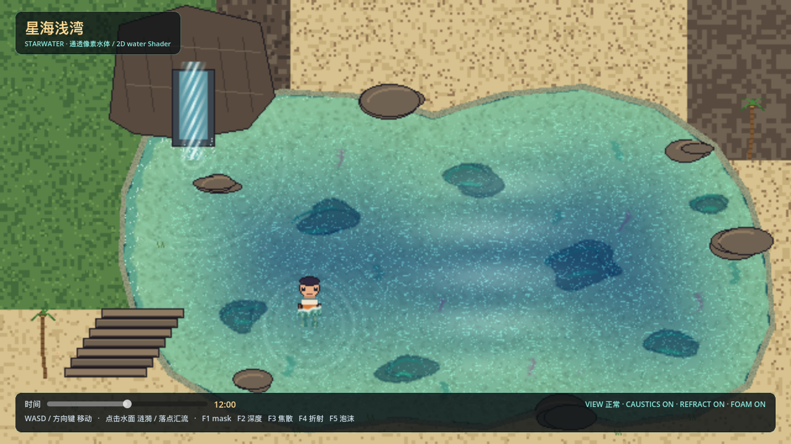
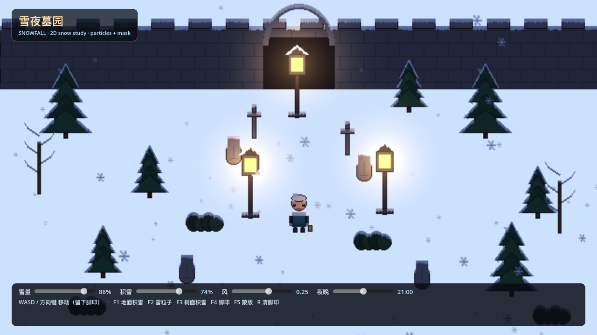

# 技术方案总览

> 2026-11 · 本阶段 6 个可运行 Demo + 3 份技术调研的横向整理。
> 每个方案按 **目标 → 核心方案 → 关键参数 → 代码落点 → 踩坑 → 验收** 记录，
> 并统一给出 **跨引擎（Godot / Unity / Unreal / Three.js）移植契约与映射**；
> 单项细节在各项目自己的 `docs/TECH.md`。
> 2026-11-18 补：新增第 9 章「跨引擎可移植性」（四层拆分 / 映射表 / 移植契约 / 验收清单）。
> 2026-11-18 再补：B 层落地为 `portable-core/`（Python / GDScript / JS 三语言 + golden 向量），
> `godot-iso-slice` 的移动与哈希已切到适配层（见 9.7）。

---

## 0. 索引

| # | 项目 / 文档 | 效果 | 技术栈 | 一句话方案 | 详细 |
| --- | --- | --- | --- | --- | --- |
| 1 | `godot-iso-slice` | 2D 等距地牢 | Godot 4.6 / GDScript | 128×64 等距 TileSet + Y-Sort + 脚底锚点 + 2D 烛光 | [TECH](../godot-iso-slice/docs/TECH.md) |
| 2 | `godot-iso-slice` 管线 | 规则→离线资产→运行时导入 | Python + GDScript | 同一 `rules.json` 双端执行，manifest + sha256，逐像素一致 | [PIPELINE](../godot-iso-slice/docs/PIPELINE.md) |
| 3 | `godot-iso-slice` Mod | GLB 运行时导入 | Godot 4.6 + glTF | manifest 校验 hash/tris/bounds/pivot 后 `GLTFDocument` 实例化 | [MODS](../godot-iso-slice/docs/MODS.md) |
| 4 | `godot-sea-water` | 《星之海》通透像素水体 | Godot 4.6 / GDScript | 水底/水面分层 + 屏幕纹理像素折射 + 焦散/泡沫/涟漪/水线 | [TECH](../godot-sea-water/docs/TECH.md) |
| 5 | `godot-snowfall` | 2D 雪天 | Godot 4.6 / GDScript | 8×3 雪花图集粒子 + 噪声蒙版地面积雪 + 雪帽/脚印/夜灯 | [TECH](../godot-snowfall/docs/TECH.md) |
| 6 | `craft-island` | Three.js 海岛水面 | Three.js r180 / Craft Anything | GPU 高度场 + 尾迹 + 泡沫 + shader 云 + 追尾相机 | [README](../craft-island/README.md) |
| 7 | `craft-cloudride` | Three.js 云海骑行 | Three.js / Craft Anything | 平面反射 RTT + 程序化骑手 IK + 低模云 | [README](../craft-cloudride/README.md) |
| 8 | `docs/saltline-teardown.md` | 1.42MB FPS 拆解 + 离线化 | Three.js | 程序化规则分层；哪些能烘、哪些只能运行时 | [拆解](saltline-teardown.md) |
| 9 | Craft Anything / REA | AI 净室复刻工作流 | Rust CLI + Claude Code | research → build → check → ready；REA 看内部，Craft 重建 | [README](../craft-cloudride/README.md) |

---

## 1. 2D 等距：`godot-iso-slice`

### 1.1 核心方案

1. **等距瓦片**：逻辑 tile `128×64`，`tile_shape = Isometric`，
   `tile_layout = DiamondDown`；图集单元做成 `128×160`，脚底画在单元 `y=128`，
   `texture_origin = (0, +48)` 把脚底对到逻辑 tile 中心。
2. **Y-Sort**：`World` 同时装 `Walls`（TileMapLayer）和 `Player`；
   层 `y_sort_origin = 32`（半格）把瓦片排序点推到菱形南顶点。
3. **等距移动**：`Vector2(input.x, input.y * 0.5)` 再 `normalized() * speed`；
   8 方向扇区：`int(floor((rad_to_deg(v.angle()) + 22.5) / 45.0))` + `posmod`。
4. **脚底锚点**：图集把脚底画在单元中心；精灵节点 `(0,0)`；胶囊在 `y=-11`。
5. **2D 烛光**：`CanvasModulate` 压暗 + 6 盏 `PointLight2D`（PCF5 软阴影）+
   TileSet occlusion layer（墙脚菱形）+ 火星粒子。

### 1.2 关键参数

| 参数 | 值 |
| --- | --- |
| tile | 128×64；atlas cell 128×160；texture_origin (0,48) |
| y_sort | layer `y_sort_origin=32`；World 包含墙层与玩家 |
| 玩家 | 50 行；速度 190；胶囊 r9/h22 @ y=-11；8 扇区 +22.5° |
| 场景 | 14×14；196 地面 / 36 墙；6 盏灯 |
| 教学开关 | F1 Y-Sort、F2 灯光、F3 管线、F4 Mod |

### 1.3 踩坑

- 忘了 `tile_shape/tile_layout` → 地砖按矩形堆叠、菱形之间空洞。
- `texture_origin` 符号反了 → 墙整体下移两格、角色悬空。
- 阴影 `z_index=-1` → 被地板盖住；去掉 z_index、同 y 先画。
- 等距“正后方”是 `(-1,-1)`，不是 `-y`；遮挡截图站位要用对角。
- 3D 灯光在 GL Compatibility + Intel 核显不工作（Mod 场景改用 unshaded）。

### 1.4 落点 / 验收

- 代码：`godot-iso-slice/src/iso_math.gd`、`src/player.gd`、
  `src/dungeon.gd`、`tools/build_tileset.gd`、`scenes/dungeon.tscn`。
- 验收：`godot --headless --path godot-iso-slice -s tools/smoke_iso.gd`
  → `ISO_SMOKE_OK`；截图 5 张、GIF 112 帧。

---

## 2. 程序化资产管线：规则 → 离线烘焙 → 运行时导入

### 2.1 架构

```
rules.json（唯一数据源）
   ├── Python tools/bake_pipeline.py
   │      └─ assets/generated/sigil_<seed>.png + manifest.json（sha256_rgba）
   └── GDScript src/sigil_rules.gd
          └─ Image（同 seed 逐字节相同）→ user://pipeline_cache → Image.load_from_file
```

### 2.2 关键做法

- 规则全部**整数**：32 位哈希（xorshift 风格）+ 显式 `& 0xFFFFFFFF`；
  避免跨语言浮点/噪声库差异。
- 离线产物带 **manifest**：`rules_version / seed / sha256_rgba / bytes`。
- 运行时生成后 `save_png` 到 `user://`，再 `Image.load_from_file` 读回，
  证明“运行时烘焙 + 缓存 + 重新导入”闭环。
- 5 个 seed 的 Python/GDScript 哈希完全一致；演示界面显示
  `MATCH · 0 px diff`。
- 缓存键：`rules_version + seed + palette_hash`；规则变→缓存失效。

### 2.3 三种落地路线

| 路线 | 适合 | 做法 |
| --- | --- | --- |
| A 构建期烘焙 | 正式内容 | CI/headless 烘焙 → manifest → 运行时加载 |
| B 运行时烘焙+缓存 | UGC/无限变体 | 同规则设备端生成 → IndexedDB/OPFS 或 `user://` |
| C 运行时导入外部资产 | Mod/UGC | manifest + PNG/GLB/OGG，校验后热加载 |

### 2.4 坑

- Godot 编辑器导入会做色彩空间/格式转换：同一 PNG 经 `load()` 后的像素哈希
  与原始 PNG 不同；要“逐像素证明”就用原始 PNG 读取。
- `Image.load_from_file("res://...")` 导出后不可用；生产内容用导入 Texture2D
  或把资产放 `user://`/PCK。
- 双执行器必须同步算法；`pipeline_check.gd` 是防回归闸门。

### 2.5 落点 / 验收

- 代码：`rules.json`、`tools/bake_pipeline.py`、`src/sigil_rules.gd`、
  `tools/pipeline_check.gd`、`scenes/pipeline_demo.tscn`。
- 验收：`PIPELINE_OK seeds=5` + `CACHE ROUNDTRIP OK`。

---

## 3. 运行时 GLB Mod 导入：`godot-iso-slice` Mod PoC

### 3.1 流程

```
res://mods（夹具）
  → 复制到 user://mods
  → 扫描 manifest.json
  → sha256 → GLTFDocument.append_from_file → generate_scene
  → 测量 tris / meshes / bounds
  → 校验 bounds / footprint / pivot / max_tris
  → 通过才实例化（unshaded + 顶点色）
```

### 3.2 校验项

| 校验 | 目的 |
| --- | --- |
| 必填字段 | id/file/sha256/bounds/footprint/pivot/max_tris |
| 文件存在 + sha256 | 完整性（不是作者签名） |
| glTF 解析 / meshes>0 | 合法性 |
| tris ≤ max_tris | 防超重资产 |
| bounds ≤ manifest（±0.02） | 防尺寸造假 |
| footprint ≤ 声明 | 防挡路范围不符 |
| \|min.y\| ≤ 0.02 | 脚底/底座锚点 |

### 3.3 坑

- bounds 要合并**所有 mesh**；第一版只取最后一个 mesh，合法资产被自己拒掉。
- sha256 ≠ 签名；正式平台要加签名/allowlist。
- glTF 外部 URI 要限制在 mod 目录；`.pck` mod 可带脚本，只信任签名包。
- GL Compatibility 3D 灯光在本机不工作 → 材质 unshaded + 顶点色。

### 3.4 落点 / 验收

- 代码：`src/mod_loader.gd`、`src/mod_demo.gd`、`tools/make_mod_glb.py`、
  `tools/mod_check.gd`、`scenes/mod_demo.tscn`。
- 验收：`MOD_CHECK_OK`（有效 mod 26 tris/2 meshes；坏 hash、坏 bounds 被拒）。

---

## 4. 通透像素水体：`godot-sea-water`



### 4.1 分层结构（核心）

```
Bottom（水底：沙/石/珊瑚/海草） ← 只有它“在水里”
Water（ColorRect + water.gdshader，读 hint_screen_texture）
Props（岸、台阶、岩石、棕榈、悬崖） ← 画在水面之上，不折射
Player（角色 + character_water.gdshader，自带水线）
```

水 shader 只采样它之前画的内容（Bottom），所以**折射/焦散只作用于水底**；
岸上物体在水面之后绘制，不参与扭曲。

### 4.2 五层

| 层 | 实现 |
| --- | --- |
| 1 mask | 640×360 池塘多边形；mask 外 `discard` |
| 2 折射底 | 屏幕纹理 + 像素级 UV 偏移（`floor(uv*res)/res`） |
| 3 水色 | 深度图混合浅/深色 + alpha（0.30–0.66），水底透出 |
| 4 泡沫 | 深度 < 0.16 的岸线 + 可平铺噪声 + 涟漪 |
| 5 焦散 | 64×64 Voronoi（9 站点）按 40px 平铺、滚动 |

深度图：陆地 BFS 距离/140×0.82 + x/y 偏置，存 0..255（**不要量化 16 级**）。
涟漪：8 个 `vec4` 槽（uv、start、strength），角色移动/静止/点击/瀑布落点。
角色水线：`line = 1 - submerge*0.62 + 曲线噪声`，水下 tint/涟漪/焦散 + 泡沫边。
昼夜：0–24 滑杆 → `day` 混合水色/泡沫/冷暖反光；F1–F5 教学开关。

### 4.3 坑

- fragment 里不能 `return`（Godot 4 shader 报错）→ if/else 单出口。
- **AtlasTexture 的 shader UV 是整张图集**，不是单帧 0..1；水线要传
  `u_frame_origin/u_frame_size` 用帧局部 UV。
- 改程序化 PNG 后必须 `--editor --quit` 重新导入，否则焦散/瀑布是旧图。
- 深度 16 级量化 → 竖直色带、入水高度跳变。
- 焦散线太粗/带红边 → 满屏噪点；细白/青线 + 更大平铺尺度。
- 低频阈值分色 → 地面迷彩块；改 3×3 哈希 dither。

### 4.4 落点 / 验收

- 代码：`assets/shaders/water.gdshader`、
  `assets/shaders/character_water.gdshader`、`src/world.gd`、`src/player.gd`、
  `tools/gen_art.py`。
- 验收：`SEA_SMOKE_OK`；日/夜/mask/深度/涟漪截图；GIF 7.5s。

---

## 5. 2D 雪天：`godot-snowfall`



### 5.1 核心方案

| 模块 | 实现 |
| --- | --- |
| 雪粒子 | 8×3（24 帧）雪花图集 + GPUParticles2D；`CanvasItemMaterial.particles_animation` + 程序材质；前后两层（170/55） |
| 风 | 直接改 `ParticleProcessMaterial.gravity.x`（wind×55） |
| 地面积雪 | 320×180 fBm 蒙版（双频 0.05+0.16、偏白分布）；`coverage` 阈值 + 冷色边缘；F5 看蒙版 |
| 树面积雪 | 从精灵“向上边缘”自动生成雪帽；每件道具独立 threshold，alpha=clamp((coverage-th)/0.32) |
| 脚印 | 10×8 脚印贴图，左右交替、12s 渐隐；Footprints `z_index=-1`；coverage>0.10 才留 |
| 夜灯 | CanvasModulate + 暖色 PointLight2D + 加色 glow 光池；角色提灯 |
| HUD | 雪量/积雪/风/夜晚滑杆 + F1–F5、R |

### 5.2 坑

- Godot 4.6 的 `CanvasItemMaterial` **没有** `particles_anim_speed`；赋值报错
  会让建模函数提前返回空字典，后续粒子层全挂。
- 雪蒙版低频+强对比 → 地面“迷彩块”；改双频 + 偏白分布。
- HUD 默认值会覆盖 world 的 0.74 → 用 `set_value_no_signal(world.*)` 再回调。
- 地面雪 shader 是 `unshaded`，PointLight2D 照不亮；路灯用加色 glow 光池。
- 截图/演示时脚印容易被 HUD 底栏挡住 → 角色走到画面中上段。

### 5.3 落点 / 验收

- 代码：`assets/shaders/snow_ground.gdshader`、`src/world.gd`、`src/player.gd`、
  `tools/gen_art.py`。
- 验收：`SNOW_SMOKE_OK`；夜景/小雪/黄昏/蒙版/脚印截图；GIF 10s。

---

## 6. Three.js WebGL：Craft Anything 净室复刻

### 6.1 工作流

```
Craft Anything CLI（Apache-2.0）
  doctor → rebuild <target> "<request>" --clean-room
  → research（可见证据/截图）→ build（本机 Claude Code）→ check → ready
  → 项目在 app/
```

- **REA**（`morluto/rea`）看程序内部（Ghidra/IDA）；**Craft Anything** 从可见
  行为重建；两者互补。
- 工具检查只支持有“可启动程序”的栈；纯静态站点需要自己补 Playwright
  **真实 GPU** 截图/视频，builder 加了一个零依赖 Rust 启动器让自检可跑。
- 第一版 GPU 实拍常暴露软件 WebGL 看不到的问题（见下）。

### 6.2 `craft-island`（Water Pro 海岛）

- Three.js r180；GPU 高度场模拟（局部 patch 跟随船）+ 船尾迹 + 泡沫 +
  shader 云 + 追尾相机；1280×720。
- 我们修复：sim RT 未初始化 → 清零；wake 每帧叠加 → 按 dt 缩放 + 高度 clamp；
  焦散/泡沫阈值；天空 fbm 云；船体水线色/红顶；棕榈/相机。

### 6.3 `craft-cloudride`（云海骑行）

- 真平面反射：相机按云海平面镜像到半分辨率 RTT，海面 shader 做模糊/涟漪；
- 程序化骑手：胶囊/球/柱低模 + 双骨骼 IK 踩踏 + 车轮旋转；
- 低模云 + 蓝天 + 控制（拖拽/滚轮/空格）；
- 坑：倒影被重复压暗 + 光照过暗（builder 自己修复）。

### 6.4 许可

Craft Anything Apache-2.0；Three.js MIT；两个 app 都是净室原创；参考视频
帧未随仓库分发。

---

## 7. Saltline 拆解（1.42MB FPS）

- 1,423,569 B / 6,193 行；Three.js r180 + 游戏代码（约 47.7%）；零二进制素材。
- 程序化：参数化几何 builder（变换栈/按材质合并/顶点色污渍/自动碰撞盒）、
  GLSL 世界坐标材质、Canvas 标签图集、57 个 Web Audio 合成音效、手写关卡+seed。
- 离线化结论：几何/标签/音频/关卡可烘；world-space 材质只能部分烘；
  天气/粒子/动态光照/混音不要烘死。
- 推荐：**构建期烘 base + 运行时同一套规则（seeded）+ manifest + 运行时导入**。
- 详见 [saltline-teardown.md](saltline-teardown.md)。

---

## 8. 横向复用清单

### 8.1 可以带走的模式

| 模式 | 适用 | 关键点 |
| --- | --- | --- |
| 脚底锚点 | 任何 2D 俯视/等距 | 图集脚底=节点原点；碰撞/阴影/Y-Sort 共用 |
| 分层渲染 | 2D 水面/倒影/遮挡 | 水底 → 水面 shader → 岸上物体；只折射该折射的 |
| 像素 snap | 像素风 shader | `floor(uv*res)/res`；nearest；避免半像素 |
| Mask + 深度 | 水/雪/雾 | 噪声蒙版 + 阈值 + 边缘阴影；深度图驱动颜色/水线 |
| 规则双端 | 程序化资产 | 整数-only；manifest + hash；缓存键含版本 |
| 运行时导入 | Mod/UGC | manifest 校验后再实例化；sha 不是签名 |
| Atlas UV | AnimatedSprite2D + shader | 帧局部 UV = (UV - origin)/size |
| 真实 GPU 验收 | 所有 shader/粒子 | 软件 WebGL 会掩盖 RT/累积/光照问题 |

### 8.2 常见坑速查

| 症状 | 先查 |
| --- | --- |
| 水/雪 shader 编译失败 | fragment 里是否用了 `return` |
| 角色飘/穿墙/遮挡错乱 | 锚点是否在脚底；碰撞体是否在脚底；y_sort 树 |
| 改素材不生效 | 是否重新 `--editor --quit` 导入 |
| 地表/水面色块 | mask 频率/对比度；深度量化级数 |
| 灯照不亮地面 | 地面 shader 是否 unshaded；改用加色 glow |
| 倒影/反射很暗 | 是否重复乘了色调/曝光 |
| 粒子层全挂 | 材质属性是否存在（4.6 无 particles_anim_speed） |

### 8.3 验证协议

1. `smoke_*.gd`：无头断言结构、参数、状态、移动/碰撞。
2. `screenshot_*.gd`：真实 GPU 截图，覆盖日/夜/开关/调试。
3. `capture_*_gif.gd` + ffmpeg：录 GIF/MP4，验收动态效果。
4. 文档：README + `docs/TECH.md` + `docs/迭代记录.md` + `assets/CREDITS.md`。

---

## 9. 跨引擎可移植性

> 目标：把「这套效果怎么做」从「Godot 里这段代码」里剥离出来。
> 结论：**数据与算法可移植，shader 与编辑器绑定要重写，验收协议完全可移植。**

### 9.1 四层拆分：什么能带走

| 层 | 内容 | 可移植性 | 做法 |
| --- | --- | --- | --- |
| A 数据 / 协议 | `rules.json`、manifest、深度图、图集布局、JSON 参数 | 100% | 源文件不进引擎格式；PNG/GLB/OGG/JSON 为唯一事实源 |
| B 算法 / 数学 | 等距变换、Y 排序规则、两骨 IK、平面反射矩阵、确定性哈希 | 高 | 按目标语言重写，测试用例跟着走 |
| C Shader / 粒子 | 水/雪/焦散、屏幕纹理、图集动画 | 中 | 数学照搬，语法与渲染管线按引擎重写 |
| D 编辑器 / 工具 | TileSet 编辑器、导入管线、场景格式 | 低 | 不追求移植，按目标引擎重建 |

本项目 A/B 层已经做对：三个 Godot Demo 的美术全部由 `tools/gen_art.py`
程序化生成 PNG，等距资产用 `bake_pipeline.py` 烘 PNG + manifest——
**引擎场景只负责「组装」，不是事实源**。B 层已进一步抽成 `portable-core/`
（三语言实现 + golden 向量，见 9.7）。换引擎时 A 层原样带走，B 层翻译，
C 层重写，D 层重建。

### 9.2 移植契约（先定死，再动代码）

| 契约 | 规定 | 原因 |
| --- | --- | --- |
| 2D 坐标 | Y 向下、原点左上；等距 2:1（128×64） | 2D 引擎一致；3D 是 Y 向上，转换只在一处做 |
| 单位 | 1 tile = 128 逻辑像素；像素世界 640×360 @2×；3D 1 unit = 1 m | 避免尺寸靠猜 |
| 锚点 | 角色原点=脚底；GLB pivot=脚底中心；图集脚底=单元中心 | 碰撞/排序/阴影共用同一约定 |
| 深度 | 0..1 连续（0 岸/浅 → 1 深），存 8 位 PNG；禁止 16 级量化 | 色带/跳变问题与引擎无关 |
| 图集 | 8×3=24 帧、行优先；帧局部 UV = `(UV-origin)/size` | Atlas UV 是所有引擎的共同坑 |
| 时间 | 全部按秒（dt）；涟漪/脚印 = 起始时间 + 生命周期 | 帧率无关，可跨引擎复现 |
| 确定性 | 整数-only 哈希（xorshift + `0xFFFFFFFF`）；同 seed 逐字节一致 | Python/C#/GDScript/JS 都能复现 |
| 着色器 | UV 左上原点；sRGB/线性在导入层解决；内核只产 RGBA8 | 避免同一贴图不同引擎不同色 |
| 资源描述 | manifest 只含通用字段：version/seed/sha256/bytes/bounds/footprint/pivot/max_tris | 任何引擎都能读 |
| 验收 | 数据契约用无头测试；视觉用真实 GPU 截图 | 与引擎无关的质量门 |

跨语言确定性补充：C# 用 `uint`、JS 用 `Math.imul` + `>>> 0`、
GDScript 用 `int & 0xFFFFFFFF`，三者的 32 位溢出语义必须逐位一致。

### 9.3 概念映射表

| 概念 | Godot 4.6 | Unity 6 (URP) | Unreal 5 | Three.js |
| --- | --- | --- | --- | --- |
| 等距瓦片 | TileMapLayer（Isometric / DiamondDown） | Tilemap + Isometric Grid | Paper2D/TileMap 或自绘网格 | InstancedMesh + 变换矩阵 |
| Y 排序 | `y_sort_enabled` + `y_sort_origin` | Transparency Sort Mode = Custom Axis (0,1,0) | 2D 排序轴 / Translucency Sort Priority | 手动排序 / `renderOrder` |
| 脚底锚点 | 节点原点 + `texture_origin` | Sprite Pivot (0.5, 0) | PaperSprite Pivot | `geometry.translate(0,-h/2,0)` |
| 2D 光照 | PointLight2D + CanvasModulate | Light2D + ShadowCaster2D | 无内建 2D 光照（3D 灯/自建） | 自建 shader / 光照贴图 |
| 屏幕纹理 | `hint_screen_texture` + `SCREEN_UV` | `_CameraOpaqueTexture`（URP 开 Opaque Texture） | SceneColor / SceneTexture 节点 | WebGLRenderTarget 或 `gl_FragCoord` |
| 像素 snap | `floor(uv*res)/res` | 同（HLSL） | 同（HLSL） | 同（GLSL） |
| 粒子图集动画 | GPUParticles2D + CanvasItemMaterial | ParticleSystem Texture Sheet Animation | Niagara Sprite Renderer SubUV | InstancedBufferGeometry + SubUV shader |
| 噪声明暗蒙版 | 自建 shader + `coverage` uniform | Shader Graph 同公式 | Material 参数集 | ShaderMaterial 同公式 |
| 平面反射 | SubViewport 镜像相机 | HDRP Planar Reflection Probe；URP 自建 | Planar Reflection 组件 | 镜像相机 + RTT（或 Reflector） |
| 运行时 glTF | GLTFDocument | glTFast | glTFRuntime 等插件 | GLTFLoader |
| 无头测试 | `--headless -s smoke.gd` | `-batchmode -nographics -runTests` | `-nullrhi -unattended` + 自动化 | Node + Playwright |
| 截图 | `viewport.get_texture().get_image()` | `ScreenCapture.CaptureScreenshot` | `HighResShot` / 自动化截图 | Playwright + 真实 GPU |

### 9.4 各方案移植评级与重写量

| 方案 | A/B 层（带走） | C/D 层（重写） | 工作量 | 风险 |
| --- | --- | --- | --- | --- |
| 等距 2D | 坐标/扇区/锚点/排序规则 | TileMap、Y-Sort、2D 灯 | 低–中 | 各引擎排序轴语义不同 |
| 规则资产管线 | `rules.json`、整数哈希、manifest | 文件 API、导入缓存 | 低 | 导入期色彩空间 |
| GLB Mod | 校验表、bounds/pivot 契约 | 运行时 glTF 加载器 | 中 | 各加载器坐标系/缩放 |
| 通透水体 | 五层拆分、深度图、涟漪模型 | 屏幕纹理、shader 语法 | 中 | URP/UE 取屏方式不同；WebGL Y 翻转 |
| 2D 雪天 | 蒙版/雪帽/脚印算法 | 粒子图集（Niagara 自带 SubUV 最省事） | 中 | unshaded 地面吃不到点光 |
| Three.js 海岛/云海 | 平面反射矩阵、高度场参数 | 用引擎内建水/反射系统替换 | 中–高 | 内建方案效果不同 |
| Saltline 离线化 | 方法论与结论 | — | 低 | 无 |

### 9.5 移植验收清单

1. **数据契约**：无头测试先过（不依赖渲染）：seed / 哈希 / manifest / bounds。
2. **黄金样张**：同 seed、同参数输出逐字节/逐像素一致（PNG）。
3. **视觉对比**：同相机、同分辨率、同昼夜参数截图；允许引擎差异，
   不允许结构缺失（mask / 泡沫 / 水线 / 脚印都在）。
4. **性能门**：1280×720 集显 ≥30fps（与引擎无关的口径）。
5. **手感一致**：输入映射、移动速度、涟漪触发的距离/阈值一致。
6. **文档**：记录绑定层对照与差异（本节的映射表就是模板）。

### 9.6 不要做的事

- 不要把引擎场景/材质/`.tres`/`.prefab`/`.uasset` 当事实源——换引擎即归零。
- 不要依赖 `z_index`/渲染顺序的偶然行为；排序规则显式写。
- 不要用浮点噪声库做确定性内容；用整数哈希。
- 不要用软件 WebGL / 无 GPU 环境验收 shader。
- 不要把教学 demo 的「引擎私有 shader 写法」当成方案本身；
  方案是分层拆分与参数，不是那段 GLSL。

### 9.7 代码落地：`portable-core` + 适配层

B 层不再只是文档约定：仓库新增 `portable-core/`，同一组算法三语言实现，
用 golden 向量锁死。

```
portable-core/
├── spec/functions.md        # 语言无关契约（输入/输出/边界）
├── spec/golden.json         # 15 iso + 9 hash 向量（生成物）
├── impl/python|gdscript|js/ # 三份等价实现
├── tools/gen_golden.py      # 用 Python 参考实现生成 golden
├── tests/                   # Python / JS 断言
├── sync.py                  # 同步到引擎工程（--check 检漂移）
└── verify.sh                # 三语言 + Godot 全量校验
```

| 函数 | 契约 | 已接入 |
| --- | --- | --- |
| `screen_motion(x, y)` | 等距 2:1，返回 `[x, y*0.5]` | `godot-iso-slice` → `IsoMath.screen_motion` |
| `dir_index(x, y)` | 8 扇区：0=右 2=下 4=左 6=上 | `godot-iso-slice` → `IsoMath.dir_index` |
| `hash32(x, y, seed)` | 整数-only uint32 | `SigilRules.hash32` + `bake_pipeline.py`（两端都 import core） |

- **适配层**：`src/iso_math.gd` 只做 `Vector2 ↔ 标量` 转换；`src/core/` 与
  `tools/core/` 是 sync 生成的副本，`verify.sh` 先跑 `sync.py --check`，手工改副本会直接失败。
- **精度边界**：GDScript 核心返回 `Array`（float64），避免 `Vector2`（float32）
  破坏 golden 逐值一致；适配层再转 `Vector2`，不影响手感。
- **验证**：
  - `bash portable-core/verify.sh` → `PORTABLE_PY_OK` / `PORTABLE_JS_OK` / `PORTABLE_GD_OK`
  - `bash godot-iso-slice/tools/verify.sh` → 追加 `PORTABLE_SYNC_OK` 与 `PORTABLE_GD_OK`
- **没进 core 的**：shader/粒子（C 层）、GLTF/文件/导入（D 层）——按 9.1 的边界处理。

详见 [portable-core/README.md](../portable-core/README.md) 与
[spec/functions.md](../portable-core/spec/functions.md)。

---

## 10. 运行与验证命令索引

| 项目 | 运行 | 验收 |
| --- | --- | --- |
| portable-core | —（库） | `bash portable-core/verify.sh` → `PORTABLE_ALL_OK` |
| iso-slice | `godot --path godot-iso-slice` | `bash godot-iso-slice/tools/verify.sh` |
| sea-water | `godot --path godot-sea-water` | `bash godot-sea-water/tools/verify.sh` |
| snowfall | `godot --path godot-snowfall` | `bash godot-snowfall/tools/verify.sh` |
| craft-island | `cd craft-island/app && python3 -m http.server 8801` | `node docs/shot.mjs` / Playwright |
| craft-cloudride | `cd craft-cloudride/app && python3 -m http.server 8801` | `node tools/screenshot.cjs` / Playwright |

---

## 11. 来源

- Godot 官方 demo `2d/isometric`（MIT）；B 站 BV1kPxP6jEbr《Godot等距视角地牢Demo技术拆解》
- B 站 BV1C44w62Ebp《Godot 复刻〈星之海〉通透像素水体效果》（擦玻璃的阿毛）
- B 站 BV18DYt6mE24《2D游戏中的雪天效果 DEV LOG.05》（Mushreb，Godot 4.7/C#）
- B 站 BV1x4nY6xEHo / BV1VxnX6ZECh《Three.js 案例合集》207/209 期
- [Saltline 拆解](saltline-teardown.md)；[Craft Anything](https://github.com/storytold/craft-anything)；[REA](https://github.com/morluto/rea)
