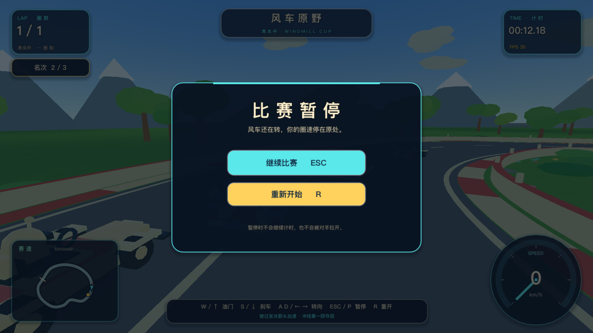

# 风车原野 · 青岚杯

原创低模卡丁车竞速 vertical slice。Godot 4.6 / GL Compatibility / 1280×720 逻辑 / 可 1920×1080。

参考视频实际做的是 **第三人称卡丁车竞速**：倒计时 → 油门/转向 → 加速带 → 一名玩家与两名 AI 抢线 → 冲线。  
本项目复刻这个核心 loop，使用原创场景、车手、车辆、赛道和 UI；没有复制参考视频或原游戏素材。


## 运行

```bash
godot --path godot-ai-3d-game
# 或
cd godot-ai-3d-game && godot
```

默认窗口 1280×720；也可 `--resolution 1920x1080`。首次启动会自动导入 `assets/ai/cc0/fox/Fox.glb`。

## 操作

| 按键 | 功能 |
| --- | --- |
| `W` / `↑` | 油门 |
| `S` / `↓` | 刹车 / 倒车 |
| `A D` / `← →` | 转向 |
| `ESC` / `P` | 暂停 / 继续 |
| `R` | 重开（比赛中、暂停或结算均可） |

目标：从起跑格出发，跑完 1 圈并第一个冲过青岚杯拱门。经过**发光箭头加速带**会获得 1.45s 冲刺；共 3 个加速带。冲线时第 1 名获胜，第 2/3 名失败，结算面板会给出用时、最高时速与冲刺次数。

## 画面与 HUD

- 第三人称追尾镜头，随速度拉 FOV，撞护栏/加速带会有轻微镜头反馈。
- 中文 HUD：圈数、名次、计时、FPS、小地图、圆形速度表、倒计时、暂停菜单、胜负结算。
- 低模玩具风：奶油/青绿玩家车、珊瑚与金色 AI 车、红白路肩、方格起跑线、青岚杯拱门、风车、果树、雪山与气球。
- 1920×1080 截图（`docs/shots/`）：

| 起跑 | 追尾 | 加速带 |
| --- | --- | --- |
|  |  |  |

| 暂停 | 航拍 | 冠军 |
| --- | --- | --- |
|  |  |  |

10 秒演示（1920×1080 / 30fps / H.264，5.2MB；真实 GPU 整圈录制后压缩到 10s）：  
[`docs/media/qinglan_cup_10s.mp4`](docs/media/qinglan_cup_10s.mp4)

> 录制时 HUD 的 FPS 标签被隐藏：逐帧 PNG 回读会让 `Engine` FPS 掉到个位数，那是采集开销，不是游戏性能。真实 1080p/720p 数据见下方性能项；正常游玩时 FPS 标签可见。

## 验收结果

环境：macOS + Intel HD Graphics 6000，OpenGL 4.1 Compatibility。

```bash
# 1) 无头核心逻辑
godot --headless --path godot-ai-3d-game -s tools/smoke_ai_3d_game.gd
# 最后一行：AI_3D_GAME_SMOKE_OK checks=53

# 2) 整圈自动驾驶回放（验收用，不是默认玩法）
godot --headless --path godot-ai-3d-game -s tools/playtest_autopilot.gd
# AUTOPILOT_PLAYTEST_OK / 13.46s / 第 1 名

# 3) 1920×1080 真 GPU 截图（6 张）
godot --path godot-ai-3d-game --resolution 1280x720 -s tools/screenshot_race.gd
# RACE_SHOTS_OK count=6

# 4) 1080p 性能（vsync 关，自动驾驶加压）
godot --path godot-ai-3d-game --resolution 1280x720 -s tools/perf_ai_3d_game.gd
# avg_fps=65.49 / p95=101.54 / 最低瞬时≈46.9

# 5) 视频帧源 + 10s 成片
godot --path godot-ai-3d-game --resolution 1280x720 -s tools/capture_race_video.gd
```

实测完整单圈：自动驾驶（仅用于验收/录制，正常运行默认关闭）**13.46s** 完赛、3 次加速带、第 1 名；人类操作路径由 smoke 的输入测试覆盖。

## 玩法结构

```
RaceWorld (Node3D)
├── Track (328.5m 闭合 Catmull-Rom 环道 + 路面/路肩/护栏/拱门)
├── Player + 2 Rivals
├── 3 Boost Pads
├── Chase Camera
└── HUD (CanvasLayer)
```

状态机：`COUNTDOWN → RACING ⇄ PAUSED → FINISHED`。起跑格在终点线后 6m，比赛距离目标 = 328.5 + 6 = 334.5m。  
技术细节（赛道生成、AI、加速带、状态机、性能数据、Hyper3D/Tripo 差异）见 [`docs/TECH.md`](docs/TECH.md)。  
迭代过程见 [`docs/迭代记录.md`](docs/迭代记录.md)，许可与 AI 资产说明见 [`CREDITS.md`](CREDITS.md)。

## AI 资产管线说明（重要）

- 视频中 GPT-6/Codex 负责代码生成，Hyper3D Rodin MCP 负责图生 3D 车/场景资产。
- 本机没有 Hyper3D 访问，允许的 Tripo 凭据来源（env / team secret）也为空，因此**没有假造 AI 模型，也没有消耗 Tripo credits**。
- 按任务允许的降级路径：玩家驾驶员使用 CC0/CC-BY 的 Khronos Fox，卡丁车、赛道、场景和 UI 全部原创程序化生成。
- 与 Hyper3D 流程的差异、后续接入方式和 credits 记录见 `docs/TECH.md` 第 2 节及 `assets/ai/README.md`。

## 已知限制

- 没有音效/音乐、手柄/触屏和设置菜单。
- AI 与玩家没有硬碰撞体；追尾或并排时可能视觉重叠。
- 全程序化低模，细节密度低于视频中的 Hyper3D 图生模型；这是无 AI 资产权限下的明确取舍。
- 中文依赖系统 CJK 字体；无 CJK 字体的机器上字形会回退。
