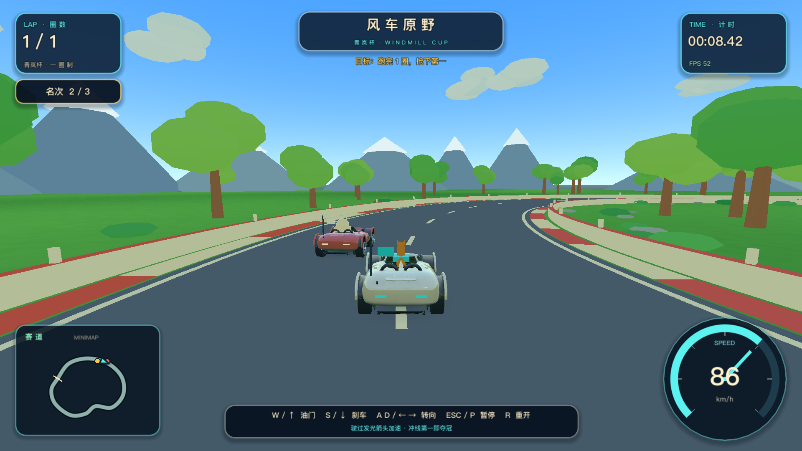
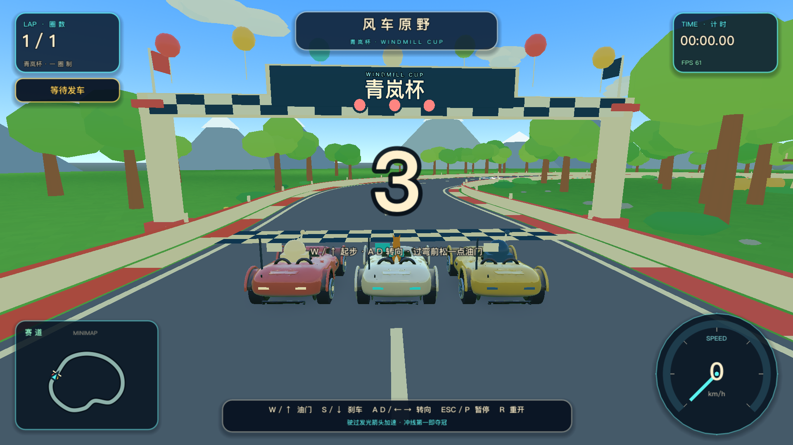
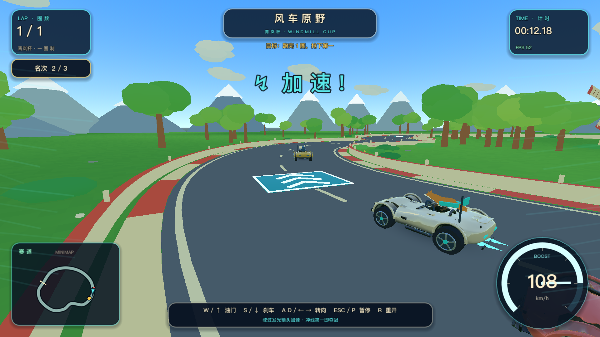
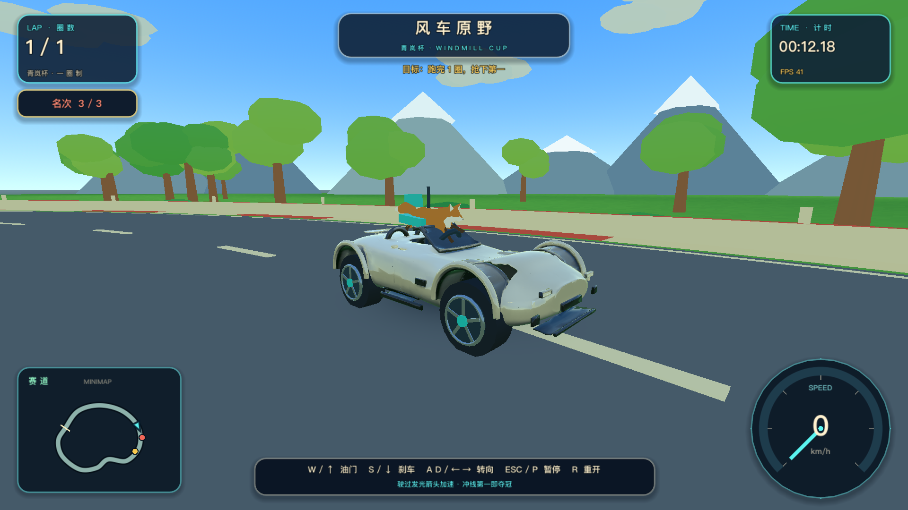
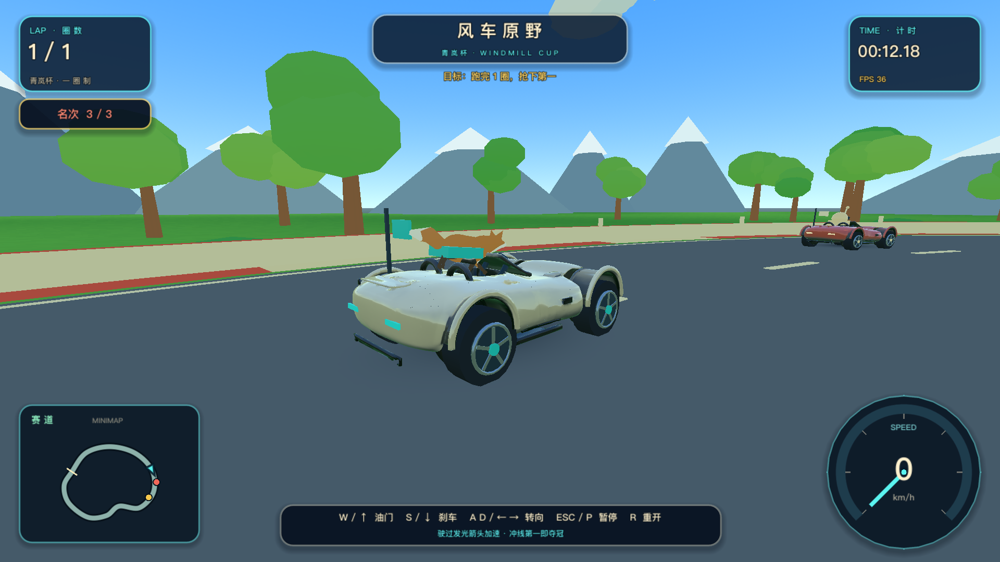

# 风车原野 · 青岚杯

原创卡丁车竞速 vertical slice：Tripo H3.1 真实感跑车 + 低模场景。Godot 4.6 / GL Compatibility / 1280×720 逻辑 / 可 1920×1080。

参考视频实际做的是 **第三人称卡丁车竞速**：倒计时 → 油门/转向 → 加速带 → 一名玩家与两名 AI 抢线 → 冲线。  
本项目复刻这个核心 loop，使用原创场景、车手、车辆、赛道和 UI；没有复制参考视频或原游戏素材。



## 运行

```bash
godot --path godot-ai-3d-game
# 或
cd godot-ai-3d-game && godot
```

默认窗口 1280×720；也可 `--resolution 1920x1080`。首次启动会自动导入 `assets/ai/cc0/fox/Fox.glb`、`assets/ai/tripo/car/car.glb` 与 `assets/ai/tripo/windmill/windmill.glb`（P2 卡丁车资产保留为归档，不再加载）。

## 操作

| 按键 | 功能 |
| --- | --- |
| `W` / `↑` | 油门 |
| `S` / `↓` | 刹车 / 倒车 |
| `A D` / `← →` | 转向 |
| `ESC` / `P` | 暂停 / 继续 |
| `R` | 重开（比赛中、暂停或结算均可） |

目标：从起跑格出发，跑完 1 圈并第一个冲过青岚杯拱门。经过**发光箭头加速带**会获得 1.45s 冲刺；共 3 个加速带。冲线时第 1 名获胜，第 2/3 名失败，结算面板会给出用时、最高时速与冲刺次数。

## 画面与 HUD

- 第三人称追尾镜头，随速度拉 FOV，撞护栏/加速带会有轻微镜头反馈。
- 中文 HUD：圈数、名次、计时、FPS、小地图、圆形速度表、倒计时、暂停菜单、胜负结算。
- 画面：Tripo H3.1 真实感跑车车体（PBR 金属漆 + 法线/粗糙度，玩家奶油/青绿、AI 珊瑚/奶油、金/藏蓝），20 边形轮胎 + 银色轮圈/辐条 + 车队色轮心；程序化转向/尾焰/尾旗/尾灯，Tripo H3.1 风车塔身 + 程序化旋转叶片；红白路肩、方格起跑线、青岚杯拱门、果树、雪山与气球。
- 1920×1080 截图（`docs/shots/`）：

| 起跑 | 追尾 | 加速带 |
| --- | --- | --- |
|  |  |  |

| 暂停 | 航拍 | 冠军 |
| --- | --- | --- |
|  |  |  |

| 车辆特写 | 车辆侧后 | 风车特写 |
| --- | --- | --- |
|  |  |  |

10 秒演示（1920×1080 / 30fps / H.264，4.5MB；真实 GPU 整圈录制后压缩到 10s）：  
[`docs/media/qinglan_cup_10s.mp4`](docs/media/qinglan_cup_10s.mp4)

> 录制时 HUD 的 FPS 标签被隐藏：逐帧 PNG 回读会让 `Engine` FPS 掉到个位数，那是采集开销，不是游戏性能。真实 1080p/720p 数据见下方性能项；正常游玩时 FPS 标签可见。

## 验收结果

环境：macOS + Intel HD Graphics 6000，OpenGL 4.1 Compatibility。

```bash
# 1) 无头核心逻辑 + Tripo 资产/回退节点检查
godot --headless --path godot-ai-3d-game -s tools/smoke_ai_3d_game.gd
# 最后一行：AI_3D_GAME_SMOKE_OK checks=68

# 2) 整圈自动驾驶回放（验收用，不是默认玩法）
godot --headless --path godot-ai-3d-game -s tools/playtest_autopilot.gd
# AUTOPILOT_PLAYTEST_OK / 13.45s / 第 1 名

# 3) 1920×1080 真 GPU 截图（9 张）
godot --path godot-ai-3d-game --resolution 1280x720 -s tools/screenshot_race.gd
# RACE_SHOTS_OK count=9

# 4) 1080p / 720p 性能（vsync 关，自动驾驶加压）
godot --path godot-ai-3d-game --resolution 1280x720 -s tools/perf_ai_3d_game.gd
# avg_fps≈58 / median≈62 / 最低瞬时 2.6–3.5（单次 ~0.3s 场景 hitch）
godot --path godot-ai-3d-game --resolution 1280x720 -s tools/perf_ai_3d_game.gd -- --vp=1280x720
# avg_fps≈65 / median≈71

# 5) 视频帧源 + 10s 成片
godot --path godot-ai-3d-game --resolution 1280x720 -s tools/capture_race_video.gd

# 6) Tripo GLB 结构/AABB 检查
godot --headless --path godot-ai-3d-game -s tools/inspect_tripo_assets.gd
```

实测完整单圈：自动驾驶（仅用于验收/录制，正常运行默认关闭）**13.45s** 完赛、3 次加速带、第 1 名；人类操作路径由 smoke 的输入测试覆盖。H3.1 跑车替换 P2 卡丁车后完赛时间/距离/AI 名次与父任务一致（13.45s，AI 275.2/281.9m）。

## 玩法结构

```
RaceWorld (Node3D)
├── Track (328.5m 闭合 Catmull-Rom 环道 + 路面/路肩/护栏/拱门)
├── Player + 2 Rivals
├── 3 Boost Pads
├── Chase Camera
└── HUD (CanvasLayer)
```

状态机：`COUNTDOWN → RACING ⇄ PAUSED → FINISHED`。起跑格在终点线后 6m，比赛距离目标 = 328.5 + 6 = 334.5m。  
技术细节（赛道生成、AI、加速带、状态机、性能数据、Hyper3D/Tripo 差异）见 [`docs/TECH.md`](docs/TECH.md)。  
迭代过程见 [`docs/迭代记录.md`](docs/迭代记录.md)，许可与 AI 资产说明见 [`CREDITS.md`](CREDITS.md)。

## AI 资产管线说明（重要）

- 视频中 GPT-6/Codex 负责代码生成，Hyper3D Rodin MCP 负责图生 3D 车/场景资产。
- 本机没有 Hyper3D 访问；沿用已登录的 Tripo CLI（`--profile cn`，经本地代理）完成图生 3D：
  - 真实感跑车车体（当前）：H3.1 (v3.1-20260211)，task `856e0f6e-f6aa-49ff-bdd5-c056c3d662ff`，源 94,256 tris → 本地 decimate **30,000 tris**，40 credits；
  - 卡丁车车体（T-001 归档）：P2-20260801，task `f7ef8737-d179-451a-b858-8ad024d14183`，18,857 tris，120 credits；
  - 风车塔身：H3.1 (v3.1-20260211)，task `cbdc4d8b-e6e1-43f9-9838-932b78f5c26d`，18,758 tris，40 credits。
- 合计 200 credits（余额 225 → 65 → 25）；跑车参考图由 `tools/blender/realistic_car_refs.py` 从零建模 + Cycles 渲染，多视图见 `assets/ai/tripo/refs/realistic_car/`，不是真实车照片/车标、参考视频或原作素材。
- 跑车的车轮、转向、boost 尾焰、尾旗、尾灯与 CC0 Fox 驾驶员仍由代码/资产驱动；风车叶片仍程序化旋转。GLB 缺失或加载失败时自动回退程序化几何。
- 同一张跑车 PBR 贴图通过 `shaders/tripo_car.gdshader` 只重着高亮度中性漆面，保留 ORM/法线与红尾灯/蓝玻璃，三套车队色仍可读。
- 任务 id、参数、credits、许可与已知 mesh 瑕疵见 `assets/ai/README.md`、`assets/ai/tripo/README.md` 与 `docs/TECH.md` 第 2 节。

## 已知限制

- 没有音效/音乐、手柄/触屏和设置菜单。
- AI 与玩家没有硬碰撞体；追尾或并排时可能视觉重叠。
- Tripo H3.1 跑车源模型 94,256 tris，为 Intel HD 6000 目标 decimate 到 30,000 tris；输出是单个网格，车轮无法拆出独立旋转，因此参考图隐藏车轮、游戏内用程序化轮组填补轮拱。车体仍有轻微 AI 拓扑瑕疵（轮拱边缘、后翼子板折线）。
- H3.1 风车屋顶纹理带烘焙明暗渐变；跑车/风车均未做二次手工重拓扑。
- 1080p 6 秒采样在赛道约 200m 处有一次 ~0.3–0.5s 的引擎/场景 hitch；禁用 Tripo 车体后仍复现，判断为既有场景事件，平均值仍高于 30 FPS。
- 驾驶员仍为 CC0/CC-BY Fox + `Run` 动画；未生成第三个 Tripo 道具/驾驶员。
- GLB 内嵌纹理在 Godot 导入时抽成同目录 `car_Color/ORM/NormalGL` 等文件；跑车 PBR 贴图导入时降到 2048²。移动/发布资产时需与 GLB 一起保留。
- 中文依赖系统 CJK 字体；无 CJK 字体的机器上字形会回退。
