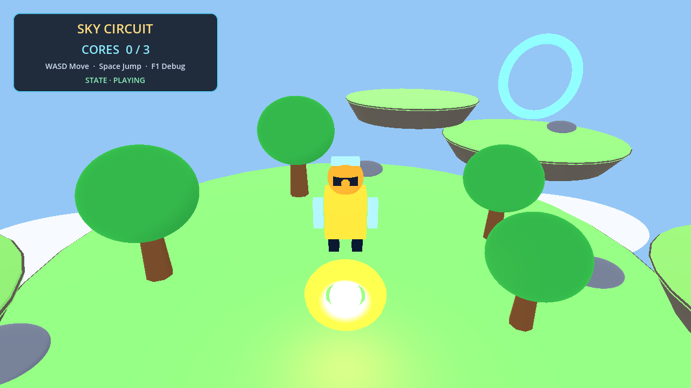

# AI Slice — Sky Circuit

一个 **Godot 4.6 的极简 3D 垂直切片**，专门用来验证“AI 做游戏”的工作流：Codex 做设计、Claude Code 实现、gda 做运行时/截图验证。所有模型都是程序化几何，没有外部资产。



## 运行

```bash
godot --path godot-ai-slice
```

控制：

- `WASD` 移动，`Space` 跳跃
- `Enter` / `Space` 开始
- `R` 重新开始
- `F1` 调试信息（FPS / 坐标 / 状态）

目标：收集 3 个 core，进入激活的传送门。

## 验收

```bash
# 核心逻辑：标题 → 游戏 → 收集 3 → 胜利 → 重开
godot --headless --path godot-ai-slice -s tools/smoke_slice.gd
# 期望：AI_SLICE_SMOKE_OK

# 三张 1280x720 截图（title / play / win）
godot --path godot-ai-slice --resolution 1280x720 -s tools/screenshot_slice.gd
```

## AI 工作流（Windows）

推荐分工：

1. **Codex**：写 `docs/GDD.md`（核心循环、控制、验收、非目标），做概念图；
2. **Claude Code**：按 GDD 做最小实现，保持 smoke 绿；
3. **gda**：Windows 上的 Godot headless/live 验证、截图、输入和日志（替代 Mac 上 Xogot 的 `xo`）。

完整步骤、gda 安装、Claude Code/Codex 的 MCP 配置、提示词模板见 [`docs/AI_WORKFLOW.md`](docs/AI_WORKFLOW.md)。

项目级 Claude Skill：[`.claude/skills/godot-slice/SKILL.md`](.claude/skills/godot-slice/SKILL.md)。它固化了“读 GDD → 最小改动 → smoke → 截图 → gda → game-feel 检查”的流程；在 `godot-ai-slice` 目录打开 Claude Code 即可使用。

## 结构

```text
godot-ai-slice/
├── project.godot              Godot 4.6 / GL Compatibility
├── scenes/main.tscn           入口场景（运行时建关卡）
├── src/
│   ├── game.gd                autoload：TITLE / PLAYING / WON
│   ├── main.gd                环境、浮岛、树/岩石、玩家、传送门、HUD
│   ├── player.gd              CharacterBody3D + 跟随相机
│   ├── coin.gd                core 收集
│   ├── portal.gd              胜利传送门
│   └── hud.gd                 标题 / HUD / 胜利 / F1 调试
├── tools/
│   ├── smoke_slice.gd         headless 验收
│   └── screenshot_slice.gd    1280x720 截图
├── .claude/skills/godot-slice/
│   └── SKILL.md               项目级 AI 工作流（smoke/截图/gda/game-feel）
├── docs/
│   ├── AI_WORKFLOW.md         Windows + Claude Code/Codex + gda
│   ├── GDD.md                 切片设计/验收
│   └── preview_*.png
└── mcp/                       Claude Code / Codex MCP 配置示例
```

## 范围

- 5 个浮岛、3 个 core、1 个传送门、标题/HUD/胜利、F1 调试；
- **没有**敌人、战斗、外部模型/音频、存档、移动端适配；这些留给下一轮 AI 迭代；
- `Cloudline: The Sky Circuit` 只是工作流参考，**没有复制其代码或美术资产**；本切片是原创程序化几何。
- 仓库没有统一 LICENSE；发布前请自行选择并补上。
