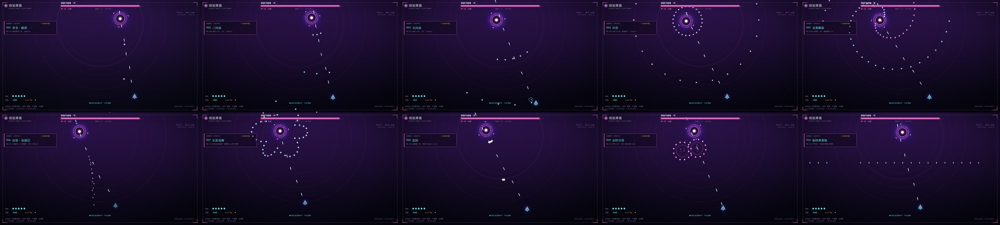
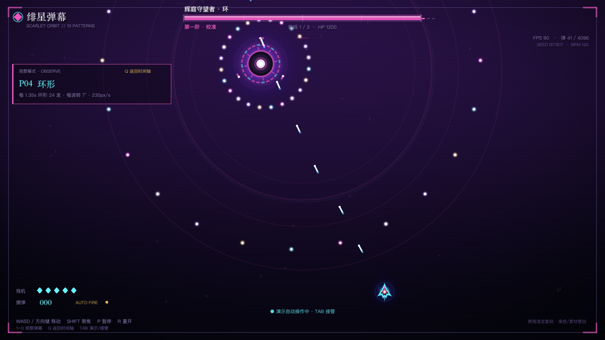
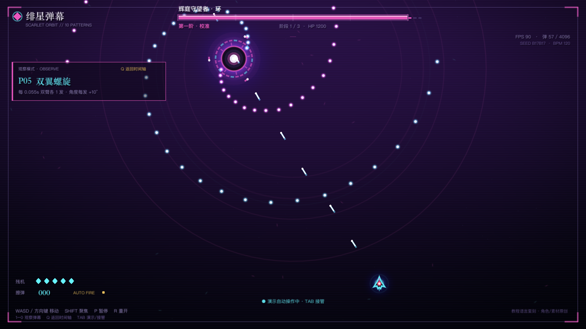
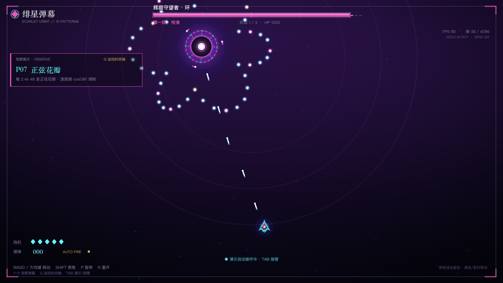
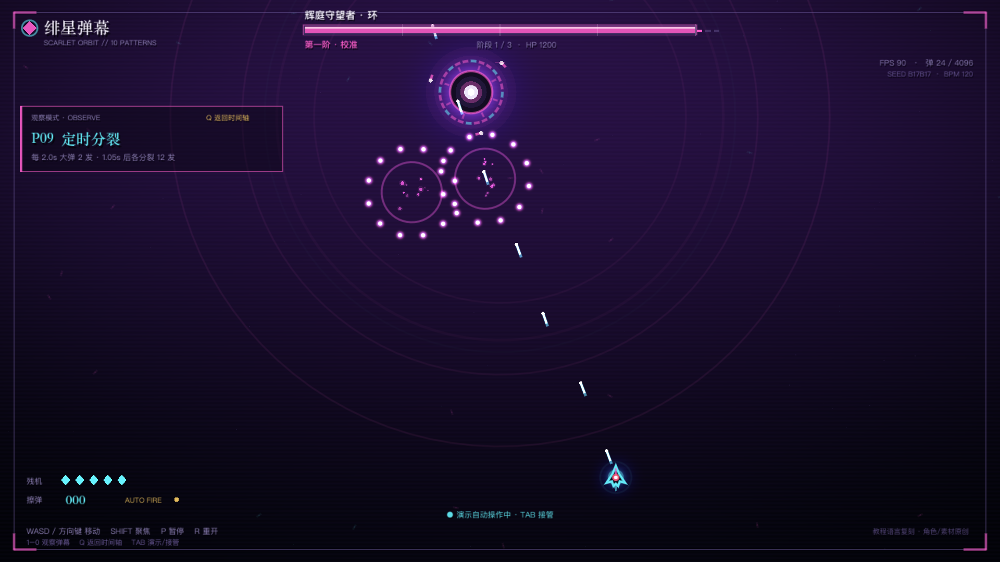
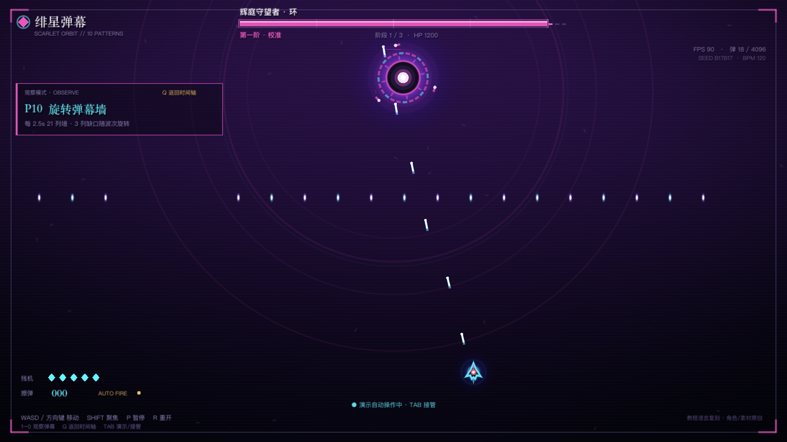
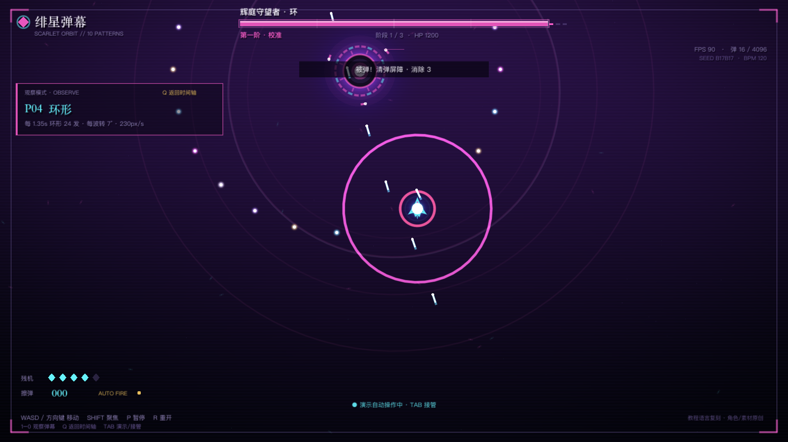

# 绯星弹幕 · Scarlet Orbit

原创 Godot 4.6 弹幕射击 vertical slice：10 种数据驱动弹幕、3 阶段 Boss 时间轴、1200 弹压力测试、固定 seed 可复现。  
视觉语言参考 B 站教程《Godot 弹幕怎么做？从一颗子弹到 10 种弹幕》的“方向 / 速度 / 行为”拆解，**未复制视频画面、代码、角色、UI 或音乐**；角色、贴图、弹幕与 UI 全部为本项目程序化原创。详见 [CREDITS.md](CREDITS.md)。



**10 秒展示视频**：[scarlet_orbit_10s_1080p.mp4](docs/media/scarlet_orbit_10s_1080p.mp4) · [GIF 预览](docs/media/scarlet_orbit_10s_800.gif)

---

## 运行

```bash
# 1280×720 逻辑窗口（默认）
godot --path godot-bullet-hell

# 任意 16:9 窗口，例如 1920×1080；内容按 canvas_items 拉伸
godot --path godot-bullet-hell --resolution 1920x1080

# 无窗口冒烟（末行必须为 BULLET_HELL_SMOKE_OK）
godot --headless --path godot-bullet-hell -s tools/smoke_bullet_hell.gd
```

引擎：Godot 4.6 stable / GL Compatibility / 无第三方运行时依赖。跨脚本引用使用 `preload` 常量，**不依赖编辑器生成的 `.godot` 类缓存**；fresh copy 可直接 headless 跑通。

## 操作

| 输入 | 功能 |
|---|---|
| W A S D / ↑←↓→ | 移动（机动 300px/s） |
| Shift | 聚焦减速（138px/s），显示 18px 判定环 |
| 自动射击 | 无需按键；瞄准 Boss，0.10s 一发 |
| 1–0 | 单独观察 P01–P10（0 = P10） |
| Q | 从观察模式返回 Boss 时间轴 |
| TAB | 演示自动操作 / 手动接管 切换 |
| P / Esc | 暂停 / 继续 |
| R | 重开（重置残机、擦弹、弹幕与阶段） |

- 玩家真实判定半径 **2.6px**，视觉判定环直径 **18px**，擦弹半径 20px。
- 生命 5；被弹后 2.2s 无敌并释放半径 132px 的清弹屏障；残机归零显示 GAME OVER。
- 默认自动演示：Boss 时间轴自动推进，玩家机采用低成本避弹 Lissajous 走位；按移动键即接管。

## 10 种弹幕

| ID | 名称 | 发射节奏 | 数量 / 形态 | 速度 | 行为 |
|---|---|---|---|---|---|
| P01 | 单发·瞄准 | 0.72s | 1 发，指向玩家 | 300 | 直线 |
| P02 | 三向扇 | 0.95s | 3 发，±13° | 260 | 直线 |
| P03 | 五向扇 | 1.25s | 5 发，±11°×2 | 240 | 直线 |
| P04 | 环形 | 1.35s | 24 发，每波转 7° | 230 | 直线 |
| P05 | 双翼螺旋 | 0.055s | 2 臂，角度每发 +10° | 210 | 直线 |
| P06 | 连射·加速层 | 2.3s 周期 | 3 脉冲 × 5 层速度 | 200→460 | 窄扇形速度层 |
| P07 | 正弦花瓣 | 2.4s | 48 发，速度随 \|cos(3θ)\| 调制 | 170→330 | 正弦横向漂移 |
| P08 | 追踪 | 1.35s | 5 发扇 | 130→200 | 1.9rad/s 转向 2.6s |
| P09 | 定时分裂 | 2.0s | 2 枚大弹，1.05s 后各 12 裂片 | 95 / 225 | 定时分裂 |
| P10 | 旋转弹幕墙 | 2.5s | 21 列，3 列缺口 → 18 发 | 158 | 墙线 ±5° 旋转、缺口轮转 |

10 种都可在 HUD 左侧卡片读到当前参数；数字键观察时时间轴暂停，Boss 不受伤、玩家不判定被弹（保留擦弹）。

## Boss 时间轴

120 BPM，1 beat = 0.5s。三阶段各有一个节拍事件序列；阶段结束或 HP 归零时切换，切换时清弹、1.5s 无敌并显示阶段横幅。

| 阶段 | 时长 | HP | 事件（beat → pattern） |
|---|---|---|---|
| 第一阶 · 校准 | 20 beats / 10s | 1200 | 0→P01，5→P02，10→P03，15→P04 |
| 第二阶 · 改速 | 24 beats / 12s | 1450 | 0→P05，6→P06，12→P07，18→P08 |
| 第三阶 · 终曲 | 32 beats / 16s | 1900 | 0→P09，8→P10，16→P07，24→P05 |

时间轴总长 38s（+ 两次阶段切换）。自动演示会走完三阶段并显示 STAGE CLEAR，随后自动重开。

## 弹幕系统

- 定长平行数组 + 紧凑写指针，容量 **4096**；出屏/寿命结束无对象分配。
- 单个 `MultiMeshInstance2D`（QuadMesh + additive glow shader）绘制全部敌弹，1 个 draw call。
- 圆形碰撞：子弹半径 + 2.6px 玩家判定；擦弹半径 + 20px；`FLAG_HIT` / `FLAG_GRAZED` 保证每发只结算一次。
- 行为：直线、正弦横向速度、追踪（限角速度）、定时分裂（父子关系，固定 seed）；子弹池负责回收。
- 固定 seed `0xB17B17`；分裂子弹出射角由池内 RNG 决定，可复现。
- 独立玩家弹池（96 发）与敌弹池分离；命中 Boss 产生火花/白闪。
- 反馈：擦弹环+火花、被弹爆炸/闪屏/屏震/清弹、分裂冲击环、阶段切换横幅+大环。

## 验收工具

```bash
# Headless 冒烟：10 pattern 数量/方向、生命周期、命中/擦弹、追踪/分裂、
# 时间轴、暂停/重开、键位路由、确定性、1200 弹容量
godot --headless --path godot-bullet-hell -s tools/smoke_bullet_hell.gd
# 末行：BULLET_HELL_SMOKE_OK   （69 checks / 0 failures，见 docs/logs/）

# 启动 600 帧无 ERROR
godot --headless --path godot-bullet-hell --quit-after 600

# 1920×1080 真 GPU 截图矩阵（18 张：10 pattern + 时间轴/切换/擦弹/命中/1200弹/暂停/胜利）
godot --path godot-bullet-hell --resolution 1280x720 -s tools/capture_bullet_hell.gd

# 性能：1280×720 或 1920×1080，默认 1200 弹；--bullets=200 可测常规密度
godot --path godot-bullet-hell --resolution 1280x720 -s tools/perf_bullet_hell.gd -- --vp=1280x720 --bullets=1200
godot --path godot-bullet-hell --resolution 1280x720 -s tools/perf_bullet_hell.gd -- --vp=1920x1080 --bullets=1200

# 10s 展示视频（Movie Maker，600 帧 @60fps）
godot --path godot-bullet-hell --resolution 1280x720 --write-movie /tmp/scarlet.avi --fixed-fps 60 --quit-after 600 -- --showcase
```

### 性能结果（Intel HD Graphics 6000 / macOS / Godot 4.6 GL Compatibility）

| 场景 | 分辨率 | 弹数 | 4s 平均 FPS | 最坏帧 |
|---|---|---|---|---|
| 常规密度 | 1280×720 | 200 | **74.13** | 25.91ms |
| 常规密度 | 1920×1080 | 200 | **67.98** | 20.92ms |
| 压力 | 1280×720 | 1200 | **51.34** | 24.89ms |
| 压力 | 1920×1080 | 1200 | **46.88** | 29.12ms |

测试命令见上；原始日志在 [docs/logs/](docs/logs/)。1200 弹压力下均值 ≥30 FPS；常规密度平均高于 60（vsync 关闭）。HUD 以 20Hz、背景以 30Hz 重录 CanvasItem 绘制，跨脚本使用 preload 常量与静态类型，是本次性能提升的关键优化。

> 截图中的 `FPS 90` / `FPS 49` 是最终 1920×1080 截图会话的真实读数（常规密度 base / 1200 弹压力），会随机器温度与采集状态波动。视频中显示 `REC 60FPS`，表示 Movie Maker 的 60fps 成片节奏，不是实时性能采样。性能结论以上表与 `docs/logs/` 为准。

## 媒体

全部截图原生 **1920×1080**（1280×720 逻辑舞台 ×1.5 SubViewport）：

| | |
|---|---|
|  |  |
|  |  |
|  |  |

- 10 秒展示：`scarlet_orbit_10s_1080p.mp4`（H.264，1920×1080，10.0s，60fps）与 `scarlet_orbit_10s_800.gif`；源录制为 1280×720@60 Movie Maker，MP4 由 ffmpeg lanczos 放大到 1080p。
- 单张矩阵：`01_pattern_p01_single.png` … `18_victory.png`（含时间轴、阶段切换、擦弹、命中、1200 弹、暂停、胜利）。
- 时长/参数和公式见 [docs/TECH.md](docs/TECH.md)，过程记录见 [docs/迭代记录.md](docs/迭代记录.md)。

## 已知限制

- 中文 UI 使用 `SystemFont`（PingFang SC / 微软雅黑 / Noto Sans CJK 等），不随仓库分发字体；无 CJK 字体的系统可能出现方框。若要完全可移植，建议后续 bundle 一份 OFL 中文字体。
- 无音频、无手柄、无键位重映射；这些不在本任务规格内。
- 弹幕池满 4096 发后新弹直接丢弃（不崩溃）；1200 弹压力场景为验收用，不是常规难度。
- 自动演示的避弹是启发式，不做最优解；观察模式玩家不判定被弹，便于看弹幕。
- 录制受 Movie Maker 限制固定为项目窗口 1280×720；最终 MP4 为 1080p 上采样，截图是原生 1080p。
