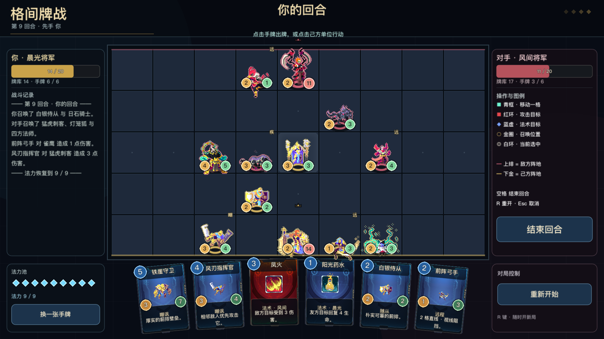

# 格间牌战 · Gridbound

> 9×5 棋盘上的卡牌 + 战棋 vertical slice。玩家与 AI 各带一套 20 张牌，召唤随从、走位、卡射程、用法术拆掉对方将军。
>
> 玩法灵感来源 **Duelyst**（Counterplay Games）。本项目不是 Duelyst 的重制或官方产品，不使用其名称/Logo 作为品牌；所有 GDScript 代码与 UI 布局为原创，美术为 CC0 1.0 资产子集（来源与 commit 见 [CREDITS.md](CREDITS.md)）。



## 快速开始

```bash
# 从仓库根目录运行
godot --path godot-card-tactics

# 或在 Godot 4.6 中打开 godot-card-tactics/project.godot
```

- 引擎：Godot 4.6（GL Compatibility）
- 逻辑分辨率：1280×720（拉伸模式 `canvas_items`，窗口/屏幕自适应）
- 目标设备：Intel HD Graphics 6000 级集显，实测 30 FPS 以上（见下方“验证”）
- 干净 clone 可直接运行：脚本用 `preload` 显式依赖，贴图由 `AssetLoader` 按 PNG 字节创建 `ImageTexture`，不依赖编辑器生成的 `.godot/imported` 缓存。

## 操作

| 操作 | 说明 |
| --- | --- |
| 点击手牌 | 选中卡牌；单位牌显示金圈召唤位，法术牌显示蓝色虚线目标圈 |
| 点击高亮格 | 召唤随从 / 把已选单位移动一格 |
| 点击红环敌人 | 攻击 |
| 点击己方单位 | 选中该单位，查看移动/攻击范围 |
| 悬停手牌 | 卡面放大 |
| 「换一张手牌」 | 每回合 1 次，把选中的手牌洗回牌库底并抽 1 张 |
| 「结束回合」/ 空格 | 结束玩家回合，AI 开始行动 |
| Esc | 取消当前选择 |
| R | 立即重开（随机新 seed） |
| 覆盖层「再来一局」 | 胜负后重开 |

## 玩法规则（vertical slice）

- **棋盘**：9 列 × 5 行。玩家将军固定从 `(4,4)` 开始，AI 将军从 `(4,0)` 开始。
- **将军**：20 HP、2 攻击；可以像普通单位一样移动/攻击；HP 归零即败。
- **回合**：玩家先手。每方在自己回合开始时：
  - 法力上限 +1（首次为 1，上限 9），并回满；
  - 抽 1 张牌（牌库空则不抽；手牌上限 6，满手时抽到的牌被弃置）；
  - 己方所有单位恢复“可移动 1 次 + 可攻击 1 次”。
- **起手**：双方各 3 张；先手在自己第一个回合抽到第 4 张，后手在首个回合抽到第 4 张。
- **牌库**：每套 20 张。玩家套牌为晨光（f1）+ 中立；AI 套牌为风间（f2）+ 中立。
- **召唤**：只能召唤到己方将军或友方随从的上下左右相邻空格。
- **移动**：每个单位每回合可向上下左右移动 1 格（不能斜走、不能穿过/停在其他单位上）。
- **攻击**：每个单位每回合攻击 1 次，无反击。
  - 近战：攻击上下左右相邻的敌人。
  - **远程**：攻击同一行或同一列、距离 1–2 格的敌人；距离 2 时中间格必须为空（视线阻挡）。
- **召唤当回合**：普通随从可以移动，但不能攻击；**疾行**单位可以立即攻击。
- **嘲讽**：如果攻击者相邻存在敌方嘲讽单位，则本回合只能攻击这些嘲讽单位。
- **胜负**：任意一方将军 HP ≤ 0，对局结束；覆盖层显示胜利/败北与 seed，可重开。
- **换牌**：每方每回合 1 次（AI 当前不使用换牌）。

### 关键词

| 关键词 | 规则 |
| --- | --- |
| 远程 | 同行/列 2 格内攻击，中间格阻挡 |
| 嘲讽 | 相邻敌人必须优先攻击它 |
| 疾行 | 召唤当回合即可攻击 |
| 登场治疗 | 召唤时为己方将军恢复指定生命 |

### 卡池（16 张 = 12 随从 + 4 法术）

| 阵营 | 卡牌 | 类型 | 费用 | 攻/血 | 关键词 / 效果 |
| --- | --- | --- | ---: | --- | --- |
| 晨光 | 白银侍从 | 随从 | 2 | 2/2 | — |
| 晨光 | 前阵弓手 | 随从 | 2 | 1/3 | 远程 |
| 晨光 | 日石骑士 | 随从 | 3 | 3/3 | — |
| 晨光 | 风刃指挥官 | 随从 | 4 | 3/4 | 嘲讽 |
| 晨光 | 铁崖守卫 | 随从 | 5 | 3/7 | 嘲讽 |
| 风间 | 猛虎刺客 | 随从 | 3 | 3/3 | 疾行 |
| 风间 | 雀鹰 | 随从 | 2 | 2/1 | 远程 |
| 风间 | 灯笼狐 | 随从 | 3 | 2/3 | — |
| 风间 | 四方法师 | 随从 | 4 | 2/4 | 远程 |
| 风间 | 心之侍 | 随从 | 5 | 4/5 | — |
| 中立 | 疗愈秘术师 | 随从 | 3 | 2/3 | 登场：己方将军 +2 HP |
| 中立 | 骸骨收割者 | 随从 | 4 | 3/4 | — |
| 晨光 | 阳光药水 | 法术 | 1 | — | 友方任意目标恢复 4 HP |
| 晨光 | 破魔箭 | 法术 | 2 | — | 对敌方随从造成 3 伤害 |
| 风间 | 凤火 | 法术 | 3 | — | 对任意敌方目标造成 3 伤害 |
| 风间 | 眼镜蛇击 | 法术 | 2 | — | 友方随从永久 +2 攻击 |

> 数值为 vertical slice 平衡调整，不等同于原版 Duelyst 卡牌数值。

## AI 与复现

- AI 使用与玩家完全相同的 `BattleCore` 规则 API。
- 每个动作由 `BattleAI.next_action()` 推进一步，顺序为：**出牌 → 走位 → 攻击 → 结束回合**。
- 出牌、走位、攻击都使用确定性评分 + 明确的 tie-breaker；牌库洗牌用固定 seed 的 Fisher-Yates。
- 同 seed + 同玩家操作序列 ⇒ 完全相同的 `BattleCore.fingerprint()`（冒烟测试覆盖）。
- 当前 AI 为单层贪心，不会做多回合组合规划，也不会使用“换牌”。

## 视觉整改（T-019）

按独立美术评审 [`docs/art-review/gridbound-art-review.md`](../docs/art-review/gridbound-art-review.md) 落地 P0 + 优先 P1。**只改视觉/UI/VFX，规则、AI、卡池与数值未变**；65 项冒烟仍为 `CARD_TACTICS_SMOKE_OK`。

| 维度 | 评审问题 | T-019 整改 | 实测 before → after |
| --- | --- | --- | --- |
| 单位/格面 | 11 个单位中 9 个中位对比 <3:1；无阵营标记 | 格面明度 +3.5 L*；队伍色基座环（金/绯）；4 方向 2px 队伍色外轮廓；将军双基座 + 冠饰；稳定同行 z 序 | 中位 ≥3:1 **2/11 → 11/11** |
| 攻血徽章 | 与精灵同层、被邻格遮挡；底色对比低 | 独立徽章层 `z+100`；亮琥珀/亮绿底 + 深色数字 + 2px 阴影；22px（将军 24px） | 徽章不再被精灵压住；单位中位提升约 +0.7～+1.0 |
| 卡面 | 名称 1.62:1、描述 8px、亮斑 4.22:1；悬停裁切、提示被遮 | 名称带/规则区深色内衬；名称 12 / 类型 10 / 描述 10（≤16 字、最多 2 行）；手牌基线 546、悬停 1.24；选中近白描边；费用不足转红 | 名称 **1.83:1 → 10.20:1**；描述 **4.97:1 → 7.20:1**；悬停 0 裁切 |
| 高亮 | 移动整格填充压过攻击；攻击/法术只靠色相 | 移动 2px 青框 + 刻度 + 12%；攻击 4px 红环 + 4 向内箭头 + 24% + 呼吸；法术虚线环 + 符心；选中近白双环；召唤金圈 + “+” | 移动 ΔL* 24.4→13.5；攻击 ΔL* 0.0→≈7.8，且结构区分 |
| HUD | “你的回合”在 AI/胜利态仍显示；法力/牌库重复；调试文案 | 顶栏单一回合状态机（玩家金/对手绯/结束灰）+ 状态行 y=62；右栏帮助图例；日志 12px；AI 回合手牌 α0.60 + 不可点；移除“演示局面/vertical slice/已换牌/Seed”等调试文案（Seed 仅结束覆盖层） | 玩家/AI/胜利三态截图正确；0 调试词 |
| VFX | 命中红闪 0.06s；凤火/召唤跨到下一次行动 | 凤火 1.10s、召唤 0.60s、斩击 0.34s；命中 0.03s 白闪 + 0.10s 红闪；20px 冲刺；白热+暖色程序化命中闪光；同屏最多 2 个 FX | 凤火 1.58s→1.10s；召唤 1.08s→0.60s |

- 复测脚本：`python3 tools/measure_artfix.py`（Pillow；输入 `docs/shots/`，before 用 T-018 评审证据）。
- 量化全文：`docs/shots/artfix/metrics.txt`；before/after 对照：`docs/shots/artfix/compare_{board,hand,highlight,attack,spell,win}_1920.png` 与对应 `_25pct.png`。
- 25% 缩略：`docs/shots/thumb25/01..08.png`。
- 仍不足：`<1.5:1` 像素占比仍未全部 ≤10%（2/11），剩余主要是 CC0 原画黑描边/缝隙、接触影与徽章深色数字；未内置字体；未做 5 人盲测。详见 metrics.txt 与下方“已知限制”。

## 项目结构

```
godot-card-tactics/
├─ project.godot
├─ scenes/main.tscn              # 单场景入口（Control 全 UI）
├─ scripts/
│  ├─ main.gd                    # UI、输入、动画、AI 回合播放
│  ├─ battle_core.gd             # 纯规则核心（无节点）
│  ├─ battle_ai.gd               # 确定性 AI
│  ├─ card_db.gd                 # data/cards.json 数据入口
│  ├─ asset_loader.gd            # 原始 PNG 字节 → ImageTexture（免导入缓存）
│  ├─ atlas_anim.gd              # JSON 帧数据 → AtlasTexture 动画
│  ├─ board_view.gd              # 9×5 棋盘绘制/点击/高亮
│  ├─ card_view.gd               # 手牌卡面与悬停放大
│  ├─ unit_view.gd               # 单位精灵/攻血徽章/攻击/移动
│  └─ mana_bar.gd                # 9 颗法力水晶
├─ data/cards.json               # 卡牌、将军、套牌
├─ assets/duelyst_cc0/          # CC0 资产子集 + LICENSE + SOURCE.md
├─ export/
│  ├─ asset_manifest.json        # 引擎无关资产清单（35 资产/1291 帧/许可/来源）
│  ├─ cards.json                 # 引擎无关卡牌/将军/套牌/规则常量
│  ├─ slice_atlas.py             # 纯 Python 切片/重打包/联系表/manifest 校验
│  ├─ build_exports.py           # 从源数据重建 manifest/cards
│  ├─ README.md                  # 导出/切片/校验用法
│  └─ sample_contact_sheet.png   # 切片证据（2 个真实图集）
├─ tools/
│  ├─ smoke_card_tactics.gd      # headless 冒烟测试（65 checks）
│  ├─ screenshot_card_tactics.gd # 8×1920×1080 + 3×1280×720 真实 GPU 截图
│  ├─ demo_card_tactics.gd       # 10 秒演示录制脚本
│  ├─ record_card_tactics.sh     # AVI → MP4/GIF
│  ├─ perf_card_tactics.gd       # 真实 GPU FPS 采样
│  └─ measure_artfix.py          # T-019 before/after 量化（单位/文字/高亮/VFX）
├─ docs/
│  ├─ DEVELOPMENT.md             # 开发文档：规则/状态机/AI/确定性/重写清单
│  ├─ CROSS_ENGINE.md            # 跨引擎四层拆分/映射表/移植契约/验收
│  ├─ PORTABLE_ASSETS.md         # 资产清单/图集 schema/锚点/许可/导出
│  ├─ TECH.md                    # 原实现：规则模型/图集/UI/资产管线 + T-019 视觉参数
│  ├─ 迭代记录.md
│  ├─ shots/                     # 01–11 实机截图 + thumb25/ + artfix/ 对照与 metrics
│  ├─ card_tactics.mp4           # 10.4s / 1280×720 / 30fps
│  └─ card_tactics.gif           # 10.4s / 800px 宽
├─ README.md
└─ CREDITS.md
```

## 开发与移植文档

- [开发文档 DEVELOPMENT.md](docs/DEVELOPMENT.md) —— 完整规则、回合状态机、动作 API、AI 评分、确定性种子与测试向量；不读 GDScript 也能重写。
- [跨引擎移植 CROSS_ENGINE.md](docs/CROSS_ENGINE.md) —— **A 数据 / B 算法 / C 渲染 / D 工具链** 四层拆分、Godot / Unity / Unreal / Three.js 映射表、移植契约与验收清单。
- [可移植资产 PORTABLE_ASSETS.md](docs/PORTABLE_ASSETS.md) —— 35 个 PNG / 24 个帧 JSON、图集 schema、帧矩形、锚点/缩放、CC0 来源与导出方法。
- [导出工具 export/README.md](export/README.md) —— `asset_manifest.json`、`cards.json`、`slice_atlas.py`；一条命令校验资产：

```bash
python3 export/slice_atlas.py verify --manifest export/asset_manifest.json
# MANIFEST_OK assets=35 atlas_assets=24 animations=109 frames=1291
```

## 验证

### 1. Headless 启动无错误

```bash
godot --path godot-card-tactics --headless --quit-after 600
```

实测输出只有引擎版本行，无 `ERROR` / `SCRIPT ERROR`。

### 2. 冒烟测试

```bash
godot --path godot-card-tactics --headless -s tools/smoke_card_tactics.gd
```

覆盖：法力曲线、召唤合法性、移动/近战/远程/视线阻挡、嘲讽、疾行、登场治疗、回合交替、抽牌与手牌上限、换牌、AI 完整回合、AI 能完整打完一局、将军死亡判胜、同 seed 复现、数据与资产完整性。

最新结果：

```
checks=65
CARD_TACTICS_SMOKE_OK
```

### 3. 真实 GPU

```bash
# 运行 600 帧，检查 console
godot --path godot-card-tactics --resolution 1280x720 --quit-after 600

# FPS 采样（Intel HD Graphics 6000 / GL Compatibility / 关闭 vsync）
godot --path godot-card-tactics --resolution 1280x720 -s tools/perf_card_tactics.gd
```

本机实测（Intel HD Graphics 6000 / GL Compatibility / 1280×720 / 关闭 vsync）：

| 场景 | 平均 FPS | 最低 FPS | 最高 FPS |
| --- | ---: | ---: | ---: |
| T-018 基线：棋盘待机（11 个单位 + 6 张手牌） | 62.2 | 42 | 77 |
| T-018 基线：AI 行动/动画期间 | 55.7 | 40 | 74 |
| **T-019 最终（4 方向描边）**：棋盘待机 | **85.1** | 73 | 94 |
| **T-019 最终（4 方向描边）**：AI 行动/动画期间 | **51.2** | 38 | 73 |

> T-019 采样时系统 load average 10–24（并行 worker）；后续 load 25–52 时采样会跌到 15–30 FPS，与 T-018 记录的窗口遮挡/负载影响一致。8 方向描边（88 个额外精灵）在同等负载下最好 idle 77.8 / action 54.7，因此最终采用 4 方向描边（44 个额外精灵），待机明显更高。要求 ≥30 FPS 在中等负载下满足；完整数据见 `docs/shots/artfix/metrics.txt`。

### 4. 截图与视频

```bash
# 8 张 1920×1080（SubViewport 1.5× 离屏渲染）+ 3 张 1280×720 原生
godot --path godot-card-tactics -s tools/screenshot_card_tactics.gd

# 10.4 秒 1280×720 / 30fps 演示 → MP4 + GIF
cd godot-card-tactics
./tools/record_card_tactics.sh
```

- [棋盘](docs/shots/01_board.png)
- [手牌悬停 + 法术目标](docs/shots/02_hand.png)
- [近战攻击（白热命中闪光）](docs/shots/03_attack.png)
- [凤火法术](docs/shots/04_spell.png)
- [胜利 / 重开](docs/shots/05_win.png)
- [AI 回合（顶栏/手牌/按钮状态）](docs/shots/06_ai_turn.png)
- [单位选中：青框移动 + 红环攻击 + 白环选中](docs/shots/07_highlight_unit.png)
- [召唤高亮（金圈 + “+”）](docs/shots/08_summon_highlight.png)
- [1280 原生：手牌悬停](docs/shots/09_native_hover_1280.png)
- [1280 原生：单位高亮](docs/shots/10_native_highlight_1280.png)
- [1280 原生：法力不足/不可出牌](docs/shots/11_unaffordable_1280.png)
- [演示 MP4](docs/card_tactics.mp4) / [演示 GIF](docs/card_tactics.gif)
- 25% 缩略：[thumb25/](docs/shots/thumb25)；before/after 对照：[artfix/](docs/shots/artfix)

> 截图使用 `demo_showcase()` 摆出的演示局面（双方各 5 个随从 + 6 张手牌）；手牌中特意放了一张风间法术以同时展示两阵营卡框，正常玩家套牌仍为晨光 + 中立。

## 资产与许可

- 美术：`assets/duelyst_cc0/`，来自 [t73liu/open-duelyst-assets](https://github.com/t73liu/open-duelyst-assets) 的 CC0 1.0 子集，commit `9fd0a16b611be8c9b991806ec5a6f602aa981823`。
- 许可全文：`assets/duelyst_cc0/LICENSE`；来源、文件清单与抽取方式：`assets/duelyst_cc0/SOURCE.md`。
- 原始游戏资产由 Counterplay Games 以 CC0 1.0 公开；**商标与品牌不在 CC0 范围内**，本项目不使用 Duelyst 名称/Logo。
- 代码与 UI：本项目原创 GDScript / 布局 / 配色，未复制 open-duelyst 的 CoffeeScript 代码。
- 中文显示依赖系统 CJK 字体（PingFang SC / Hiragino Sans GB / Noto Sans CJK SC / Microsoft YaHei 等），不随项目分发。

## 已知限制

- 这是 vertical slice，不是完整 Duelyst：无神器、无将军技能、无飞行/位移等完整关键词体系，卡池仅 16 张。
- 远程按需求简化为“同行/列 2 格 + 中间格阻挡”，没有实现原版的全部视线/AOE 细节。
- AI 为确定性单层贪心，能完整打一局但不会做长线组合规划。
- 无音频；无卡组编辑器；无联网。
- 贴图为源码运行时按 PNG 字节加载；若要导出 PCK，需把原始 PNG 加入导出过滤，或改回 Godot 导入资源加载。
- 系统缺少 CJK 字体时，中文 UI 可能显示为方框；T-019 仍未内置 OFL 字体，换机/导出字宽可能变化。
- T-019 后 11/11 单位中位对比 ≥3:1，但 `<1.5:1` 像素占比仅 2/11 达标；剩余主要来自 CC0 原画黑描边、接触影与徽章深色数字（徽章内部可读，但与格面的整体对比低），需要原创单位美术或更激进的去黑边才能彻底清掉。
- 25% 缩略下卡面文字仍不可读（符合评审预期）；商店缩略图应单独构图，不能直接裁整屏。
- 牌库/帮助信息已去重，但手牌悬停详情面板（评审 P0-2 可选项）未实现；卡面仍用 ≤16 字缩写。
- P2 的面板金线/切角材质与区域色边线只完成了基础版（上绯下金 3px 边线），未做完整 UI 套件。
- 未执行评审要求的 5 人盲测（本次为单人实机与量化复测）；外放前仍需真人任务测试。
- 玩法/数值为可玩性优先的调整，不代表原版平衡。
