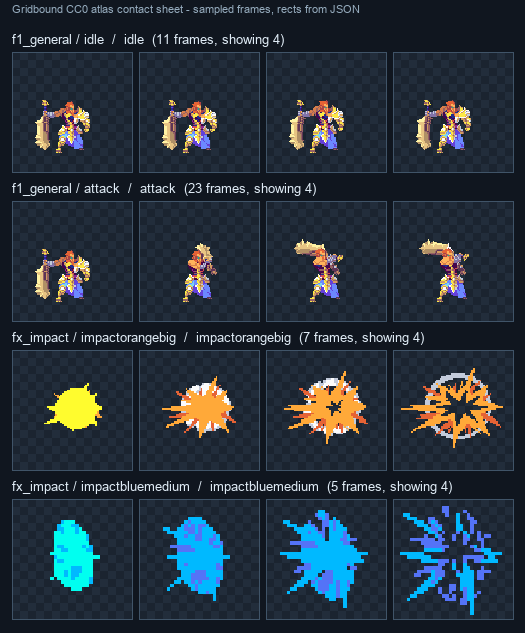

# Export · 引擎无关资产与卡牌导出

> **结论先行**：这个目录让其他引擎在**不安装 Godot** 的情况下拿到全部数据与美术：`asset_manifest.json` 是资产权威清单，`cards.json` 是规范化卡牌数据，`slice_atlas.py` 负责切片/重打包/校验，`build_exports.py` 可从源数据重建前两个文件。已在本机 Python 3 + Pillow 12 上跑通，并生成联系表 [`sample_contact_sheet.png`](sample_contact_sheet.png) 作为证据。

## 1. 文件

| 文件 | 作用 | 是否提交 |
| --- | --- | --- |
| `asset_manifest.json` | 35 个资产的路径、尺寸、SHA-256、全部帧名/矩形、动画、用途、锚点/缩放、许可/来源 | 是 |
| `cards.json` | 16 张卡 + 2 将军 + 双方套牌 + 规则常量（引擎无关） | 是 |
| `slice_atlas.py` | 纯 Python 切片/重打包/联系表/manifest 校验工具 | 是 |
| `build_exports.py` | 从 `data/cards.json` + `assets/duelyst_cc0/` 重建 manifest 与 cards | 是 |
| `sample_contact_sheet.png` | 525×633 联系表（f1_general 的 idle/attack + fx_impact 两个动画） | 是 |
| 其他切片/临时图集 | 验证用中间产物 | **否**（放 `/tmp`） |

依赖：Python 3.9+、Pillow（`python3 -m pip install Pillow`）。`build_exports.py` 只用标准库。

## 2. 一条命令验收

```bash
cd godot-card-tactics
python3 export/slice_atlas.py verify --manifest export/asset_manifest.json
```

实测输出：

```
MANIFEST_OK assets=35 atlas_assets=24 animations=109 frames=1291
```

校验内容：

- 顶层 schema / license / source / counts；
- 每个 `path` 存在、PNG 尺寸匹配、SHA-256 匹配；
- `frame_data` 存在、JSON 尺寸与 PNG 一致；
- 动画名集合、每个动画的帧数、每帧 name/rect 与 JSON 完全一致；
- 帧矩形不越界、`x1/y1` 与 `width/height` 一致；
- `static_card_art` 的动画/索引有效；
- `counts.assets / atlas_assets / animations / frames` 与实际一致。

失败时输出 `MANIFEST_FAIL errors=N` 与逐条原因，退出码 1。

## 3. 重建导出

```bash
cd godot-card-tactics
python3 export/build_exports.py
# 实测：
# assets=35 atlas_assets=24 animations=109 frames=1291
# wrote export/asset_manifest.json
# wrote export/cards.json cards=16 generals=2
```

- 读取 `data/cards.json`（原始文件不被修改）与 `assets/duelyst_cc0/**`；
- 资产按路径排序，帧顺序与源 JSON 一致；生成日期固定为 2026-11-21，因此相同输入 → 相同字节输出；
- manifest 的 `source.commit` 固定为 `9fd0a16b611be8c9b991806ec5a6f602aa981823`；
- `cards.json` 的 `source.sha256` 是当前 `data/cards.json` 的哈希，便于发现源数据漂移。

## 4. `slice_atlas.py` 用法

```bash
python3 export/slice_atlas.py --help
python3 export/slice_atlas.py frames --help
python3 export/slice_atlas.py strip --help
python3 export/slice_atlas.py contact --help
python3 export/slice_atlas.py verify --help
```

### 4.1 `frames`：抽单帧

```bash
python3 export/slice_atlas.py frames \
  --png assets/duelyst_cc0/units/f1_general.png \
  --json assets/duelyst_cc0/units/f1_general.json \
  --animation idle --animation attack \
  --out-dir /tmp/gridbound_frames
```

实测：`frames=34 animations=2 out=/tmp/gridbound_frames`（idle 11 + attack 23）。输出文件名为 `frame_name`（同名时不会冲突；源 JSON 的 frame_name 唯一）。

参数：`--all`（全部动画；未给 `--animation` 时的默认）、`--scale 0.5`（最近邻缩放）、`--root`（相对路径根，默认项目根）。

### 4.2 `strip`：重打包成新图集

```bash
python3 export/slice_atlas.py strip \
  --png assets/duelyst_cc0/units/f2_onyxjaguar.png \
  --json assets/duelyst_cc0/units/f2_onyxjaguar.json \
  --animation run --columns 6 \
  --out /tmp/gridbound_atlas/onyxjaguar_run.png
```

实测：

```
atlas=614x104 frames=6 animations=1 out=/tmp/gridbound_atlas/onyxjaguar_run.png
sidecar=/tmp/gridbound_atlas/onyxjaguar_run.json
first_rect {'frame_name': 'f2_onyxjaguar_run_000.png', 'x0': 2, 'y0': 2, 'x1': 102, 'y1': 102, 'width': 100, 'height': 100}
```

- 输出 PNG + **同名 `.json`**（与源 JSON 同 schema：`texture_filename/width/height/frames`，外加 `grid`/`source` 信息）；
- 每格是该图集的最大帧尺寸；帧放在格左上，记录实际 `x0/y0/x1/y1/width/height`；
- `--columns` 默认 8、`--padding` 默认 2、`--background transparent` 或 `#rrggbb`；
- 适合 Three.js/自定义引擎；Unity/Unreal 也可以直接导入这张新图集。

### 4.3 `contact`：联系表（证据/预览）

```bash
python3 export/slice_atlas.py contact --out export/sample_contact_sheet.png \
  --entry "f1_general / idle=assets/duelyst_cc0/units/f1_general.png:assets/duelyst_cc0/units/f1_general.json:idle:4" \
  --entry "f1_general / attack=assets/duelyst_cc0/units/f1_general.png:assets/duelyst_cc0/units/f1_general.json:attack:4" \
  --entry "fx_impact / impactorangebig=assets/duelyst_cc0/fx/fx_impact.png:assets/duelyst_cc0/fx/fx_impact.json:impactorangebig:4" \
  --entry "fx_impact / impactbluemedium=assets/duelyst_cc0/fx/fx_impact.png:assets/duelyst_cc0/fx/fx_impact.json:impactbluemedium:4"
```

实测：`contact_sheet=525x633 rows=4`。每行显示“资产/动画（总帧数，展示数）”，缩略图带棋盘格透明背景。



`--entry` 格式：

```
label=png_path:json_path:animation[:max_frames]
```

路径相对项目根（或 `--root`）。`--thumb` 默认 120px。

### 4.4 `verify`：manifest 自校验

```bash
python3 export/slice_atlas.py verify --manifest export/asset_manifest.json
```

见 §2。若在别的仓库使用，加 `--root <project_root>`。

## 5. Manifest 结构（速查）

```json
{
  "schema": "gridbound.asset-manifest/1",
  "coordinate_system": { "origin": "top-left", "y": "down", "atlas_rect": "[x0,y0,w,h]" },
  "license": { "id": "CC0-1.0", "file": "assets/duelyst_cc0/LICENSE" },
  "source": { "repo": "https://github.com/t73liu/open-duelyst-assets", "commit": "9fd0a16b611be8c9b991806ec5a6f602aa981823", "upstream": "https://github.com/open-duelyst/duelyst" },
  "reference_runtime": {
    "design_resolution_px": [1280,720],
    "board": { "cols": 9, "rows": 5, "cell_px": 88, "origin_px": [236,104] },
    "unit_sprite_scale": 1.22,
    "animation_fps": { "idle": 8, "run": 13, "attack": 17, "hit": 15, "death": 14 },
    "fx_fps": 24,
    "depth": { "unit": "10 + grid_y", "fx": 60, "overlay": 1000 }
  },
  "counts": { "assets": 35, "atlas_assets": 24, "animations": 109, "frames": 1291 },
  "validation": { "command": "python3 export/slice_atlas.py verify --manifest export/asset_manifest.json" },
  "assets": [
    {
      "id": "f1_general",
      "kind": "unit_atlas",
      "path": "assets/duelyst_cc0/units/f1_general.png",
      "frame_data": "assets/duelyst_cc0/units/f1_general.json",
      "upstream_path": "assets/units/f1_general.png",
      "size_px": [1024,1024],
      "sha256": "...",
      "license": "CC0-1.0",
      "source": { "repo": "https://github.com/t73liu/open-duelyst-assets", "commit": "9fd0a16b611be8c9b991806ec5a6f602aa981823", "path": "assets/units/f1_general.png" },
      "frame_data_sha256": "...",
      "frame_count": 97,
      "frame_size_px": [100,100],
      "animations": {
        "idle": { "frames": [ {"name": "...", "rect": [404,0,100,100]} ] }
      },
      "reference_runtime": { "pivot": "center", "scale": 1.22, "...": "..." },
      "used_by": ["board_unit", "general:f1"]
    }
  ]
}
```

- 所有路径是**项目根相对 POSIX 路径**；不要用 `res://`。
- `kind`：`unit_atlas` / `spell_icon_atlas` / `fx_atlas` / `tile_texture` / `card_frame`。
- 完整字段语义见 [`docs/PORTABLE_ASSETS.md`](../docs/PORTABLE_ASSETS.md) 与 [`docs/CROSS_ENGINE.md`](../docs/CROSS_ENGINE.md)。

## 6. 新增资产/卡牌的流程

1. 把 CC0/自有 PNG + 帧 JSON 放进 `assets/duelyst_cc0/<folder>/`；保持左上矩形约定。
2. 若是新卡：更新 `data/cards.json`（`sprite`/`icon`/`faction`/`type` 等）。
3. 运行 `python3 export/build_exports.py` 重建 manifest/cards。
4. 运行 `python3 export/slice_atlas.py verify --manifest export/asset_manifest.json`。
5. 跑 Godot 冒烟 `godot --path godot-card-tactics --headless -s tools/smoke_card_tactics.gd`（应仍为 65 checks，除非新增测试）。
6. 在 `docs/PORTABLE_ASSETS.md`/`CREDITS.md` 记录来源与许可；不要提交临时切片。

## 7. 许可与边界

- 资产 CC0 1.0；许可全文在 `assets/duelyst_cc0/LICENSE`，来源与 commit 在 `assets/duelyst_cc0/SOURCE.md`。
- “Duelyst”名称/Logo 是商标，不在 CC0 内；导出/移植时使用原创品牌。
- `export/` 下的 JSON/PNG 是本项目的派生数据/证据图；不改变原始资产许可。

## 8. 相关文档

- [开发文档](../docs/DEVELOPMENT.md) —— 规则、AI、确定性、测试向量。
- [跨引擎移植](../docs/CROSS_ENGINE.md) —— 四层拆分、引擎映射、契约、验收清单。
- [可移植资产](../docs/PORTABLE_ASSETS.md) —— 每个文件、图集 schema、锚点、导出方法。
