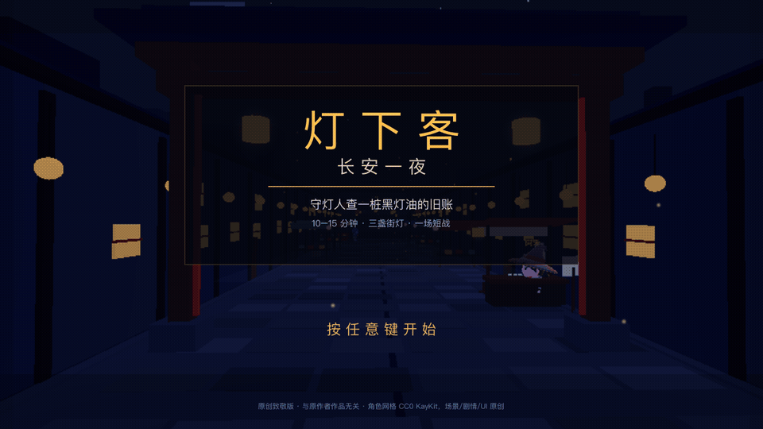
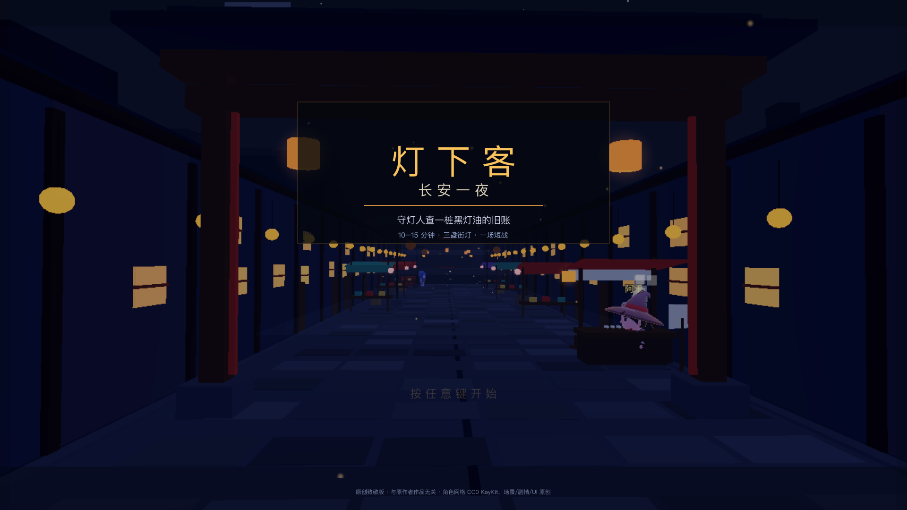
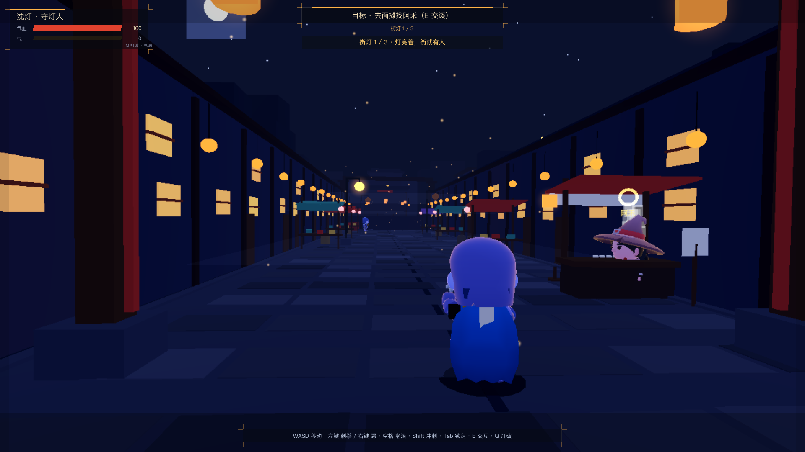
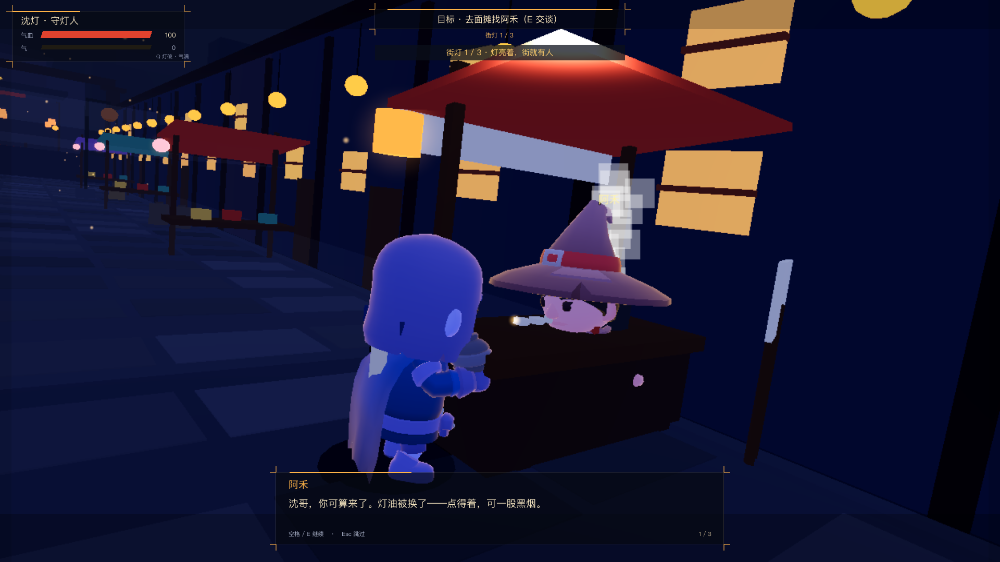
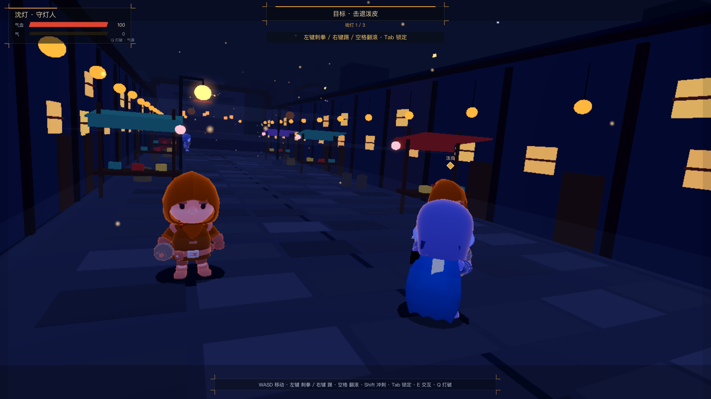
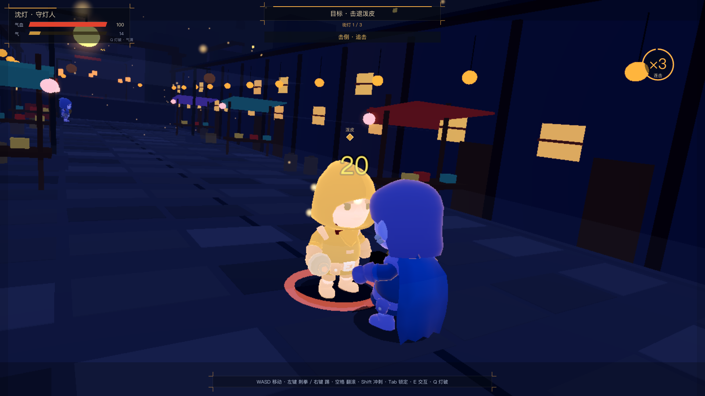
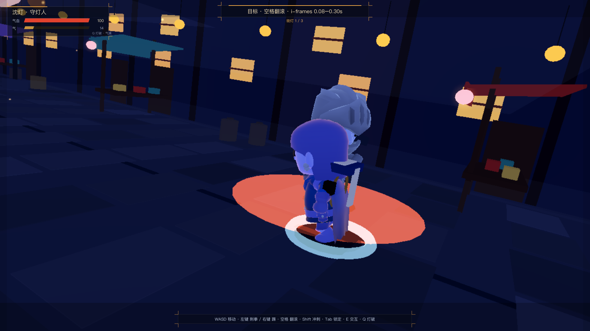
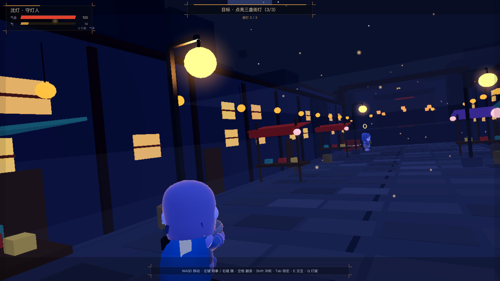
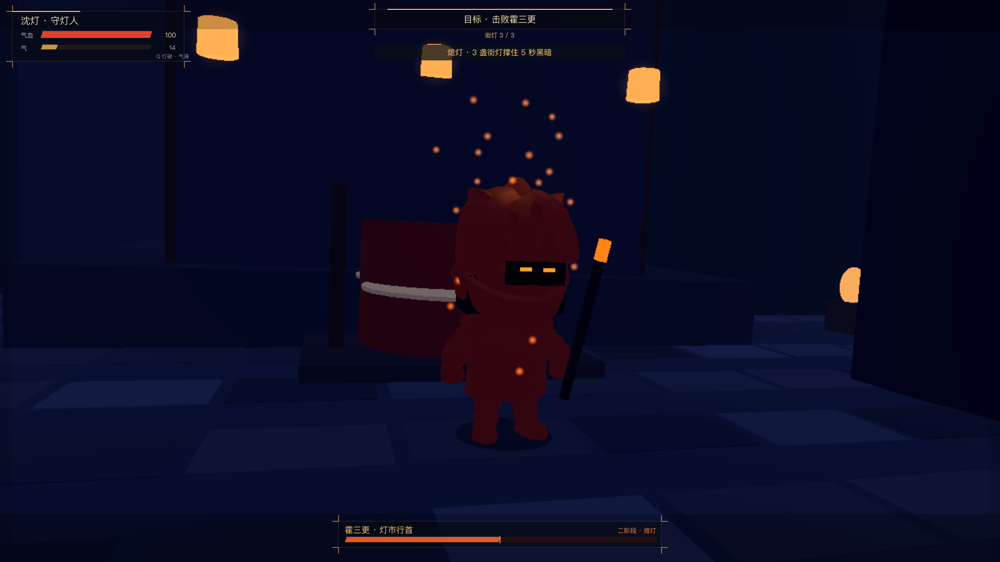
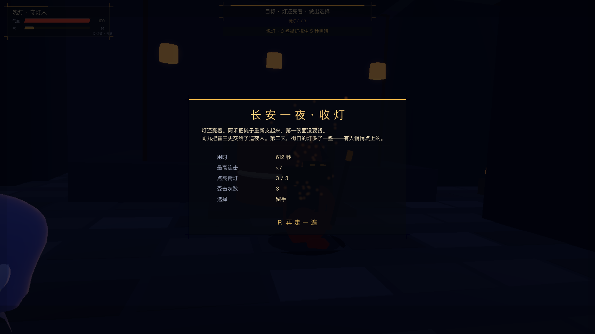

# 灯下客 · 长安一夜

原创致敬版 **3D 动作 vertical slice**：一条 90m 长安风虚构夜街、4 个原创角色、3 场战斗、1 个短 Boss、3 盏会改变 Boss 战的可点亮街灯。10–15 分钟有头有尾。

> **原创声明**：本作与“Opus 5.5 长安城动作游戏”原作者无关；没有使用原作者或原游戏任何角色、名字、剧情、模型、动画、音频、UI、场景素材。玩法/节奏仅作类型研究。角色网格使用 **CC0 KayKit Adventurers** 并重新着色/加原创道具；场景、剧情、UI、代码、特效均为本项目原创。详见 [`CREDITS.md`](CREDITS.md)。



> 10 秒实机录屏：`docs/gameplay.mp4`（1280×720 H.264）；GIF 为同源 960×540 / 12fps。GIF 是脚本化镜头（真实运行、真实渲染），用于展示夜街 → 3 连 → 翻滚 → Boss 熄灯 → 结算。

## 玩起来

```bash
cd godot-changan-action
godot --headless --path . --editor --quit   # 首次导入资源
godot --path . --resolution 1280x720        # 打开游戏
```

Godot **4.6 stable**（`89cea1439`），GL Compatibility；默认 1280×720、`canvas_items` 拉伸；支持 1920×1080。无第三方运行时依赖。

| 输入 | 作用 |
| --- | --- |
| `W A S D` / 方向键 | 相机相对移动；`Shift` 冲刺 |
| 鼠标移动 | 转视角（进入游戏后捕获鼠标；`Esc` 暂停/释放） |
| 鼠标左键 | 刺拳；连按两下接第三下会自动收尾 |
| 鼠标右键 | 踢击；在 3 连的第三下为终结踢（击倒） |
| `Space` | 翻滚（0.08–0.30s 无敌帧） |
| `Tab` | 锁定 / 解除锁定（8m、前方 120°） |
| `E` | 交互：与阿禾/闻九对话、吃面、点亮街灯、敲鼓 |
| `Q` | 灯破（气满 100；范围 30 伤害并击倒） |
| `R` | 重试本场 / 结算后再走一遍 |
| `Esc` | 暂停 / 跳过对话 / 失败回标题 |
| 手柄 | LS 移动、X 刺拳、Y 踢、B 翻滚、LB 冲刺、RB 锁定、A 交互、RT 灯破（右摇杆视角为 P1） |

## 流程（3 拍）

1. **灯灭（B1）**：牌楼 → 阿禾面摊。对话后两名泼皮砸场；教学关。胜利后目标变为“点亮三盏街灯”。
2. **灯亮（B2）**：街中段点灯（1/3、2/3）→ Z=45 触发油贩 + 打手 → 点灯 3/3 → 鼓楼找闻九，得知“灯越多，霍三更的熄灯越短”。
3. **灯下（B3）**：进入鼓楼广场 → 霍三更两阶段 Boss。二阶段会熄灯：**黑暗时长 = 20 − 5 × 已点亮街灯数**（0/1/2/3 灯 = 20/15/10/5 秒）。胜利后选择 **留手 / 了结**，进入结算。

面摊可回血一次（+40）；失败可从当前战斗满血重试，不掉落、不惩罚；无存档。

## 战斗

- 玩家 100 HP / 100 气；刺拳 6、踢 14、3 连终结 20、灯破 30。
- 命中停顿 2/4/6/8 帧、屏幕震动、敌人受击闪、击退、伤害数字、连击计数；翻滚 i-frames；被击倒 → 起身（起身前 0.5s 无敌）。
- 敌人：**泼皮**（2 连挥）、**油贩**（掷油瓶 + 火油地面）、**打手**（砸地/冲撞，高 poise）。攻击令牌保证同屏最多 1 人处于攻击态。
- Boss：铁尺三连、扫堂、撒油、二阶段火油冲锋；3 连终结造成 0.8s 破绽，灯破每阶段可击倒一次。
- 可读性：所有敌人起手都有地面/线形预警（≥0.35s）；锁定菱形 + 自动朝向；夜景由玩家补光 + 月光 + 街灯保证可读。

## 验收

```bash
# 状态机 / 伤害 / i-frames / AI 令牌 / 触发 / Boss / 胜负 / 重开 / 剧情 beat
godot --headless --path . -s tools/smoke_changan_action.gd
# 末行：CHANGAN_ACTION_SMOKE_OK（83 项断言）

# 600 帧无 SCRIPT ERROR
godot --headless --path . --quit-after 600

# 真实 GPU 截图（9 张 1920×1080）
godot --path . --resolution 1920x1080 -s tools/screenshot_changan.gd
# 末行：CHANGAN_SCREENSHOTS_OK

# 真实 GPU 性能（1280×720）
godot --path . --resolution 1280x720 -s tools/probe_fps.gd
# 末行：CHANGAN_FPS_OK / FAIL（见 docs/TECH.md §9 的宿主负载说明）

# 10 秒 GIF/MP4 源帧
godot --path . --resolution 1280x720 -s tools/capture_gif.gd
# 帧在 /tmp/changan_gif；docs/gameplay.gif/.mp4 是编码后的交付物
```

本机实测（2026-11-21，Intel HD 6000）：

```text
CHANGAN_ACTION_SMOKE checks=83 failures=0
CHANGAN_ACTION_SMOKE_OK
CHANGAN_SCREENSHOTS_OK 9 shots
```

性能（同一台 Intel HD 6000，1280×720，无 VSync；宿主跑着 Lark/Blender/其他 agent）：

```text
CHANGAN_FPS avg=37.4 min=25.0 samples=24 lights=3 draws=198 tris=56592
CHANGAN_FPS_OK
CHANGAN_VERIFY_OK
```

- **最终 `verify.sh` 一次全绿**：avg 37.4 ≥30、min 25.0 ≥20，draw calls 198、tris 56,592、3 盏实光。达到 Intel HD 6000 目标。
- 负载高时同机会出现 avg 33.2/min 3.0 等抖动；逐帧诊断确认 0.6–1.1 秒卡顿也会发生在 `action=none`，属宿主争抢。多次结果与诊断见 `docs/TECH.md` §9，不把一次结果当永久保证。
- 渲染预算：`scaling_3d/scale=0.65`、无实时阴影/glow/SSAO/SSR、约 3 盏实光（月光 + 玩家补光 + 最近街灯；Boss 熄灯时广场灯串替换街灯）、约 150–200 draw calls、50–57k tris。
- 原始日志：`docs/logs/`（boot / smoke / screenshots / fps / verify 摘要）。

## 截图（真实 GPU，1920×1080）

| | |
| --- | --- |
|  |  |
|  |  |
|  |  |
|  |  |
|  | |

## 代码结构

| 文件 | 作用 |
| --- | --- |
| `scripts/main.gd` | 场景/相机/时间/战斗编排、任务与剧情、HUD 数据、VFX 对象池、结算/重开、工具 API |
| `scripts/player.gd` | 沈灯：移动/冲刺/刺拳/踢/3 连/翻滚/灯破/受击/击倒/起身/胜利 FSM |
| `scripts/enemy.gd` | 泼皮/油贩/打手/Boss：AI、攻击令牌、预警、poise/受击、两阶段 Boss |
| `scripts/world.gd` | 程序化长安夜街、牌楼、摊位、鼓楼、54 盏灯笼、3 盏街灯、边界/碰撞、光照预算 |
| `scripts/npc.gd` | 阿禾/闻九：idle/talk + 原创身份道具 + 名字标签 |
| `scripts/hud.gd` | 中文自绘 HUD：血/气/连击/目标/街灯/Boss/锁定/交互/对话/选择/结算/失败 |
| `shaders/character_tint.gdshader` | 原创色键 shader：保留 CC0 贴图明暗，旋转色相到本作角色色 |
| `tools/*` | smoke、截图、FPS、逐帧卡顿、GIF 采集、verify |

设计与技术细节见 [`docs/TECH.md`](docs/TECH.md)；迭代/问题记录见 [`docs/迭代记录.md`](docs/迭代记录.md)。

## 已知限制

- 无音频（P0 按规格用停顿/震屏/闪/数字撑打击感）；TTS/配音为 P2。
- 程序化角色仍为 Q 版共享骨架；Tripo 图生 3D 因本机无 `TRIPO_API_KEY` 未执行，见 `CREDITS.md` 的待补项。
- 手柄右摇杆视角、按键重映射、震屏开关为 P1；当前键鼠完整可玩，手柄基础按键已映射。
- 性能最低帧需在干净机器上复测；当前宿主负载让 min 数据不可信。
