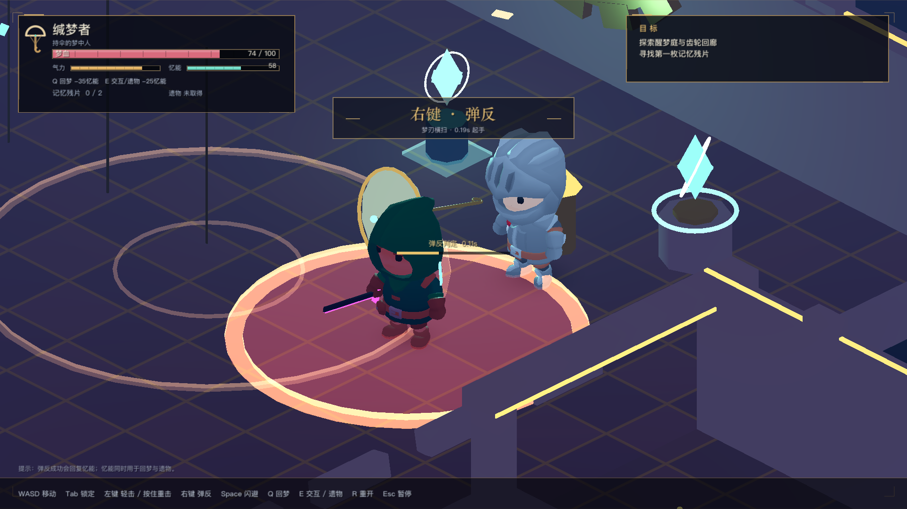

# 梦隙 · 残响（Dreamrift Vestige）

原创 3D 等轴类魂动作 vertical slice。你扮演持伞的**缄梦者**，在四段相连的梦境中收集记忆残片，
用**0.18 秒弹反窗**和**带 i-frames 的闪避**穿过梦魇，最后用「窥梦棱镜」看破一座原本不可见的断桥，
在无钟之间击败**钟摆守梦人**。

> 原创名称、世界观、关卡、UI、剧情与程序化资产。仅借用类魂/等轴动作的抽象类型语言；
> 没有使用《Memoria Wake》或其他商业作品的角色、场景、名称、UI、素材、剧情或音乐。
> 角色模型为 KayKit **CC0**，详见 [CREDITS.md](CREDITS.md)。



## 运行

```bash
godot --path godot-dream-parry
# 或
godot --path godot-dream-parry --resolution 1920x1080
```

- Godot **4.6**，渲染器 **GL Compatibility**。
- 内部设计分辨率 **1280×720**，可窗口化到 1920×1080。
- 无第三方运行时依赖；模型直接 `load()` glTF。
- 没有音频资产；这是程序化玩法切片，不是完整商品。

## 操作

| 输入 | 动作 |
| --- | --- |
| `WASD` | 等轴相机相对移动 |
| `Tab` / 鼠标中键 | 锁定/解除锁定最近梦魇 |
| 鼠标左键（点击） | 轻击（伞刃横扫） |
| 鼠标左键（按住 ≥0.32s 再松开） | 重击（消耗更多气力） |
| 鼠标右键 | 弹反（起手后 **0.18s** 判定窗，总动作 0.45s） |
| `Space` | 闪避：0.26s i-frames，总动作 0.42s |
| `Q` | 回梦：35 梦血，消耗 35 **忆能**；有施法动作，可被打断 |
| `E` | 与残梦灯/遗物/残片/断桥互动；断桥边使用遗物 |
| `R` | 游玩/梦碎时回最后残梦灯；胜利后开始全新一轮 |
| `Esc` / `P` | 暂停 |

弹反成功会让敌人进入 **1.65s 失衡硬直**，并开放反击窗口；硬直内左键攻击伤害 ×2.2，
同时回复 20 忆能。回梦和遗物共用**忆能**：忆能来自缓慢自然回复、命中与完美弹反，
因此“回血”和“开路”是同一资源的两难。

## 流程（约 4–8 分钟）

1. **醒梦庭**：从残梦灯醒来，沿石径进入齿轮回廊。残梦灯可作为重生点。
2. **齿轮回廊**：击败失忆巡游者，拾取第一枚记忆残片，在祭坛取得**窥梦棱镜**。
3. **断桥秘园（隐藏）**：西侧断桥被幻象挡住；在断桥边按 `E`，消耗 25 忆能令断桥显形，
   跨桥取得第二枚残片。未使用遗物前，幻象墙有真实碰撞，不能通过。
4. **无钟之间**：进入 Boss 房，击败钟摆守梦人。Boss 半血进入**第二声钟**，
   加速并强化起手。`丧钟领域` 是不可弹反的 AoE，必须用闪避 i-frames 躲开。
5. **结算**：Boss 死亡且集齐 2 枚记忆残片 → 梦潮退去；`R` 开始新的一轮。

梦碎会扣回最后残梦灯：普通梦魇与存活的 Boss 重置，已拾取的残片与遗物保留。
Boss 已经被击败则不会因玩家死亡而复活（可直接去收尾）。

## 目录

```
scenes/main.tscn            主场景（运行时构建关卡/角色/HUD）
scripts/dream_world.gd      主控：流程、类魂循环、战斗判定、遗物门、相机、UI 接线
scripts/dream_level.gd      程序化等轴关卡、房间灯光、齿轮/断桥/钟面/漂浮碎片
scripts/dream_player.gd     玩家 FSM、雨伞/攻击/弹反/闪避/回梦/资源、KayKit 回退
scripts/dream_enemy.gd      梦魇 FSM、预警、攻击/硬直/破韧/死亡、Boss 二阶段
scripts/dream_hud.gd        中文 HUD、弹反提示、Boss 血条、暂停/梦碎/胜利
scripts/dream_fx.gd         程序化命中环/火花/伤害数字/闪避残影
shaders/dream_floor.gdshader 单 DrawCall 地砖 + 细缝与自发光
assets/models/kaykit/       KayKit CC0 角色（Knight / Rogue_Hooded / Mage）
tools/                      smoke / screenshot / perf / video 验收工具
docs/TECH.md                技术细节与参数
docs/迭代记录.md             迭代过程、问题与验证
docs/shots/                 7 张 1920×1080 真 GPU 截图
docs/dream_parry.mp4        10 秒 1280×720 演示
docs/dream_parry.gif        10 秒 GIF
```

## 自测

```bash
# 无头逻辑验收（末行 DREAM_PARRY_SMOKE_OK）
godot --headless --path godot-dream-parry -s tools/smoke_dream_parry.gd

# 10 秒无 ERROR 运行
godot --headless --path godot-dream-parry --quit-after 600

# 1920×1080 真 GPU 截图（输出 docs/shots）
godot --path godot-dream-parry --resolution 1280x720 -s tools/screenshot_dream_parry.gd

# 真实窗口性能采样
godot --path godot-dream-parry --resolution 1280x720 -s tools/perf_dream_parry.gd
```

最近一次：`DREAM_PARRY_SMOKE_OK checks=140`；无头 600 帧无 `SCRIPT ERROR`。
真实窗口 1280×720（Boss 实战）：平均 **45.0 FPS**；请求 1920×1080 时本机显示器将窗口夹取到
1440×762，平均 **55.9 FPS**。1920×1080 截图来自 1920 离屏 SubViewport，不是实时帧率承诺。
详见 [docs/TECH.md](docs/TECH.md) 的“性能与已知限制”。
