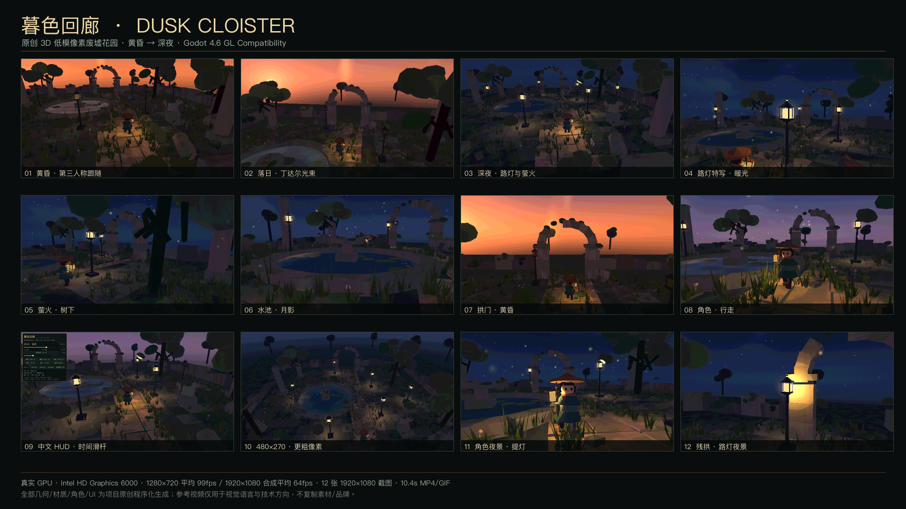

# 暮色回廊 · Dusk Cloister

原创 **3D 低模 + 像素化废墟花园** vertical slice。Godot 4.6 / GL Compatibility。

黄昏 18:30 → 深夜 22:30；沿着石路穿过断柱与残拱，路灯按阈值一盏盏亮起，萤火在草丛与池边出现，水面、云影、光束随时间与风变化。角色是原创的提灯守园学徒「苔灯」，不是参考视频里的红裙金发小女孩。

> 视觉语言与技术方向参考 B 站 BV1sEpE6pEWK（UP timbercyke，Godot 实时像素风废墟花园）。**没有复制**参考视频的场景布局、角色、贴图、模型、UI 或品牌；本项目全部几何/材质/角色/UI 均为程序化原创，参考只用于确认「黄昏→深夜、路灯/萤火渐亮、水/云影/光束、像素化」这些方向。



## 快速运行

```bash
# 仓库根目录
godot --path godot-dusk-garden

# 或进入项目目录
cd godot-dusk-garden
godot .
```

- 引擎：**Godot 4.6 stable**（GL Compatibility）。
- 默认窗口 1280×720；内部 3D 以 640×360 渲染，最近邻整数倍放大（2×）。HUD 为全分辨率。
- 若显示器支持，可 `--resolution 1920x1080`（3×）。本机物理屏 1440×900，因此 1920×1080 截图由真实 GPU 的 SubViewport 合成（见 `docs/TECH.md`）。

## 操作

| 操作 | 功能 |
| --- | --- |
| `W A S D` / 方向键 | 相机相对方向移动 |
| `Shift` | 跑 |
| 鼠标左键 | 点击地面前往（显示落点环） |
| 鼠标右键拖动 | 环绕相机 |
| 滚轮 | 拉近/拉远 |
| `H` | 隐藏/显示 HUD |
| `Space` | 暂停 |
| `T` | 自动时间开/关 |
| `1` / `2` / `3` | 预设：黄昏 18:50 / 暮蓝 20:40 / 深夜 22:20 |
| `F` / `G` | 路灯 / 萤火开关 |
| `P` | 像素吸附（像素偏移补偿）开/关 |
| `R` | 相机复位 |
| `Q` / `E` | 相机偏航 −/+ |
| `[` / `]` | 时间微调 |

HUD 还提供时间滑杆、自动速度、内部 RT 320×180 / 480×270 / 640×360、路灯/萤火/暂停按钮、FPS/draw call/像素吸附状态。

## 场景与方法

- **低模废墟花园（全程序化）**：20×20 石板路（路径暖石、庭院约 60% 覆盖、苔藓/落叶/碎石）、断柱与柱鼓、残拱（拱券缺 2 块楔石）、圆形水池 + 残破喷泉 + 睡莲、4 棵主树 + 墙外树林剪影、长椅、石狐雕像、6 盏路灯。
- **角色**：宽檐草帽、墨绿披风、锈橙围巾、铜灯笼手杖；idle 呼吸/转头、行走摆臂/迈步、灯笼钟摆；自发光灯笼 + 地面暖光池。
- **时间/环境**：5 个关键帧插值（18:30 → 22:30）；太阳/月亮方向与能量、天空渐变、云量、雾、曝光、水色联动。
- **路灯**：6 盏阈值 0.17/0.26/0.35/0.45/0.55/0.65，错峰渐亮，点亮瞬间有轻微闪烁；OmniLight + 灯笼玻璃自发光 + 加色辉光 + 地面光池 + 水面倒影。
- **萤火**：160 只，CPU 更新 MultiMesh（1 draw call），9 个区域，独立闪烁/漂浮；活动度 `smoothstep(0.30, 0.72, t)` 渐显。
- **水/云影/光束**：水池支持天空菲涅尔反射、日/月镜面高光、池内路灯虚拟倒影、量化涟漪、湿石池沿；世界空间 fbm 云影投在 toon 材质上；3 个锥形光柱 + 屏幕空间 14-tap 丁达尔/日月辉。
- **像素化**：640×360 SubViewport（3D）+ 640×360 后期 RT；最近邻整数倍放大；关 MSAA/TAA/SSAA/debanding；相机锚点像素吸附（像素偏移补偿）；低分辨率 Bayer 抖动 + 20 级色阶。
- **中文 HUD**：全分辨率 CanvasLayer，不被像素化；PingFang/Noto 等系统字体回退。

完整架构、参数与公式见 [`docs/TECH.md`](docs/TECH.md)。

## 截图与视频

全部来自 **真实 GPU**（Intel HD Graphics 6000，OpenGL 4.1 Compatibility），1920×1080；12 张主截图 + 自检图。

| 文件 | 内容 |
| --- | --- |
| `docs/shots/00_contact_sheet_1920.png` | 12 张截图 4×3 总览 |
| `docs/shots/01_dusk_thirdperson.png` | 黄昏 · 第三人称跟随 |
| `docs/shots/02_sunset_beams.png` | 落日 · 丁达尔光束 |
| `docs/shots/03_night_thirdperson.png` | 深夜 · 路灯与萤火 |
| `docs/shots/04_lamp_closeup.png` | 路灯特写 · 暖光 |
| `docs/shots/05_fireflies.png` | 萤火 · 树下 |
| `docs/shots/06_pool_reflection.png` | 水池 · 月影/路灯倒影 |
| `docs/shots/07_arch_beams.png` | 残拱 · 黄昏 |
| `docs/shots/08_character_walk.png` | 角色行走 |
| `docs/shots/09_hud_panel.png` | 中文 HUD |
| `docs/shots/10_lowres_480.png` | 480×270 粗像素对照 |
| `docs/shots/11_character_night.png` | 角色夜景 · 提灯 |
| `docs/shots/12_arch_lamp_night.png` | 残拱路灯夜景 |
| `docs/shots/13_25pct_480.png` | 25% 视图可读性检查 |
| `docs/shots/14_silhouette_1920.png` | 纯黑剪影检查（帽/披风/提灯/手杖/靴） |
| `docs/shots/15_character_4x.png` | 角色 4× 细节（脸/灯笼/材质） |

- 视频：[`docs/media/dusk_cloister.mp4`](docs/media/dusk_cloister.mp4)（1280×720，10.43s，H.264，含标题）
- GIF：[`docs/media/dusk_cloister.gif`](docs/media/dusk_cloister.gif)（480×270，12fps，10.43s）
- 标题叠层源图：[`docs/media/title_overlay.png`](docs/media/title_overlay.png)
- 截图/镜头明细见 [`docs/截图清单.md`](docs/截图清单.md)。

## 性能

真实 GPU：Intel HD Graphics 6000 / OpenGL 4.1 Compatibility（本机）。

| 场景 | 平均 FPS | 最低 FPS* | Draw calls | RT |
| --- | --- | --- | --- | --- |
| 1280×720 窗口（目标） | **98.9** | 27.9 | 187 | 640×360 |
| 1920×1080 SubViewport 合成 + 全分辨率 HUD | **63.6** | 26.0 | 239 | 640×360 ×3 |

\* 5 秒采样窗口内的瞬时最低值，包含启动/OS 调度尖峰；平均满足 Intel 30fps+。HUD 截图里的 FPS 是 1920 合成 + PNG 回读时的瞬时读数（不同轮次 29–90），不代表 1280 目标帧率。

复现：

```bash
godot --path godot-dusk-garden --script tools/probe_fps.gd
```

## 自测

```bash
# 1) headless smoke（末行必须 DUSK_GARDEN_SMOKE_OK）
godot --headless --path godot-dusk-garden --script tools/smoke_dusk_garden.gd

# 2) 真实 GPU 控制台 0 错误（跑 5 秒）
godot --path godot-dusk-garden --resolution 1280x720 --quit-after 300

# 3) 1920×1080 截图（真实 GPU SubViewport 合成）
godot --path godot-dusk-garden --script tools/capture_shots.gd

# 4) 纯黑剪影
godot --path godot-dusk-garden --script tools/capture_silhouette.gd

# 5) 10.4s 电影（Godot Movie Maker → ffmpeg）
godot --path godot-dusk-garden --resolution 1280x720 \
  --write-movie docs/media/dusk_cloister.avi \
  --fixed-fps 30 --disable-vsync -- --movie
ffmpeg -y -i godot-dusk-garden/docs/media/dusk_cloister.avi \
  -loop 1 -i godot-dusk-garden/docs/media/title_overlay.png \
  -filter_complex "[1:v]format=rgba,fade=t=in:st=0:d=0.6:alpha=1,fade=t=out:st=2.6:d=0.6:alpha=1[t];[0:v][t]overlay=0:0:enable='between(t,0,3.2)',fade=t=in:st=0:d=0.5,fade=t=out:st=9.5:d=0.9,format=yuv420p" \
  -c:v libx264 -crf 19 -preset medium -movflags +faststart -shortest \
  godot-dusk-garden/docs/media/dusk_cloister.mp4
```

最近一次结果：

- `CHECKS 70` / `DUSK_GARDEN_SMOKE_OK`；headless 0 个 SCRIPT ERROR。
- 真实 GPU 启动/运行日志 0 ERROR / 0 WARNING。
- 12 张 1920×1080 真实 GPU 截图；10.43s MP4 + GIF。
- 25% / 4× / 纯黑剪影自检通过（角色与提灯轮廓可读）。

## 文档

- [`docs/TECH.md`](docs/TECH.md) · 架构、渲染管线、像素偏移补偿、时间/路灯/萤火/水/天空参数、性能与限制
- [`docs/迭代记录.md`](docs/迭代记录.md) · 残留盘点、修复顺序、before/after、参数与证据
- [`docs/截图清单.md`](docs/截图清单.md) · 每张截图的时间/相机/证明点
- [`CREDITS.md`](CREDITS.md) · 原创边界、参考、工具与字体

## 已知限制 / 交接

- 1920×1080 是真实 GPU 的 SubViewport 合成（物理屏 1440×900），不是 1920 原生窗口；渲染内核仍是 640×360 最近邻 ×3。
- 无音频；HUD 使用系统字体（macOS PingFang SC），其他系统走 Noto/DejaVu 回退。
- 截图/剪影工具退出时 Godot 会打印 `ObjectDB instances leaked at exit`（工具未完全释放节点），游戏本体运行无此问题。
- 技术复核（像素吸附的极端运动、丁达尔深度遮挡、最低帧）留给 T-20261127-008；验收留给 T-009；独立美术复评留给 T-010。
