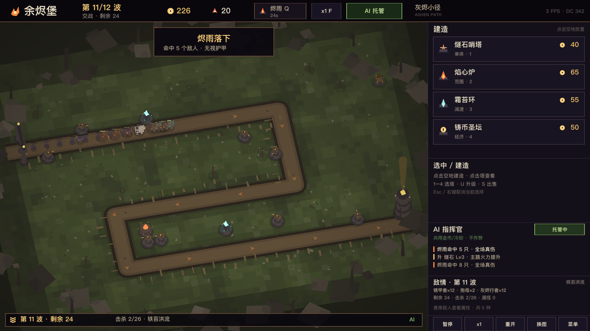

# 余烬堡 3D · Emberhold 3D

**把单文件 HTML 塔防《余烬堡》完整移植到 Godot 4.6 的 3D 低模版本：2 张地图、4 种塔、5 种敌人（含 Boss）、12 波、AI 指挥官可无人值守守完两图。**



## 直接运行

```bash
godot --path godot-emberhold-3d
# 或：Godot 4.6 项目管理器导入 godot-emberhold-3d/ 后运行
```

- Godot **4.6**，GL Compatibility，1280×720 逻辑分辨率；1920×1080 自动使用 1.5× 3D 内部渲染。
- 无外部模型/贴图/音频；所有低模、地形、路径、门、灯塔、道具均由 `MeshKit` 程序化生成。
- 中文字体使用系统字体（PingFang SC / Microsoft YaHei / Noto Sans CJK 等），不随项目分发字体文件。
- 实时方向光阴影已实现但默认关闭，以保证 Intel HD 30fps+；需要时加 `-- --shadows`（更强 GPU 可选）。

## 操作

| 输入 | 行为 |
| --- | --- |
| 鼠标点击商店卡 | 选择要建造的塔 |
| 鼠标点击草地 | 放置；无效格提示原因 |
| 鼠标点击塔 | 选中，显示射程/升级/出售 |
| 右键 / `Esc` | 取消建造或选中 |
| `1`–`4` | 燧石 / 焰心 / 霜苔 / 圣坛 |
| `U` / `E` | 升级选中塔 |
| `S` / `X` | 出售选中塔（返还 65%） |
| `Space` / `P` | 暂停 / 继续（暂停仍可建造升级） |
| `F` / `Tab` | 1× → 2× → 3× 倍速 |
| `A` | AI 托管 ↔ 手动；手动操作会自动接管 |
| `Q` | 烬雨（冷却 35s；战斗进行中可用） |
| `M` | 换图并重开（保留 AI 模式与倍速） |
| `R` | 重开当前图 |
| 菜单 `Enter` / `W` / `←` `→` | 手动开局 / 看 AI 打一局 / 选图 |

## 内容

- **地图**：灰烬小径（1120px 折返长道）、冻苔回廊（960px 多弯近路）。路径、可建造格、8 个阻挡道具与 HTML 版逐格一致。
- **塔**：燧石哨塔（单体）/ 焰心炉（范围）/ 霜苔环（减速）/ 铸币圣坛（经济），3 级升级，数值与 HTML 完全一致。
- **敌人**：灰烬行者 / 幽火蛾 / 锈甲兽 / 孢母（治疗+减速抗性）/ 无光巨像（Boss，第 12 波约 3030 HP）。
- **AI 指挥官**：0.55s 决策间隔，自动经济、建造、升级、存钱与烬雨；与玩家共用金币/冷却，没有作弊接口；HUD 显示最近 3 条决策与原因。
- **地图过渡**：0.88s 8×8 抖动溶解；只覆盖 3D 战场，HUD 保持稳定。
- **中文 UI**：HUD、商店、选中/塔信息、敌人/波次、地图选择、暂停、结算、FPS 与 draw calls。
- **3D**：正交 3/4 相机、低模地形/路径/树/石/骨堆/冰晶/出生门/终点灯塔、3D 投射物、落点特效、范围指示器、接触阴影、方向光与雾。

## 验证

```bash
# 逻辑/数值/AI 自动验收（headless，最后一行必须是 EMBERHOLD3D_SMOKE_OK）
godot --headless --path godot-emberhold-3d -s tools/smoke_emberhold3d.gd

# 真实场景交互验收：HUD 点击、建造/升级/出售、暂停、换图、重开、结算、菜单
godot --path godot-emberhold-3d -s tools/probe_emberhold3d.gd

# 1920×1080 截图（9 张）
godot --path godot-emberhold-3d -s tools/screenshot_emberhold3d.gd

# FPS 压测（自动 AI 到第 8 波，统计 7 秒）
godot --path godot-emberhold-3d --resolution 1280x720 -- --bench

# 10 秒演示视频（Godot MovieWriter → ffmpeg）
bash tools/make_media.sh
```

最近一次结果（2026-11-26，Intel HD 6000 / 共享 Mac）：

- smoke：**72 checks / 0 fails / EMBERHOLD3D_SMOKE_OK**。
- probe：**29 checks / 0 fails / EMBERHOLD3D_PROBE_OK**。
- AI 无人值守：灰烬小径 **204 击杀 / 20 生命 / 559.67s / 72 决策**（与 HTML 完全一致）；冻苔回廊 **204 / 20 / 443.73s / 61 决策**（HTML 444.75s，AI 决策/塔位一致）。
- FPS（loadavg ≈ 3.0）：1280×720 全 HUD **39.9 / 47.6 / 47.4**（三次），1920×1080 **39.2**；1280×720 隐藏 HUD 约 **51.0**。全部 ≥ 30。
- 真实 GPU console：**0 error / 0 script error**（`--resolution 1920x1080 --quit-after 600`；probe/smoke 同样 0）。
- 证据：9 张 1920×1080 截图、10s MP4（1280×720/30fps）、10s GIF（960×540/15fps）。详见 `docs/PARITY.md` 与 `docs/TECH.md`。

> 截图里的 FPS 数字来自 1920×1080 高分辨率离屏取景 + PNG 读回，低于实际游戏帧率；性能评估以 `--bench` 和抓帧日志为准。

## 截图

| 文件 | 内容 |
| --- | --- |
| `captures/01-menu-ashen.png` | 主菜单，灰烬小径 |
| `captures/02-menu-frost.png` | 主菜单，冻苔回廊 |
| `captures/03-map-transition.png` | 灰烬→冻苔 3D 战场抖动过渡（45%） |
| `captures/04-build-preview.png` | 建造预览、幽灵塔、范围指示器 |
| `captures/05-wave-combat.png` | 第 11 波 24 敌、12 塔、AI 面板 |
| `captures/06-frost-assault.png` | 冻苔回廊第 11 波 |
| `captures/07-boss-wave.png` | 第 12 波无光巨像与 Boss 血条 |
| `captures/08-pause.png` | 暂停界面与选中塔信息 |
| `captures/09-victory.png` | AI 无人值守胜利结算 |

演示视频/GIF：`captures/emberhold3d-demo.mp4`、`captures/emberhold3d-demo.gif`。

## 资产接口（T-030 artist）

| 文件 | 替换内容 |
| --- | --- |
| `scenes/tower_view.tscn` + `scripts/tower_view.gd` | 4 种塔 × 3 级模型、炮塔朝向、开火反馈、幽灵预览 |
| `scenes/enemy_view.tscn` + `scripts/enemy_view.gd` | 5 种敌人模型、翅膀/悬浮动画、血条、受击/减速表现 |
| `scenes/map_view.tscn` + `scripts/map_view.gd` | 地形/路径/道具/出生门/灯塔/环境粒子 |
| `scenes/projectile_view.tscn` + `scripts/projectile_view.gd` | 3 种 3D 投射物 |
| `scenes/vfx.tscn` + `scripts/vfx.gd` | 命中/死亡/升级/技能/回血/金币文字 |
| `materials/*.tres` | 石/骨/金/余烬/霜/地面/路径材质；可整体替换 |
| `shaders/dither.gdshader` | 地图过渡抖动 |

模型均为 3D 几何/顶点色，不使用 2D billboard 冒充；血条（Sprite3D）属于 UI 例外。

## 目录

```
godot-emberhold-3d/
  project.godot
  scenes/                main + TowerView / EnemyView / MapView / ProjectileView / VFX
  scripts/               game_model / map_data / 3D views / HUD / main
  materials/             StandardMaterial3D 资源
  shaders/dither.gdshader
  tools/                 smoke / probe / screenshot / make_media
  captures/              9 张 1920×1080 截图 + MP4/GIF
  docs/                  TECH / 迭代记录 / PARITY
```

## 已知限制

- 实时方向光阴影默认关闭（Intel HD 性能取舍）；塔/敌人/道具使用程序化接触阴影，光照/雾正常。`-- --shadows` 开启实时阴影。
- HUD 以 10Hz 重绘，3D 以 60Hz 渲染；文字/数字最多约 100ms 更新一次，交互立即响应。
- 桌面鼠标优先；未做手机触控专用布局。
- 无音频（与 HTML 版一致）。
- AI 后期金币会过剩（12 塔/升级饱和），这是与 HTML 相同的防御饱和，不是作弊。
- 截图/视频中的 FPS 数字为采集环境读数，不代表目标设备的稳定帧率。

## 原创与许可

见 `CREDITS.md`：全部 3D 几何、材质、UI、代码为本任务原创；未使用第三方模型/贴图/音频；参考 HTML 版本身也是原创；Cinderwatch 仅作为概念对照（MIT）。
