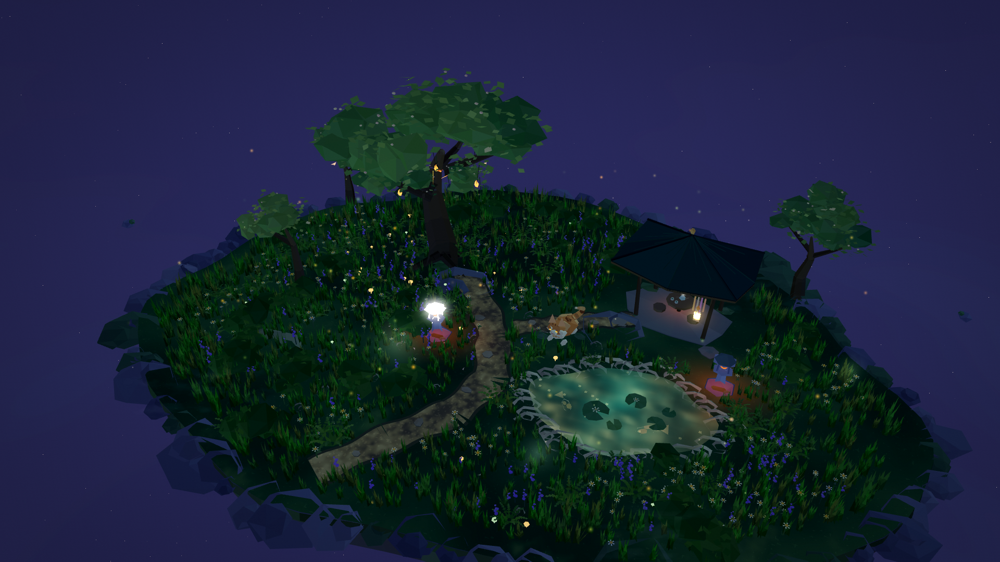

# 苔光浮庭 · Mosslight Isle

原创 Godot 4.6 **治愈系浮空庭园 vertical slice**。视觉语言参考 B 站转发的《feralui》夜景片段：**高层 3/4 俯视的浮岛、冷月与暖灯、苔草/花簇、锦鲤水塘、缓慢环绕**；场景布局、低模资产、UI、角色（苔猫）、茶亭、风铃与交互均为本次原创，不复制原视频的任何场景/物件/角色/UI/素材/品牌。



**10 秒演示视频**：[MP4](docs/media/mosslight_isle_10s.mp4) · [GIF](docs/media/mosslight_isle_10s.gif)  
1920×1080 截图：[docs/shots/](docs/shots/)（夜全景 / 池水微距 / 猫的交互 / 白昼 / 雨景 / 月树细节 / 风铃交互 / HUD）

## 亮点

- **全程序化场景**：浮空岛、层状岩、砂径、月树、茶亭、风铃、苔灯、苔猫、锦鲤、花海，全部由 GDScript 生成；没有外部模型/贴图/音频文件。
- **微动画而非静态摆件**：6 叶草簇风摆、树冠呼吸与叶卡片轻颤、落花、萤火、浮尘、雨、锦鲤游动、水波与岸边暖倒影、茶汤蒸汽、风铃摆动、灯芯呼吸、岛屿轻浮。
- **4 个可轻触小物**：苔灯 ×2、风铃、苔猫。鼠标悬停出现 `E · 名称` 标记，点击或 `E` 触发暖光/声音/尾部/星屑反馈。
- **昼夜 × 晴雨**：冷月→晨光、晴→雨，各 1.2–2s 平滑过渡；灯光、天空、雾、萤火、雨环与 HUD 同步。
- **极简 HUD**：标题、FPS、操作提示、夜/晴/高/暂停四枚药丸按钮；支持暂停、重置、隐藏界面与 F1 预算信息。
- **真实性能达标**：Intel HD Graphics 6000 上 **720p 高画质夜 42fps / 1080p 窗口 30fps（HUD 可见，中位数）**，详见 [docs/fps.txt](docs/fps.txt)。

## 运行

```bash
# 从仓库根目录
godot --path godot-feralui-scene --headless --import      # 首次/新克隆，生成缓存
godot --path godot-feralui-scene                          # 1280×720
godot --path godot-feralui-scene --resolution 1920x1080   # 1080p 窗口
```

Godot 4.6 stable / **GL Compatibility** / 无第三方运行时依赖。

## 操作

| 输入 | 功能 |
| --- | --- |
| 鼠标左键 / 右键拖拽 | 环绕相机（停止自动环绕） |
| 滚轮 | 推近 / 拉远（14–39m） |
| 空格 | 自动环绕开 / 关 |
| 鼠标悬停 + 左键点击，或 `E` | 轻触苔灯 / 水灯 / 风铃 / 苔猫 |
| `N` | 夜 / 昼（平滑过渡） |
| `T` | 晴 / 雨（平滑过渡） |
| `Q` | 高 / 低画质（草叶、花、阴影、粒子预算） |
| `P` | 暂停 / 继续（世界和粒子冻结，HUD 可操作） |
| `R` | 重置相机、昼夜、天气、画质与全部交互状态 |
| `H` | 收起 / 显示 HUD |
| `F1` | 显示 draw calls / primitives 调试行 |

HUD 四枚按钮与键盘等价。截图中的实时 FPS 在离屏 SubViewport 捕获下无参考意义，故统一隐藏；正常运行窗口默认显示实时 FPS。

## 场景与交互

- **苔灯**（路径边）：暖芯灯球、地面光池与一盏无阴影点光。点击切换亮/暗，带轻微闪光和木头般的轻响。
- **水灯**（水塘边）：同一类小灯的第二件，独立状态。暖光在池面形成反射。
- **玻璃风铃**（茶亭檐下）：四根玻璃管 + 木槌 + 米色纸签 + 暖色小铜铃。点击后摆动、生成星屑并播放程序化玻璃三连音。
- **苔猫**（砂径与池塘之间）：原创低模猫，待机呼吸/眨眼/尾巴慢摆；点击抬头、摆尾、耳朵与暖色微尘，配低频程序化呼噜。
- **茶亭**：程序化瓦檐、木柱、茶桌、茶具与上升蒸汽；夜间小纸灯与地面暖池给画面一个“有人刚离开”的落脚点。
- **水塘**：风格化 teal 水面、岸边卵石、睡莲与 2 条游动锦鲤；无显式反射相机，暖灯倒影是 shader 内的解析近似。

声音由 [scripts/procedural_audio.gd](scripts/procedural_audio.gd) 在启动时本地合成，不打包外部音频；无音频设备时不影响运行。

## 性能

环境：Intel Core i7-5650U / Intel HD Graphics 6000 / macOS / OpenGL 4.1 Compatibility / vsync off / HUD 与交互标记可见。

| 场景 | avg | median | min | best 2s |
| --- | ---: | ---: | ---: | ---: |
| 夜 高画质 720p | 41.3 | 42.0 | 39.0 | 43.0 |
| 昼 高画质 720p | 36.0 | 37.0 | 31.0 | 38.1 |
| 夜雨 高画质 720p | 27.9 | 30.0 | 1.0* | 30.5 |
| 夜 低画质 720p | 45.3 | 46.0 | 14.0* | 49.0 |
| 夜 高画质 1080p 窗口 | 30.4 | 30.0 | 27.0* | 31.6 |

`*` 为共享主机的切换/外部负载尖峰；验收以 median 与 best 2s 为主，且 FPS 探针同时 gate 720p 与 1080p 窗口。1080p 运行时窗口因本机桌面被限制为 1920×762，实际逻辑视口仍为 1280×720；1920×1080 截图通过离屏 SubViewport 捕获。

最终采样：**167 draw calls / 133,554 primitives / 182 nodes**（HUD 可见、1080p）。完整日志见 [docs/fps.txt](docs/fps.txt)。

预算：2,200 草簇（6 叶/簇）、300 白花、189 薰衣草、114 卵石/岛缘石、16 组可摇曳树冠、104 萤火、86 浮尘、34 落花、460 雨滴；低画质降草/花实例、关树冠/卵石阴影并减少粒子。

## 自测

```bash
# 无脚本错误 / 无警告
godot --headless --path godot-feralui-scene --quit-after 600
godot --path godot-feralui-scene --resolution 1280x720 --quit-after 180

# 85 项 headless 冒烟
godot --headless --path godot-feralui-scene -s tools/smoke_feralui_scene.gd
# 末行：FERALUI_SCENE_SMOKE_OK

# 真实窗口 FPS（写 docs/fps.txt）
godot --path godot-feralui-scene --resolution 1280x720 -s tools/probe_fps.gd

# 真实 GPU 1920×1080 截图（8 张）
godot --path godot-feralui-scene -s tools/screenshot_feralui_scene.gd

# 300 帧 / 30fps / 10s 源帧 → ffmpeg 编码
godot --path godot-feralui-scene --fixed-fps 30 -s tools/capture_feralui_scene.gd
ffmpeg -y -framerate 30 -i /tmp/feralui_scene_frames/frame_%04d.jpg \
  -c:v libx264 -preset slow -crf 25 -pix_fmt yuv420p -movflags +faststart \
  docs/media/mosslight_isle_10s.mp4
ffmpeg -y -i docs/media/mosslight_isle_10s.mp4 \
  -vf "fps=10,scale=840:-1:flags=lanczos,split[s0][s1];[s0]palettegen=max_colors=128:stats_mode=diff[p];[s1][p]paletteuse=dither=bayer:bayer_scale=4:diff_mode=rectangle" \
  docs/media/mosslight_isle_10s.gif
```

真实验收输出：[docs/verification.txt](docs/verification.txt)。

## 关键参数

| 项 | 值 |
| --- | --- |
| 逻辑分辨率 | 1280×720；截图 1920×1080 |
| 相机默认 | yaw 22° / pitch 35.5° / 距离 21.5m / 焦点 (0, 2.15, 0.30) / FOV 43° |
| 世界尺寸 | 浮岛约 23.6×17m；岛顶海拔 0；底面到 -5.1 |
| 默认模式 | 夜 / 晴 / 高画质；自动环绕 0.85°/s |
| 昼夜过渡 | 指数插值，约 1.5s 视觉稳定；天空/灯光/雾/粒子同步 |
| 天气过渡 | 指数插值，约 1.5s；雨 460 滴、雾更浓、水面雨环 |
| 交互 | 4 个屏幕空间目标，悬停半径 62 design px；点击容差 7px |
| 总代码 | GDScript/Shader 全原创；参考视频只做 /tmp 抽帧研究，不入库 |

## 文件结构

```text
godot-feralui-scene/
  project.godot
  scenes/main.tscn
  scripts/                 # main / world / geo / camera / interaction / hud / atmosphere / fx / audio
  shaders/                 # ground / path / water / wind_foliage / sky / post_grade
  tools/                   # smoke / probe_fps / screenshot / capture
  docs/
    TECH.md                # 场景构成 / 光照 / 微动画 / 交互 / 性能 / 与视频差异
    迭代记录.md
    verification.txt
    fps.txt
    agency/T-20261125-009.md
    shots/                 # 8×1920×1080 PNG
    media/                 # 10s MP4 + GIF
  README.md
  CREDITS.md
```

## 已知限制

- 美术是低模/程序化路线，细节密度与参考视频的 3A 级手工场景不可等同；优先保证“治愈感、微动画、原创性、真实 30fps”。
- 参考视频以夜间为主；昼与雨是本次设计延伸，不是原视频内容。
- 1080p 的实测输出受本机窗口高度限制（1920×762 实际窗口）；1080p 图片为 1920×1080 离屏截图。
- 程序化交互音效未经混音/响度校准；视频是无声的，声音在运行游戏中触发。
- 无战斗、角色操控、存档或沙盒建造；这是场景 vertical slice，不是完整游戏。
