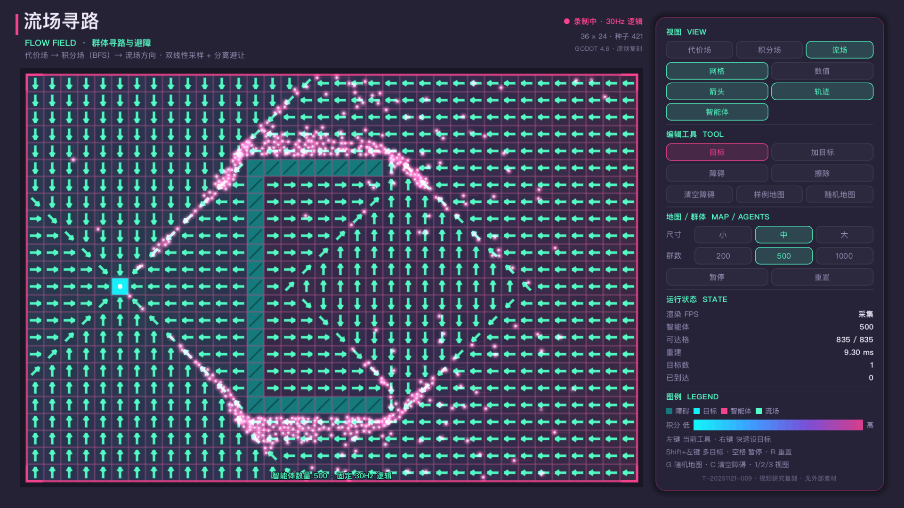

# 流场寻路 · Flow Field

Godot 4.6 原创实现的群体寻路可视化 Demo：**代价场 → 积分场（8 邻接 BFS）→ 流场方向**，智能体沿场移动，并用分离力绕开同伴、用圆形碰撞绕开障碍。

参考 B 站视频 [BV12bzZY2EfA《群体寻路与避障：Flow Field 流场寻路算法如何实现群体寻路》](https://www.bilibili.com/video/BV12bzZY2EfA) 的算法讲解与视觉语言（粉色网格 / 青色箭头 / 深青障碍）。代码、场景、UI 全部原创，不包含视频素材或第三方运行库。



## 运行

```bash
# 在仓库根目录
godot --path godot-flowfield --resolution 1280x720
```

- Godot **4.6**，GL Compatibility（Mobile / 集显友好）。
- 逻辑分辨率 1280×720，窗口自动拉伸；截图与视频为 1920×1080。
- 默认：中号地图 36×24、500 智能体、样例 C 形回廊。

## 功能

- **三视图**：代价场（二元代价 + 数值）、积分场（热力色 + BFS 步数）、流场（方向箭头 + 热力底色）。
- **可编辑地图**：左键放目标 / 拖拽目标；右键快速设目标；Shift+左键加目标（最多 8 个）；障碍 / 擦除画笔支持拖拽笔划，流场实时重建。
- **地图与群体**：24×16 / 36×24 / 48×32 三档；200 / 500 / 1000 智能体；随机地图（固定种子可复现）；清空障碍；暂停 / 重置。
- **运行状态**：渲染 FPS、智能体数、可达格、重建耗时、目标数、到达次数。
- **可复现**：固定种子 + 固定邻域顺序 + 固定 RNG；同地图同目标下积分场/流场逐位一致，智能体位置可复现。
- **视频**：10 秒 30fps 演示（流场箭头、群体绕障、目标切换重算、手绘障碍）——[docs/video/flowfield_demo.mp4](docs/video/flowfield_demo.mp4)。

## 操作

| 输入 | 行为 |
| --- | --- |
| 左键 | 当前工具；目标工具下拖拽可移动目标 |
| 右键 | 快速设目标；在“加目标”工具下移除最近目标 |
| Shift + 左键 | 添加额外目标 |
| 空格 | 暂停 / 继续 |
| R | 重置智能体（同种子重新播撒） |
| G | 随机地图 |
| C | 清空障碍 |
| 1 / 2 / 3 | 代价场 / 积分场 / 流场 |
| H | 隐藏 / 显示控制台 |

## 算法

1. **代价场 `cost[]`**：`0` = 障碍，`1` = 可行走。
2. **积分场 `integration[]`**：所有目标作为多源 BFS 起点，8 邻接逐层 `+1`；对角移动要求两侧正交格都可走，禁止斜穿墙角；不可达为 `INF`。
3. **流场 `flow[]`**：每个可达非目标格选择积分值更小的邻格方向；固定 8 邻域遍历顺序，平局也确定。
4. **采样与移动**：对单位所在格四角的流向量做双线性插值并归一化（平滑转弯）；速度朝目标方向加速，叠加空间哈希分离力与障碍软斥力，最大力/最大速度限幅。
5. **碰撞**：圆形单位 vs 格子障碍精确推出（最多 3 次迭代），网格边界夹紧；目标到达半径 0.8 格，到达后从距目标 ≥12 步的格重生。

详细推导、数据结构与性能取舍见 [docs/TECH.md](docs/TECH.md)；原理、选型、T-011 性能因果链与跨引擎移植见 [docs/TECHNICAL_PRINCIPLES.md](docs/TECHNICAL_PRINCIPLES.md)（[交互版](docs/TECHNICAL_PRINCIPLES-交互版.html)，单文件无外部依赖）。

## 验证

```bash
# 1) 600 帧 headless，检查脚本/引擎错误
godot --path godot-flowfield --headless --quit-after 600

# 2) 正确性冒烟（最后一行 FLOWFIELD_SMOKE_OK）
godot --path godot-flowfield --headless -s tools/smoke_flowfield.gd

# 3) 真实 GPU 帧率（输出 BENCH 行）
godot --path godot-flowfield --resolution 1280x720 -s tools/bench_flowfield.gd

# 4) 重新生成 1920×1080 截图与视频帧
godot --path godot-flowfield --resolution 1280x720 -s tools/capture_flowfield.gd
```

冒烟测试覆盖：积分场有限值 vs 独立 BFS 可达性、流场单调递减、斜穿墙角禁止、画笔/清障/多目标编辑、智能体不穿墙/无 NaN、同种子可复现。

## 性能（本机 Intel HD，1280×720，关垂直同步）

| 智能体 | 平均 FPS | 最差帧 | 30Hz 逻辑步长 |
| --- | ---: | ---: | ---: |
| 200 | 65.0 | 25.2 ms | 2.85 ms |
| 500 | 49.0 | 34.4 ms | 7.15 ms |
| 1000 | 47.0 | 45.1 ms | 7.89 ms |

1000 智能体时方向/分离/拖尾自动降到 10Hz 刷新、拖尾隔一个取样，移动仍按 30Hz 积分。三次实测均 ≥30 FPS；帧率会随机器负载波动，完整日志见 [docs/迭代记录.md](docs/迭代记录.md)。

> 审计级复测（T-011，5 轮、P95/hitch、720p/1080p）见 [docs/perf/REPORT.md](docs/perf/REPORT.md)：高负载环境下默认 ALL 中位 26.4 FPS、P95 57.9 ms，**绝对数不可与上表单次 47.0 直接比较**；同轮归一 2.17×，成本排序与原因见 [docs/TECHNICAL_PRINCIPLES.md](docs/TECHNICAL_PRINCIPLES.md) §4。

## 目录

```
godot-flowfield/
├─ project.godot
├─ scenes/main.tscn
├─ scripts/
│  ├─ main.gd            # 入口、输入、UI 接线
│  ├─ flow_field_grid.gd # 代价场 / BFS 积分场 / 流场
│  ├─ flow_sim.gd        # 固定 30Hz 群体模拟、分离、碰撞
│  ├─ flow_view.gd       # 三视图、箭头、MultiMesh 智能体、拖尾
│  └─ flow_ui.gd         # 中文控制台
├─ tools/
│  ├─ smoke_flowfield.gd # 正确性冒烟
│  ├─ bench_flowfield.gd # 真实 GPU FPS 基准
│  └─ capture_flowfield.gd # 1920×1080 截图 + 10s 视频帧
├─ docs/                 # 技术说明、迭代记录、截图、视频
└─ CREDITS.md
```

## 已知限制

- 积分场使用均匀步长的 BFS（视频同款），暂不支持加权地形；接入权重时需换成 Dijkstra，流场输出格式不变。
- 智能体上限 1200；1000 档为保证集显 30fps，会牺牲部分拖尾密度与刷新频率。
- 截图/视频工具为离线逐帧采集，采集时 FPS 栏显示“采集”而不是实时帧率。
- 目标/障碍编辑会整场重建积分场与流场（中图约 6–14 ms），未做增量更新。
