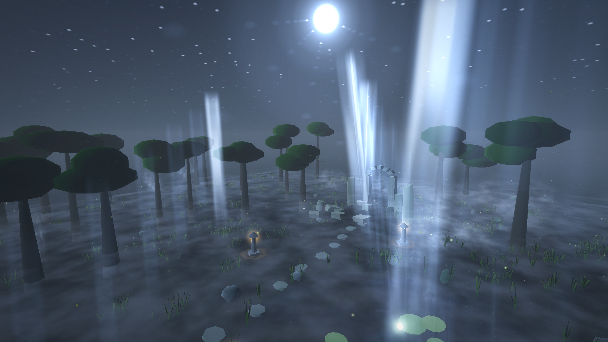

# 雾林微光 · Fogwood

原创 Godot 4.6 大气/雾气技术 demo。灵感来自 B 站短视频《时之笛重制版雾气效果惊人》（仅研究其**贴地雾团 + 金色浮尘 + 缓慢环绕镜头**的视觉语言），**不使用**任何塞尔达/任天堂角色、场景、模型、贴图、Logo、音乐或视频素材。

- 引擎：Godot 4.6 stable / GDScript / **GL Compatibility** / 1280×720 逻辑画布
- 场景：原创程序化低模雾林（林地、树群、石柱拱门、踏石、浅潭、石灯笼、雾精灵、草叶）
- 雾：WorldEnvironment **指数深度雾 + 高度雾**（GL Compatibility 支持），外加 20 片 billboard 雾片、2 层水平贴地雾、248 粒子、4 组伪光束、屏幕空间 god rays
- 性能：Intel HD Graphics 6000 实测高质量 720p **44fps（昼）/ 37fps（夜）**，1080p 窗口 **35fps**；详见 [docs/fps.txt](docs/fps.txt)



媒体：[MP4](docs/fog_atmosphere_demo.mp4) · [GIF](docs/fog_atmosphere_demo.gif) · 1920×1080 截图在 [docs/shots/](docs/shots/)。

## 运行

```bash
# 仓库根目录
godot --path godot-fog-atmosphere
# 或 1080p 窗口（内部仍按 1280×720 逻辑渲染，再拉伸）
godot --path godot-fog-atmosphere --resolution 1920x1080
```

也可以用 Godot 4.6 打开 `godot-fog-atmosphere/project.godot` 后 F5。

## 操作

| 输入 | 功能 |
| --- | --- |
| 鼠标左键拖拽 | 环绕相机（自动环绕会暂停） |
| 滚轮 | 拉近 / 拉远（6.5–32m） |
| WASD | 平移环绕焦点（半径 18m 内） |
| 空格 | 开 / 关自动环绕 |
| F | 雾浓度循环：淡 → 中 → 浓 → 重 |
| G | 雾层高度循环：0.4 → 1.2 → 2.4 → 3.6m |
| C | 雾色循环：晨白 → 冷蓝 → 暖金 → 苔绿 |
| B | 风速循环：0.4× → 0.8× → 1.4× → 2.2× |
| N | 昼 / 夜（1.25s 平滑过渡；月光、灯笼、星、光束、精灵同步） |
| 1 / 2 | 质量高 / 低 |
| R | 重置相机、雾、风、雾色、昼夜与质量 |
| Tab | 隐藏 / 显示 HUD |

HUD 右上角为真实 FPS（截图工具中已隐藏，避免把 1920×1080 截图 SubViewport 的采集帧率误当运行帧率）。

## 雾与大气参数

| 项 | 档位 / 值 |
| --- | --- |
| 深度雾 `fog_density` | 0.0004 / 0.0020 / 0.0044 / 0.0085（指数雾） |
| 高度雾 `fog_height` | 0.4 / 1.2 / 2.4 / 3.6 m |
| `fog_height_density` | 昼 0.026 / 夜 0.050 |
| 雾色 | 晨白 (0.86,0.83,0.73) / 冷蓝 (0.55,0.66,0.80) / 暖金 (0.88,0.78,0.58) / 苔绿 (0.60,0.72,0.56) |
| 雾片 | 高质量 20 片（7.5–19m，贴地 0.35–1.65m）+ 2 层水平雾（62×62m） |
| 粒子 | 浮尘 190 / 流萤 34 / 落叶 24（高质量） |
| 伪光束 | 4 组交叉面片（14–18m 高） |
| 风速 | 0.4 / 0.8 / 1.4 / 2.2 × |
| 质量低 | 雾片 9 / 水平层 1 / 粒子 104 / 光束 2 / 草叶 45%，关闭阴影与 god rays，保留 Glow |

## 质量档

| 项 | 高 | 低 |
| --- | --- | --- |
| 雾片 | 20 | 9 |
| 水平雾层 | 2 | 1 |
| 浮尘/流萤/落叶 | 190/34/24 | 80/15/9 |
| 光束 | 4 | 2 |
| 草叶实例 | 1200 | 540 |
| 方向光阴影 | 单级 2048（48m） | 关 |
| Glow | 开 | 开（观感优先） |
| 屏幕 god rays | 8 taps | 关 |

## 自测（真实输出见 [docs/verification.txt](docs/verification.txt)）

```bash
godot --path godot-fog-atmosphere --headless --quit-after 600       # 无 ERROR
godot --path godot-fog-atmosphere --headless -s tools/smoke_fog.gd  # 末行 FOG_SMOKE_OK（59 项）
godot --path godot-fog-atmosphere --resolution 1280x720 -s tools/probe_fps.gd
godot --path godot-fog-atmosphere --resolution 1280x720 -s tools/screenshot_fog.gd
godot --path godot-fog-atmosphere --fixed-fps 30 -s tools/capture_fog.gd
```

截图：1920×1080 SubViewport + 1280×720 逻辑画布，共 8 张，见 `docs/shots/`。
视频：300 帧 / 30fps / 10s；编码命令：

```bash
ffmpeg -y -framerate 30 -i /tmp/fog_atmosphere_frames/frame_%04d.jpg \
  -c:v libx264 -preset medium -crf 20 -pix_fmt yuv420p -movflags +faststart docs/fog_atmosphere_demo.mp4
ffmpeg -y -i docs/fog_atmosphere_demo.mp4 \
  -vf "fps=12,scale=900:-1:flags=lanczos,split[s0][s1];[s0]palettegen=max_colors=160:stats_mode=diff[p];[s1][p]paletteuse=dither=bayer:bayer_scale=4:diff_mode=rectangle" \
  docs/fog_atmosphere_demo.gif
```

## 性能（Intel HD Graphics 6000 / i7-5650U / vsync off）

| 场景 | avg | median | min | best 2s |
| --- | ---: | ---: | ---: | ---: |
| 高质量 昼 720p | 44.2 | 44.0 | 40.0 | 48.0 |
| 高质量 夜 720p | 37.4 | 38.0 | 36.0 | 38.0 |
| 低质量 昼 720p | 45.1 | 46.0 | 23.0* | 49.0 |
| 高质量 昼 1080p 窗口 | 34.5 | 35.0 | 34.0 | 34.6 |
| 低质量 昼 1080p 窗口 | 36.2 | 38.0 | 32.0 | 38.0 |

\* 低质量首帧有 shader/测量预热；以 median 为准。本机 1440×900 屏幕把 1080p 窗口高度夹到 762；内部 3D 始终按 1280×720 渲染，1080p 只是最终 blit 尺寸。共享主机偶尔有外部负载尖峰，多次运行 720p 高质昼在 33–48fps 之间。

## 结构

```
scenes/main.tscn              入口（Node3D + main.gd）
scripts/main.gd               组装、输入、demo API、FPS、雾/水面/后处理接线
scripts/world_builder.gd      程序化地形/树/石/遗迹/水面/踏石/草/灯笼/精灵/贴图
scripts/fog_system.gd         雾片/水平雾层/粒子/伪光束/质量档/风
scripts/atmosphere.gd         WorldEnvironment 深度+高度雾、天空、昼夜、质量
scripts/camera_rig.gd         环绕相机与输入
scripts/hud.gd                标题/参数面板/快捷键/FPS
scripts/post_fx.gd            屏幕后处理挂载
shaders/sky.gdshader          昼/夜渐变、太阳、月亮、星星
shaders/water.gdshader        浅潭波光、菲涅耳、精灵微光
shaders/grass.gdshader        低模草叶风摆
shaders/beam.gdshader         伪光束噪声
shaders/post_fx.gdshader      god rays + 分级 + 暗角 + 颗粒
tools/                        smoke / screenshot / fps / movie capture
docs/TECH.md                  雾模型、公式、shader、限制
docs/迭代记录.md              参考拆解、迭代参数与实测
```

## 说明与限制

- **不是真体积雾/ray-marching**：Compatibility 不支持 Volumetric Fog；本 demo 用环境深度+高度雾、半透明雾片、粒子和伪光束逼近观感，详见 TECH。
- 无第三方运行时资产/字体/模型；仅用 Godot 内置与 OS 系统字体。
- 水面是解析式着色（无真实反射/折射）；无音频、无移动端触控。
- 参考视频仅用于视觉语言研究，参考帧只存 /tmp，未进入仓库。
