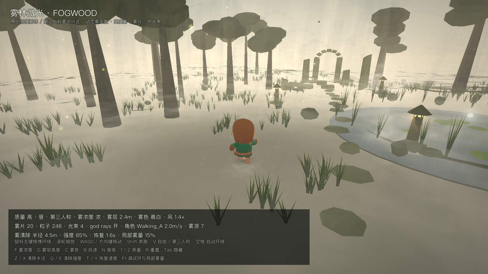

# 雾林微光 · Fogwood

原创 Godot 4.6 大气/雾气技术 demo，含**可操控第三人称角色**与**动态雾驱散**交互。灵感来自 B 站短视频《时之笛重制版雾气效果惊人》（仅研究其**贴地雾团 + 金色浮尘 + 缓慢环绕镜头**的视觉语言），**不使用**任何塞尔达/任天堂角色、场景、模型、贴图、Logo、音乐或视频素材。

- 引擎：Godot 4.6 stable / GDScript / **GL Compatibility** / 1280×720 逻辑画布
- 场景：原创程序化低模雾林（林地、树群、石柱拱门、踏石、浅潭、石灯笼、雾精灵、草叶）
- 角色：**KayKit Rogue（CC0）**，Idle / Walking_A / Running_A；第三人称跟随相机 + 可切换自由相机；程序化人形回退
- 雾：WorldEnvironment **指数深度雾 + 高度雾**（GL Compatibility 支持），外加 20 片 billboard 雾片、2 层水平贴地雾、248 粒子、4 组伪光束、屏幕空间 god rays
- 动态雾：角色移动时清出局部雾区（雾片淡出/推开、雾层遮罩、近身雾粒子淡出、雾浪/足迹），停下 1.6s 平滑恢复；远处雾保持
- 性能：Intel HD Graphics 6000 实测第三人称行走高质量 720p **36fps（昼）/ 37fps（夜）**，1080p 窗口 **33fps**；详见 [docs/fps_interaction.txt](docs/fps_interaction.txt)



媒体：[MP4](docs/fog_interaction_demo.mp4) · [GIF](docs/fog_interaction_demo.gif) · 1920×1080 截图在 [docs/shots/](docs/shots/)。父任务（纯雾景）的媒体仍保留：[MP4](docs/fog_atmosphere_demo.mp4) · [GIF](docs/fog_atmosphere_demo.gif)。

角色/交互截图：09 静止浓雾 · 10 行走清雾 · 11 停下恢复 · 12/13 半径 2m/10m · 14 F1 调试环 · 15 夜雾 + 灯笼 · 16 俯瞰清雾范围。

## 运行

```bash
# 仓库根目录
# 首次运行/新克隆需要先导入资源（角色 GLB；之后 .godot 缓存存在则不必重复）
godot --path godot-fog-atmosphere --headless --import
godot --path godot-fog-atmosphere
# 或 1080p 窗口（内部仍按 1280×720 逻辑渲染，再拉伸）
godot --path godot-fog-atmosphere --resolution 1920x1080
```

也可以用 Godot 4.6 打开 `godot-fog-atmosphere/project.godot` 后 F5（编辑器会自动导入）。新克隆缺少 `.godot/imported` 时，headless 工具需先执行一次 `--headless --import`。

## 操作

| 输入 | 功能 |
| --- | --- |
| 鼠标左键拖拽 / 右摇杆 | 环绕相机（自动环绕会暂停） |
| 滚轮 | 拉近 / 拉远（第三人称 3.5–12m；自由相机 6.5–32m） |
| WASD / 方向键 / 左摇杆 | 第三人称移动角色（相对相机方向）；自由相机下 WASD 平移焦点 |
| Shift | 奔跑（2.0 → 4.6m/s） |
| V | 第三人称 / 自由相机切换 |
| 空格 | 开 / 关自动环绕 |
| F | 雾浓度循环：淡 → 中 → 浓 → 重 |
| G | 雾层高度循环：0.4 → 1.2 → 2.4 → 3.6m |
| C | 雾色循环：晨白 → 冷蓝 → 暖金 → 苔绿 |
| B | 风速循环：0.4× → 0.8× → 1.4× → 2.2× |
| N | 昼 / 夜（1.25s 平滑过渡；月光、灯笼、星、光束、精灵同步） |
| 1 / 2 | 质量高 / 低 |
| Z / X | 雾清除半径 −0.5 / +0.5m（1.5–10m） |
| Q / E | 雾清除强度 −10% / +10%（0–100%） |
| T / Y | 恢复速度：恢复时间 −0.3 / +0.3s（0.6–4s，越短恢复越快） |
| F1 | 调试：清除半径/淡出环、局部雾量、清除量、雾浪数 |
| R | 重置角色、相机、雾、清雾参数、风、雾色、昼夜与质量 |
| Tab | 隐藏 / 显示 HUD |

HUD 右上角为真实 FPS（截图工具中已隐藏，避免把 1920×1080 截图 SubViewport 的采集帧率误当运行帧率）。HUD 底部显示雾清除半径/强度/恢复时间/局部雾量与角色速度；F1 在左上角追加调试行。

## 角色与动态雾驱散

### 角色

- **KayKit Character Pack: Adventurers — Rogue.glb（CC0 1.0）**，内嵌贴图，缩放 0.74（约 1.73m）；隐藏未使用的武器/披风网格。
- 动画 `Idle` / `Walking_A` / `Running_A`；行走/奔跑速度与动画 `speed_scale` 随实际速度调整。
- 移动：相对相机 yaw；平滑加速/转向；`terrain_height()` 贴地；世界边界 33m；池岸阻挡（水外 0.55m）；树干/石柱/灯笼圆形推离。
- 程序化人形保留为 `FOG_FORCE_PROCEDURAL=1` 或模型缺失时的回退。
- 夜间隔雾补光仅 0.10 → 0.48 能量、4.2m 范围，不开阴影；近身雾片有 35% 基础柔化，避免角色被雾块硬切。
- 第三人称相机默认 20° / 7.2m；与树干/石柱做 2D 圆碰撞自动拉近，并避免钻入地形。

### 雾清除参数

| 项 | 默认 | 范围 / 说明 |
| --- | ---: | --- |
| 清除半径 `clear_radius` | 4.5m | 1.5–10m（Z/X） |
| 清除强度 `clear_strength` | 0.85 | 0–1（Q/E） |
| 恢复时间 `recovery_time` | 1.6s | 0.6–4.0s（T/Y） |
| 上升时间 `RISE_TIME` | 0.28s | 移动时清除量 0→1 |
| 停止延迟 `IDLE_DELAY` | 0.35s | 停下后开始恢复 |
| 近身基础柔化 `BODY_SOFTNESS` | 0.35 | 玩家处最低保留 65% 可见雾量 |
| 近身雾团（跟随） | 8 片 | 低质量 4；移动时被推到清除半径外形成雾墙 |
| 近身雾粒子 | 44 | 低质量 22；移动时淡出 |
| 雾浪 / 足迹 | 16 / 7 | 低质量 8 / 4；行走时生成 |

局部可见雾量系数（1 = 未清除）：

```
core      = 1 - smoothstep(radius * 0.55, radius * 1.55, distance)
core_near = 1 - smoothstep(1.4, 3.0, distance)
local     = max(BODY_SOFTNESS * core_near, strength * clear_amount * core)
factor    = clamp(1 - local, 0, 1)
```

- 雾片：逐实例 alpha = `factor`，并按 `radius * 0.30 * strength * clear_amount * core` 径向推开。
- 水平雾层：`shaders/fog_layer.gdshader` 以世界坐标距离计算同一遮罩，直接改写 alpha。
- 近身雾团：移动时推到 `radius * 0.52` 之外，保留约 45% alpha 形成可读雾墙。
- 停下后 `clear_amount` 按 `recovery_time` 线性回落，雾片/雾层/粒子/雾墙平滑复原。
- **限制**：GL Compatibility 不能逐像素修改 WorldEnvironment 的全局深度/高度雾；清雾作用于“看得见的雾体”（雾片、贴地雾层、近身雾粒子）。远处全局高度雾/深度雾保持不变。详见 [docs/TECH.md](docs/TECH.md)。

## 雾与大气参数

| 项 | 档位 / 值 |
| --- | --- |
| 深度雾 `fog_density` | 0.0004 / 0.0020 / 0.0044 / 0.0085（指数雾） |
| 高度雾 `fog_height` | 0.4 / 1.2 / 2.4 / 3.6 m |
| `fog_height_density` | 昼 0.026 / 夜 0.050 |
| 雾色 | 晨白 (0.86,0.83,0.73) / 冷蓝 (0.55,0.66,0.80) / 暖金 (0.88,0.78,0.58) / 苔绿 (0.60,0.72,0.56) |
| 雾片 | 高质量 20 片（7.5–19m，贴地 0.35–1.65m）+ 2 层水平雾（62×62m） |
| 粒子 | 浮尘 190 / 流萤 34 / 落叶 24（高质量） |
| 伪光束 | 4 组交叉面片（14–18m 高） |
| 风速 | 0.4 / 0.8 / 1.4 / 2.2 × |
| 质量低 | 雾片 9 / 水平层 1 / 粒子 104 / 光束 2 / 草叶 45%，关闭阴影与 god rays，保留 Glow |

## 质量档

| 项 | 高 | 低 |
| --- | --- | --- |
| 雾片 | 20 | 9 |
| 水平雾层 | 2 | 1 |
| 浮尘/流萤/落叶 | 190/34/24 | 80/15/9 |
| 近身雾团 | 8 | 4 |
| 近身雾粒子 | 44 | 22 |
| 雾浪 / 足迹 | 16 / 7 | 8 / 4 |
| 光束 | 4 | 2 |
| 草叶实例 | 1200 | 540 |
| 方向光阴影 | 单级 2048（48m） | 关 |
| 角色补光 | 1（无阴影） | 1（无阴影） |
| Glow | 开 | 开（观感优先） |
| 屏幕 god rays | 8 taps | 关 |
| 实测 draw calls | 99（含角色/雾浪/近身雾，1080p 昼） | — |

## 自测（真实输出见 [docs/verification.txt](docs/verification.txt)）

```bash
godot --path godot-fog-atmosphere --headless --import                            # 首次/新克隆
godot --path godot-fog-atmosphere --headless --quit-after 600                    # 无 ERROR
godot --path godot-fog-atmosphere --headless -s tools/smoke_fog.gd              # FOG_SMOKE_OK（60 项）
godot --path godot-fog-atmosphere --headless -s tools/smoke_fog_interaction.gd  # FOG_INTERACTION_SMOKE_OK（79 项）
godot --path godot-fog-atmosphere --resolution 1280x720 -s tools/probe_fps.gd
godot --path godot-fog-atmosphere --resolution 1280x720 -s tools/probe_fps_interaction.gd
godot --path godot-fog-atmosphere --resolution 1280x720 -s tools/screenshot_fog.gd
godot --path godot-fog-atmosphere --resolution 1280x720 -s tools/screenshot_fog_interaction.gd
godot --path godot-fog-atmosphere --fixed-fps 30 -s tools/capture_fog.gd
godot --path godot-fog-atmosphere --fixed-fps 30 -s tools/capture_fog_interaction.gd
```

截图：1920×1080 SubViewport + 1280×720 逻辑画布，父任务 8 张 + 角色/雾交互 8 张（09–16），见 `docs/shots/`。
视频：300 帧 / 30fps / 10s；编码命令：

```bash
ffmpeg -y -framerate 30 -i /tmp/fog_interaction_frames/frame_%04d.jpg \
  -c:v libx264 -preset medium -crf 20 -pix_fmt yuv420p -movflags +faststart docs/fog_interaction_demo.mp4
ffmpeg -y -i docs/fog_interaction_demo.mp4 \
  -vf "fps=10,scale=840:-1:flags=lanczos,split[s0][s1];[s0]palettegen=max_colors=128:stats_mode=diff[p];[s1][p]paletteuse=dither=bayer:bayer_scale=4:diff_mode=rectangle" \
  docs/fog_interaction_demo.gif
```

## 性能（Intel HD Graphics 6000 / i7-5650U / vsync off）

| 场景 | avg | median | min | best 2s |
| --- | ---: | ---: | ---: | ---: |
| 高质量 第三人称行走 昼 720p | 35.0 | 36.0 | 28.0 | 36.5 |
| 高质量 第三人称行走 夜 720p | 36.1 | 37.0 | 20.0* | 37.0 |
| 低质量 第三人称行走 昼 720p | 35.8 | 39.0 | 3.0* | 40.6 |
| 高质量 第三人称行走 昼 1080p 窗口 | 32.9 | 33.0 | 32.0 | 33.0 |
| 高质量 静止 昼 1080p 窗口 | 32.2 | 32.0 | 31.0 | 32.5 |

\* 首段含质量档切换/测量预热；以 median 为准。本轮 1080p 窗口在本机被系统夹为 1920×762（内部仍 1280×720 渲染）。父任务无角色基线（44/37/45/35fps）仍见 [docs/fps.txt](docs/fps.txt)；本轮完整样本见 [docs/fps_interaction.txt](docs/fps_interaction.txt)。draw calls 99 / nodes 116（含角色 12 网格、雾浪、近身雾团、补光）。

## 结构

```
scenes/main.tscn                入口（Node3D + main.gd）
assets/models/kaykit/Rogue.glb  KayKit CC0 角色（内嵌贴图）
scripts/main.gd                 组装、输入、demo API、FPS、角色/雾/水面/后处理接线
scripts/world_builder.gd        程序化地形/树/石/遗迹/水面/踏石/草/灯笼/精灵/贴图；障碍/石块索引
scripts/fog_system.gd           雾片/水平雾层/粒子/伪光束/质量档/风；局部清雾遮罩
scripts/fog_interaction.gd      动态雾驱散：清除量、雾墙、近身雾粒子、雾浪/足迹、F1 调试环
scripts/player_controller.gd    第三人称角色：KayKit 模型/动画、地形贴合、边界/障碍、回退人形
scripts/atmosphere.gd           WorldEnvironment 深度+高度雾、天空、昼夜、质量
scripts/camera_rig.gd           环绕相机、第三人称跟随、右摇杆、相机避障
scripts/hud.gd                  标题/参数面板/雾清除状态/F1 调试/快捷键/FPS
scripts/post_fx.gd              屏幕后处理挂载
shaders/sky.gdshader            昼/夜渐变、太阳、月亮、星星
shaders/water.gdshader          浅潭波光、菲涅耳、精灵微光
shaders/grass.gdshader          低模草叶风摆
shaders/beam.gdshader           伪光束噪声
shaders/fog_layer.gdshader      水平雾层的世界坐标局部清雾遮罩
shaders/post_fx.gdshader        god rays + 分级 + 暗角 + 颗粒
tools/                          smoke / smoke_interaction / screenshot / fps / movie capture
docs/TECH.md                    雾模型、雾驱散公式、角色/相机、shader、限制
docs/迭代记录.md                参考拆解、迭代参数与实测
```

## 说明与限制

- **不是真体积雾/ray-marching**：Compatibility 不支持 Volumetric Fog；本 demo 用环境深度+高度雾、半透明雾片、粒子和伪光束逼近观感，详见 TECH。
- **局部清雾只作用于可见雾体**：GL Compatibility 无法逐像素修改 WorldEnvironment 的全局深度/高度雾；清雾 = 雾片逐实例 alpha/推移 + 贴地雾层 shader 遮罩 + 近身雾粒子/雾墙 + 雾浪。远处全局雾保持；TECH 如实说明。
- **相机避障是 2D 圆近似**：只对树干/高石柱做视线拉近与地形抬升；不会为树冠、灌木或雾片做遮挡处理。
- **角色**：KayKit Rogue 为 CC0 低模，无 IK/脚部坡面贴合；程序化回退是胶囊人形。夜间隔雾补光为非物理可读性补光。
- **性能**：720p 高质行走 36fps、1080p 窗口 33fps；draw calls 99、节点 116。1080p 余量不大。
- 唯一第三方资产为 CC0 KayKit Rogue（见 [CREDITS.md](CREDITS.md)）；无第三方运行时库/字体文件，UI 仅用 OS 系统字体。
- 水面是解析式着色（无真实反射/折射）；无音频、无移动端触控。
- 参考视频仅用于视觉语言研究，参考帧只存 /tmp，未进入仓库。
