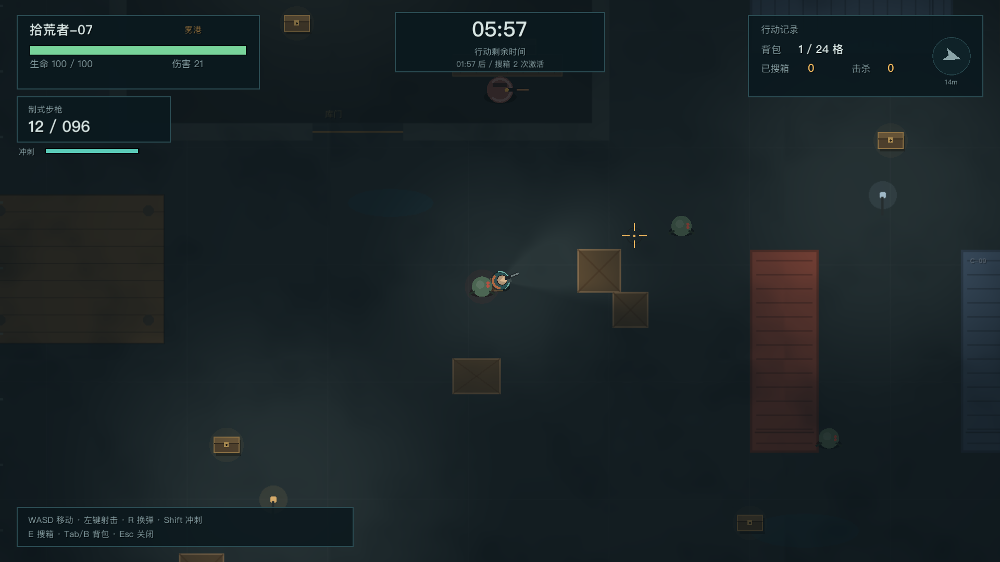
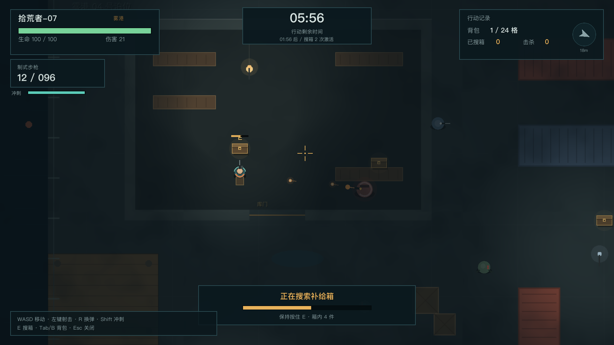
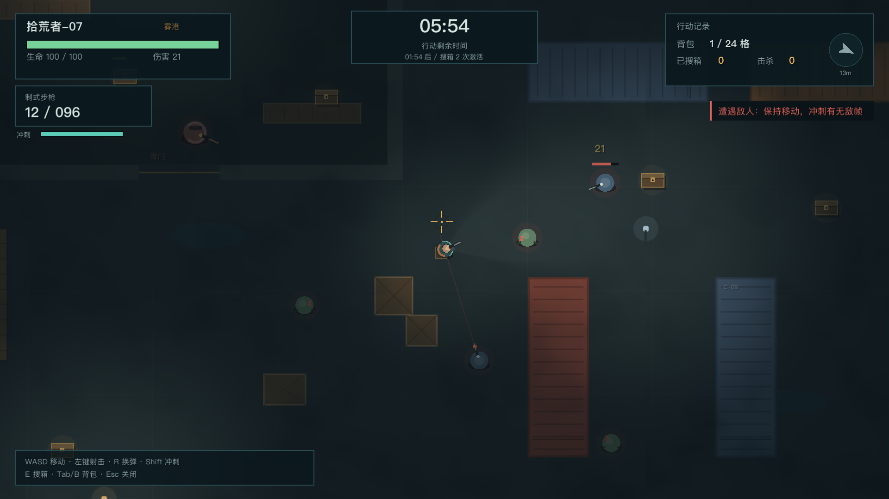
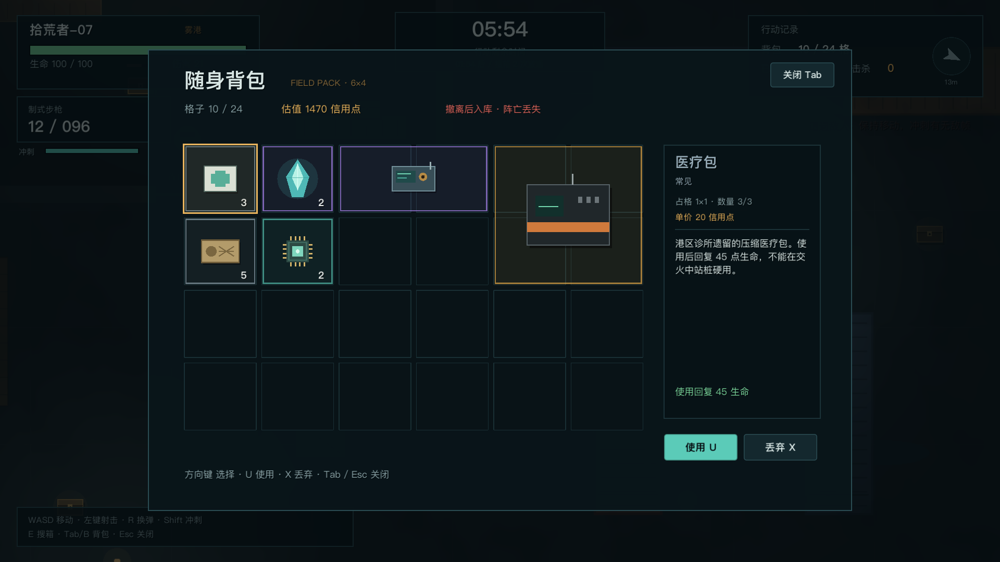
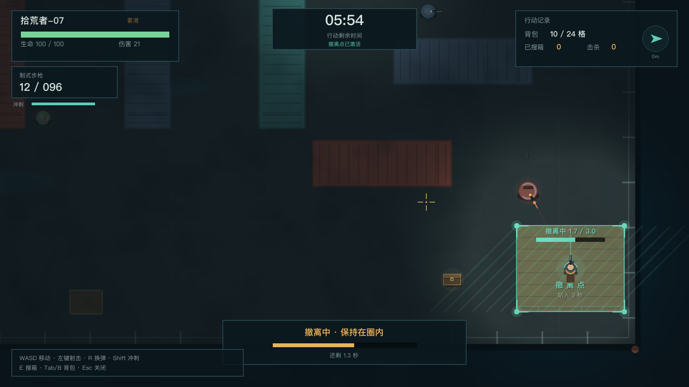
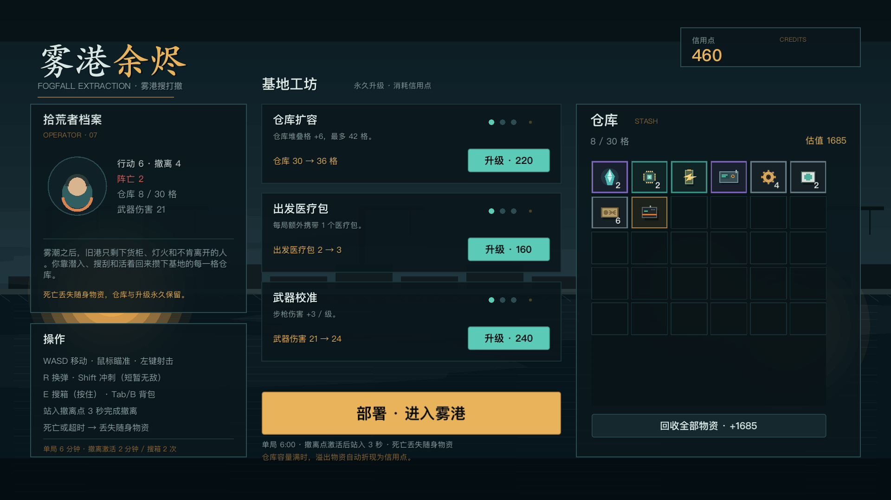
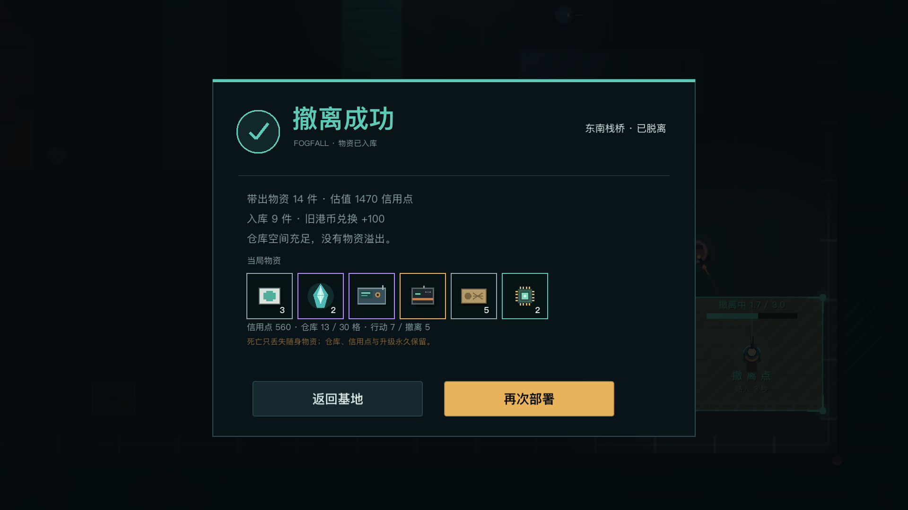

# 雾港余烬 · Fogfall Extraction

原创俯视角「搜打撤」vertical slice。潜入雾港、搜补给箱、与三种敌人交火，带着物资从东南栈桥撤离；死亡只丢当局携带，仓库、信用点与基地升级永久保留。

- **Godot 4.6**，GL Compatibility，逻辑分辨率 1280×720，可拉伸到 1920×1080。
- 纯 GDScript / 程序化绘制，**无第三方运行时依赖**，全部名称、场景、角色、道具图标与 UI 原创。
- 单局 6 分钟；撤离点 2 分钟后或搜完 2 个箱子激活；站入 3 秒完成撤离。
- 6×4 背包、8 类战利品、3 种敌人、3 项永久升级、`user://` 存档。

> 原创声明：本作只借鉴“搜打撤”这一通用玩法循环，灵感来自一条公开视频的玩法描述（见 [CREDITS.md](CREDITS.md)）。**没有**使用原作者的名称、角色、素材、UI、Logo 或画面；本项目的所有图形/文案均为程序化原创或引擎内置。



| 搜箱 | 交火 |
| --- | --- |
|  |  |

| 背包 | 撤离 |
| --- | --- |
|  |  |

| 基地/升级 | 撤离成功 |
| --- | --- |
|  |  |

- **10 秒实机 MP4**：[docs/fog_harbor_demo.mp4](docs/fog_harbor_demo.mp4)（1920×1080，30fps）
- **GIF**：[docs/fog_harbor_demo.gif](docs/fog_harbor_demo.gif)（960 宽，12fps）
- 全部截图：[docs/shots/](docs/shots/)

## 跑起来

需要 Godot 4.6（本机实测 `4.6.stable.official.89cea1439`）。

```bash
cd godot-fog-harbor
godot --headless --path . --editor --quit   # 首次导入/注册全局类
godot --path .                              # 1280×720 窗口
# 或
godot --path . --resolution 1920x1080       # 1920 窗口，逻辑画布仍是 1280×720
```

没有外部模型/贴图/音频依赖；地图、角色、图标、雾、光照都在运行时生成。

## 核心循环

```
基地（仓库 / 3 项升级 / 信用点）
  ↓ 部署
雾港行动（6:00）
  ├─ 搜补给箱：按住 E 0.9 秒，把能装下的物资塞进 6×4 背包
  ├─ 交火：潜伏者 / 枪手 / 精英；雾中视野有限
  ├─ 撤离点：2:00 后或搜箱 2 次激活；站入 3 秒 → 撤离成功
  └─ 阵亡 / 超时 → 行动失败
  ↓ 结算
成功：旧港币 → 信用点，其余物资 → 仓库（仓库满时溢出自动折现）
失败：当局背包全部丢失；仓库、信用点、升级不变
  ↓
返回基地，继续部署
```

- 单局 6 分钟；撤离点 `Rect2(2080, 1200, 200, 160)`。
- 撤离点激活：`elapsed >= 120s` **或** 搜完 2 个箱子。
- 撤离进度：在圈内累计 3 秒；离开圈会清零。
- 超时与阵亡同样按失败结算。

## 操作

| 输入 | 作用 |
| --- | --- |
| `W A S D` / 方向键 | 移动 |
| 鼠标 | 瞄准（手电锥朝向鼠标） |
| 鼠标左键 | 射击（hitscan，12 发弹匣 / 96 备弹） |
| `R` | 换弹（1.35 秒） |
| `Shift` | 冲刺 0.16 秒，冷却 1.05 秒，冲刺时短暂无敌 |
| 按住 `E` | 搜索附近的补给箱（0.9 秒） |
| `Tab` / `B` / `I` | 打开/关闭背包（打开时暂停世界） |
| `Esc` | 关闭背包 |
| 背包内 `方向键` / 鼠标 | 选择格子 |
| 背包内 `U` / `Enter` | 使用医疗包（回复 45 生命） |
| 背包内 `X` / `Delete` | 丢弃整组物资（会掉在脚边，0.6 秒后可自动拾回） |

- 背包内点击格子可查看名称/稀有度/占格/单价/描述；右下按钮也可使用/丢弃。
- 丢下的物资生成世界拾取物；背包满时会留在地上。
- 撤离无需按键，站入激活后的撤离圈 3 秒即可。

## 内容

### 战利品（8 类）

| 物品 | 稀有度 | 价值 | 占格 | 堆叠 | 说明 |
| --- | --- | ---: | --- | ---: | --- |
| 旧港币 | 常见 | 20 | 1×1 | 8 | 撤离时自动兑换信用点 |
| 医疗包 | 常见 | 20 | 1×1 | 3 | 使用回复 45 生命 |
| 黄铜零件 | 常见 | 35 | 1×1 | 5 | 材料 |
| 船运芯片 | 少见 | 90 | 1×1 | 3 | 材料 |
| 军用电池 | 少见 | 75 | 1×1 | 2 | 材料 |
| 精密仪器 | 稀有 | 170 | 2×1 | 1 | 占两个背包格 |
| 雾晶 | 稀有 | 240 | 1×1 | 2 | 材料 |
| 黑匣子 | 绝密 | 480 | 2×2 | 1 | 占四格，价值最高 |

- 箱子每次抽 2–3 次；精英箱保底至少一件稀有及以上。
- 搜索完成后，装不下的物资留在箱内；清背包后可以再搜。
- 撤离时旧港币直接入账；非货币物资按堆叠入库；仓库满时溢出部分按面值折现。

### 敌人

| archetype | HP | 速度 | 侦测半径（含雾 0.85） | 攻击 | 备注 |
| --- | ---: | ---: | ---: | --- | --- |
| 潜伏者 | 55 | 122 | 212 | 近战 14，前摇 0.48s | 直冲、绕墙 |
| 雾港枪手 | 70 | 96 | 289 | 单发弹丸 9，前摇 0.62s | 保持中距、绕行 |
| 港区看守（精英） | 170 | 104 | 357 | 三连发 8×3 / 近战 18 | 守东南栈桥，弹速最快 |

FSM：巡逻 → 警觉 → 追击 → 攻击 → 硬直 → 死亡。视野使用墙体射线；丢失视线 3.4 秒后回到巡逻。雾把有效侦测半径压到 85%，但没有真实光照遮挡模拟。

### 基地与升级

| 升级 | 效果 | 3 级价格 |
| --- | --- | --- |
| 仓库扩容 | 仓库 +6 格（24 → 42） | 120 / 220 / 360 |
| 出发医疗包 | 每局初始医疗包 +1（1 → 4） | 80 / 160 / 260 |
| 武器校准 | 步枪伤害 +3 / 级（18 → 27） | 140 / 240 / 380 |

- 信用点来源：旧港币（面值）、仓库溢出折现、回收仓库全部物资。
- 存档：`user://fogfall_save.json`，升级/撤离/阵亡时写入。
- 已入库物资、信用点和升级在重开后保留；阵亡只清空当局背包。

## 验证

```bash
# 首次导入（新机器）
godot --headless --path . --editor --quit

# 1) 600 帧无 ERROR
godot --headless --path . --quit-after 600

# 2) headless smoke（106 项）
godot --headless --path . -s tools/smoke_fog_harbor.gd
# 末行：FOG_HARBOR_SMOKE_OK

# 3) 真实 GPU 截图（9 张 1920×1080）
godot --path . -s tools/screenshot_fog_harbor.gd
# 末行：FOG_HARBOR_SHOTS_OK

# 4) 10 秒 30fps 源帧（300 帧）
godot --path . --fixed-fps 30 -s tools/capture_fog_harbor.gd
ffmpeg -y -framerate 30 -i /tmp/fog_harbor_frames/frame_%04d.jpg \
  -c:v libx264 -pix_fmt yuv420p -crf 20 -preset medium -movflags +faststart \
  docs/fog_harbor_demo.mp4
ffmpeg -y -i docs/fog_harbor_demo.mp4 \
  -vf "fps=12,scale=960:-1:flags=lanczos,split[a][b];[a]palettegen=max_colors=160[p];[b][p]paletteuse=dither=bayer:bayer_scale=4" \
  -loop 0 docs/fog_harbor_demo.gif

# 5) 真实窗口 FPS
godot --path . --resolution 1280x720 -s tools/probe_fps.gd
```

本机实测（Intel Core i7-5650U / Intel HD Graphics 6000，共享 macOS 主机）：

- `FOG_HARBOR_SMOKE_OK`，`checks=106 failures=0`。
- 600 帧 headless：无 SCRIPT ERROR。
- 9 张 1920×1080 截图、10 秒 1920×1080/30fps MP4 + GIF。
- **最终版验收轮**：**avg 34.05 / median 37 / best 2s 46 / min 6 / draws 123**（1280×720，vsync off，主机 load 16.5），见 [docs/fps.txt](docs/fps.txt)。
- 低负载整轮曾达 **avg 55.65 / min 51 / draws 207**（夜间 shader 版本）。
- 最终版把 draw calls 压到 123–133（地图预渲染 + UI 批量网格 + 面板/网格精简）；共享主机 load 38–40 时曾掉到 9–16 avg。多次采样、负载与 caveat 全部保留在 [docs/fps.txt](docs/fps.txt)。

## 项目结构

```text
godot-fog-harbor/
├── project.godot
├── scenes/main.tscn            # 只挂 main.gd 的 Node2D
├── scripts/
│   ├── main.gd                 # 基地/行动/结算状态机、光照 shader 接线、demo API
│   ├── game_state.gd           # 信用点/仓库/升级/统计 + user:// JSON 存档
│   ├── items.gd                # 8 类战利品、稀有度、箱子权重
│   ├── inventory.gd            # 6×4 网格、堆叠、2×1/2×2 占位、使用/丢弃
│   ├── raid_rules.gd           # 6:00 / 激活条件 / 3 秒撤离 / 超时
│   ├── player.gd               # WASD、瞄准、hitscan、换弹、冲刺、绘制
│   ├── enemy.gd                # 3 archetype + FSM + 雾中视野 + 弹丸信号
│   ├── enemy_bullet.gd         # 敌方弹丸
│   ├── loot_chest.gd           # 确定性掉落 + 按住 E 搜索 + 剩余物资
│   ├── extraction_zone.gd      # 撤离圈状态与进度
│   ├── pickup.gd               # 丢弃后的地面拾取
│   ├── harbor_map.gd           # 程序化地图/碰撞/灯光锚点
│   ├── fx.gd                   # 曳光/火花/浮动数字/环
│   ├── hud.gd                  # 血/弹/计时/撤离/背包/提示/罗盘
│   ├── backpack_panel.gd       # 6×4 背包 UI
│   ├── base_screen.gd          # 基地/仓库/升级 UI
│   ├── result_screen.gd        # 成功/失败结算
│   ├── ui_theme.gd             # 深青+琥珀色板、按钮、面板、文本
│   ├── item_art.gd             # 8 个原创矢量小图标
│   └── fog_art.gd              # 系统 CJK 字体 + 雾噪声纹理
├── shaders/fog_overlay.gdshader # 单次全屏夜间/雾/手电/光池 shader
├── tools/
│   ├── smoke_fog_harbor.gd
│   ├── screenshot_fog_harbor.gd
│   ├── capture_fog_harbor.gd
│   └── probe_fps.gd
├── docs/
│   ├── TECH.md                 # 状态机 / 背包 / 掉落 / 存档 / AI / 地图 / 渲染
│   ├── 迭代记录.md
│   ├── fps.txt                 # 多次真实采样
│   ├── verification.txt        # 命令与真实输出
│   ├── agency/T-20261121-026.md
│   ├── shots/                  # 9 张 1920×1080
│   └── fog_harbor_demo.mp4/.gif
├── CREDITS.md
└── README.md
```

## 性能与实现取舍

- **一次性预渲染地图**：2400×1500 的程序化静态地图先渲染到 SubViewport，再烘焙成 `ImageTexture` 交给单个 Sprite2D；把约 100 个地图绘制命令降为 1 个精灵绘制。
- **单次全屏夜间/雾 shader**：不再使用 Godot `PointLight2D` 多 pass。shader 同时绘制夜色、3 个光池（最近的灯 + 撤离点）、玩家径向光、手电锥、可平铺雾纹理和暗角。
- **UI 网格批处理**：仓库/背包的空格线用一条 `draw_multiline`，只对已占用格绘制图标与稀有度边框。
- **离屏裁剪**：敌人/箱子按相机距离隐藏视觉，不影响 AI/物理。
- 显示器 1280×720、vsync 关闭、GL Compatibility；draw calls 123–133（战斗场景，含弹丸）。
- 共享主机负载对 FPS 影响极大（同一构建在 55.65 avg 与 9.32 avg 之间波动）；不要只看单次采样。

## 已知限制

- **无音效/音乐**；无移动端触控（本 slice 面向键鼠）。
- 中文 UI 依赖系统 CJK 字体（PingFang / Hiragino / Noto Sans CJK / 微软雅黑）；未打包字体，Linux/Windows 需自行确认中文字体。
- 自定义夜间/雾 shader 是屏幕空间伪光照：**没有**墙体遮挡、真实阴影或逐灯阴影；灯光只负责明暗与可读性。
- 敌人使用直接转向 + 碰撞滑动 + 卡住反向，**没有 NavMesh**；复杂角落可能绕行不完美。
- 只有 1 张手工布局的地图、固定 9 个箱子/8 个敌人；没有随机地图生成。
- 武器/护甲无变体；弹药只在开局发放，箱子不掉弹药；敌人不掉落。
- 丢弃物资掉在脚边，0.6 秒后自动拾回；没有独立的地面物品管理 UI。
- 存档是直接覆盖写，不是原子写；损坏的 JSON 会按空存档启动。
- 仓库溢出按面值折现，数值上较宽松；属于有意降低挫败感的设计。
- 撤离成功会把全部非货币物资入库；仓库满时只保留能放下的部分。

## 版权与来源

所有程序化美术、物品/敌人/场景名称、UI、文案均为本项目原创。参考来源只用于玩法研究，不包含任何原作素材或品牌。详见 [CREDITS.md](CREDITS.md)。
