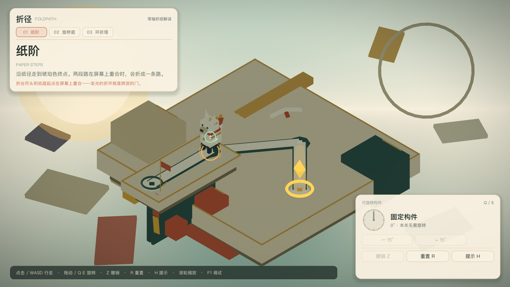
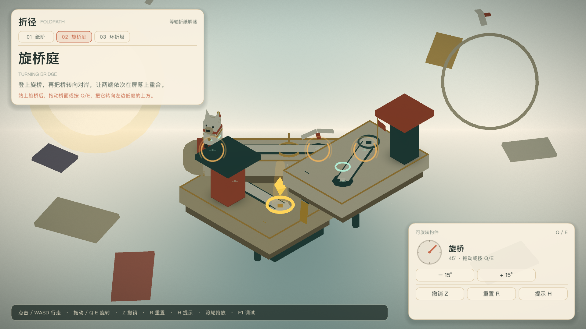
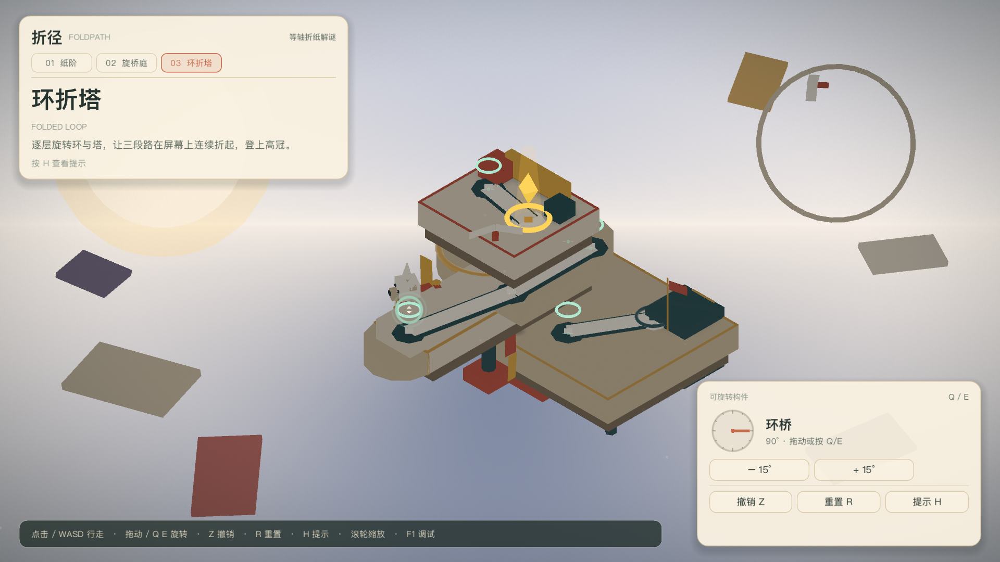

# Foldpath · 折径

**原创等轴「不可能几何」解谜 vertical slice。**
把两段在屏幕上重合、但处在不同深度的纸径折成一条能走的路。

Godot 4.6 · GL Compatibility · 1280×720 逻辑分辨率 · 1920×1080 验收截图
Intel HD Graphics 6000 实窗 1280×720：正常玩法 83–101 FPS，旋转中 93 FPS，L3 调试叠加 55.9 FPS（并发负载下最低实测 34.7 FPS）；draw calls 147–261



## 这是什么

- **固定等轴正交相机**。不能环绕，只能轻微缩放；画面每一帧都由同一套正交投影计算。
- **屏幕空间折叠**：把两段路径的端点投影到屏幕，只有在屏幕上重合并有足够深度差时才打开“折环”。角色跨过折环时平滑折起、翻面、落到另一层。
- **旋转纸桥/纸环**：拖动构件或用 `Q/E` 旋转。构件上的路径与角色一起转，屏幕对齐关系实时改变。
- **三个原创关卡**：教学 → 单旋桥 → 多段旋转的不可能回路；点击路径节点行走、目标点过关。
- **原创纸艺低模**：奶油纸、苔绿、陶土、黄铜；无缝天空渐变、雾、软阴影贴片；原创小折狐“小折”。
- 撤销、重置、关卡选择、提示高亮、胜利卡片、中文 HUD、`F1` 调试叠加全部可用。



## 运行

需要 Godot **4.6**（GL Compatibility，真实桌面 GPU）：

```bash
godot --path godot-foldpath-puzzle --resolution 1280x720
```

窗口内按 `F1` 可看到屏幕投影点、折环阈值、路径图、平台角度、FPS、draw calls。

### 验收与素材生成

```bash
# headless 逻辑/场景 smoke（末行 FOLDPATH_SMOKE_OK）
godot --headless --path godot-foldpath-puzzle -s tools/smoke_foldpath.gd

# headless 启动 600 帧，应无 SCRIPT ERROR
godot --headless --path godot-foldpath-puzzle --quit-after 600

# 真实 GPU 实窗：真实点击/拖动、FPS、实时截图
godot --path godot-foldpath-puzzle --resolution 1280x720 -s tools/probe_live.gd

# 1920×1080 截图（7 张，SubViewport 真实 GPU）
godot --path godot-foldpath-puzzle --resolution 1280x720 -s tools/capture_shots.gd

# 10 秒 1280×720 演示视频帧
godot --path godot-foldpath-puzzle --resolution 1280x720 --fixed-fps 30 -s tools/capture_video.gd
```

演示视频：[`docs/shots/foldpath_demo_10s.mp4`](docs/shots/foldpath_demo_10s.mp4) · GIF：[`docs/shots/foldpath_demo_10s.gif`](docs/shots/foldpath_demo_10s.gif)

## 操作

| 输入 | 作用 |
| --- | --- |
| 点击路径节点 / 折环 | 小折狐沿当前连通路径走过去；跨层时自动折叠 |
| `←↑→↓` / `WASD` | 朝屏幕方向走到相邻节点（键盘移动） |
| 在可旋转构件上拖动 | 连续旋转；松手吸附到 15° 档位 |
| `Q` / `E` | 选中构件 −15° / +15° |
| 鼠标滚轮 | 轻微缩放（0.82–1.22×，保持屏幕对齐可读） |
| `Z` | 撤销上一步（移动或旋转；带回放动画） |
| `R` | 重置本关 |
| `H` | 下一条提示，并高亮相关构件/节点 |
| `F1` | 调试叠加：投影点、阈值圆、折环、路径图、角度、FPS、draw calls |
| `1` / `2` / `3` | 直接切关 |
| `Enter` | 过关后下一关 |
| `Esc` | 关闭胜利卡片（留在本关） |

## 三个原创关卡

| 关卡 | 核心机制 | 解法 |
| --- | --- | --- |
| **01 纸阶** | 点击行走 + 预对齐跨层折环 | 从高折台走到尽头，跨过屏幕上重合的折环，沿低庭纸径到琥珀终点 |
| **02 旋桥庭** | 登上旋桥、坐在桥上旋转、两端依次对齐 | 高台 → 折环 → 旋桥内端 → 走到外端 → 转 90° → 外端与低庭折环重合 → 到终点 |
| **03 环折塔** | 双旋转 + 三段跨层，构成不可能回路 | 低基 → 环桥 → 转环桥 90° → 折塔 → 转折塔 90° → 高冠终点 |



关卡是数据驱动的 JSON（`levels/level_01.json` … `level_03.json`），节点、边、平台枢轴、初始角、旋转步长、提示、软阴影贴片都在数据里。

## 为什么是原创的

- 项目名 **Foldpath / 折径**、关卡名、角色 **小折狐**、色板、几何、UI、关卡布局与解法均为本项目原创。
- 只从参考视频中抽象出机制：固定等轴相机、旋转构件、屏幕空间路径连接、点击行走、目标点过关。
- **没有**复制 Monument Valley / ustwo 的关卡、角色（Ida）、建筑、神圣图案、配色、音乐、UI 或品牌；没有把参考视频/帧/音频放入项目或仓库。
- 视觉语言是“折叠纸片 + 黄铜刻线 + 苔绿/陶土”，不是参考作品的视觉复刻。参考与许可见 [CREDITS.md](CREDITS.md)。

## 性能与边界

- 1280×720 实窗（Intel HD 6000 / OpenGL 4.1 Compatibility，VSync off，前台）：正常玩法 **L1 101.1 / L2 82.9 / L3 87.8 FPS**，L2 旋转中 **93.2 FPS**，L3 调试叠加 **55.9 FPS**；并发负载下实窗探针最低 **34.7 FPS**，仍高于 30。1920×762（本机显示器上限）为 **31.8–47.2 FPS**。draw calls 约 147（L1 空闲）到 261（L3 + 调试/胜利 UI）。
- 静态平台几何按材质/阴影分组烘焙；角色、旋转件、飘带、项目符号保持独立。1920×1080 截图由真实 GPU SubViewport 渲染（`size_2d_override` 1280×720），7 张均已核对尺寸。
- 屏幕对齐只对 JSON 中声明的 `fold_pairs` 生效；阈值 18 设计像素，深度差 ≥0.35；旋转吸附 15°，所以设计上的解在整数档位上精确为 0 px。缩放会改变像素距离，但设计解的投影距离始终为 0。
- 该机 GL Compatibility 驱动上，方向光 shadow map 经 ORTHOGONAL / PSSM 多组参数测试仍无可见投影，所以用**艺术化的软阴影贴片 + 深色底面 + 雾/天空渐变**实现“柔和阴影”，并非物理投射；详见 [docs/TECH.md](docs/TECH.md)。
- 已知边界：屏幕拾取不做前景遮挡测试；仅点击/拖动 + 键盘；无音效；无存档；相机不可环绕。
