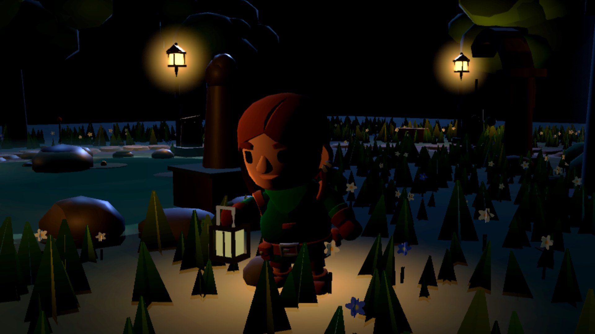
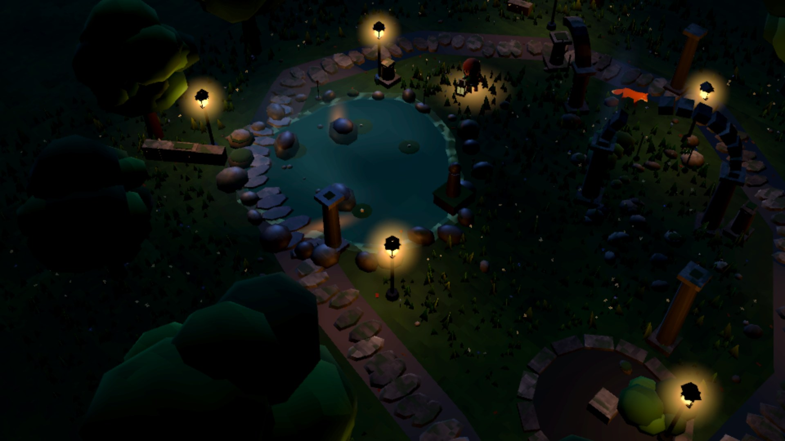
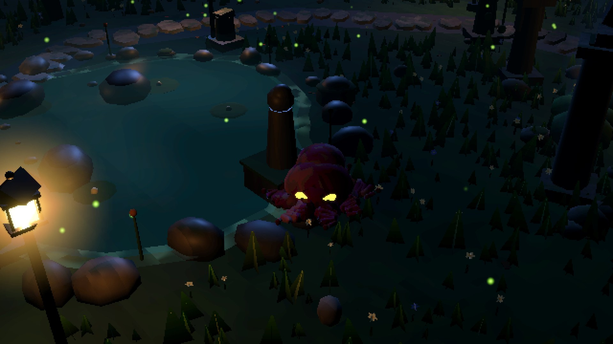

# 废墟花园 · 夜景技术方案（当前实现）

> 日期：2026-11-01
> 适用版本：Godot 4.6 / Mobile(Vulkan) / 内部 960×540 + LINEAR + MSAA 2×
> 结论先行：夜景不是一张滤镜，而是 **9 层叠加**——太阳/月亮 → 环境光 → 天空/雾 → 路灯 → 萤火 → 水面/雾/月光柱 → 后处理 → 角色提灯 → 角色/章鱼夜态。所有层都由同一条时间曲线驱动，因此黄昏→深夜→清晨是连续过渡。

## 1. 总览

| 层 | 载体 | 主要文件 |
|---|---|---|
| 时间模型 | 5 条曲线（day/night/low_sun/dusk_glow/twilight） | `scripts/garden_scene.gd` |
| 月亮/补光 | 2 盏无影 `DirectionalLight3D` | `garden_scene.gd` |
| 天空/雾 | `ProceduralSkyMaterial` + `Environment` fog | `garden_scene.gd` |
| 路灯 | 8 盏 `OmniLight3D` + 发光玻璃 + billboard 光晕 + 水面反射 | `garden_world.gd` |
| 萤火 | `GPUParticles3D` 220 个、加法混合 | `garden_world.gd` |
| 水面/岸线 | 自定义 `water.gdshader` / `foam.gdshader` | `shaders/` |
| 池面雾/月光柱 | `mist.gdshader` / `light_shaft.gdshader` | `shaders/` |
| 后处理 | 柔光/冷暖分级/暗角 | `shaders/post_process.gdshader` |
| 角色提灯 | 短杆 + 四层光晕 + 地面池 + 无影点光 + 距离 LOD | `scripts/garden_patrol.gd` |
| 角色夜态 | KayKit 线性贴图 + 章鱼变色/睡眠 | `garden_patrol.gd` / `garden_octopus.gd` |




## 2. 渲染管线

- 3D 渲染到 `SubViewport`：**960×540**，`MSAA 2×`，`own_world_3d`。
- `TextureRect` 用 **LINEAR** 放大到窗口；后处理 shader 挂在 `_display.material` 上。
- UI 独立 `CanvasLayer`（1920×1080），不受 3D 分辨率影响。
- 环境：ACES 色调映射、glow、雾、`ProceduralSkyMaterial` 渐变天空。
- 角色：KayKit Rogue / Rogue_Hooded / Knight + glTF Fox；贴图 `LINEAR+MIPMAPS`。

## 3. 时间模型

```gdscript
sun_alt = sin((hours - 4.9) / 14.2 * PI)
day      = clamp(sun_alt, 0, 1)
night    = clamp(-sun_alt, 0, 1)
low_sun  = clamp(1 - abs(sun_alt) / 0.55, 0, 1) * (1 - night)
dusk_glow = smoothstep(0.05, 0.18, day) * (1 - smoothstep(0.45, 0.8, day))
twilight  = smoothstep(18.6, 19.2, h) * (1 - smoothstep(20.4, 21.6, h))
```

| 曲线 | 作用 |
|---|---|
| `day` | 太阳能量/色温、环境光、天空顶部 |
| `night` | 月亮、雾密度、萤火、章鱼夜态、提灯亮度 |
| `low_sun` | 黄昏暖地平线、曝光提升 |
| `dusk_glow` | 黄昏光比、环境光偏暖 |
| `twilight` | 蓝调时刻（19:00–21:00）的冷色过渡 |

一天按 ×600 速度走完（2.4 分钟），所有视觉量每帧重算，没有“状态切换”。

## 4. 逐层实现

### 4.1 太阳 / 月亮 / 补光

```gdscript
sun_energy  = pow(day, 0.5) * (2.2 + dusk_glow * 1.4)
sun_color   = Color(1.0,0.55,0.28).lerp(Color(1.0,0.98,0.9), clamp(sun_alt/0.9,0,1))
moon_energy = pow(night, 0.8) * 0.48
fill_energy = 0.08 + dusk_glow*0.45 + night*0.15 + twilight*0.15
```

- 月亮颜色 `(0.55,0.70,1.0)`，**关阴影**（Intel Iris 上开阴影掉 10–20 FPS）。
- 补光 `(0.42,0.58,0.85)`，保证夜里暗部不是死黑。

### 4.2 环境光 / 天空 / 雾

```gdscript
ambient = night 蓝 (0.08,0.13,0.22) → day 灰绿 (0.55,0.62,0.62)
ambient = lerp(ambient, (0.36,0.36,0.38), low_sun*0.5)
ambient = lerp(ambient, (0.20,0.28,0.42), twilight*0.45)
fog_density = 0.006 + night*0.012 + dusk_glow*0.008
```

- 天空用 `ProceduralSkyMaterial`：`sky_top_color` / `sky_horizon_color` 随时段插值；
  `sun_angle_max=8°`、`sun_curve=0.12`，黄昏有太阳盘。
- 地平线颜色与雾色同源，避免“天空与雾断开”。

### 4.3 路灯（8 盏）

- 沿石径均匀分布，左右交替偏移 1.75m；每盏：
  - `OmniLight3D`：颜色 `(1.0,0.72,0.4)`、range 7、无阴影；
  - 玻璃罩 `emission = level*1.6`；
  - billboard 光晕：alpha `level*(0.62+0.12*flicker)`；
  - 水面倒影面片：alpha `level*(0.22+0.05*sin)`。
- 亮度曲线 `_lamp_level(h)`：17:24 起亮、19:24 全亮、05:12 起灭、06:48 全灭。
- 闪烁：`0.94 + 0.04*sin(t*7+φ) + 0.02*sin(t*21+2φ)`。

### 4.4 萤火

- `GPUParticles3D`：220 个、lifetime 7s、fixed_fps 30、加法混合 billboard。
- 夜间按 `_firefly_level(h)` 控制 `amount_ratio` 与发光强度；白天完全关闭。
- 发射盒 `15×1.6×15`，速度 0.02–0.12，缓慢漂移。

### 4.5 水面 / 岸线

- `water.gdshader`：`u_night` 加深水色、`u_lamp` 路灯暖色反射、`u_sunset` 黄昏暖反射、`sun_dir` 高光方向。
- `foam.gdshader`：岸线用世界噪声打断，避免恒定的“霓虹环”。

### 4.6 池面雾 / 月光柱

- 池面雾：`mist.gdshader`，强度 `night*0.16`，面片覆盖水池。
- 月光柱：半透明面片，强度 `night*0.5*weight`，只在夜间显示。

### 4.7 角色提灯（夜间重点）

结构：

```text
GardenPatrol
├── ModelRoot（Rogue, 0.74, yaw π）
├── LanternRig（每帧跟随 handslot_r 世界位置）
│   ├── LanternBody（短杆/灯框/玻璃，尺寸见 garden_patrol.gd 常量）
│   └── 光晕：core 0.8 / outer 2.2 / far 4.5 / wide 1.4（按距离 LOD）
├── LanternPool（3.8m 地面加法面片）
└── LanternLight（根节点无影 OmniLight）
```

- 挂点：每帧 `LanternRig.global_position = handslot_r.global_position + basis*offset`（当前 `ROGUE_LANTERN_OFFSET` / `ROGUE_LAMP_CENTER_HEIGHT` 见代码）；
  灯光/光晕/地面池不随手臂旋转，只随位移，避免走一步闪一次。
- 亮度：`glow = max(night, low_sun*0.55)`；黄昏已点亮，深夜最强。
- B 方案（冻结参数）：
  - 玻璃 albedo `(0.50, 0.478, 0.322 + dusk*0.004)`，`emission=0.15`；
  - 根灯光 `0.008 + glow*0.02`（刻意压很低，避免近场打爆脸）；
  - 光晕 alpha：core `0.03`、outer `0.12`、far `0.12`、wide `0.40`；
  - 地面池 alpha `glow*0.45`。
- 距离 LOD（`camera_ref` 距离 12–22m 插值 `far_t`）：
  - 近景收敛核心光晕，保护脸；
  - 广角放大 wide 光晕，保证提灯在 27.5m 下仍是一个可读的暖点。
- 硬指标（B-17 独立签字）：
  - 玻璃色比六格全部入带：G/R 0.93–0.97、B/G 0.58–0.64，基准余量 ≥0.005；
  - 夜间脸部 R 通道 p95 216（统一 ROI）；
  - 广角（960）亮芯 11×10，长边/面积度量在 1920 下通过。



### 4.8 后处理

```gdscript
glow_intensity = 0.35 + lamp_level*0.45 + night*0.2
u_vignette = 0.2 + night*0.1
u_bloom    = 0.06 + lamp_level*0.1 + night*0.04
u_night / u_warm 用于冷暖分级
```

- 不做像素对齐、dither、6bit 量化；保留柔光/暗角/分级。
- 代码里保留了 QA 用的 `halos_forced_off` / `wide_core` 钩子，用于对比“光晕关/开”和广角亮芯；发布路径默认不启用。

### 4.9 角色与章鱼夜态

- 角色材质：`LINEAR+MIPMAPS`、roughness 0.98、specular 0.05，减少夜间高光裁切。
- 章鱼：`set_octopus_time(night)` 夜间收拢触手、降低饱和度、闭眼；触手渲染仍为“静态管 + uniform 顶点变形”。

## 5. 性能与取舍

| 项 | 选择 | 原因 |
|---|---|---|
| 内部 960×540（非 1280×720） | 63.3 avg / 52 min | 1280 实测 51.7，保 60 FPS 优先 |
| 月亮阴影关闭 | 无影 | 开阴影掉 10–20 FPS |
| 路灯无阴影、range 7 | 8 盏动态灯 | 移动端灯数敏感；靠亮池而非阴影建立层次 |
| 提灯“视觉灯 + 稳定根灯” | 1 盏无影灯 | 跟手会频闪；稳定灯位保脸/地面池 |
| 萤火 fixed_fps=30 | 220 粒子 | 省 GPU，视觉足够 |
| 后处理单 pass | 柔光/分级/暗角 | 不做 SSAO/SSR（Mobile 不支持或太贵） |

## 6. 验收与度量

```bash
# 截图矩阵（近景/广角/黄昏/夜/正午/640 源画面/同框）
godot --path godot-garden --resolution 1440x810 -s tools/screenshot_patrol.gd

# 走位/间距/FPS/开关
godot --path godot-garden --resolution 1280x720 -s tools/probe_patrol.gd

# 任务链/角色动画/倒地复活
godot --path godot-garden --resolution 1280x720 -s tools/qa_cycle3_hero.gd
```

- 亮度指标：脸 R 通道 p95、玻璃 G/R 与 B/G、街灯纯白比例、提灯亮芯尺寸。
- 证据与签字：`docs/agency/cycle-3/37-art-final-b-17.md`、`38-design-final-3.md`。
- 阶段结论：视觉加权 **7.46**（独立签“通过，限定 KayKit 模型路径”）；完整游戏 8 分留后续内容/材质/音频/UI 阶段。

## 7. 已知问题 / 下一步

- 街灯罩纯白过曝（41%），需要压玻璃 emission 或降光晕。
- 窗格/墙面平涂，材质密度不足；需要贴图/法线/细节道具。
- 提梁在行走态还没验；狐狸五官、扫帚头可见性、前景草埋脚。
- 性能受本机负载影响，需固定场景状态、关 vsync 的 3 连跑中位数复测。
- 音频、UI 完整度、内容量是 8 分阶段的主要缺口。

## 8. 文件索引

- 主控/时间/天空/后处理：`scripts/garden_scene.gd`、`shaders/post_process.gdshader`
- 世界/路灯/萤火/雾/光束：`scripts/garden_world.gd`
- 角色/提灯：`scripts/garden_patrol.gd`、`scripts/garden_hero.gd`
- 章鱼：`scripts/garden_octopus.gd`、`shaders/octopus*.gdshader`
- 水面/岸线/雾/光柱：`shaders/water.gdshader`、`foam.gdshader`、`mist.gdshader`、`light_shaft.gdshader`
