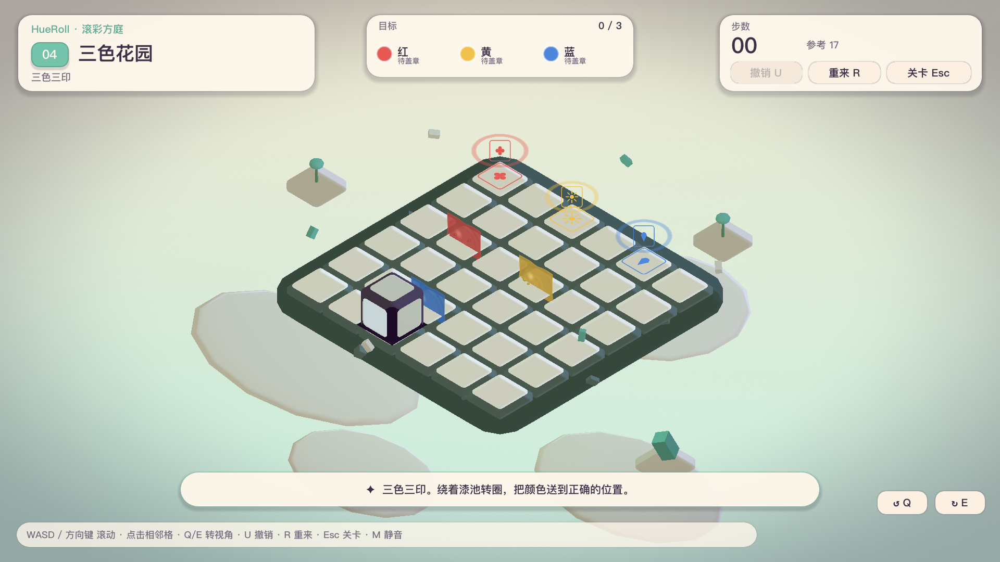

# HueRoll · 滚彩方庭

一款 **3D 等轴滚块涂色解谜** vertical slice：把方块滚进漆池，让朝下的面蘸色；再把颜色滚到目标砖上“盖章”。
低多边形陶瓷浮岛、粉彩配色、程序化网格/图标/音效，Godot 4.6 / GDScript / **GL Compatibility**，
1280×720 逻辑分辨率，可 1920×1080。



> 10 秒巡览：`docs/hueroll.gif`（960×540） / `docs/hueroll.mp4`（1280×720 / 20fps / 10s）。
> 机制研究自 B 站《SideStamp》官方预告片（GoodHeartGames，[BV1b8xm6EEX7](https://www.bilibili.com/video/BV1b8xm6EEX7)）。
> 本工程为**净室实现**：没有使用对方的任何角色、关卡、UI、模型、贴图或视频素材；名称、美术、关卡与代码均为原创。
> 详见 [CREDITS.md](CREDITS.md)。

## 运行

```bash
godot --path godot-hueroll-puzzle
```

- Godot 4.6（实测 `4.6.stable.official.89cea1439`）。
- 首次运行/导入：`godot --headless --path godot-hueroll-puzzle --editor --quit`。
- 无第三方运行时依赖；没有打包任何贴图、字体或音频文件。圆角网格、漆池/印章图标、
  UI 与 WAV 音效全部在运行时生成；排版使用系统字体（PingFang SC / Noto Sans CJK / Microsoft YaHei 等）。
- 无存档毒化：最佳步数/星级写在 `user://hueroll_save.cfg`，删除即回到未完成状态。

## 操作

| 输入 | 作用 |
| --- | --- |
| `W A S D` / 方向键 | 沿屏幕斜向滚动一格（W=左上、D=右上、S=右下、A=左下） |
| 点击 / 点按相邻格 | 向该格滚动 |
| `Q` / `E` | 等轴镜头逆/顺时针旋转 90° |
| `U` / `Z` | 撤销一步 |
| `R` | 重置当前关 |
| `Esc` | 关卡选择（游戏中/结算界面均可） |
| `Enter` / `N` | 结算后进入下一关 |
| `F1` | 调试面板（网格坐标、六面颜色、目标状态、FPS/绘制） |
| `M` | 音效开/关 |

> 屏幕相对移动：WASD 映射到屏幕四条斜向，点击相邻格永远是最直观的替代。

## 规则

- **滚动**：方块占一格，四方向逐格滚动，每次绕底边旋转 90°；六面各自带颜色或空白。
- **蘸漆**：滚入漆池后，**落到最下面的那一面**浸入池色；池子不消耗。
- **混色**：红+黄=橙、黄+蓝=绿、红+蓝=紫。干掉的间色再蘸原色会被新漆覆盖，方便修复；
  空白 + 颜色 = 颜色；同色叠加不变。
- **盖章**：滚到目标砖上，用当前底面颜色盖章；目标砖上显示所需颜色与其原创印记。
  正确则**锁定**（后续经过不会被覆盖）；错误可再盖；空白底面不盖章。所有目标正确即过关。
- **步数与星级**：3★ = ≤ 参考步数；2★ = ≤ 1.5×参考；其余 1★。参考步数是本工程关卡解的可复现长度，
  不是严格数学最优。最佳成绩本地保存。

## 关卡

| # | 名称 | 目标 | 参考步数 | 教学点 |
| --- | --- | --- | --- | --- |
| 01 | 初蘸 | 红 | 5 | 漆池蘸色 → 颜色朝下 → 盖章 |
| 02 | 双印 | 红 ×2 | 13 | 同一面多次盖章；滚动会改变朝向 |
| 03 | 冷暖 | 红 + 蓝 | 17 | 双色、双池、路线取舍 |
| 04 | 三色花园 | 红 + 黄 + 蓝 | 17 | 三色三目标 |
| 05 | 混色实验 | 橙 ×2 | 17 | 红+黄=橙；同一面先后接触两种漆 |
| 06 | 彩虹回廊 | 橙 + 绿 + 紫 | 25 | 三种间色、六池、障碍/孔洞 |

关卡数据在 `levels/level_*.json`；每关带校验过的 `solution`（n/e/s/w）和 `par`，smoke 会重放验证。
关卡中有意保留一次错误盖章（第 6 关在绿色目标上先盖黄、后纠正），用于覆盖“错误可覆盖/正确锁定”。

## 视觉与程序化资产

- **棋盘**：深色圆角底框（MultiMesh）+ 奶油陶瓷镶嵌砖（MultiMesh）+ 单块浮岛底板；
  暗色缝隙、柔和接触阴影；外围漂浮小岛、花、水晶、云与碎片。
- **方块**：程序化圆角盒 + 六面独立面板；绕底边滚动、落地压缩；底面颜色光晕；柔和 blob 阴影。
- **漆池**：程序化波浪边缘 + 环形涟漪 + 高光（`shaders/puddle.gdshader`），2–3 颗漆滴。
- **目标**：原创印章图标（花/日/滴/编织/叶/星），所需颜色显示在地面印记与浮空徽章上；
  正确盖章时环状扩散 + 粒子 + 白瓷印记，目标徽章收起。
- **界面**：1280×720 设计稿按视口等比缩放；关闭/完成/关卡选择均为代码绘制；中文系统字体。
- **音频**：22.05kHz、16-bit 单声道 WAV 在启动时合成（滚动/蘸漆/盖章/错误/撤销/胜利等）。

## 性能

测试机：**Intel HD Graphics 6000 / macOS / OpenGL 4.1 Compatibility / Godot 4.6**。

| 分辨率 | 场景 | 平均 FPS | 最低 | 最高 | draw calls |
| --- | --- | --- | --- | --- | --- |
| 1920×1080（离屏，关垂直同步） | 三色花园 | **84.7** | 75 | 93 | 119 |
| 1920×1080（离屏，关垂直同步） | 彩虹回廊 | **71.4** | 66 | 82 | 128 |
| 1280×720（主窗口，关垂直同步） | 三色花园 | **111.3** | 99 | 122 | 119 |
| 1280×720（主窗口，关垂直同步） | 彩虹回廊 | **98.5** | 77 | 115 | 128 |

- 游戏内右下角常显实时 `FPS · 绘制`（文档截图中隐藏：离屏抓图会被人为拖慢，性能以 probe 为准）。
- 方向光阴影 2048 + 软过滤；降为 1024 还有余量（见 TECH 的优化记录）。
- 命令：
  ```bash
  godot --path godot-hueroll-puzzle --resolution 1280x720 -s tools/perf_hueroll.gd
  godot --path godot-hueroll-puzzle --resolution 1280x720 -s tools/perf1080_hueroll.gd
  ```

## 自测 / 工具

```bash
# 无头逻辑 + 场景验收（525 checks）
godot --headless --path godot-hueroll-puzzle -s tools/smoke_hueroll.gd
# -> HUEROLL_SMOKE_OK checks=525 levels=6

# 真实 GPU 1920×1080 截图（7 张）
godot --path godot-hueroll-puzzle --resolution 1280x720 -s tools/screenshot_hueroll.gd
# -> HUEROLL_SHOTS_OK

# 10 秒 GIF/MP4 源帧
godot --path godot-hueroll-puzzle --resolution 1280x720 -s tools/capture_hueroll_gif.gd
# -> /tmp/hueroll_gif/frame_000..199.png -> docs/hueroll.gif / docs/hueroll.mp4
```

- `tools/smoke_hueroll.gd` 覆盖：6 关 schema、全部 solution、面朝向矩阵、混色、漆池、盖章/锁定/错误覆盖、
  撤销/重置、阻挡、星级、点击相邻格、Q/E 镜头、胜利→下一关、关卡选择、关卡加载、无脚本错误。
- 截图：`docs/shots/01_overview.png`（等轴全景）、`02_dip.png`（漆池染色）、`03_stamp.png`（盖章）、
  `04_win.png`（完成）、`05_select.png`（关卡选择）、`06_debug.png`（调试）、`07_mix.png`（混色/橙目标）。
- 真实 GPU 启动 300 帧与 headless 600 帧均无 `SCRIPT ERROR` / `ERROR`；smoke 不再有泄漏警告。

## 文档与版权

- [docs/TECH.md](docs/TECH.md)：滚动矩阵、面颜色/混色、印章规则、关卡 schema、渲染/性能、与参考的差异。
- [docs/迭代记录.md](docs/迭代记录.md)：逐帧参考分析、假设、视觉/性能迭代与测试结果。
- [CREDITS.md](CREDITS.md)：原创声明、字体/引擎与参考作品说明。本工程不包含任何 SideStamp/GoodHeartGames 资产。
