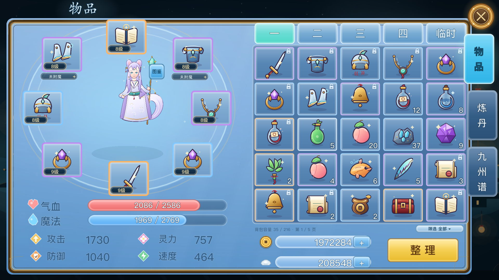
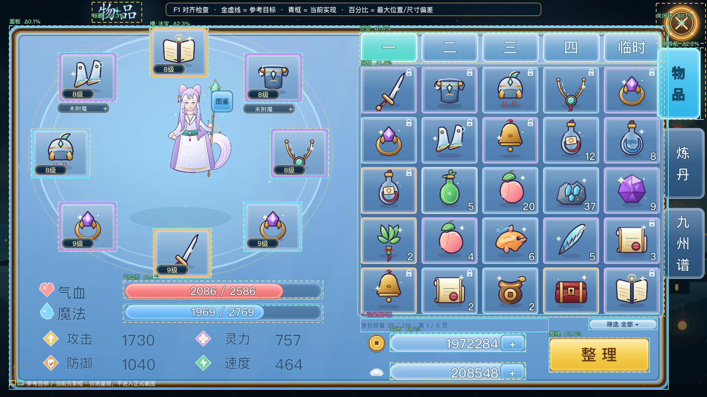
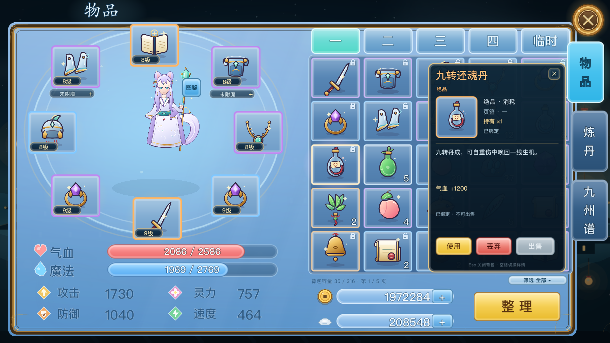
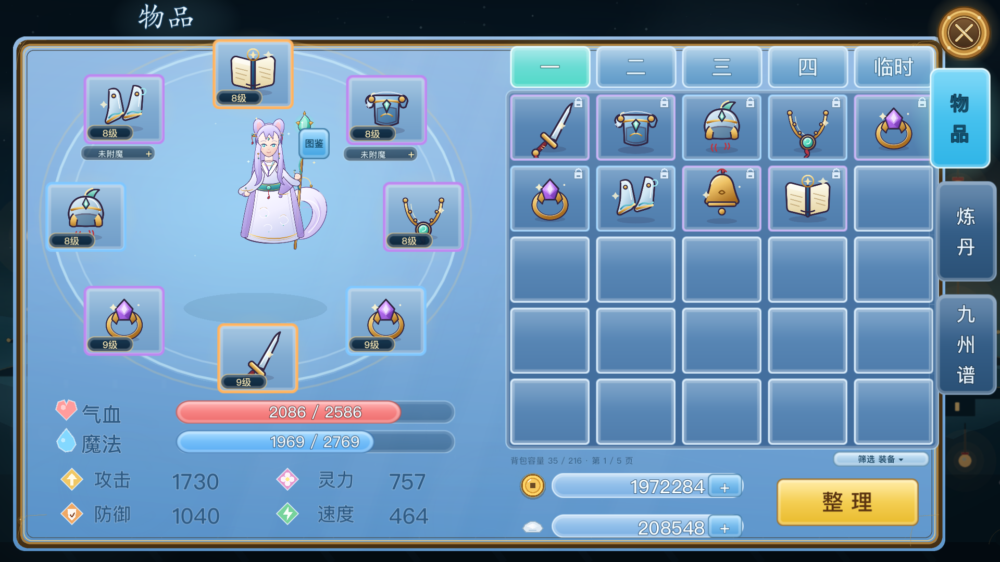
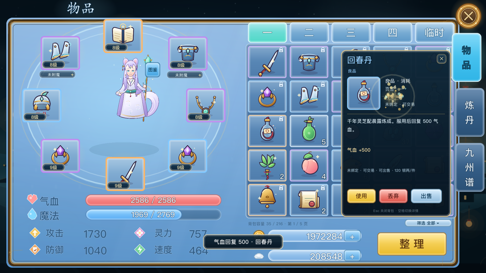
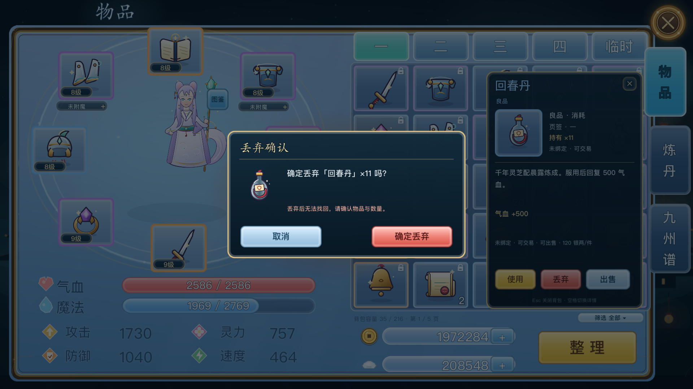
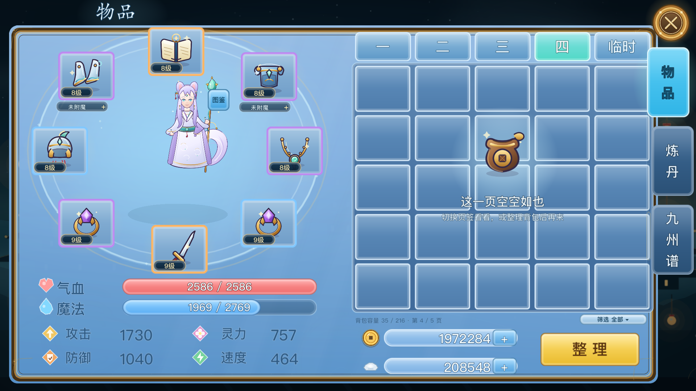

# 云璃背包 · Inventory UI Study

用 **Godot 4.6 + GL Compatibility** 复刻的国风手游道具背包界面。以 529×356 参考截图为测量基准，校正**布局/比例/配色/信息层级/交互**；所有面板、角饰、物品图标、立绘、背景、文案与游戏名均为原创；参考图不进入仓库。

- 1280×720 逻辑分辨率，窗口可拉伸到 1920×1080（截图即 1920×1080）
- **1:1 校正**：面板 `(17,47) 1193×659`、左右分界 x=653、页签 103×54、网格 5×5（槽 102×85 / 步距 110×91）、8 装备槽 104×90；关键几何误差 ≤3%（实测最大 2.71%）
- **F1 对齐检查覆盖层**：金虚线=参考目标、青框=当前实现、实时显示偏差百分比
- 数据驱动：`data/items.json`，35 件物品 / 5 个页签 / 6 个分类；网格始终显示 25 个槽位框
- 可交互、可运行、纯 GDScript 自绘 UI，无外部 UI 素材包
- headless 自测：86 项检查，末行 `INVENTORY_UI_SMOKE_OK`
- 真实 GPU 录制：10 秒 1920×1080 MP4（含切页、hover、使用、整理、关/开面板）

## 预览



| 对齐检查（F1） | 选中详情 |
| --- | --- |
|  |  |

| 分类筛选 | 使用后反馈 |
| --- | --- |
|  |  |

| 丢弃二次确认 | 空页 |
| --- | --- |
|  |  |

- 演示视频：[docs/media/inventory_ui_demo.mp4](docs/media/inventory_ui_demo.mp4)（1920×1080，10s，30fps）
- GIF：[docs/media/inventory_ui_demo.gif](docs/media/inventory_ui_demo.gif)（960 宽）
- 全部截图：[docs/media/screenshots/](docs/media/screenshots/)
- 测量表与误差：[docs/fidelity-1to1.md](docs/fidelity-1to1.md)
- 性能与主机信息：[docs/media/fps.txt](docs/media/fps.txt)

## 运行

需要 Godot 4.6（GL Compatibility）。

```bash
cd godot-inventory-ui
godot --path .                 # 直接运行
# 或打开 Godot 编辑器导入本目录
```

首次运行会自动导入 SVG/PNG 资源。

### 自测（headless）

```bash
godot --headless --path . -s tools/smoke_inventory_ui.gd
```

最后一行应为：

```text
INVENTORY_UI_SMOKE_OK
```

### 重新生成原创资产 / 截图 / 视频

```bash
python3 tools/gen_assets.py                              # 背景、面板、关闭钮、光圈、暗角（绶带/符文环保留未用）
godot --path . -s tools/capture_inventory_ui.gd -- --shots
godot --path . --fixed-fps 30 -s tools/capture_inventory_ui.gd -- --video
# 视频帧在 /tmp/inv_ui_frames，用 ffmpeg 编码（见 docs/TECH.md）
```

## 操作

| 操作 | 鼠标 / 触屏 | 键盘 |
| --- | --- | --- |
| 选中物品 | 单击格子 | 方向键移动选中 |
| 查看详情 | 单击 / 详情卡 | `Space` 切换详情 |
| 使用物品 | 双击 / 详情卡「使用」 | `Enter` |
| 翻页 | 点击「一/二/三/四/临时」/ 滚轮 / 拖动右侧滚动条 | `Tab` / `Shift+Tab`，或 `1`–`5` |
| 分类筛选 | 点网格下方「筛选 全部 ▾」 | 鼠标操作（下拉） |
| 关闭背包 | 右上圆形关闭钮 | `Esc` |
| 重新打开 | 「打开背包」按钮 | `B` / `I` |
| 显示 FPS | — | `F3` |
| 对齐检查 | — | `F1`（金虚线目标 / 青框实现 / 偏差%） |

- 触摸由 Godot 的 `emulate_mouse_from_touch` 映射为点击；触屏用户通过详情卡的「使用 / 丢弃 / 出售」完成操作。
- 丢弃一定走二次确认；任务物品不可丢弃/出售，装备在详情中置灰不可操作。
- 使用消耗品后数量 -1，归零移除；整理按品质→类型→等级→名称排序。
- 右侧竖排「炼丹 / 九州谱」与人物环「图鉴」为可点击的占位面板。

## 功能清单

- 全屏冰蓝面板：顶部浅色书法标题（无绶带）、细金描边与角饰、圆形关闭钮、暗角国风夜景。
- 左区：原创「青丘灵狐·云璃」纸娃娃，8 个装备槽（品质框 / 等级 / 「未附魔」小标签），气血/魔法双色条，攻击/灵力/防御/速度，铜币/银币与「整理」。
- 右区：5 个页签（活跃薄荷绿）、分类下拉筛选、5×5 物品网格（空位也保留槽框）、品质描边、堆叠数量、绑定锁标记、容量与页码、低对比可拖拽滚动条。
- 选中详情卡：名称/品质/类型/等级/描述/属性/绑定与交易状态 + 使用/丢弃/出售；不可用状态置灰。
- 丢弃二次确认、出售加银两、使用扣减并播放金光粒子、整理重排动画、空页空状态。
- 打开/关闭面板缩放+淡入、hover 抬升+柔光、选中描边呼吸、tooltip 淡入、页签薄荷高亮切换。

## 目录

```text
godot-inventory-ui/
├── project.godot
├── scenes/main.tscn
├── scripts/                 # 纯 GDScript UI 与数据/状态
│   ├── main.gd
│   ├── inventory_state.gd
│   ├── theme_kit.gd
│   └── ui/                  # 面板、网格、页签、立绘、详情、确认框、FX、F1 对齐检查…
├── data/items.json          # 35 件物品 + 8 件装备数据
├── assets/
│   ├── bg/night_palace.png  # 程序化生成的原创夜景
│   ├── char/cloud_fox.svg   # 原创纸娃娃立绘
│   ├── icons/*.svg          # 20 个原创物品图标
│   └── ui/*.png             # 面板/关闭钮/光圈/暗角（绶带、符文环保留未用）
├── tools/
│   ├── gen_assets.py
│   ├── smoke_inventory_ui.gd
│   └── capture_inventory_ui.gd
├── docs/
│   ├── TECH.md
│   ├── fidelity-1to1.md     # 参考测量表 / 误差 / 例外 / 颜色 / 回归
│   ├── 迭代记录.md
│   └── media/
├── CREDITS.md
└── README.md
```

## 性能

在同一台 Intel Core i7-5650U / Intel HD Graphics 6000 主机（GL Compatibility、共享主机环境）上：

- 1920×1080 SubViewport（1280×720 逻辑画布 1.5×）：344 draw calls；共享主机波动明显，多次采样 **13–36 FPS**（最新 pass [35,16,13,17,18,18] avg 19.5/min 13；早先 pass avg 33/min 28）。数值见 `docs/media/fps.txt`。
- 逐帧 JPEG 回读录制时额外开销与交互帧率分开记录。
- 优化点：闲置格子光晕 `visible=false`、纸娃娃自定义绘制节流到 ~30Hz、装备槽光晕仅品质 3/悬停时显示。
- `F3` 显示实时 FPS/绘制数。

## 已知限制

- 1:1 口径为布局/比例/配色/信息层级/交互；参考图为 529×356（1.486:1），16:9 适配详见 `docs/fidelity-1to1.md` §7。
- 参考图没有容量条与分类筛选；保留为网格下方空白带的低对比辅助控件（F1 中品红标记）。
- 详情卡是新增交互浮层，默认总览不显示，选中时覆盖右侧网格 2 列。
- 装备槽为展示/查看态；本 demo 不实现换装/附魔玩法。
- 炼丹、九州谱、图鉴为占位界面；货币「+」为占位提示。
- 字体使用系统 CJK 字体（PingFang / Kaiti），未打包字体；非 macOS 平台请确认有中文回退字体。
- 玩法、数值、经济、AI 不在本次范围内；这是 UI 视觉与交互 demo。

## 版权与来源

参考来源仅用于界面分析；未复制任何游戏截图/图标/Logo/UI 切图/文案。详见 [CREDITS.md](CREDITS.md)。
