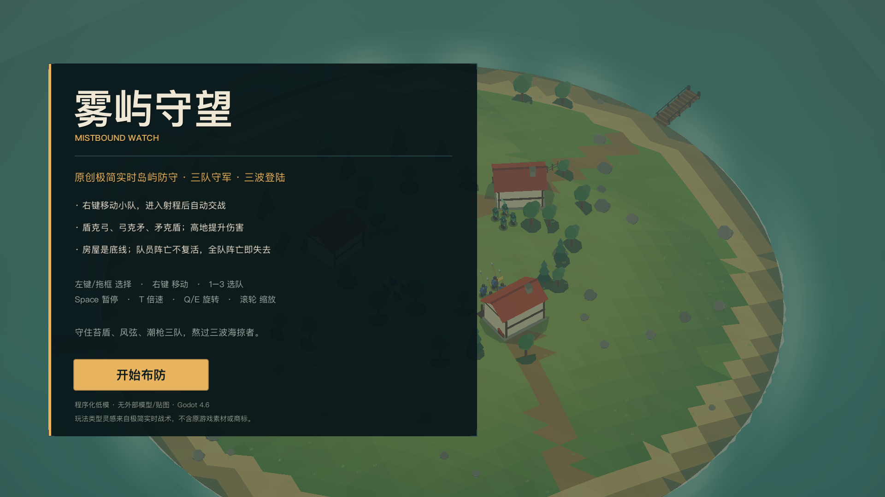
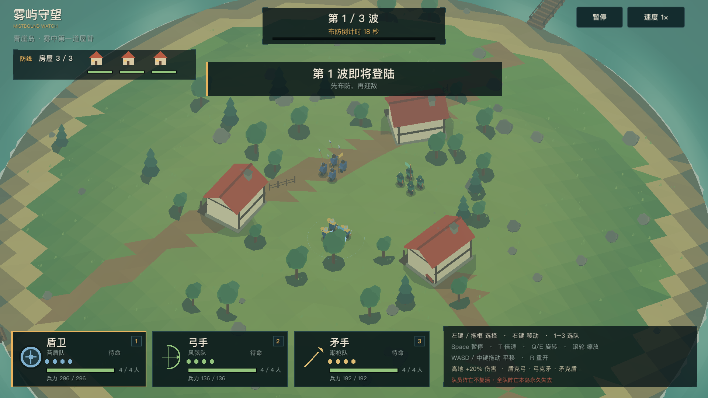
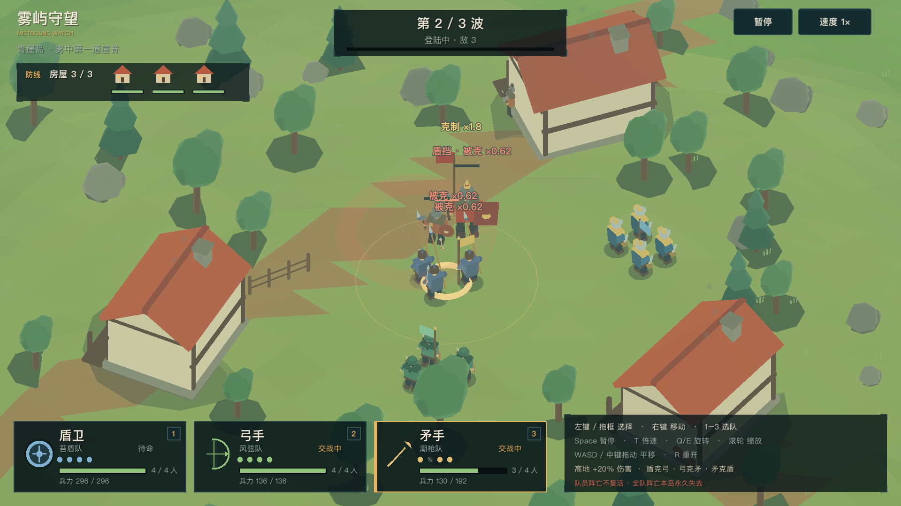
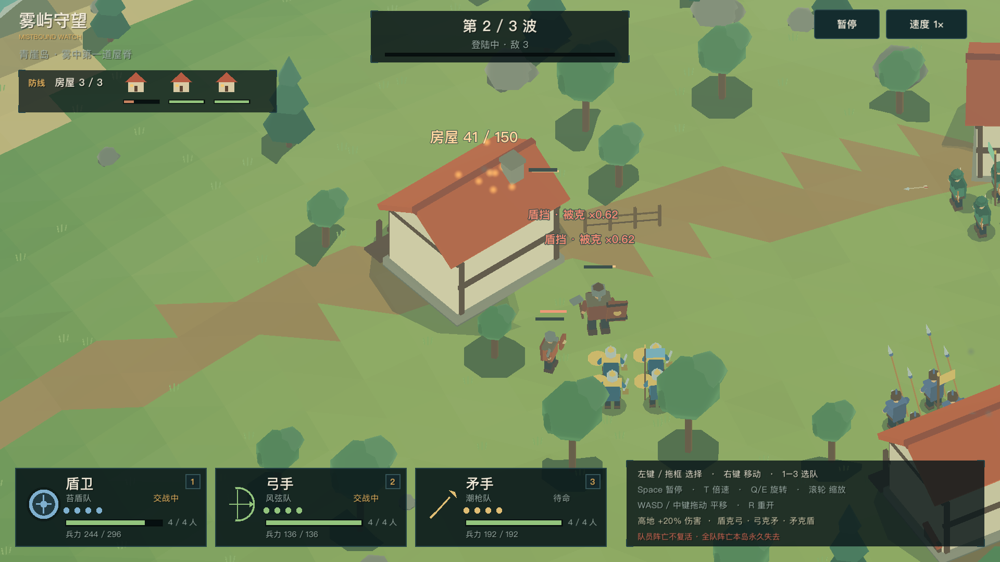

# 雾屿守望 · Mistbound Watch

原创极简实时岛屿防守 vertical slice。率三支小队在低多边形海岛上布防，迎击从海上登陆的海掠者，靠兵种克制、高差和房屋防线撑过波次。
Godot 4.6 / GL Compatibility / 1280×720 逻辑画布 / 1920×1080 截图与视频。






## 运行

```bash
godot --path godot-island-defense
```

- 默认窗口 1280×720，可在 1920×1080 下渲染（本项目截图/视频为真实 1920×1080 SubViewport 输出）。
- 无外部模型/贴图/音频；全部模型、地形、UI、粒子在运行时程序化生成。
- 无第三方运行时依赖。

headless 自测：

```bash
godot --path godot-island-defense --headless -s tools/smoke_island_defense.gd
```

末行输出 `ISLAND_DEFENSE_SMOKE_OK`。

## 操作

| 输入 | 功能 |
| --- | --- |
| 左键点选 / 拖框 | 选择小队（可多选） |
| 右键地面 | 让已选小队移动；多队时自动排开 |
| 1 / 2 / 3 | 选中对应小队并把镜头移过去 |
| Space | 暂停 / 继续 |
| T | 1× / 2× 倍速 |
| Q / E | 旋转视角 |
| 滚轮 | 缩放 |
| WASD / 鼠标中键拖动 | 平移视角 |
| Esc | 暂停 / 继续 |
| R | 重开本局 |
| 顶部 / 面板按钮 | 暂停、倍速、开始、继续、重开、下一岛 |

所有中文文本使用系统 CJK 字体（PingFang SC / Hiragino Sans GB / Noto Sans CJK SC / Microsoft YaHei / WenQuanYi Micro Hei），不打包字体文件。

## 核心规则

### 三支小队（每队 4 人）

| 兵种 | 定位 | 生命 | 伤害 | 射程 | 移速 | 特性 |
| --- | --- | --- | --- | --- | --- | --- |
| 盾卫（苔盾队） | 前排 | 74 | 13 | 2.6 | 3.25 | 受到远程伤害 ×0.5；克制弓手 |
| 弓手（风弦队） | 远程 | 34 | 11 | 15.5 | 3.00 | 箭矢投射物；克制矛手，惧怕盾卫 |
| 矛手（潮枪队） | 反盾 | 48 | 15 | 3.35 | 3.55 | 长杆拒止；克制盾卫，被弓手消耗 |

克制三角：**盾克弓 ×1.8 / 弓克矛 ×1.8 / 矛克盾 ×1.8**；被克制方受到攻击时约为 ×0.62。
高地（攻方比守方高 ≥1.5m）伤害 +20%；仰攻 -15%。盾卫与重盾单位挡箭 50%，潮汐首领挡箭 35%。

### 敌人与防守

- 海掠者从三处滩头登陆，寻路到最近的房屋；途中会攻击挡路的小队。
- 敌人：海掠者、重盾蛮兵（128 HP，弓箭减伤）、掷斧手（远程）、潮汐首领（310 HP，重盾精英）。
- 每座房屋 150 HP；被近身攻击或投斧点燃。**所有房屋焚毁**或**三支小队全部阵亡**即失败。
- 小队成员阵亡永久减员；整队阵亡后本岛无法复活。进入下一岛前，幸存队伍补员至 4 人，阵亡队伍不会归来。
- 清空全部波次即胜利；第 1 岛 3 波，第 2 岛暮火湾 4 波。阵亡/胜利均可重开。

### 波次节奏

- 初始布防 20 秒；清空一波后 8 秒进入下一波。
- 登陆艇靠岸后逐名投放敌人；每艇最多 5 人，多艇错峰登陆。
- 支持暂停（Space）与 1×/2× 倍速（T）。

## 演示

- 10 秒 MP4：`docs/mistbound_watch_demo.mp4`（30fps，1920×1080）
- 10 秒 GIF：`docs/mistbound_watch_demo.gif`（12fps，800px）
- 1920×1080 截图：`docs/shots/`（开场 / 布防 / 登陆 / 克制接战 / 房屋受击 / 暂停 / 胜利 / 失败 / 第二岛）

## 验证

| 项目 | 命令 | 结果 |
| --- | --- | --- |
| 启动 / 退出 | `godot --path . --headless --quit-after 600` | exit 0，stderr 空 |
| 真实 GPU 启动 | `godot --path . --resolution 1280x720 --quit-after 600` | exit 0，stderr 空 |
| 逻辑 smoke | `godot --path . --headless -s tools/smoke_island_defense.gd` | 81 checks，0 failures |
| 交互 | `godot --path . --resolution 1280x720 -s tools/probe_input_island_defense.gd` | 15 checks，0 failures |
| FPS | `godot --path . -s tools/probe_fps_island_defense.gd` | 1280×720 43.9 fps / 1920×1080 31.4 fps（Intel HD 6000） |
| 截图 | `godot --path . -s tools/screenshot_island_defense.gd` | 9 × 1920×1080 |
| 视频 | `godot --path . -s tools/record_island_defense.gd` + ffmpeg | 301 帧 / 10.0s |

完整命令与原始输出见 `docs/verification.txt`，FPS 见 `docs/fps.txt`。

## 文件结构

```
godot-island-defense/
  project.godot
  scenes/main.tscn
  scripts/
    game.gd          # 主状态机 / 输入 / 波次 / 结算 / demo hooks
    balance.gd       # 数值、克制、岛屿与波次唯一事实来源
    island.gd        # 高度场、地形网格、海岸、植被、AStar3D
    squad.gd         # 小队编队 / 自动索敌 / 阵亡
    enemy.gd         # 海掠者 AI / 房屋目标 / 首领
    boat.gd          # 登陆艇
    projectile.gd    # 箭矢 / 投斧
    house.gd         # 房屋 HP / 火焰 / 焚毁
    camera_rig.gd    # 正交相机 / 缩放 / 旋转 / 平移 / 屏幕射线
    hud.gd           # 中文 HUD / 开场 / 暂停 / 结算
    models.gd        # 程序化低模与粒子纹理
    fx.gd            # 命中、刀光、尘土、漂浮文字
    ui_style.gd      # 原创 UI 色板与按钮
  shaders/water.gdshader
  tools/
    smoke_island_defense.gd
    probe_input_island_defense.gd
    probe_fps_island_defense.gd
    screenshot_island_defense.gd
    record_island_defense.gd
  docs/
    TECH.md
    迭代记录.md
    verification.txt
    fps.txt
    shots/
    mistbound_watch_demo.mp4
    mistbound_watch_demo.gif
  CREDITS.md
```

## 原创与版权

- 代码、程序化模型、地形、配色、UI、粒子与文字均为本项目原创。
- 未使用任何第三方 3D/2D 素材；未使用第三方运行时库。
- 玩法类型受极简实时岛屿防守启发，但未复制任何原游戏名称、角色、UI、素材或商标。
- 详细许可见 `CREDITS.md`。
