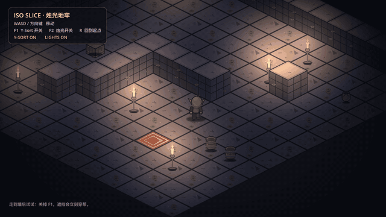
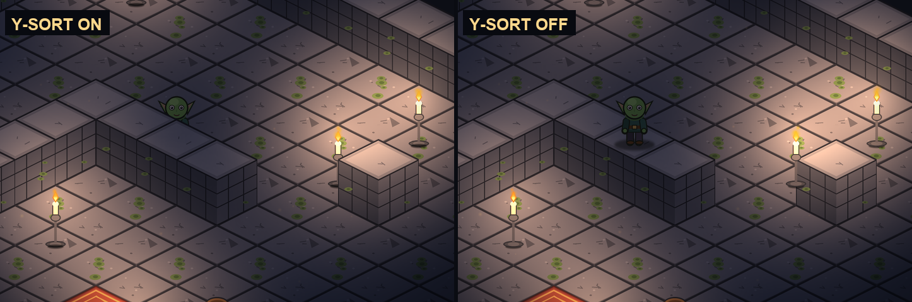
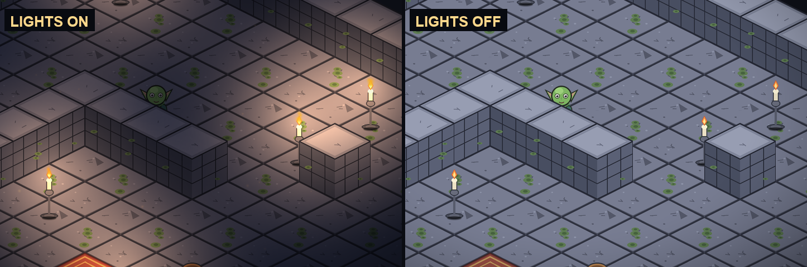
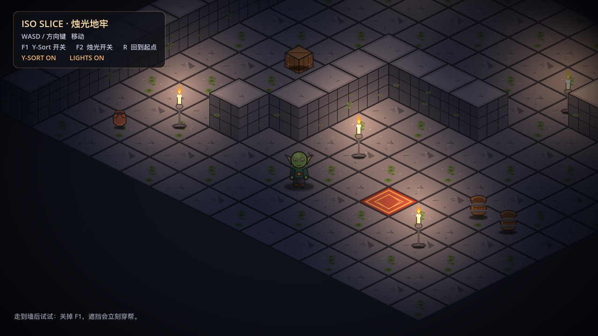
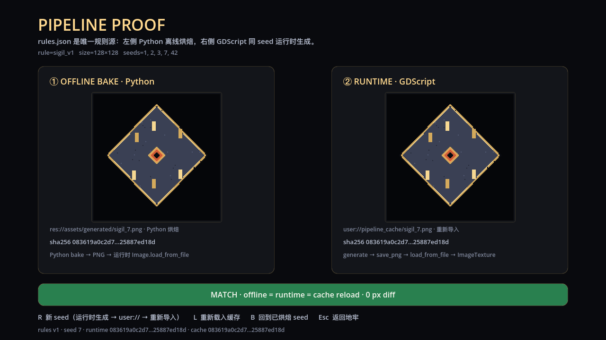
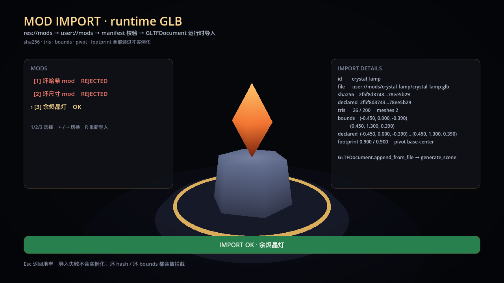

# 烛光地牢 · Iso Slice

纯 2D 的等距视角技术切片：**128×64 菱形瓦片 + Y-Sort 遮挡 + 脚底碰撞 + 8 方向动画 + 实时 2D 烛光/阴影**。

参考 B 站视频 [BV1kPxP6jEbr](https://www.bilibili.com/video/BV1kPxP6jEbr)《Godot等距视角地牢Demo_技术拆解》与 Godot 官方 demo 仓库 `2d/isometric` 的五个技术点重新实现；美术和代码都是本仓库自己的，没有拷贝官方素材。



> 6 秒脚本演示：绕到残墙后 → 被墙挡住 → 关掉 F1 穿帮 → 关灯 → 走回烛光下。
> 同内容视频版：`docs/iso_slice.mp4`（831 KB，GIF 为 4.6 MB）。

## 运行

- Godot **4.6 stable**（实测 `4.6.stable.official.89cea1439`）。
- 1280×720，**GL Compatibility**；2D 光照和实时阴影在兼容渲染器下实测正常。
- 无第三方运行时依赖；首次运行需要 Godot 导入工程。

```bash
godot --path godot-iso-slice
```

主场景 `scenes/dungeon.tscn`。首次从源码运行若提示 `class_name` 未注册：

```bash
godot --headless --path godot-iso-slice --editor --quit
```

## 操作

| 键 | 作用 |
| --- | --- |
| WASD / 方向键 | 移动（等距 2:1 补偿已内置） |
| F1 | 开关 Y-Sort —— **教学开关**：关掉后角色会穿到墙前 |
| F2 | 开关烛光 —— 同时把 CanvasModulate 拉到全白，展示“平光 vs 光照” |
| F3 | 进入程序化管线演示（rules → 离线资产 → 运行时导入） |
| F4 | 进入 Mod 运行时导入演示（GLB + manifest 校验） |
| R | 回到起点 |

## 五个技术点 → 代码落点

| # | 技术点 | 落点 | 关键值 |
| --- | --- | --- | --- |
| 1 | 等距瓦片 | `tools/build_tileset.gd:33` | `tile_shape=Isometric`、`tile_layout=DiamondDown`、`tile_size=(128,64)` |
| 2 | Y-Sort 深度排序 | `scenes/dungeon.tscn:24` | `World` 同时装 `Walls` 和 `Player`；`TileMapLayer.y_sort_origin = 32` |
| 3 | 等距移动 | `src/iso_math.gd` → `src/core/portable_core.gd`、`src/player.gd:27` | 先 `y *= 0.5`，再 `normalized() * SPEED` |
| 4 | 8 方向扇区 | `src/iso_math.gd` → `src/core/portable_core.gd` | `(angle + 22.5°) / 45°` 取整，边界落在对角线中间 |
| 5 | 脚底锚点 | `scenes/player.tscn:24` | 精灵脚底画在图集单元中心，精灵节点放 `(0,0)`；碰撞胶囊在 `y=-11` |
| 6 | 2D 实时烛光 | `src/dungeon.gd` `_spawn_candles()` | 6 × `PointLight2D`（开阴影）+ `CanvasModulate` + TileSet 遮挡层 |

> 玩家脚本 `src/player.gd` 只有 **50 行**（官方原版 54 行）——移动/朝向/动画切换全在里面。
>
> B 层（等距数学 + 确定性哈希）已抽到仓库级 `portable-core/`：Python / GDScript / JS
> 三语言 golden 校验。本工程 `src/core/` 是同步副本，`src/iso_math.gd` 只是 Vector2 适配层；
> 改算法请改 `portable-core/impl/` 后跑 `python3 portable-core/sync.py`。

### Y-Sort 开关对比



左：Y-Sort 开，角色被残墙挡住，只露出头。右：关掉 F1，角色整块画到墙前——这就是“遮挡错乱”的样子。

### 灯光开关对比



左：CanvasModulate 压暗 + 6 盏烛光 + 墙/道具的 LightOccluder。右：关灯后全白平光，方便核对瓦片与遮挡。

### 起始画面



## 程序化管线 PoC：rules → 离线资产 → 运行时导入

`rules.json` 是唯一规则源。同一个 `sigil_v1` 规则有两条执行路径：

- **离线烘焙**：`tools/bake_pipeline.py` → `assets/generated/*.png` + `manifest.json`（含 `sha256_rgba`）
- **运行时生成**：`src/sigil_rules.gd` 同 seed 生成 → 写 `user://` → `Image.load_from_file` → `ImageTexture`

两条路径**逐像素一致**（5 个 seed 哈希全同，0 px diff）。



运行：

```bash
python3 tools/bake_pipeline.py
godot --headless --path godot-iso-slice --editor --quit
godot --headless --path godot-iso-slice -s tools/pipeline_check.gd
godot --path godot-iso-slice scenes/pipeline_demo.tscn
```

地牢里按 **F3** 进入演示；`R` 换 seed（运行时生成+缓存+重新导入）、`L` 重载缓存、`B` 回到烘焙 seed、`Esc` 返回。
完整说明和生产化注意事项（`res://` 原始 PNG 导出限制、编辑器导入的色彩空间、缓存键、mod 校验）见 [docs/PIPELINE.md](docs/PIPELINE.md)。

## Mod 运行时导入 PoC：GLB + manifest + 校验

`res://mods` → `user://mods` → 扫描 `manifest.json` → `sha256` → `GLTFDocument.append_from_file`
→ 测量 tris/bounds → 校验 bounds/footprint/pivot → 通过才实例化。



| 夹具 | 结果 |
| --- | --- |
| `crystal_lamp` | IMPORT OK（26 tris / 2 meshes） |
| `bad_scale` | REJECTED · bounds exceed manifest |
| `bad_hash` | REJECTED · sha256 mismatch |

```bash
python3 tools/make_mod_glb.py
godot --headless --path godot-iso-slice -s tools/mod_check.gd
godot --path godot-iso-slice scenes/mod_demo.tscn
```

地牢里按 **F4** 进入 3D 转台演示；`1/2/3` 选择、`R` 重新从磁盘导入、`Esc` 返回。
完整格式、校验规则和生产化注意（签名、资源上限、外部 URI、PCK 脚本风险）见 [docs/MODS.md](docs/MODS.md)。

## 验证

```bash
# 1) 生成程序化美术（需要 Python 3 + Pillow）
python3 tools/gen_art.py

# 2) 导入资源并重建 TileSet
godot --headless --path godot-iso-slice --editor --quit
godot --headless --path godot-iso-slice -s tools/build_tileset.gd

# 3) 无头验收（瓦片/排序/碰撞/灯光/动画/移动）
godot --headless --path godot-iso-slice -s tools/smoke_iso.gd

# 4) 管线 PoC：离线烘焙 + 跨语言逐像素校验 + 缓存回环
python3 tools/bake_pipeline.py
godot --headless --path godot-iso-slice -s tools/pipeline_check.gd

# 5) Mod PoC：GLB 夹具 + 运行时校验
python3 tools/make_mod_glb.py
godot --headless --path godot-iso-slice -s tools/mod_check.gd

# 6) 视觉验收：地牢 5 张图 → /tmp/iso_slice_shots/
godot --path godot-iso-slice --resolution 1280x720 -s tools/screenshot_iso.gd
#    管线演示 3 张图 → /tmp/iso_pipeline_shots/
godot --path godot-iso-slice --resolution 1280x720 -s tools/screenshot_pipeline.gd
#    Mod 演示 3 张图 → /tmp/iso_mod_shots/
godot --path godot-iso-slice --resolution 1280x720 -s tools/screenshot_mod.gd
```

也可以直接 `bash tools/verify.sh` 一次跑完导入、TileSet、smoke、管线校验和 mod 校验。

GIF 复录（帧写到 `/tmp/iso_slice_gif/`）：

```bash
godot --path godot-iso-slice --resolution 1280x720 -s tools/capture_iso_gif.gd
ffmpeg -framerate 15 -i /tmp/iso_slice_gif/frame_%03d.png \
  -vf "fps=12,scale=640:360:flags=lanczos,split[s0][s1];[s0]palettegen=max_colors=56:stats_mode=diff[p];[s1][p]paletteuse=dither=bayer:bayer_scale=4" \
  -loop 0 godot-iso-slice/docs/iso_slice.gif
```

## 目录

```
godot-iso-slice/
├── rules.json                       程序化规则唯一数据源（sigil_v1）
├── mods/                            GLB mod 夹具（valid / bad_scale / bad_hash）
├── assets/
│   ├── tiles/iso_tiles.png          程序化图集（4×2，单元 128×160）
│   ├── tiles/dungeon_tileset.tres   由 build_tileset.gd 生成
│   ├── sprites/hero.png             8 方向 ×（2 idle + 4 walk）
│   ├── props/                       木桶/木箱/陶罐/烛台
│   ├── fx/                          光斑、阴影、火星、尘埃
│   ├── ui/vignette.png              屏幕暗角
│   └── generated/                   管线 PoC 产物（sigil PNG + manifest）
├── scenes/dungeon.tscn              房间 + 灯光 + HUD
├── scenes/player.tscn               脚底锚点 + 相机
├── scenes/pipeline_demo.tscn        离线 vs 运行时管线演示
├── scenes/mod_demo.tscn             GLB mod 运行时导入演示
├── src/
│   ├── iso_math.gd                  2:1 补偿 + 8 扇区
│   ├── player.gd                    50 行玩家脚本
│   ├── hero_frames.gd               运行时从图集切 SpriteFrames
│   ├── dungeon.gd                   铺房间、道具、烛光、教学开关
│   ├── sigil_rules.gd               rules.json 的 GDScript 运行时执行器
│   ├── pipeline_demo.gd             离线/运行时/缓存导入对比 UI
│   ├── mod_loader.gd                mod 扫描/哈希/GLTF/几何校验
│   ├── mod_demo.gd                  3D 转台 + mod 列表/详情 UI
│   └── hud.gd                       标题/操作/状态/暗角
├── tools/
│   ├── gen_art.py                   全部美术的程序化生成器
│   ├── bake_pipeline.py             rules.json 的 Python 离线烘焙器
│   ├── make_mod_glb.py              手写 GLB mod 夹具生成器
│   ├── build_tileset.gd             生成 TileSet（碰撞/遮挡/Y-Sort）
│   ├── pipeline_check.gd            跨语言哈希 + 缓存回环校验
│   ├── mod_check.gd                 mod 安装/扫描/校验无头验收
│   ├── smoke_iso.gd                 无头验收
│   ├── screenshot_iso.gd            地牢验证截图
│   ├── screenshot_pipeline.gd       管线演示截图
│   ├── screenshot_mod.gd            mod 演示截图
│   ├── capture_iso_gif.gd           脚本化 GIF 录制
│   └── verify.sh                    一键验收
└── docs/
    ├── TECH.md                      技术拆解与排查手册
    ├── PIPELINE.md                  规则→资产→运行时导入 PoC 说明
    ├── MODS.md                      GLB mod 运行时导入 PoC 说明
    ├── 迭代记录.md                   三轮问题、根因、修复与验证
    └── iso_slice.gif
```

## 已知边界

- **纯 2D**：没有真正的高低差、跳跃、斜坡；要做高低差需要额外的假投影/缩放/影子方案。
- 每盏开阴影的 `PointLight2D` 都有绘制开销；移动端建议控制在 8 盏以内并复用光照贴图。
- 墙是单格立方块，连续墙面会出现方块接缝（本切片的美术选择）；要做连续石墙，需要增加边缘/转角瓦片和 47 瓦片规则。
- 中文 HUD 走**系统字体回退**（PingFang SC / Noto Sans CJK / Microsoft YaHei），不随项目分发字体；跨平台验收需确认系统有 CJK 字体。

## 素材与许可

全部美术由 `tools/gen_art.py` 程序化生成，无外部素材。技术参考 Godot 官方 demo（MIT）与上述 B 站视频；未使用其素材或代码。详见 `assets/art/CREDITS.md`。
