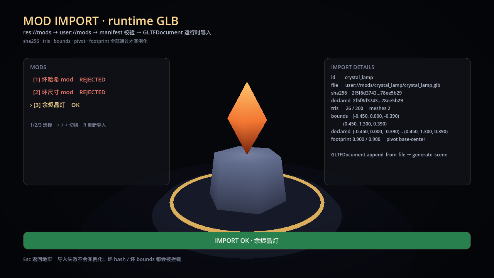
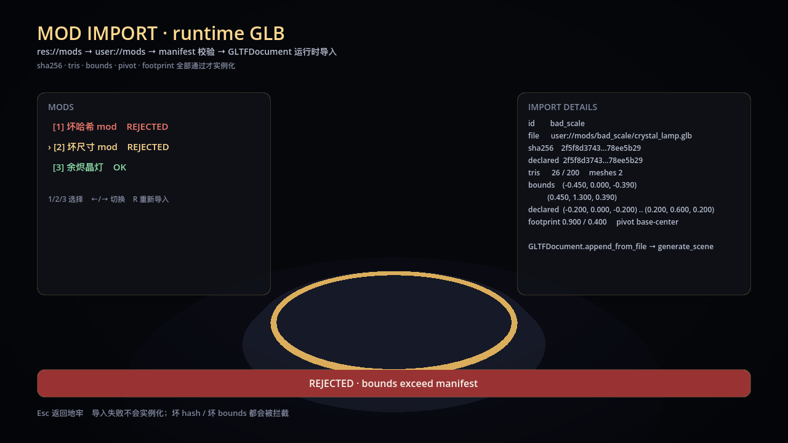
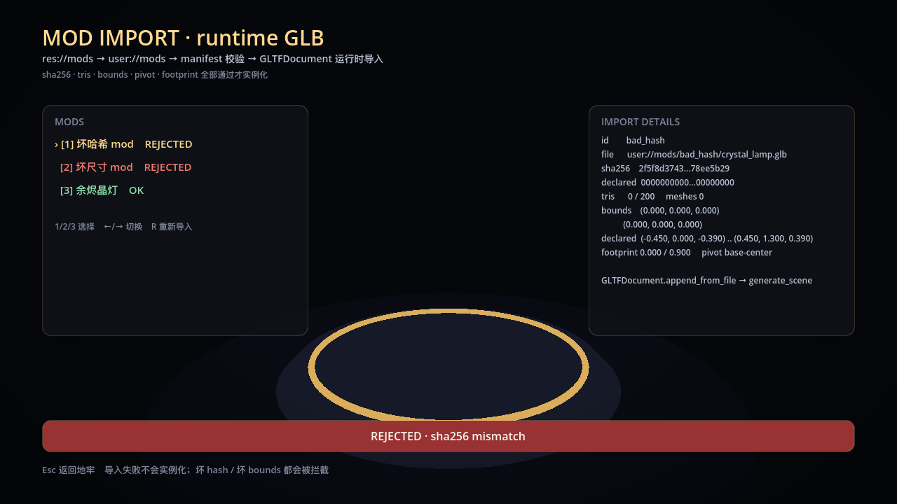

# 运行时 Mod 导入 PoC：GLB + manifest + 校验

上一轮证明了“规则 → PNG → 运行时导入”；这一轮把资产换成 **GLB 模型**，
走一条更接近真实 mod 的路径：

```
res://mods/<id>/            （夹具，模拟下载/解压）
        │  安装：复制
        ▼
user://mods/<id>/           （可写目录，模拟用户 mod 目录）
        │  scan manifest.json
        ▼
sha256 → GLTFDocument.append_from_file → generate_scene
        │  测量 tris / meshes / bounds
        ▼
bounds / footprint / pivot / max_tris 全部通过
        │
        ▼
实例化到 3D 转台；任何一项失败 → 不实例化 + 显示原因
```



## 夹具

`tools/make_mod_glb.py` 手写生成 GLB（不依赖 Blender/gltf 库），三个夹具：

| id | 内容 | 结果 |
| --- | --- | --- |
| `crystal_lamp` | 六边形石座 + 余烬晶体，26 tris，2 meshes | **IMPORT OK** |
| `bad_scale` | 同一 GLB，manifest 声明的 bounds 只有实际的一半 | **REJECTED · bounds exceed manifest** |
| `bad_hash` | 同一 GLB，manifest 的 sha256 写错 | **REJECTED · sha256 mismatch** |

GLB 结构（手写）：

- 六边形石座：底部 6 + 顶部 6 + 顶盖中心，18 tris；
- 八面体晶体：6 顶点，8 tris；
- 顶点色 `COLOR_0`（VEC4 float）；材质 `doubleSided`；
- 无贴图、无骨骼、无动画，约 2.9KB；
- bounds 从**两个 mesh 合并**后计算（见 `docs/迭代记录.md` 的问题 1）。

manifest 示例：

```json
{
  "id": "crystal_lamp",
  "name": "余烬晶灯",
  "version": 1,
  "format": "glb",
  "file": "crystal_lamp.glb",
  "sha256": "2f5f8d37…",
  "bounds": {
    "min": [-0.45, 0.0, -0.389711],
    "max": [0.45, 1.3, 0.389711]
  },
  "footprint": 0.9,
  "pivot": "base-center",
  "max_tris": 200,
  "author": "mod-poc",
  "license": "CC0"
}
```

## 校验规则（ModLoader）

| 检查 | 目的 |
| --- | --- |
| 必填字段 | id/file/sha256/bounds/footprint/pivot/max_tris 缺一不可 |
| 文件存在 | 防 manifest 指向不存在的路径 |
| `sha256` | 内容完整性（注意：**不是**签名，不能证明作者身份） |
| `GLTFDocument.append_from_file` | 解析失败直接拒绝 |
| `meshes > 0` | 空模型不实例化 |
| `tris <= max_tris` | 防超重模型拖垮帧率/内存 |
| `bounds` 在声明范围内（±0.02） | 防止模型比声明的大很多（碰撞/占位不符） |
| `footprint <= 声明值`（±0.02） | 防止挡路范围不符 |
| `|min.y| <= 0.02` | 脚底/底座必须在原点，否则会“飘”或“陷地” |

失败时 `validate()` 会 `free()` 掉刚生成的场景，避免重复导入时泄漏。

## 3D 展示

`scenes/mod_demo.tscn` + `src/mod_demo.gd`：

- 3D 转台：石座 + 金环 + 深色圆盘；
- 导入的模型用 `GLTFDocument` 生成后，统一改成 **unshaded + 顶点色**；
  这样在 GL Compatibility / Intel 核显上不依赖 3D 灯光（本项目 2D 用的也是 GL Compatibility）；
- 自动缓慢旋转；
- 左侧 mod 列表、右侧校验详情、底部状态条；
- 所有数字都来自运行时测量（tris/bounds/footprint），不是 manifest 自报。

## 运行

```bash
# 生成夹具（可重复，输出确定）
python3 tools/make_mod_glb.py

# 无头校验：安装 + 扫描 + 3 个夹具
godot --headless --path godot-iso-slice -s tools/mod_check.gd

# 3D 演示
godot --path godot-iso-slice scenes/mod_demo.tscn
```

地牢里按 **F4** 进入；`1/2/3` 选择，`←/→` 切换，`R` 重新从磁盘导入，`Esc` 返回。

实测：

```
INSTALLED=3
MOD bad_hash ok=false tris=0  meshes=0 reason=sha256 mismatch
MOD bad_scale ok=false tris=26 meshes=2 reason=bounds exceed manifest
MOD crystal_lamp ok=true  tris=26 meshes=2
MOD_CHECK_OK
```

## 拒绝示例





## 生产化注意

1. **sha256 ≠ 签名**：只能证明“文件没变”，不能证明“是谁做的”。正式 mod 平台要加签名/allowlist/审核。
2. **资源上限**：除 tris 外，还应限制文件大小、纹理尺寸/数量、动画数量、材质数量；避免 DoS。
3. **外部 URI**：glTF 可引用相对路径纹理；加载前限制只能读 mod 目录内的文件，防路径穿越。
4. **脚本**：Godot 的 GLB 导入本身不执行脚本；但如果允许 mod 用 `.pck`，PCK 可以带 GDScript——必须只信任签名过的包，或把 mod 限定为纯数据。
5. **单位/pivot**：manifest 必须声明 bounds/footprint/pivot；不同 DCC 导出单位不同，靠运行时测量兜底。
6. **版本兼容**：manifest 加 `engine_min`/`format_version`；不兼容直接拒绝。
7. **缓存**：GLB 每次解析有成本；可在首次导入后转成 `.res`/`.scn` 缓存到 `user://`，但仍保留 manifest 校验。
8. **授权**：manifest 的 `license` 只作展示；正式分发仍需人工审核。

## 和 Saltline 的关系

Saltline 是“规则即资产”的极端（1.4MB，全部运行时生成）；本 PoC 是它的**可运营版本**：

- 几何/纹理离线烘焙成 GLB/PNG（可审核、可压缩、可换 DCC）；
- manifest 描述资产与约束；
- 运行时校验后导入；
- 仍然保留“运行时生成 → 缓存”的路径（见 `docs/PIPELINE.md`）。

Saltline 的完整拆解见仓库根目录 `docs/saltline-teardown.md`。
