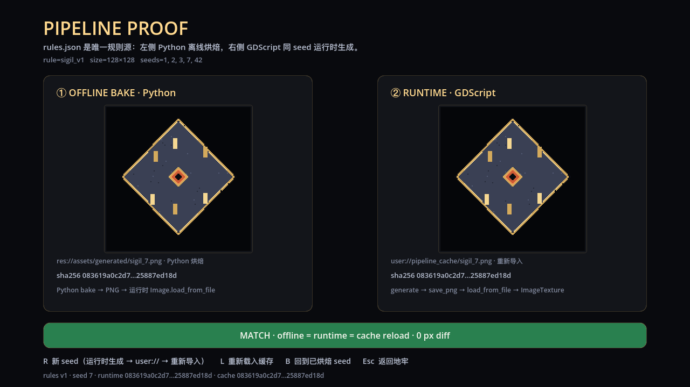
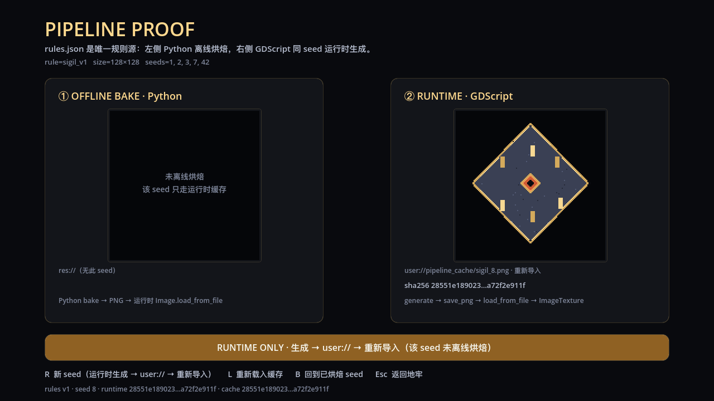

# 程序化管线 PoC：rules → 离线资产 → 运行时导入

这个 PoC 用一个小规则（`sigil_v1`，128×128 程序化徽记）证明三件事：

1. **规则是数据**：`rules.json` 是唯一规则源，尺寸/调色板/菱形/符文/眼睛/噪点参数都在里面；
2. **同一规则可双端执行**：Python 离线烘焙与 GDScript 运行时生成，**同 seed 逐像素一致**；
3. **产物可落盘、再导入**：运行时生成 → 写 `user://` → `Image.load_from_file` → `ImageTexture`，形成“运行时烘焙 + 缓存 + 导入”的闭环。



> 左：Python 离线烘焙的 PNG；右：GDScript 同 seed 生成、写入 `user://` 后重新导入。
> 两边 SHA-256 相同，逐像素 0 diff。

## 文件

| 文件 | 作用 |
| --- | --- |
| `rules.json` | 唯一规则源（版本、seed、尺寸、调色板、几何/符文/眼睛/噪点参数） |
| `tools/bake_pipeline.py` | 离线执行器：读 rules → 生成 PNG + `manifest.json`（`sha256_rgba`） |
| `src/sigil_rules.gd` | 运行时执行器：同 rules、同 seed → `Image` → 字节数组 |
| `assets/generated/` | 烘焙产物：`sigil_<seed>.png` + `manifest.json` |
| `scenes/pipeline_demo.tscn` | 演示场景（离线 vs 运行时；R/L/B/Esc） |
| `src/pipeline_demo.gd` | 演示 UI + 缓存/导入流程 |
| `tools/pipeline_check.gd` | 无头跨语言校验：5 个 seed + 缓存回环 |
| `tools/screenshot_pipeline.gd` | 拍对比截图 |
| `tools/verify.sh` | 一键：烘焙 → 导入 → TileSet → smoke → 管线校验 |

## 规则本身：为什么能跨语言一致

`sigil_v1` 刻意只用**整数**：

- 128×128 RGBA，外层透明；
- 2:1 菱形：`d = |2x-c|*ry + |2y-c|*rx`，`d <= 2*rx*ry` 为内部；
- 金边/内高光/外暗线都按 `edge = K - d` 的整数阈值分档；
- 6 条符文：从 seed 派生的 32 位哈希做位置抖动，离边框或眼睛太近就跳过；
- 中心“眼”：按 `d` 的整数阈值分瞳孔/虹膜/高光/金环；
- 石面噪点：`h32(x,y,seed)` 的位掩码决定稀疏亮点/暗点；
- 没有浮点、没有抗锯齿、没有语言相关的噪声库。

哈希函数：

```
v = (x*374761393 + y*668265263 + (seed & 0xFFFFFFFF)*1013904223) & 0xFFFFFFFF
v = (v ^ (v >> 13)) & 0xFFFFFFFF
v = (v * 1274126177) & 0xFFFFFFFF
v = (v ^ (v >> 16)) & 0xFFFFFFFF
```

Python 的任意精度整数与 GDScript 的 64 位整数在这里都被显式 `& 0xFFFFFFFF`，乘法结果不超过 64 位，因此逐位一致。

## 两条执行路径

### ① 离线烘焙（Python）

```bash
python3 tools/bake_pipeline.py
```

输出：

- `assets/generated/sigil_1.png` … `sigil_42.png`
- `assets/generated/manifest.json`

manifest 记录：

```json
{
  "rules_version": 1,
  "rule": "sigil_v1",
  "size": 128,
  "baked_seed": 7,
  "seeds": [1, 2, 3, 7, 42],
  "assets": {
    "7": {"file": "sigil_7.png", "seed": 7,
          "sha256_rgba": "083619a0…", "bytes": 65536}
  }
}
```

### ② 运行时生成 + 缓存 + 导入（GDScript）

`pipeline_demo.gd` 的 `_show_seed()`：

1. `SigilRules.generate(rules, seed)` 生成运行时图像；
2. 计算 `sha256_rgba`；
3. `save_png("user://pipeline_cache/sigil_<seed>.png")`；
4. `Image.load_from_file(cache_path)` 重新导入；
5. 显示重新导入的图像，并和离线 PNG 逐像素比较。

## 运行

```bash
# 一键校验（推荐）
bash tools/verify.sh

# 只跑管线校验
godot --headless --path godot-iso-slice -s tools/pipeline_check.gd

# 打开演示场景
godot --path godot-iso-slice scenes/pipeline_demo.tscn
```

地牢里也可以按 **F3** 进入演示，**Esc** 返回。

| 键 | 作用 |
| --- | --- |
| `R` | 新 seed：运行时生成 → 写 `user://` → 重新导入（该 seed 未离线烘焙） |
| `L` | 重新从 `user://` 导入当前 seed 的缓存，和运行时重新生成的结果比对 |
| `B` | 回到已烘焙 seed（默认 7），展示离线 == 运行时 == 缓存 |
| `Esc` | 返回地牢 |

## 实测结果

```
RUNTIME MATCH seed=1  91c1edb3590b9655…
RUNTIME MATCH seed=2  11043f53a88b4794…
RUNTIME MATCH seed=3  3cdb0d101310e3ee…
RUNTIME MATCH seed=7  083619a0c2d70817…
RUNTIME MATCH seed=42 73218dcab91f5901…
CACHE ROUNDTRIP OK seed=7 user://pipeline_cache/sigil_7.png
PIPELINE_OK seeds=5
```

演示里：

- 离线 PNG vs 运行时：**MATCH，0 px diff**；
- 运行时 → 缓存 → 重新导入：SHA-256 相同；
- 新 seed：左侧显示“未离线烘焙”，右侧走运行时缓存（RUNTIME ONLY）。



## 生产化注意（重要）

1. **`Image.load_from_file("res://...")` 在导出后不可用**：PoC 为了拿到逐像素原始数据，直接读了 `res://` 下的 PNG；
   Godot 导出时源 PNG 不一定在包里。生产内容请：
   - 用编辑器导入的 `Texture2D`（但导入可能做色彩空间/压缩转换，哈希会变）；
   - 或把烘焙资产放到 `user://`/外部目录/PCK，再用 `Image.load_from_file` 或 `ResourceLoader` 读。
2. **编辑器导入 ≠ 原始像素**：实测同一张 PNG 经 Godot 导入后，`get_image()` 的 RGBA 哈希与原始 PNG 不同（导入会做色彩空间/格式转换）。
   需要“逐像素证明”时比较原始 PNG；需要“游戏里显示”时用导入纹理。
3. **跨语言浮点是雷**：本 PoC 全部整数。若规则里用 float/噪声库，要么把实现固定到同一份 WASM/共享库，要么接受“视觉相似但哈希不同”。
4. **缓存键**：`rules_version + seed + palette_hash`；规则一改，旧缓存必须失效。
5. **运行时导入 mod**：manifest + PNG/GLB/OGG；校验尺寸、pivot（脚底/中心）、文件大小；Godot `.pck` 可带脚本，只加载可信 mod。
6. **不要烘死的**：天气、雨/水花、粒子、动态光照、3D 音频混音；这些留在运行时。几何/标签/音频/布局适合烘。
7. **双执行器要同步**：`rules.json` 改了参数两边自动生效；但如果改的是**算法**，必须同时改 `bake_pipeline.py` 与 `sigil_rules.gd`。
   哈希已抽到仓库级 `portable-core/`（Python/GDScript/JS 同一组 golden），两端都直接 import 同步副本；
   `pipeline_check.gd` 是防回归的闸门。

## 和 Saltline 的关系

Saltline 把“规则即资产”做到了极致（1.4MB 下载）；本 PoC 展示的是它的**生产化反向**：

- 规则 → 离线烘焙 → manifest → 运行时导入（正式内容）；
- 规则 → 运行时生成 → 缓存 → 重新导入（UGC/无限变体）；
- 规则 + 外部资产 → 运行时导入（mod）。

Saltline 的拆解和“哪些能烘/哪些不能烘”见仓库根目录的 `docs/saltline-teardown.md`。
