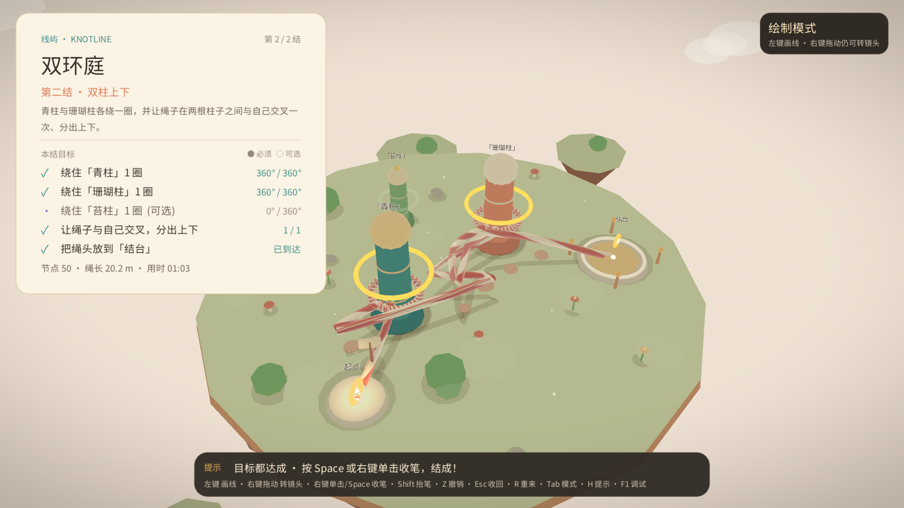
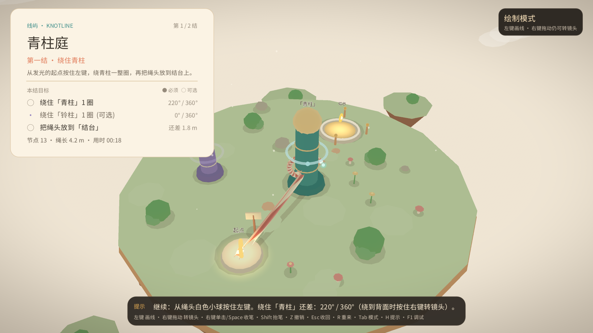
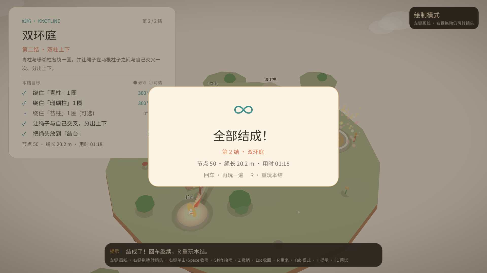
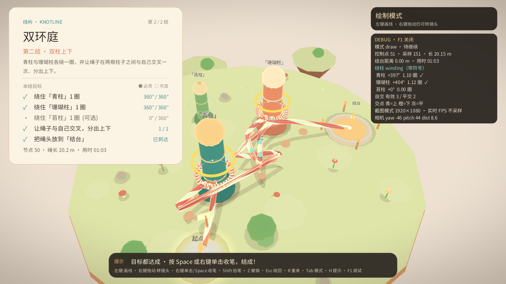

# Knotline · 线屿

**一款原创的 3D 一笔画 + 绕柱打结解谜 vertical slice。**
一根不能断的绳子，绕过彩柱、与自己一上一下，最后把绳头放上结台。

Godot 4.6 · GL Compatibility · 1280×720 逻辑分辨率（截图 1920×1080）· Intel 集显 live 窗口实测带绳 113.7 FPS（最终 HUD 109 FPS，见下）



## 这是什么

- 鼠标射线在 3D 地形和半空中画一条**连续的一笔**，线始终从发光起点出发；
- 线绕柱子时自动避开柱体，形成可检测的 **winding（绕柱圈数）**；
- 两股线交叉时按 3D 高度分出 **over / under（上 / 下）**；
- 目标不是“画够几圈”，而要同时满足：**套住指定目标 + 结条件 + 绳头落在结台**；
- 逐步撤销（带收绳动画）、重置、上下两条手工关卡、中文目标 HUD 和情境提示；
- 低多边形漂浮 diorama、程序化几何/材质/UI/音效，未使用任何第三方运行时资源。



## 操作

| 输入 | 作用 |
| --- | --- |
| 左键拖动 | 从起点开始画线；松手是暂停，**不会断笔** |
| 在绳头白球附近按住左键 | 从当前线头继续 |
| 右键拖动 | 旋转镜头（绘制模式下也可用，边画边绕柱） |
| 右键单击 / `Space` | 收笔并结算 |
| `Shift`（绘画时按住） | 抬笔约 0.30 m，用来从旧绳上方跨过 |
| `Tab` | 绘制 / 镜头模式切换 |
| `WASD` / 方向键、滚轮 | 平移焦点、缩放 |
| `Z` | 撤销最后一个控制点（带平滑回收动画） |
| `Esc` | 收回当前这一笔（回到起点） |
| `R` | 重置本结 |
| `H` | 下一条本关提示 |
| `F1` | 调试：采样线、交点上/下、带符号 winding、FPS / draw calls |
| `1` / `2` | 直接切到第 1 / 2 结（演示用） |
| `M` | 静音 / 开启程序化音效 |
| `Enter`（过关后） | 下一结（全部完成后回到第一结） |

> 目标 HUD 永远显示“本结目标、当前角度/圈数、自交上下、绳头到结台的距离”；底部提示会按状态自动切换。

## 两条手工关卡

| 关卡 | 套住目标 | 结条件 | 终点 |
| --- | --- | --- | --- |
| 第 1 结 · **青柱庭** | 「青柱」1 圈（必须）；「铃柱」1 圈（可选，会响铃） | 仅绕柱；无自交要求 | 结台 |
| 第 2 结 · **双环庭** | 「青柱」+「珊瑚柱」各 1 圈（必须）；「苔柱」可选 | 必须有一次**自交并分出上下**（按住 `Shift` 抬笔跨过） | 结台 |

关卡是 JSON 数据驱动：`levels/level_01.json`、`levels/level_02.json`。换关卡不需要改代码。



## 运行

```bash
# 可玩版本（需要可用的桌面 GPU；GL Compatibility）
godot --path godot-knotline-puzzle --resolution 1280x720
```

第一次启动会构建 `.godot` 缓存；字体在运行时用 `FontFile.load_dynamic_font` 直接读取，不依赖 Godot 导入流水线。项目无第三方运行时依赖。全新环境若没有 `.godot` 缓存，先执行一次 `godot --headless --path godot-knotline-puzzle --import` 注册 `class_name`。

## 自测与验收

```bash
# 1) 无头逻辑测试（98 项检查）
godot --headless --path godot-knotline-puzzle -s tools/smoke_knotline.gd
# => KNOTLINE_SMOKE_OK checks=98 levels=2

# 2) 真实 GPU 性能 + 屏幕射线画线 + 撤销 + 1280×720 实拍
godot --path godot-knotline-puzzle --resolution 1280x720 -s tools/probe_live.gd
# 最新一次实测：LIVE_IDLE fps=56.0 draws=172
#               LIVE_ROPE fps=113.7 draws=173
#               LIVE_SCREEN_DRAW started=true points=17 steps=9
#               LIVE_UNDO before=9 after=8 ok=true
#               LIVE_DEBUG fps=108.7 draws=182（HUD 显示 FPS 109 / Draw 182）
# 多次测量在 55–152 FPS 区间波动（macOS 窗口遮挡/集显状态）

# 3) 1920×1080 截图（7 张，SubViewport + 2× MSAA，脱离窗口回读）
godot --path godot-knotline-puzzle --resolution 1280x720 -s tools/capture_shots.gd

# 4) 10 秒视频帧源（固定 30 fps，300 帧）
godot --path godot-knotline-puzzle --resolution 1280x720 --fixed-fps 30 -s tools/capture_video.gd
# 再用 ffmpeg 编码为 docs/shots/knotline_demo_10s.mp4 / .gif
```

真实 GPU 运行 10 秒（`--quit-after 600`）console 无 `ERROR` / `SCRIPT ERROR`。FPS 受 macOS 窗口遮挡与集显状态影响；本次 live 窗口多次实测均远高于 30 FPS，最终截图 HUD 显示 **109 FPS**。

## 媒体

- 1920×1080 截图：`docs/shots/01_overview.png` … `07_level2_overview.png`
- 1280×720 实时性能/调试图：`docs/shots/08_live_1280.png`
- 10 秒演示：`docs/shots/knotline_demo_10s.mp4`（1280×720, 30 fps, 300 帧）与 `.gif`（800×450, 12 fps）
- 参考视频只用于机制研究，未复制任何素材；见 `docs/迭代记录.md` 与 `CREDITS.md`。



## 技术概要

- **画线**：鼠标射线命中岛面/柱体，命中表面即取表面点；射向天空时落在经过上一个点的“面向镜头”平面上，支持在空中走线；`Shift` 抬笔。
- **绳网格**：控制点 → Catmull-Rom 采样 → 平行传输框架的 Tube（10 边）→ `ArrayMesh`；条纹由 `shaders/rope.gdshader` 依据 UV 的斜向条带生成，带暗色 Fresnel 轮廓、轻微自发光和阴影。
- **绕柱**：线段与柱体在 XZ 平面求交后插入半径 `r + rope_radius + clearance` 的圆弧，绳不会穿过柱子；winding 用柱体附近连续区间内的角度展开，取最强的同向区间（尾部甩出不会抹掉已完成的圈）。
- **结条件**：在 XZ 平面找自交；两股线高度差 ≥ 0.12 m 记为“上下”（over/under），< 0.12 m 记为“平交”。不宣称完整 knot theory；近似与边界见 `docs/TECH.md`。
- **Undo**：只回退最后一个用户控制点（自动圆弧点一并回退），0.2 秒收绳动画；`Esc` 退回起点，`R` 重建本关。
- **性能**：GL Compatibility；游戏内关闭 MSAA；2048 方向光阴影贴图；接触阴影/踏脚石/云朵合并为 MultiMesh；1280×720 live 窗口最新 113.7 FPS / 173 draw calls（无 debug；多次 55–152）。1920 截图走独立的 SubViewport + 2×MSAA 回读，截图帧率不代表游戏帧率。

## 目录

```
godot-knotline-puzzle/
├── project.godot
├── scenes/main.tscn
├── src/                 # 核心、世界、相机、HUD、音效
├── levels/              # 两个 JSON 关卡
├── shaders/             # 绳材质、暗角
├── assets/fonts/        # Noto Sans SC 子集 + OFL
├── tools/               # smoke / probe / capture
├── docs/TECH.md         # 技术细节与近似边界
├── docs/迭代记录.md     # 参考对照与迭代过程
├── docs/shots/          # 截图与 10s 视频/GIF
└── CREDITS.md
```

## 原创边界

名字、角色（无角色，只有线/柱/岛）、美术、色板、UI、关卡、文案均为本项目原创。参考 B 站《Trifolium》Demo 视频仅用于理解“一笔画、绕柱、打结、友好 undo”的抽象机制；本项目按任务要求采用**鼠标射线画线 + 独立结条件**，不复制原游戏的角色、场景、UI、关卡、品牌、音频或视频素材。详见 `CREDITS.md`。

## 已知限制

- 自交判定是 XZ 平面 + 高度差启发式，不是完整 knot invariant；近顶点的交点可能被跳过。
- 绕柱避让是玩法辅助而非物理绳碰撞；绳自身不做自碰撞。
- 方向光阴影在这台 Intel GL 驱动上肉眼偏淡，因此额外使用贴地接触阴影与压扁的“绳影”增强可读性。
- 视频是脚本驱动的 1280×720 演示，不含音频；输入链路另由 `probe_live.gd` 的屏幕射线测试覆盖。
- 只支持鼠标（触摸会模拟鼠标），无手柄支持。
- 字体为项目用字子集；新增中文文案后需重新生成子集。
