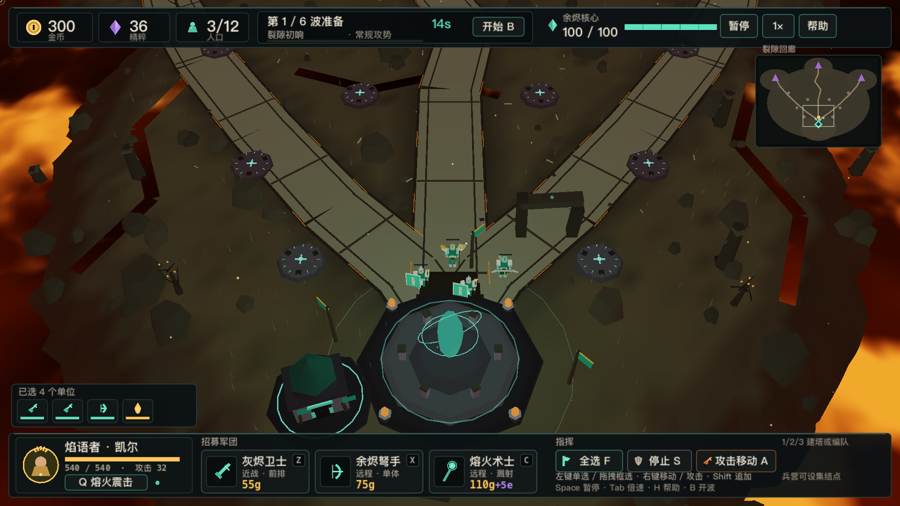
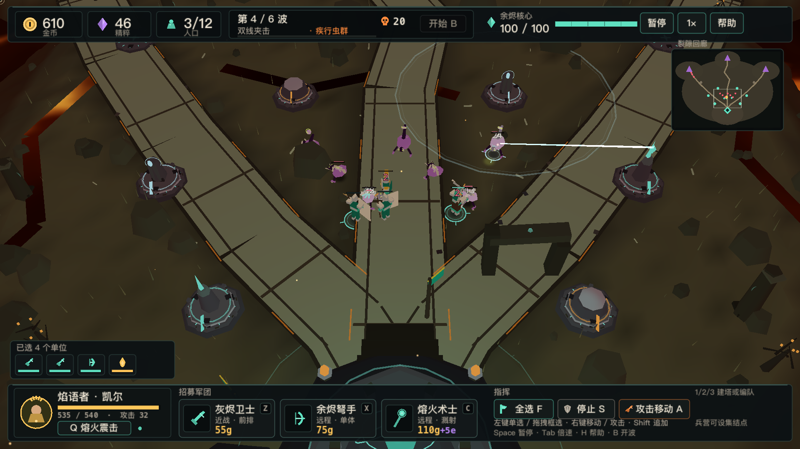
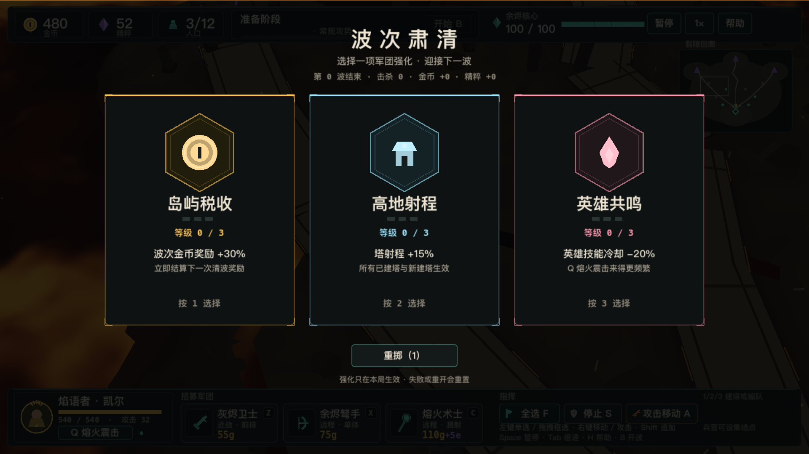
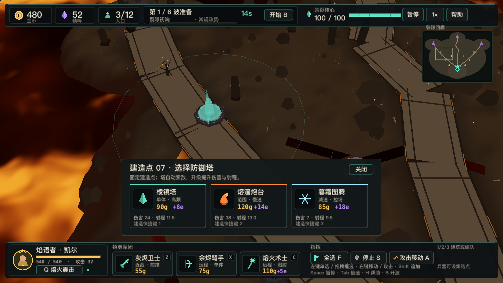
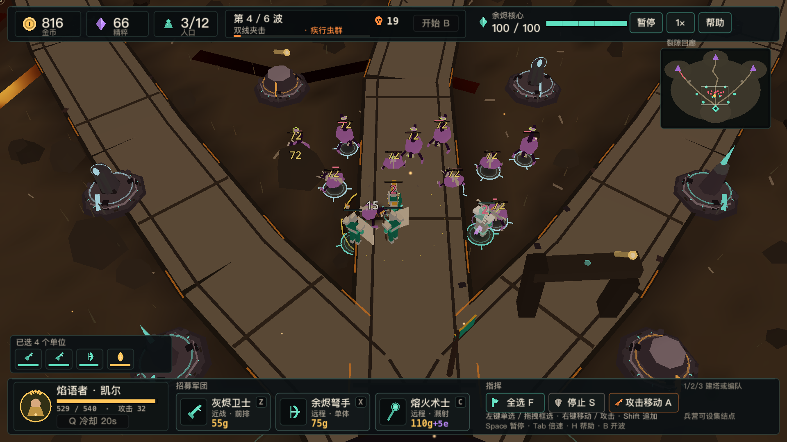
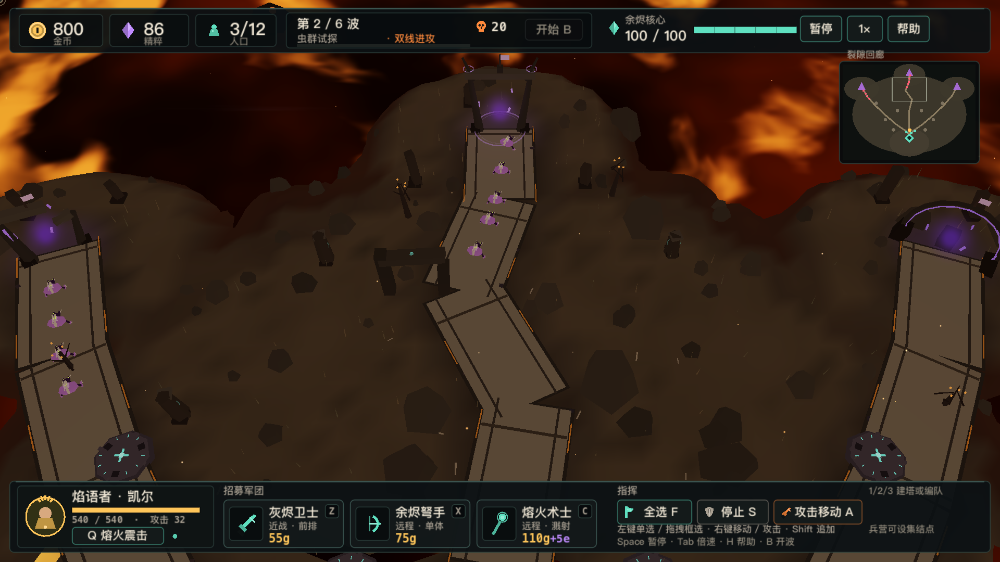
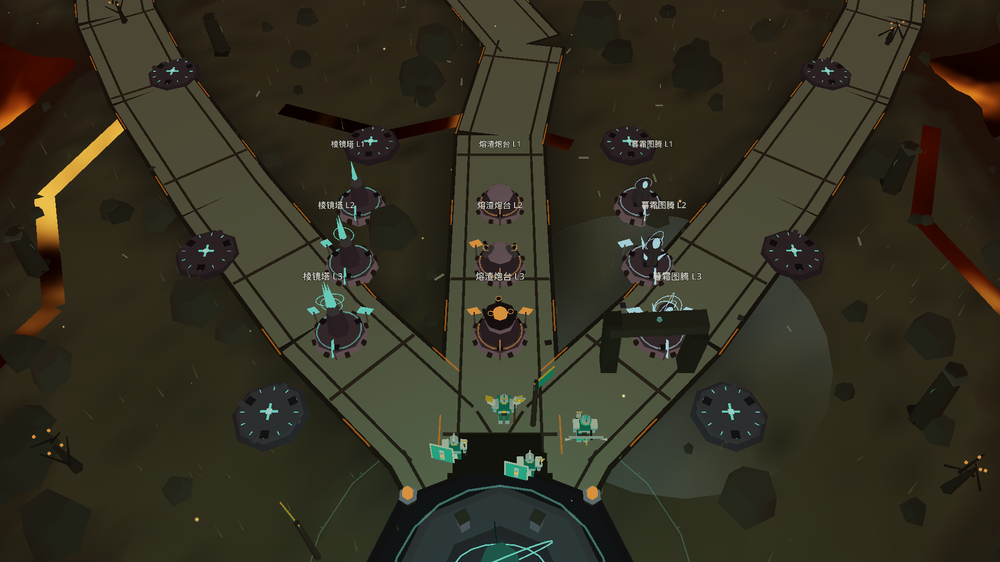
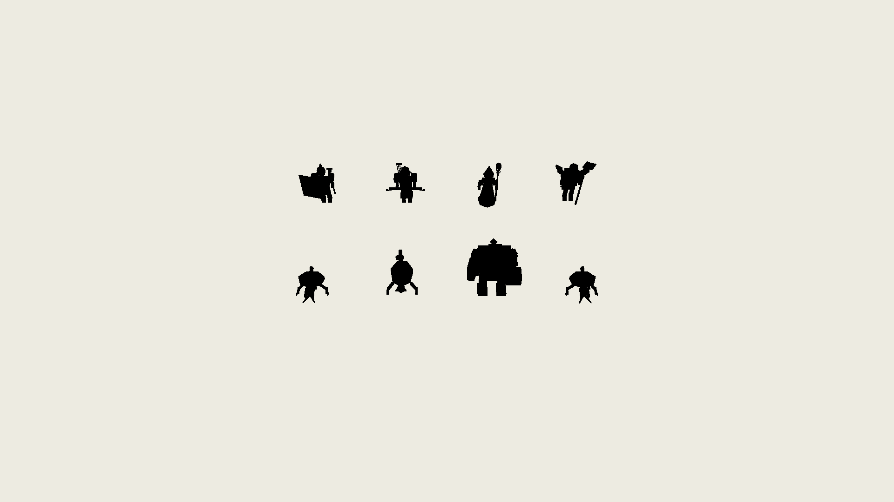
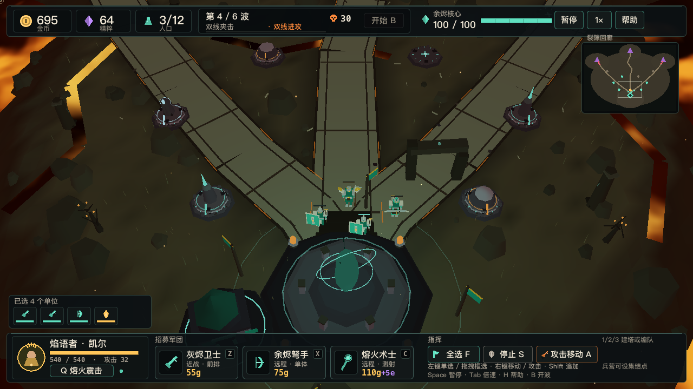

# Legionfall · 军团陨落

一个原创的「塔防 + RTS + 肉鸽」3D 俯视 vertical slice：三线裂隙不断涌出虚空蠕群，你一边框选军团、一边在固定建造点起塔，撑过 6 波，每波结束三选一。

- 引擎：Godot 4.6 stable（`4.6.stable.official.89cea1439`），GL Compatibility
- 设计分辨率：1280×720（`canvas_items` 拉伸）；截图/视频输出 1920×1080
- 主题：原创「余烬荒原 / 三线裂隙 / 灰烬军团」；不使用任何 Warcraft / 《军团塔防》素材、角色、UI、关卡或名称
- 目录：`godot-legion-td/`
- 工作名：Legionfall / 军团陨落（原创）



## 本轮美术 pass（T-20261127-020）

按 T-019 生产 brief 做了第一遍完整美术 pass：4 个玩家角色、3 个原创敌人、3 塔 × Lv1–3、3 种传送门、7m 核心、熔岩荒原/遗迹/石道、VFX 与 HUD 全部重做；所有低模改成按剪影/阵营色设计并用顶点色合并渲染。

- **Draw calls**：727 → **292**（波 4，8 塔；同一基线场景）；1080p **41.1 FPS / P95 29.70ms**，720p **55.6 FPS / P95 22.05ms**。
- **可读性**：玩家职业纯黑剪影 max IoU **0.586**；敌人 vs 地表 L* **Δ22.4**；石道 vs 地表 **Δ17.8**；HUD 面积 **24.8%**；英雄 Q 近白 **0.011%**。
- **证据**：`docs/shots/after/`（18 张 1920/720 PNG（16 截图 + 2 缩略图） + 10s MP4/GIF）；`docs/art-pass-T-20261127-020.md`；`docs/art_check_after.json`；`docs/perf_legion_td_after.json`。
- **仍未过**：峰值场景 639 dc / 25.2 FPS（1080p），需 game-engineer 的 MultiMesh/全局血条/阴影/UI 合批；第 4 敌型需 designer 签字；无骨骼/mocap、LOD、原生 1920 UI。

## 30 秒上手

```bash
# 直接游玩
godot --path godot-legion-td

# 无头逻辑自测（80 项；末行 LEGION_TD_SMOKE_OK）
godot --headless --path godot-legion-td -s tools/smoke_legion_td.gd

# 真实 GPU 1920×1080 截图（18 张 PNG，输出 docs/shots/after/）
godot --path godot-legion-td -s tools/screenshot_legion_td.gd

# 美术读数：L*/对比/过曝/剪影 IoU/HUD/25%+灰度
python3 tools/art_check.py --shots docs/shots/after --ui scripts/legion_ui.gd \
  --out docs/art_check_after.json

# 真实 GPU 性能：720p 窗口 / 1080p SubViewport / peak 压力场景
godot --path godot-legion-td --resolution 1280x720 -s tools/perf_legion_td.gd
LEGION_PERF_1080=1 godot --path godot-legion-td -s tools/perf_legion_td.gd
LEGION_PERF_PEAK=1 LEGION_PERF_1080=1 godot --path godot-legion-td -s tools/perf_legion_td.gd

# 10 秒 1920×1080 帧采集（15 fps，随后用 ffmpeg 编码）
godot --path godot-legion-td -s tools/video_legion_td.gd

# 六波全流程机器人（8 塔 Lv3 + 招募 + 自动三选一）
godot --headless --path godot-legion-td -s tools/probe_legion_run.gd
```

## 核心循环

1. **准备（首波 14s，之后 10s）**：招募军团（Z/X/C），在 8 个固定建造点建塔，设置兵营集结点。
2. **三线防守**：北门 / 西门 / 东门同时来敌；近战、远程、精英与终波熔核巨像走不同石道。
3. **RTS 指挥**：左键单选、拖拽框选、Shift 追加；右键移动或点杀敌人；A + 左键攻击移动；F 全选；S 停止。
4. **波中手忙脚乱**：WAVE 阶段仍可招募、建塔、升级、出售和指挥，不用等下一波。
5. **清波 → 三选一**：每波清空后从 10 个原创强化中随机抽 3 个（可重掷 1 次），只在本局生效。
6. **随机波次修饰**：同一 run seed 固定；精英潮 / 疾行虫群 / 虫群增殖 / 双线进攻 / 嗜血。
7. **胜负**：核心 100 HP 归零失败；守住第 6 波胜利。R 重开，重开换新 seed。



## 内容

### 军团（3 兵种 + 1 英雄）

| 单位 | 定位 | 生命 / 伤害 | 射程 | 价格 | 人口 |
| --- | --- | --- | ---: | --- | ---: |
| 灰烬卫士 | 近战前排 | 170 / 15 | 1.9 | 55g | 1 |
| 余烬弩手 | 远程单体 | 105 / 13 | 8.2 | 75g | 1 |
| 熔火术士 | 远程溅射 2.6m | 120 / 27 | 7.0 | 110g + 5e | 2 |
| 焰语者 · 凯尔 | 英雄 / Q 范围技 | 540 / 32 | 2.5 | 初始 | 0 |

英雄 Q「熔火震击」：9m 内 72 伤害并减速 50% / 2.5s，20s 冷却；阵亡 24s 后在兵营复活。

### 塔与建造点（8 个固定点）

| 塔 | 定位 | 价格 | 伤害 | 射程 | 特殊 |
| --- | --- | --- | ---: | ---: | --- |
| 棱镜塔 | 单体高频 | 90g + 8e | 24 | 11.5 | 0.75s 间隔 |
| 熔渣炮台 | 范围慢速 | 120g + 14e | 38 | 13.0 | 3.4m 溅射 |
| 暮霜图腾 | 减速控场 | 85g + 18e | 7 | 9.5 | 50% 减速 / 2s |

- Lv1 → Lv3：每级 +50% 伤害、+8% 射程、-5% 间隔；升级花费见 `legion_data.gd`。
- 出售返还总投入 60%；固定点不可移动。
- 建造面板打开时按 1/2/3 可直接建对应塔；否则 1/2/3 呼叫编队。

### 敌人与波次

- 裂爪兽（近战）、酸刺虫（7.6m 远程）、熔核巨像（精英，950 HP）。
- 6 波：7 → 13 → 12 → 20 → 17 → 20 基础数量；终波双巨像 + 三线混编。
- 敌人生命/伤害随波次增长；波次修饰由 `seed + wave` 决定，同 seed 可复现。

### 肉鸽强化（10 选 3，局内等级）

军团训练（单位伤害）、坚韧战团（单位生命，含新兵）、疾行军令（移速）、高地射程（塔射程）、熔渣回收（塔伤害）、岛屿税收（波次金币）、精粹涌动（击杀精粹）、英雄共鸣（Q 冷却）、暮霜附魔（所有塔命中减速）、扩编令（人口 +4）。



## 操作

| 输入 | 功能 |
| --- | --- |
| 鼠标左键 | 单选；拖拽框选；Shift 追加/取消 |
| 鼠标右键 | 选中单位移动；点敌人集火；选中兵营时设集结点 |
| A 然后左键 | 攻击移动：沿途自动索敌交战 |
| S / F | 停止警戒 / 全选存活单位 |
| Z / X / C | 招募卫士 / 弩手 / 术士 |
| Q | 英雄熔火震击 |
| 1/2/3 | 空建造点时建塔；否则呼叫编队 |
| Ctrl+1/2/3 | 记录编队 |
| B | 准备阶段立即开波 |
| Space / Tab | 暂停 / 1× ↔ 2× |
| H / Esc | 帮助 / 取消选择或攻击移动 |
| R | 结算画面重开（新 seed） |
| F3 | 显示/隐藏 FPS、draw calls 调试层（正式 HUD 不常驻） |
| 滚轮 / 中键拖拽 / 方向键 / 屏幕边缘 | 缩放 / 平移 / 平移 / 边缘滚动 |

## 真实现场截图（T-020 之后）

| | |
| --- | --- |
|  |  |
|  |  |
|  |  |

- 全部证据与 before/after 对照：`docs/shots/after/README.md`；T-018 原图在 `docs/shots/before/`。
- 结算画面 `07/08` 为真实运行渲染，数字由 debug API 填写为代表性整局值（已在 after/README 披露）。

## 10 秒演示（T-020）

- MP4 1920×1080 / 15fps / 10.000s / 150 帧：`docs/shots/after/legionfall_after_10s.mp4`
- GIF 960×540 / 12fps：`docs/shots/after/legionfall_after_10s.gif`
- 脚本：三门全景 → 空建造点三塔菜单（含幽灵预览）→ 交战 → 英雄 Q → 传送门脉冲 → 三选一。

## 性能（Intel HD Graphics 6000，真实 GPU，vsync off）

| 场景 | 平均 FPS | P95 帧时间 | 最差帧 | Draw calls |
| --- | ---: | ---: | ---: | ---: |
| 1280×720，8 塔 Lv3 + 第 4 波 + 小队 + Q | **55.6** | 22.05 ms | 93.22 ms | 291 / 311 max |
| 1920×1080 SubViewport，同场景 | **41.1** | 29.70 ms | 164.96 ms | 291 / 311 max |
| 峰值 1280×720：44 玩家 + 20 敌人 + 8 塔 Lv3 + Q | 32.0 | 45.59 ms | 105.77 ms | 639 / 666 max |
| 峰值 1920×1080：同场景 | 25.2 | 49.96 ms | 185.86 ms | 639 / 666 max |

- T-018 基线为 727 draw calls / 36.8 FPS @1080p / P95 36.73ms；本轮通过顶点色合并降到 **292 dc**，1080p 平均 **41.1**，720p **55.6**。
- **峰值场景仍超 550 dc 硬上限、1080p <30fps**；需要 game-engineer 的 MultiMesh/全局血条/阴影/UI 合批/LOD。详见 `docs/perf_legion_td_after.json` 与 `docs/art-pass-T-20261127-020.md`。
- 单次 worst 117–250ms 尖峰仍在；perf 前已预热 Q/弹体/命中/冲击材质。截图/视频读回不计入 perf。
- 完整复现见 `docs/TECH.md`。

## 项目结构

```
godot-legion-td/
  project.godot
  scenes/main.tscn
  scripts/
    legion_game.gd        # 主控：输入、经济、波次、胜负、调试 API
    legion_world.gd       # 程序化地形/石道/传送门/核心/建造点/相机
    legion_actor.gd       # RTS 单位、英雄、敌人共用 FSM
    legion_tower.gd       # 三种塔、索敌、升级、出售
    legion_projectile.gd  # 弩矢/火球/酸液/熔渣弹
    legion_art.gd         # 程序化低模、材质、贴图、特效
    legion_mesh_kit.gd    # 顶点色合并器：一个部件 = 一个 ArrayMesh/材质
    legion_data.gd        # 数值、波次、修饰、强化、文案 + 视觉调色板
    legion_ui.gd          # 1280×720 中文 HUD 自绘（1080 = 1.5×）
  tools/
    smoke_legion_td.gd
    probe_legion_run.gd
    perf_legion_td.gd     # 720/1080 + peak 场景 + JSON
    screenshot_legion_td.gd
    video_legion_td.gd
    art_check.py          # L*/对比/过曝/剪影 IoU/HUD/25%+灰度（只读截图）
  docs/
    TECH.md
    迭代记录.md
    art-pass-T-20261127-020.md
    art_check_after.json
    perf_legion_td_after.json
    shots/before/         # T-018 原图
    shots/after/          # T-020 截图 + 10s MP4/GIF
```

## 原创与资产

全部 3D 模型、地形、材质、图标、UI、名称与文案均为本仓库程序化生成 / 新写代码；没有外部图片、GLB、音频或第三方运行时库。运行时只使用系统字体（PingFang SC / Noto Sans CJK 等）并通过 `SystemFont` 引用，不随仓库分发字体文件。参考视频只作为「塔防 + RTS + 每波三选一」抽象机制的研究对象。详见 `CREDITS.md` 与 `docs/TECH.md`。

## 已知限制（T-020 后）

- 美术仍是程序化/简单节点动画，没有骨骼/mocap；idle/walk/attack/death 可读但不是最终表演；滑步未量化。
- **峰值性能未过**：44 玩家 + 20 敌人 + 8 塔时 639 dc / 25.2 FPS（1080p）；需 engineer 的 MultiMesh/全局血条/阴影/UI 合批/LOD。
- 仍是 1280×720 UI 设计 ×1.5，没有原生 1920 画布；12–15px 次要信息在 720 下低于 brief 的严格字号线。
- 第 4 敌型（执灯者）未加入，需 designer 签字；敌人 vs 石道的明度差只有 4.6，灰度下依赖色相/骨甲高光。
- 石道 L*37（brief 目标 49）；核心 30% 裂纹偏暗；单帧尖峰 117–250ms 仍在。
- 平衡未细调：8 座 Lv3 塔 + 10 单位可 100 核心通关 6 波（见 `probe_legion_run.gd`）。
- 寻路是直线移动 + 圆形分离，没有导航网格/绕障；敌人只沿三条固定石道。
- 招募采用「购买小队」即时出兵；兵营用于设置新兵集结点，不包含训练队列。
- 无音频、无存档、无手柄；相机固定 52° 俯角，不能旋转。
- 未经独立 QA / 美术总监复评/真实玩家盲测；截图与数值仅代表本次 worker 自测状态。
