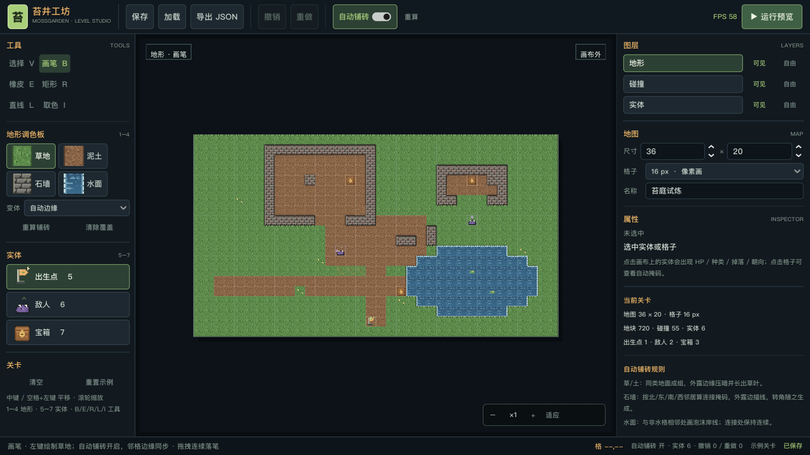
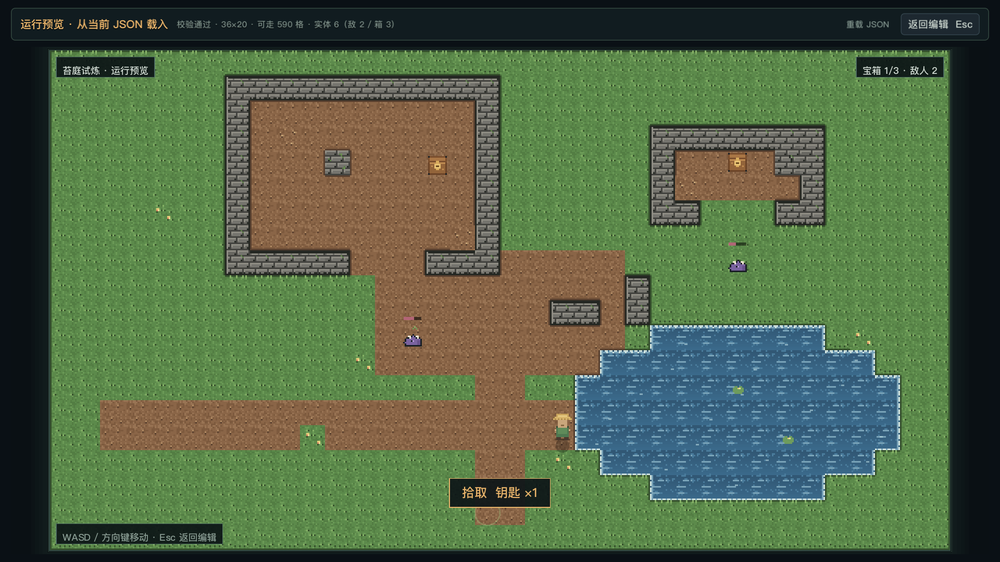

# 苔井工坊 · Mossgarden Level Studio

原创的 2D 关卡编辑器 demo（Godot 4.6 / GL Compatibility）。复刻的是“画结构 → 规则自动铺砖 → 放置实体并配置属性 → JSON 保存/导出 → 运行预览”的编辑工作流，不是 LDtk 克隆：没有使用 LDtk 的源码、素材、品牌、Logo 或 UI 布局。



## 能做什么

- **网格画布**：可调地图尺寸（8–96 格）、格子大小（16/32/48 px）、整数倍缩放 ×1–×4、中键/空格平移、滚轮缩放、网格与坐标、选中与悬停高亮。
- **三层工作区**：地形 / 碰撞 / 实体，支持显示、隐藏、锁定切换。
- **绘图工具**：画笔、橡皮、矩形填充、直线、取色；四类原创程序化瓦片：草地、泥土、石墙、水面。
- **规则自动铺砖**：草地/泥土按“连续地面”算边缘，石墙按四邻连接掩码生成端点/转角/外露描边，水面在与非水相邻处生成泡沫岸线；支持自动铺砖开关、重算、手动变体覆盖与一键清除覆盖。
- **实体与属性**：出生点 / 敌人 / 宝箱，放置、选中、拖动、删除；属性面板编辑种类、HP、伤害、朝向、巡逻半径、掉落类型/数量，全部写入 JSON。
- **编辑体验**：撤销/重做（最多 80 步）、保存/加载编辑器 JSON、导出运行时 JSON、清空、重置示例。
- **运行预览**：把当前导出 JSON 重新解析成可走的小场景；出生点、墙体/碰撞/水面阻挡、宝箱拾取与 HUD 校验。
- **中文 UI + 键鼠快捷键 + 状态提示**；无第三方运行时依赖，所有瓦片、图标和玩家精灵均由 `TileArt` 在运行时程序化生成。

## 运行

```bash
cd godot-level-editor
godot --path .
```

也可以从仓库根目录：

```bash
godot --path godot-level-editor
```

项目逻辑分辨率 1280×720，使用了整数倍像素缩放；窗口可以拉到 1920×1080。首次用 CLI 或 CI 跑（并且没有 `.godot/` 导入缓存）时，可先执行一次：

```bash
godot --headless --path godot-level-editor --import
```

脚本之间使用 `preload` 常量而不是全局类缓存，因此 smoke 在干净工作区也可直接跑。

## 操作

| 操作 | 键鼠 |
| --- | --- |
| 绘制 / 放置 / 选择 | 左键 |
| 平移画布 | 中键拖拽，或空格 + 左键拖拽 |
| 缩放 | 滚轮（以鼠标为中心）、右下 `− / +`、`适应` |
| 工具 | V 选择 · B 画笔 · E 橡皮 · R 矩形 · L 直线 · I 取色 |
| 地形 | 1 草地 · 2 泥土 · 3 石墙 · 4 水面 |
| 实体 | 5 出生点 · 6 敌人 · 7 宝箱 |
| 撤销 / 重做 | Ctrl/Cmd+Z / Ctrl/Cmd+Shift+Z（或 Ctrl/Cmd+Y） |
| 保存 / 加载 / 导出 | Ctrl/Cmd+S / Ctrl/Cmd+O / Ctrl/Cmd+E |
| 运行预览 | F5；Esc 返回编辑 |
| 删除选中实体 | Delete / Backspace |

- 画笔在实体层会变成“放置”；实体层用选择工具拖动、Delete 删除。
- 矩形/直线仅用于地形和碰撞；拖拽期间是范围预览，松开才写入（可撤销）。
- 变体下拉选“自动边缘”以外的项会给新落笔的格子写入手动变体，优先级高于自动掩码；`重算铺砖`保留手动格，`清除覆盖`把全部手动格恢复自动。
- 碰撞层在非激活时只画很淡的提示；激活碰撞层后显示高对比红色斜线，便于检查不可走区域。

## 保存 / 导出

- **保存**：编辑器 JSON（含图层显隐/锁定、`next_entity_id`、自动掩码）。
- **导出 JSON**：运行时 JSON（不含编辑器图层 UI 元数据，格式标记为 `mossgarden.level.runtime`）。
- 默认目录：`user://levels/` 与 `user://exports/`；内置示例在 `res://levels/demo_level.json`。
- 运行时 JSON 会被“运行预览”原样解析，确保“导出即可用”。

字段定义、掩码规则和示例见 [docs/schema.md](docs/schema.md)。

## 自测 / 复现

```bash
# 无界面规则与全链路烟测（末行应为 LEVEL_EDITOR_SMOKE_OK）
godot --headless --path godot-level-editor -s tools/smoke_level_editor.gd

# 1920×1080 真实 GPU 截图（6 张）
godot --path godot-level-editor -s tools/screenshot_level_editor.gd

# 10 秒演示序列（200 帧 @20fps，1280×720）
godot --path godot-level-editor -s tools/capture_level_editor_sequence.gd

# 真实 GPU 帧率探针（关垂直同步）
godot --path godot-level-editor --resolution 1280x720 -s tools/probe_level_editor.gd
```

实测与产物见 [docs/VERIFY.md](docs/VERIFY.md) 和 [docs/迭代记录.md](docs/迭代记录.md)。

## 截图与视频

| 画面 | 文件 |
| --- | --- |
| 编辑器总览 | `docs/shots/01_editor_overview.png` |
| 自动铺砖细节 / 掩码 | `docs/shots/02_autotile_edges.png` |
| 实体属性面板 | `docs/shots/03_entity_properties.png` |
| 矩形工具 + 碰撞层 | `docs/shots/04_rect_tool_collision.png` |
| 运行时 JSON | `docs/shots/05_json_export.png` |
| 运行预览 / 拾取 | `docs/shots/06_preview_walk.png` |
| 10s 视频 | `docs/media/level_editor_10s.mp4` / `.gif` |



## 目录

```
godot-level-editor/
├── project.godot
├── scenes/editor.tscn
├── scripts/
│   ├── level_data.gd        # 数据模型、自动铺砖、实体、JSON schema、示例关卡
│   ├── tile_art.gd          # 原创 16px 瓦片 / 实体图标 / 玩家精灵
│   ├── editor_canvas.gd     # 网格画布、工具输入、平移缩放、选择与预览
│   ├── editor.gd            # 工具栏/调色板/图层/属性/撤销/文件/预览接线
│   └── level_preview.gd     # 运行时 JSON → 可走小场景
├── levels/demo_level.json
├── tools/                   # smoke / 截图 / 演示序列 / FPS 探针 / 示例生成
└── docs/                    # schema / TECH / 迭代记录 / 验收 / 截图 / 视频
```

## 已知边界

- 只有一张内置关卡与一个固定三层结构；不是完整 LDtk（无世界地图、外部 tileset、多关卡、编辑器插件链）。
- 自动铺砖目前只基于四邻，没有 8 邻/随机变体权重；手动变体是视觉覆盖，不改变逻辑地形类型。
- 撤销采用整图快照，96×96 级别仍可用，但大图上不是命令级最优方案。
- 图层显隐/锁定与关卡名属于编辑器会话状态，不进入撤销栈（会随 JSON 保存）。
- 预览是“校验地图”，不是完整玩法；敌人不移动/不战斗，宝箱只做拾取反馈。
- 中文 UI 使用系统字体（PingFang SC / 微软雅黑 / Noto CJK 回退），不随项目分发字体文件。

## 版权

原创代码与程序化美术；未使用 LDtk 的源码或素材，也未包含第三方运行时依赖。参考视频只用于确认工作流，抽帧未进入仓库。详见 [CREDITS.md](CREDITS.md)。
