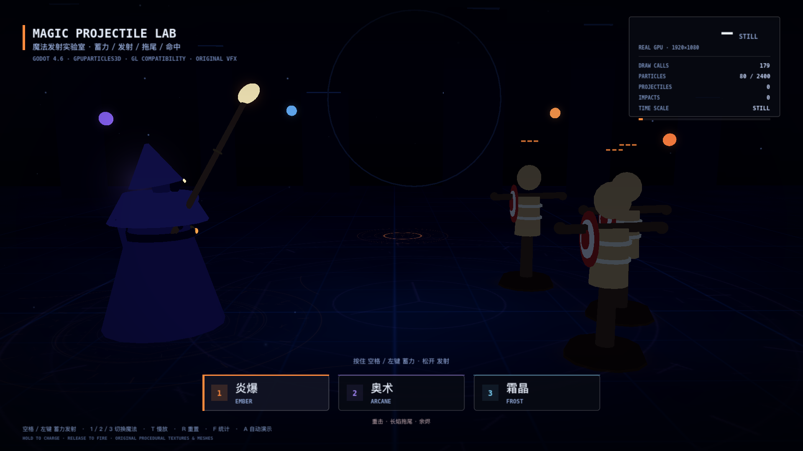
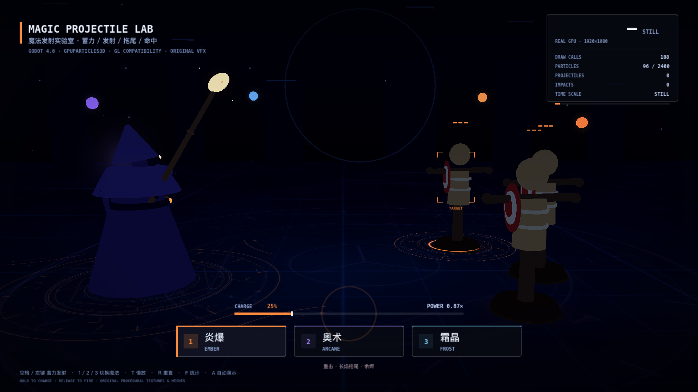
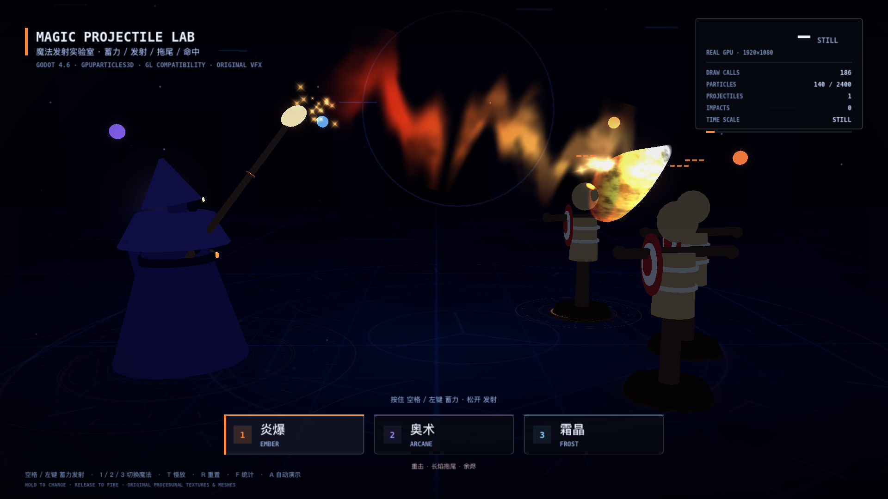
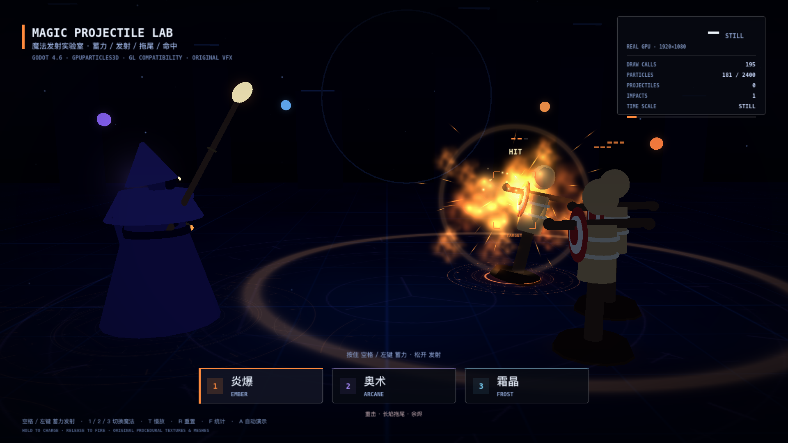
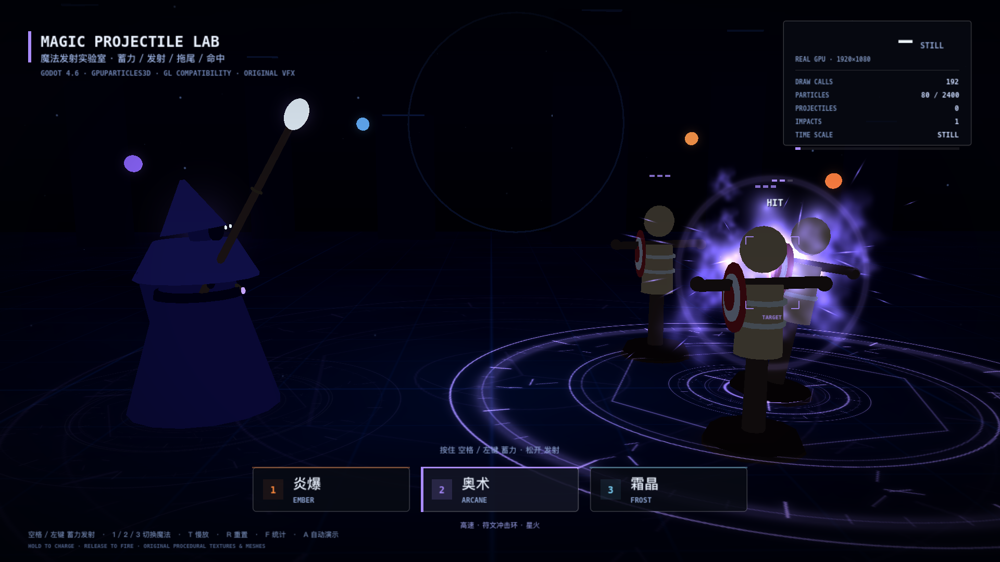
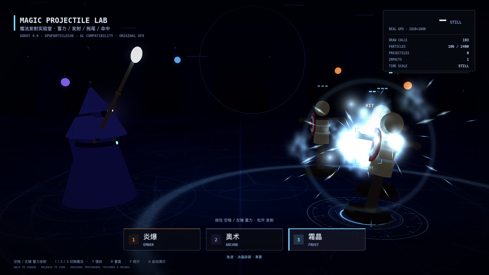
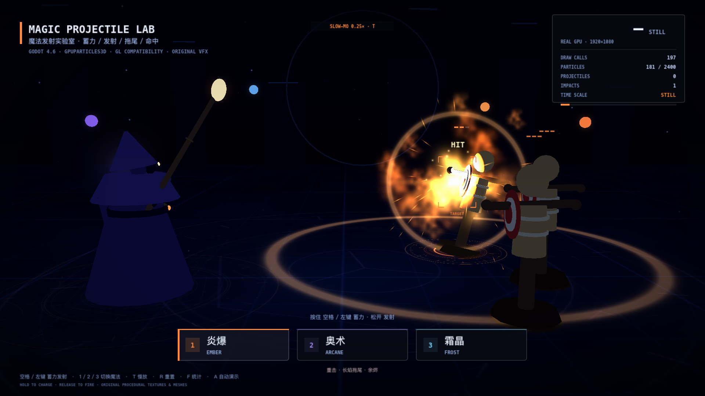
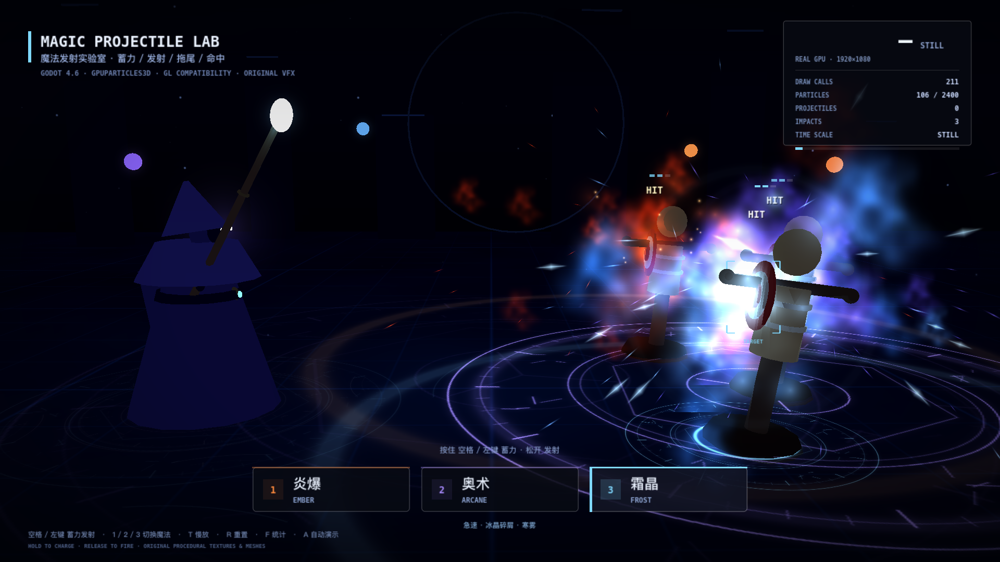

# Magic Projectile Lab · 魔法发射实验室

Godot 4.6（GL Compatibility）的 3D 魔法发射特效 demo。按 B 站中配教程《Godot Particles 魔法发射特效教程！》所展示的**特效构成**复刻并扩展为可交互 demo：
教程原出处为 **Le Lu — “Godot 4 · Magic Projectile VFX (Fireball)”，VFX for Games 系列第 11 集**（YouTube `74XywaLGO5Q`；B 站中配 `BV1v7sn6UEnu`，UP 双雷交火）。技术拆解与差异见 [docs/TECH.md](docs/TECH.md)，素材/教程署名见 [CREDITS.md](CREDITS.md)。

> 原创声明：本项目中**没有**使用教程或视频的任何贴图、模型、角色或素材。全部贴图由 `tools/gen_assets.py` 程序化生成，网格由 GDScript 程序化构建。

---

## 运行

```bash
cd godot-magic-vfx
godot --path .
```

- 引擎：Godot **4.6 stable**，渲染器 **GL Compatibility**（Intel HD 4000/6000 可跑）。
- 逻辑分辨率 1280×720，窗口可拉伸到 1920×1080；HUD 按视口等比缩放。
- 项目无外部依赖、无音频、无联网；首次打开会导入 14 张原创 PNG。

## 操作

| 输入 | 行为 |
| --- | --- |
| 按住 **空格** / **鼠标左键** | 开始蓄力（法阵、聚能粒子、法杖抬升）；左下显示 CHARGE / POWER |
| 松开 | 发射当前魔法；依据蓄力值决定力度（0.76×–1.35×） |
| 鼠标移动 / 左键 | 瞄准（默认鼠标指向；靠近木桩会锁定，空格会优先选择最近木桩） |
| **1 / 2 / 3** | 切换 炎爆 EMBER / 奥术 ARCANE / 霜晶 FROST |
| **T** | 慢放 0.25×（再次按下恢复） |
| **R** | 重置：清空所有飞行物/命中/粒子，木桩复原 |
| **F** | 展开/收起详细统计（FPS、帧耗、Draw Calls、粒子数、弹体/命中数、时间倍率） |
| **A** | 开/关自动演示（闲置 14 s 后也会自动开始） |
| **Esc** | 取消蓄力；未蓄力时退出 |

木桩 3 点生命，3 次命中后倒下，3.4 s 后自动重建；同一时间可有多枚弹体。

## 特效链路

```
蓄力（法阵 + 聚能粒子 + 晶石增亮）
  → 发射（法杖闪光 + 后坐 + 枪口爆发）
  → 飞行（火焰头网格 + 扫描贴图 + 火焰平面拖尾 + 火星 + 动态点光）
  → 命中（闪核 + 冲击环 + 火焰/火星/余烬 + 木桩受击/击退/闪白）
  → 余辉（地面焦痕、余烬、光照 2 ~ 3 s 衰减）
```

三种魔法：

- **炎爆 EMBER**：橙金长焰，重击，命中留下余烬与地面焦痕。
- **奥术 ARCANE**：紫青高速弹，命中留下旋转符文环。
- **霜晶 FROST**：冰蓝晶刺，命中迸发冰晶与寒雾。

## 截图 / 视频 / 测试 / 性能

```bash
# 真实 GPU 1920×1080 截图（10 张，输出到 docs/shots/）
godot --path . -s tools/screenshot_magic_vfx.gd

# 重录 10 s 演示视频并生成 MP4 + GIF（1280×720@30fps 录制）
tools/build_media.sh

# headless 自测（末行 MAGIC_VFX_SMOKE_OK）
godot --headless --path . -s tools/smoke_magic_vfx.gd

# 性能采样（720p / 1080p 离屏；含同进程最小基准，见 docs/TECH.md §7）
godot --path . -s tools/perf_magic_vfx.gd
godot --path . -s tools/perf_magic_vfx.gd -- --1080
```

预览（真实 GPU，1920×1080）：

| | |
| --- | --- |
|  |  |
|  |  |
|  |  |
|  |  |

- 视频：`docs/magic_vfx_demo.mp4`（10.9 s，30 fps，1280×720）
- GIF：`docs/magic_vfx_demo.gif`
- 全部 1920×1080 截图：`docs/shots/01_overview.png` … `10_combo_impacts.png`

## 文件结构

```
godot-magic-vfx/
├─ project.godot             Godot 4.6 / GL Compatibility / 1280×720
├─ scenes/main.tscn          单场景，节点在运行时程序化构建
├─ scripts/
│  ├─ main.gd                状态机、输入、瞄准、弹体/命中调度、相机震动、光照池
│  ├─ spell_data.gd          三系魔法的色板/速度/粒子参数表
│  ├─ caster.gd              原创法师（几何体拼装）、蓄力/施法动画、法阵
│  ├─ projectile.gd          程序化火焰头网格 + 拖尾 + 粒子 + 飞行
│  ├─ trail_quad.gd          缓存的滚动火焰四边形拖尾（无逐帧网格重建）
│  ├─ impact_fx.gd           命中包：闪核/冲击环/火焰/火星/烬/烟/符文/寒雾
│  ├─ dummy.gd               原创木桩：受击弹簧、闪白、击倒、重建
│  └─ hud.gd                 1280×720 逻辑 HUD（1080p 自动 1.5×）
├─ shaders/                  头部/拖尾/地面/法阵/背景/暗角（GLSL 兼容写法）
├─ assets/textures/          14 张原创程序化 PNG + MANIFEST.json
├─ tools/                    贴图生成、smoke、截图、录像、性能、验证脚本
└─ docs/                     TECH / 迭代记录 / 截图 / 视频
```

## 粒子与性能预算

| 系统 | amount | lifetime | 说明 |
| --- | ---: | ---: | --- |
| 环境尘埃 | 80 | 12 s | 常驻，低成本 |
| 蓄力聚能 | 48 | 0.7 s | 蓄力时 |
| 枪口爆发 | 18 | 0.35 s | 单次 |
| 弹体火星 | 40 | 0.55 s | 飞行时 |
| 弹体火团 | 16 | 0.55 s | 飞行时 |
| 命中火焰 | 22 | 0.62 s | 单次 |
| 命中火星 | 36 | 0.8 s | 单次 |
| 命中火核 | 26 | 0.55 s | 单次 |
| 余烬 | 14 | 1.7 s | 炎爆单次 |

按“同屏 3–4 个命中 + 1–2 个弹体 + 蓄力”的典型情况估算约 **500–900 活跃粒子**，软预算 **2,400**，HUD 实时显示 `PARTICLES n / 2400`。所有瞬态 FX 有 TTL 兜底清理（见 TECH §6）。

> 性能现状（如实）：本机 2026-11-22 测量，空闲 720p ~45–58 FPS；发射/命中时出现 0.3–2 s 的 GL 驱动级停顿，普通连发未达到 30 FPS。已做 quad 拖尾、资源缓存、光源池化、MSAA 关闭、粒子减半；剩余瓶颈与 handoff 见 [TECH §7](docs/TECH.md)。验收时请勿用本机在 load 8–22 下的绝对 FPS 作结论。

## 许可 / 来源

见 [CREDITS.md](CREDITS.md)。Godot Engine 为 MIT；本仓库内的贴图/网格/代码均为本次原创，教程仅作为技术参考，未复制其素材。
