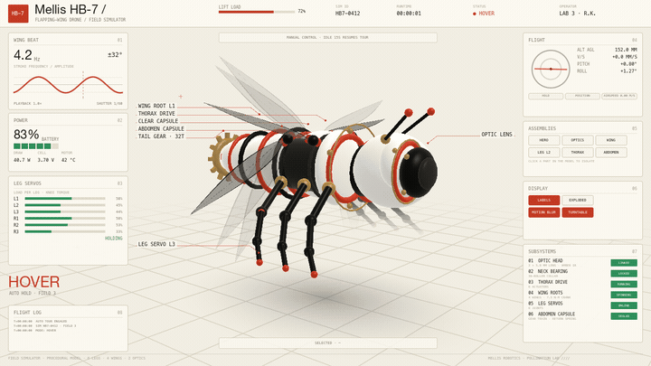

# Mellis HB-7 · Godot 3D Teardown Study

一台可以在浏览器之外拆开的机械蜂：**爆炸视图、零件隔离、引线标签、自动巡览**，
四周仪表与中间的运动由**同一个纯函数求解器**驱动，数字不会和动作打架。
Godot 4.6 / GDScript，1280×720，**GL Compatibility**。



> 视频版：`docs/mech_bee.mp4`（9 秒，1280×720）。
> 参考：开源项目 [elvarofficial/teardown](https://github.com/elvarofficial/teardown)（MIT）
> 里的 Mellis HB-7 机械蜂示例；本工程是 **Godot 版净室复刻**，没有使用原项目代码或素材。

## 运行

```bash
godot --path godot-mech-bee
```

- Godot 4.6（实测 `4.6.stable.official.89cea1439`）。
- 首次运行需导入：`godot --headless --path godot-mech-bee --editor --quit`。
- 无第三方运行时依赖；所有几何、贴图、HUD 均在运行时程序化生成。

## 操作

| 输入 | 作用 |
| --- | --- |
| 鼠标拖拽 | 环绕相机 |
| 滚轮 | 缩放 |
| 点击零件 | 选中 + 高亮 + 显示标签 |
| `I` | 隔离 / 释放选中零件 |
| `H` / `B` | HOVER / BANKING |
| `E` / `R` | TEARDOWN / REASSEMBLY |
| `L` / `T` | 标签 / 转台 |
| `Space` | 暂停 / 继续 |
| `Esc` | 取消选中与隔离 |

- **自动巡览**：状态每 5.5s 切换一次，零件高亮每 2.2s 轮换；任何输入接管后，
  静置 15s 自动恢复。
- 右侧 `ASSEMBLIES` 点击可直接把某个部件拉近并隔离；`DISPLAY` 控制标签、爆炸、运动残影、转台。

## 已实现

- **17 个可拆零件**：头/光学镜头/胸/腹部两段/尾齿轮/透明舱 + 4 翼 + 6 腿。
- **爆炸与回装**：每件有独立位移方向与级联延迟；TEARDOWN 全拆，REASSEMBLY 回装，
  ABDOMEN / THORAX / WING OFF 只动对应子系统。
- **单求解器遥测**：翼频、电池、功耗、6 路舵机负载、姿态、升降、飞行日志全部来自
  `mech_solver.gd`；翼摆、机身俯仰/滚转、腿部微动也读同一组值。
- **程序化模型**：球/圆柱/圆环/盒子拼装；翅膀纹理由 GDScript 逐像素生成；
  暖纸色 HUD 用 `StyleBoxFlat` + 自绘表盘/波形。
- **GL Compatibility 友好**：3D 材质用 **unshaded 假棚拍光照**（固定光向 + 环境 + 边缘光），
  不依赖 GPU 点光/阴影，Intel 核显也能稳定出图。

## 验证

```bash
bash tools/verify.sh
# MECH_SMOKE_OK parts=17 moved=17
```

截图（需要真实 GPU / 窗口）：

```bash
godot --path godot-mech-bee --resolution 1280x720 -s tools/screenshot_mech.gd
# -> docs/shots/{01_hover,02_teardown,03_isolate,04_banking,05_thorax_open}.png
```

录 GIF / MP4：

```bash
godot --path godot-mech-bee --resolution 1280x720 -s tools/capture_mech_gif.gd
ffmpeg -framerate 20 -i /tmp/mech_gif/frame_%03d.png -vf "fps=12,scale=720:-1:flags=lanczos,split[a][b];[a]palettegen=max_colors=128[p];[b][p]paletteuse=dither=bayer:bayer_scale=3" -loop 0 docs/mech_bee.gif
ffmpeg -framerate 20 -i /tmp/mech_gif/frame_%03d.png -c:v libx264 -pix_fmt yuv420p -crf 20 -movflags +faststart docs/mech_bee.mp4
```

## 代码落点

| 文件 | 作用 |
| --- | --- |
| `src/main.gd` | 场景、相机、输入、状态机、自动巡览、截图/时间步 |
| `src/mech_solver.gd` | 纯函数求解器：运动 + 遥测 + 子系统状态 |
| `src/mech_model.gd` | 程序化机械蜂、材质、翅膀纹理、爆炸/隔离/高亮 |
| `src/mech_hud.gd` | 暖纸色 HUD、波形/姿态/负载、按钮与日志 |
| `src/labels_overlay.gd` | 3D→2D 投影标签与引线 |
| `shaders/mech_surface.gdshader` | 固定棚拍光（unshaded） |
| `shaders/wing.gdshader` | 翅膀膜/叶脉 + 残影透明度 |
| `shaders/grid_ground.gdshader` | 场地网格 + 边缘淡出 |

更细的拆解见 [`docs/TECH.md`](docs/TECH.md) 与 [`docs/迭代记录.md`](docs/迭代记录.md)。
