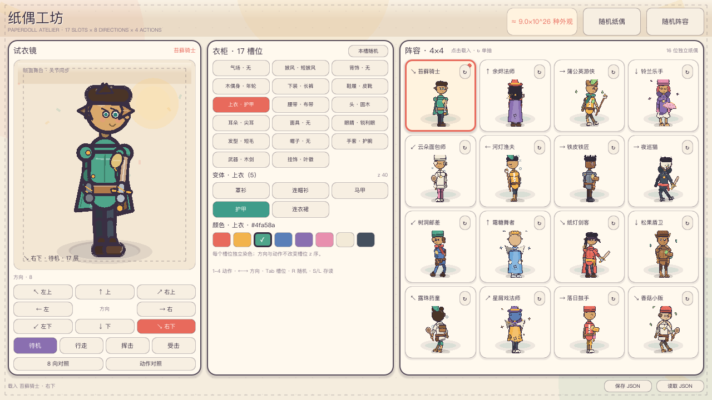

# 纸偶工坊 · Paper Doll Atelier

Godot 4.6 / 2D / GL Compatibility / 1280×720 的原创纸偶换装与 4×4 阵容演示。
全部角色、服装、武器与界面绘制均由 GDScript 程序化生成，不依赖任何外部贴图或第三方运行时库。



## 能玩什么

- **17 个独立槽位**：气场、披风、背饰、木偶身、下装、鞋履、上衣、腰带、头、耳朵、面具、眼睛、发型、帽子、手套、武器、挂饰。
  - 共 **83 套变体**，每槽 **8 色独立 tint**，组合空间约 `9.0×10^26`。
  - 槽位拥有固定 z 序；背面朝向会翻转披风 / 背饰 / 武器的层级。
- **8 方向**：下、左下、左、左上、上、右上、右、右下。美术固定朝右绘制，左侧由节点镜像。
- **4 个动作**：待机、行走、挥击、受击。共享一套脊柱 / 双臂双骨链 / 双腿双骨链，换装与换向不脱节。
- **换装 UI**：槽位选择、变体切换、色板染色、本槽随机、整只随机、实时试衣镜。
- **16 个预设角色**：`presets/lineup_16.json` 载入为 4×4 阵容；点击卡片载入试衣镜，↻ 单抽该位。
- **保存 / 读取**：把当前 17 槽组合、方向、动作写为 JSON（默认 `user://paperdoll_outfit.json`）。
- **对照页**：8 方向对照、4 动作对照，均为烘焙静态快照。

## 操作

| 操作 | 说明 |
| --- | --- |
| 鼠标 | 点击槽位 / 变体 / 色块 / 方向 / 动作 / 阵容卡 |
| `1`–`4` | 待机 / 行走 / 挥击 / 受击 |
| `←` `→` | 上一个 / 下一个方向 |
| `Tab` | 循环槽位 |
| `R` | 随机整只纸偶 |
| `S` / `L` | 保存 / 读取当前组合 |
| `Esc` | 关闭对照页；无弹层时退出 |

## 运行

```bash
godot --path godot-paper-doll --resolution 1280x720
```

项目固定 1280×720、GL Compatibility、`canvas_items` 拉伸，默认 60 FPS。

## 验证

```bash
# 1. 启动无脚本错误（600 帧）
godot --path godot-paper-doll --headless --quit-after 600

# 2. 数据 / 方向 / 动作 / z 序 / 存档 / 烘焙缓存
godot --path godot-paper-doll --headless -s tools/smoke_paperdoll.gd

# 3. 真机 1280×720 截图（6 张，写入 docs/shots/）
godot --path godot-paper-doll --resolution 1280x720 -s tools/screenshot_paperdoll.gd

# 4. Intel 集显帧率（要求 ≥30）
godot --path godot-paper-doll --resolution 1280x720 -s tools/perf_paperdoll.gd

# 5. 一键验收
bash godot-paper-doll/tools/verify.sh
```

预期关键标记：

```text
PAPERDOLL_SMOKE_OK slots=17 variants=83 dirs=8 actions=4 presets=16 cards=16 baked_cards=16 ...
PAPERDOLL_SHOTS_OK
PAPERDOLL_FPS_OK min=...
PAPERDOLL_VERIFY_OK
```

## 媒体

- 截图：`docs/shots/01_studio.png`、`02_wardrobe.png`、`03_actions.png`、`04_directions.png`、`05_lineup.png`、`06_saved.png`
- 演示视频：`docs/paperdoll.mp4`（H.264，约 8.5 s）
- 动图：`docs/paperdoll.gif`（同片段，便于聊天工具预览）
- 重新录制：`bash tools/record_paperdoll.sh`

## 性能

Intel HD Graphics 6000、1280×720、GL Compatibility 实测 **35–55 FPS**（`PAPERDOLL_FPS_OK`）。
关键优化：

1. 4×4 阵容与对照页使用 `DollThumbnail`：SubViewport 烘焙一次后关闭渲染；
2. 纸偶的数百条填充 / 描边合并为一次三角形数组提交；
3. 试衣镜以 24 Hz 重绘（定格木偶质感），画面仍按显示器帧率合成；
4. 卡片按 17 槽外观签名缓存，避免无意义重烘焙。

详见 [docs/TECH.md](docs/TECH.md) 与 [docs/迭代记录.md](docs/迭代记录.md)。

## 目录

```text
scenes/main.tscn              主场景（纯脚本建 UI）
scripts/main.gd               状态、UI、存档、对照弹层、验收 API
scripts/doll/doll_data.gd     17 槽 / 变体 / 色板 / 8 向 / 4 动作 / z 序 / JSON
scripts/doll/doll_pose.gd     关节与动作曲线
scripts/doll/doll_renderer.gd 单纸偶渲染、翻转、镜像、三角形批次
scripts/doll/draw_kit.gd      程序化画笔与三角形批处理
scripts/doll/paint_*.gd       木偶 / 布料 / 道具绘制
scripts/ui/                   主题、试衣镜舞台、阵容卡、烘焙缩略图
presets/lineup_16.json        16 个原创预设
tools/                        smoke / screenshot / perf / record / verify
docs/shots/                   真机截图
```

## 版权

全部美术为原创程序化绘制；不包含《一个木头人，怎么变成16个角色》或任何第三方角色素材、UI、名称。
字体使用系统字体（PingFang SC / Noto Sans CJK 等），不随项目分发。详见 [assets/CREDITS.md](assets/CREDITS.md)。
