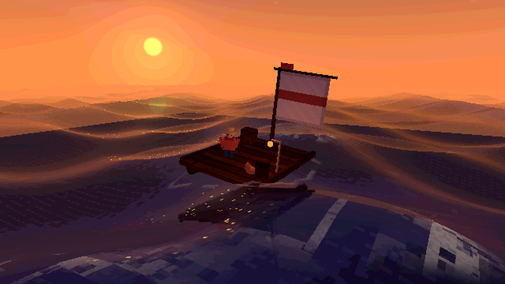

# Pixel Ocean · 像素海

Godot 4.6（GL Compatibility）的海面 + 木筏效果研究。窗口 1280×720；3D 世界先渲染到
640×360 的 SubViewport，再用最近邻放大 2×，HUD 直接画在 1280×720 上保持文字清晰。

灵感来自 B 站视频《我做了一个很酷的效果》（BV1ehsm69EnT，大肥鱼的开发日记）公开的
配方与视觉语言。**没有使用视频的任何画面、素材或工程文件**；代码、shader、木筏/角色
模型和贴图全部由本工程程序化生成。



## 运行

```bash
godot --path godot-pixel-ocean
# 或在编辑器里打开：
godot --editor --path godot-pixel-ocean
```

要求 Godot 4.6；渲染器为 GL Compatibility；无第三方运行时依赖、无外部模型/贴图。

## 操作

| 输入 | 作用 |
| --- | --- |
| 鼠标左键拖拽 | 绕木筏旋转相机 |
| 滚轮 | 缩放（4.5–26 单位） |
| `1` / `2` / `3` | 正午 / 晚霞 / 夜 预设 |
| `↑` / `↓` | 波高 ±0.1 |
| `←` / `→` | 浪向 ±10° |
| `R` | 倒影开/关 |
| `F` | 泡沫弱/强 |
| `T` | 透明循环 |
| `G` | 碎金 sparkle 开/关 |
| `O` | 显示/隐藏 5 点浮力采样标记 |
| `H` | 显示/隐藏参数面板 |
| `Space` / `P` | 暂停/继续波浪 |
| `C` | 相机复位 |

左上角面板可调：波高、浪向、泡沫、透明、倒影、碎金、时间（0–24h 连续调色）、
5 点浮力采样、暂停波浪。相机静止约 5 秒后自动缓慢环绕；拖拽会立即接管。

## 视频配方对照

| # | 视频配方 | 本工程实现 |
| --- | --- | --- |
| 1 | 一张网 | `PlaneMesh` 140×140，220×220 顶点细分（48,841 顶点），世界坐标位移 |
| 2 | 叠几道浪 | 3 道不同方向/波长/速度/陡度的波叠加 |
| 3 | 拉长 + 拧弯 + 浪群 | 采样坐标 x 压缩（`stretch`）、低频 sin 相位弯曲、低频浪群振幅包络 |
| 4 | 浪尖挤尖 | Gerstner 式水平位移；水平 Jacobian < 1 越强，浪越尖 |
| 5 | 木筏五点 | 中心 + 四角取水面高度；平均定 y、前后差定俯仰、左右差定横滚 |
| 6 | 像素水纹 | 世界网格内两层滚动短横线 + 4 档受光色 + 像素 dither + 受限色阶 |
| 7 | 上色/逆光 | 深/中/亮/浪尖四色阶梯；朝太阳浪面更亮，逆光浪脊透亮 |
| 8 | 白沫 | Jacobian 压缩阈值 + 坡度 + 低频斑块；木筏边缘一圈圆角矩形 SDF 泡沫 |
| 9 | 夜晚/晚霞 | 时间 0–24h 调色板插值；太阳高度/颜色/环境光/星空/云带一并变化 |
| 10 | 镜面/倒影 | 320×180 SubViewport 共享 World3D 的镜像相机，水面按屏幕 UV 采样 |
| 11 | 碎金 | 窄太阳高光带 + 稀疏金色 sparkle（世界网格哈希 + 时间闪烁） |
| 12 | 透明 | 水材质 alpha 混合；fresnel 控制观感，面板“透明”滑杆可调 |

## 可调参数

| 参数 | 默认 | 范围 | 说明 |
| --- | --- | --- | --- |
| 波高 `wave_height` | 1.15 | 0–2.0 | 三道波总振幅倍率 |
| 浪向 `wave_direction` | 0° | -180–180° | 三道波共同旋转 |
| 泡沫 `foam_amount` | 0.85 | 0–1.6 | 浪尖白沫与筏边泡沫强度 |
| 透明 `transparency` | 0.22 | 0–1 | 0 不透明，1 最透明（映射 opacity 1.0→0.48） |
| 倒影 `reflection_strength` | 0.90 | 0–1 | 0 关闭反射视口 |
| 碎金 `sparkle_amount` | 1.10 | 0–1.6 | 金色闪光密度 |
| 时间 `time_of_day` | 18.4h | 0–24h | 天空/海水/太阳/夜光/灯笼 |

波形内部参数（`scripts/ocean.gd`、`shaders/water.gdshader` 两边一致）：
chop 0.85、stretch 0.35、grouping 0.55、wave_speed 1.0。
三道波：波长 15 / 7 / 4.6，相对方向 -0.38 / +0.72 / +1.90 rad，振幅 0.62 / 0.30 / 0.16。

## 验收 / 工具

```bash
./tools/verify.sh           # 导入 + headless smoke + 600 帧启动 + GPU 截图
./tools/verify.sh --probe   # 追加 vsync-off FPS 探针

godot --headless --path . -s tools/smoke_pixel_ocean.gd
godot --path . --resolution 1280x720 -s tools/screenshot_pixel_ocean.gd
godot --path . --resolution 1280x720 -s tools/probe_pixel_ocean.gd
./tools/build_media.sh      # 重新渲染 9s 帧序列并编码 mp4/gif
```

最近一次自测（本机 Intel HD Graphics 6000，1280×720，关闭垂直同步）：

- `PIXEL_OCEAN_SMOKE_OK`；
- `--quit-after 600` headless 启动无 `SCRIPT ERROR` / `ERROR:`；
- 9 张 GPU 截图写入 `docs/shots/`（`PIXEL_OCEAN_SHOTS_OK`）；
- 默认设置（640×360 内部分辨率 + 倒影开）平均 **92.2 FPS / 最低 58 FPS**；
  关倒影平均 128.8 FPS；约 104,604 图元 / 88 draw calls；
- `docs/pixel_ocean.mp4`（1280×720，9.0s，15fps）与 `docs/pixel_ocean.gif`
  （800×450，9.0s，12fps，96 色）。

## 目录

```
godot-pixel-ocean/
├─ project.godot                 1280×720 / GL Compatibility / nearest 2D
├─ scenes/main.tscn              640×360 WorldViewport + TextureRect 放大 + HUD
├─ scripts/
│  ├─ main.gd                    世界搭建、昼夜调色、镜像相机、参数入口、按键
│  ├─ ocean.gd                   网格/波形 uniform/CPU 五点采样
│  ├─ raft.gd                    木筏/水手/猫/灯笼、五点浮力、调试标记
│  ├─ orbit_camera.gd            轨道相机
│  └─ hud.gd                     参数面板（SystemFont 中文）
├─ shaders/
│  ├─ water.gdshader             3 波位移、像素水纹、泡沫、倒影、碎金、透明
│  ├─ sky.gdshader               天穹渐变/太阳/云带/星点
│  └─ seabed.gdshader            海床沙色 + 像素焦散
├─ tools/                        smoke / 截图 / GIF 帧 / FPS / verify / media
├─ docs/
│  ├─ TECH.md                    实现与数学细节
│  ├─ 迭代记录.md                视觉迭代与修复过程
│  ├─ shots/                     9 张 GPU 实拍
│  ├─ pixel_ocean.mp4
│  └─ pixel_ocean.gif
└─ assets/CREDITS.md             原创声明与参考说明
```

## 已知限制

- 平面倒影为 320×180 镜像相机近似，没有斜裁剪面；贴近水面的物体可能轻微漏出。
- 水面是 alpha 混合、不写深度，没有折射/水深吸收/水下雾；透明只混合海床颜色。
- 无实时阴影、SSR、泛光；为 Intel 集显与像素风做的取舍。
- 泡沫/碎金/云/星都是程序化像素近似，不追求物理正确。
- HUD 中文依赖系统 CJK 字体（macOS 自带 PingFang；Linux 需安装中文字体）。
- 截图/视频工具需要真实 GPU 窗口，`--headless` 只能跑 smoke/逻辑断言。

## 许可与致谢

见 [assets/CREDITS.md](assets/CREDITS.md)。参考视频仅用于学习效果配方与视觉语言，
本项目与视频作者无隶属关系。
