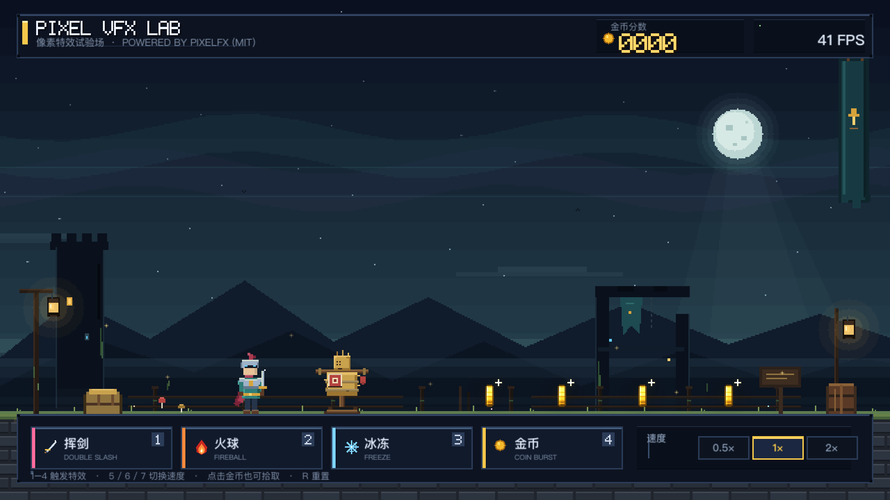

# Pixel VFX Lab · 像素特效试验场

用 [PixelFX](https://github.com/patch-gg/pixelfx)（MIT）的透明 sprite sheet，在 **Godot 4.6** 里做的可交互像素特效 playground：**挥剑、火球、冰冻、捡金币**。场景、木桩、骑士、HUD 均为原创代码绘制；PixelFX 只提供导出后的特效帧。



> 四组特效各一段 + 连招的 10 秒演示：[`docs/pixel_vfx_demo.mp4`](docs/pixel_vfx_demo.mp4) · [`docs/pixel_vfx_demo.gif`](docs/pixel_vfx_demo.gif)

## 运行

需要 **Godot 4.6**（GL Compatibility）与 **ffmpeg**（仅在重新生成媒体时需要）。

```bash
godot --path godot-pixel-vfx
```

首次启动会导入 `assets/pixelfx/*/*.png`。窗口逻辑分辨率 1280×720；世界以 640×360 渲染后按 2×（720p）/ 3×（1080p）整数放大，最近邻采样。

## 操作

| 输入 | 作用 |
|---|---|
| `1` / 点击「挥剑」 | 双斩：命中停顿 0.08 s、2 px 轻震、伤害数字；0.833 s 后清理 |
| `2` / 点击「火球」 | 火球投射物 → 命中爆炸（截取前 2.2 s）+ 灼烧染色 3 s + 伤害数字 |
| `3` / 点击「冰冻」 | 冻结冰晶 4.033 s，木桩蓝色 tint、状态条与 HUD 倒计时 2.9 s |
| `4` / 点击「金币」 | 一次拾取全部金币：+10/枚、collect burst（45 ms 错峰）、分数更新、2.6 s 后重生 |
| `5` / `6` / `7` | 速度 0.5× / 1× / 2×（按钮同样可点） |
| 点击金币 | 单独拾取一枚 |
| `R` | 重置分数、金币、状态和所有特效 |

## 效果与帧数据

| 组 | PixelFX id | 帧数 | 时长 | 运行时行为 |
|---|---|---|---|---|
| 挥剑 | `melee/double-slash` | 25 | 0.833 s | 一次命中判定（12–18 伤害）+ 命中停顿 |
| 火球 | `fire/fireball` + `explosions/small-explosion` | 36 循环 / 163 | 1.2 s / 5.433 s | 飞行 0.35 s，爆炸只播 2.2 s，灼烧 3.0 s |
| 冰冻 | `ice/freeze` | 121 | 4.033 s | 状态 2.9 s；tint 0.42 向 `#8fd8ff`，HUD/头顶计时条 |
| 金币 | `pickups/coin-spin` + `pickups/collect-burst` | 48 循环 / 42 | 1.6 s / 1.4 s | 4 枚同时拾取，每枚只计一次，2.6 s 重生 |

导出命令、pivot、sheet 尺寸与 SHA-256 见 [`assets/pixelfx/MANIFEST.json`](assets/pixelfx/MANIFEST.json)；重新导出脚本 [`tools/export_pixelfx.sh`](tools/export_pixelfx.sh)。

## 自测与取证

```bash
# 干净检出/Git 发布后先导入一次：生成 .godot 缓存与全局 class_name 表
godot --headless --path godot-pixel-vfx --import

# headless 冒烟：加载/触发/清理/金币只计一次/冻结计时/速度切换
godot --headless --path godot-pixel-vfx -s tools/smoke_pixel_vfx.gd
# 最后一行应为 PIXEL_VFX_SMOKE_OK

# 真实 GPU FPS（720p 窗口 + 1080p 离屏），写 docs/perf.json
godot --path godot-pixel-vfx -s tools/probe_pixel_vfx.gd

# 1920×1080 截图（真实 GPU，离屏 3× 世界）
godot --path godot-pixel-vfx -s tools/screenshot_pixel_vfx.gd

# 重新生成 10 s MP4 / GIF（30 fps 确定性步进）
bash godot-pixel-vfx/tools/build_media.sh

# 或一键完成 import + smoke + FPS + 截图
bash godot-pixel-vfx/tools/verify.sh
```

本机实测（Intel HD Graphics 6000，OpenGL 4.1 Compatibility，macOS；测试时有其他任务并行）：

| 场景 | 平均 FPS | 最小 1 s 采样 |
|---|---|---|
| 1280×720 真实窗口，特效连发 | **66.4** | 29 |
| 1920×1080 离屏，特效连发 | **40.7** | 2（首次使用大图表的单次卡顿；预热后正常） |

详细测量条件、预热方式与限制见 [`docs/TECH.md`](docs/TECH.md)。截图中的 FPS 是 1080p 离屏实测代表值 **41 FPS**（截图用固定步进而非实时，故固定显示该值）；真实交互窗口读取 `Engine.get_frames_per_second()`。为了在 Intel HD 6000 上保住 30 fps+，项目关闭 macOS HiDPI backing（`window/dpi/allow_hidpi=false`），窗口仍为 1280×720 逻辑分辨率，游戏内世界仍按 2× 整数缩放；如果更在意 Retina 原生锐度，可在 `project.godot` 改回 `true`，帧率会明显下降。

## 结构

```
godot-pixel-vfx/
  assets/pixelfx/          6 组 PixelFX PNG+JSON、MIT LICENSE/NOTICE、MANIFEST
  scenes/main.tscn         单根场景（世界、HUD 由脚本构建）
  scripts/main.gd          输入/时序/命中停顿/速度/分数/清理
  scripts/world.gd         原创 640×360 舞台、相机、金币/木桩/骑士
  scripts/knight.gd        原创 40 px 骑士（idle/挥剑/施法）
  scripts/dummy.gd         原创草靶木桩（后仰/白闪/冰冻/灼烧/状态条）
  scripts/sprite_fx.gd     JSON 驱动的 sprite sheet 播放器
  scripts/fx_library.gd    sheet/JSON 加载与校验
  scripts/hud.gd           1280×720 中文像素风 HUD
  scripts/pixel_font.gd    原创 5×7 位图字体（标题/分数/伤害数字）
  tools/                   smoke / FPS probe / 截图 / 视频 / 导出脚本
  docs/                    TECH、迭代记录、perf.json、截图、MP4/GIF
```

## 许可与来源

- **PixelFX**：MIT，commit `5294518ce7c72e48b6100a744596e0acf57f2826`。见 [`assets/pixelfx/LICENSE`](assets/pixelfx/LICENSE)、[`assets/pixelfx/NOTICE.md`](assets/pixelfx/NOTICE.md)。PixelFX 的 NOTICE 同时注明 `src/core/sim.js` 改编自 Hugo Duprez / Sprite Fusion（MIT）以及 Hollow Crown（MIT）；本项目只使用了导出的 sprite sheet，没有打包其 core 代码。
- **不打包字体**：PixelFX gallery 里的 Patch Pixel 字体不在 MIT 覆盖范围，本项目未包含；中文 HUD 使用 macOS 系统字体（PingFang SC 等）运行时渲染，不写入仓库。英文标题/分数/伤害数字使用原创 5×7 位图字体绘制。
- **原创部分**：舞台、天空、遗迹、栅栏、灯笼、月亮、骑士、木桩、金币摆位、HUD、像素字体与所有 GDScript。
- 今日头条视频仅作为选题来源；没有复制视频画面或其他游戏素材。完整署名见 [`CREDITS.md`](CREDITS.md)。

## 已知限制 / 下一棒

- 没有音效与手柄支持；命中停顿只影响逻辑/特效，不影响 HUD。
- 冰冻 sheet 是按 PixelFX 默认角色体型绘制的冰晶壳；本项目的 44 px 草靶能完整套入，但冰壳边缘属于装饰，不参与碰撞。
- 1080p 在本机通过 1920×1080 离屏 SubViewport 验证（显示器为 1440×900）；截图/视频均为真实 GPU 渲染。
- 非 macOS 环境若无 CJK 系统字体，中文 HUD 可能回退或显示 tofu；需替换 `hud.gd` 的 `font_names` 或引入有许可的 CJK 字体。
- 后续若接入实际战斗，可直接复用 `SpriteFX` 的 JSON 播放与 `Main` 的特效总线；数值/命中判定目前仅作演示。
