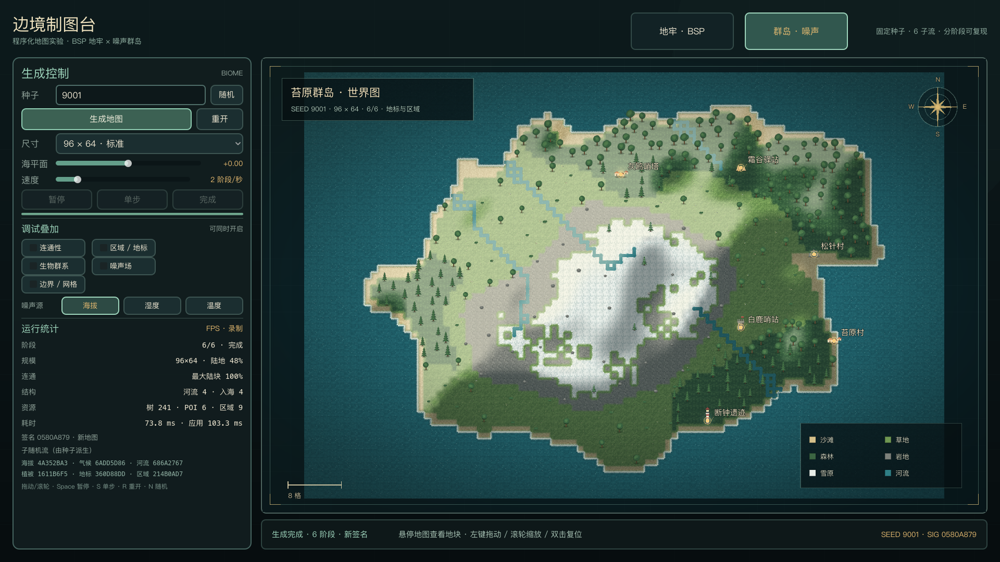
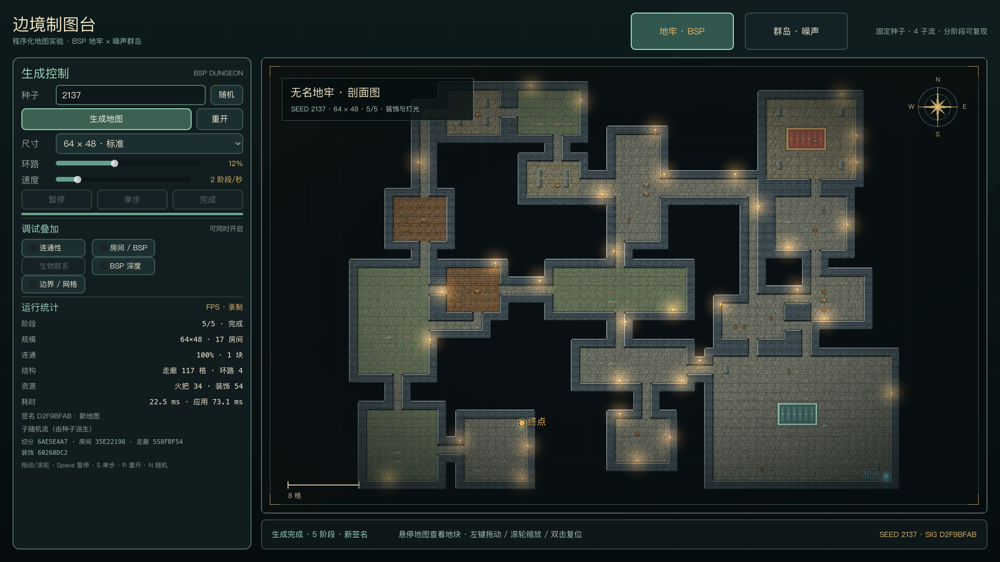
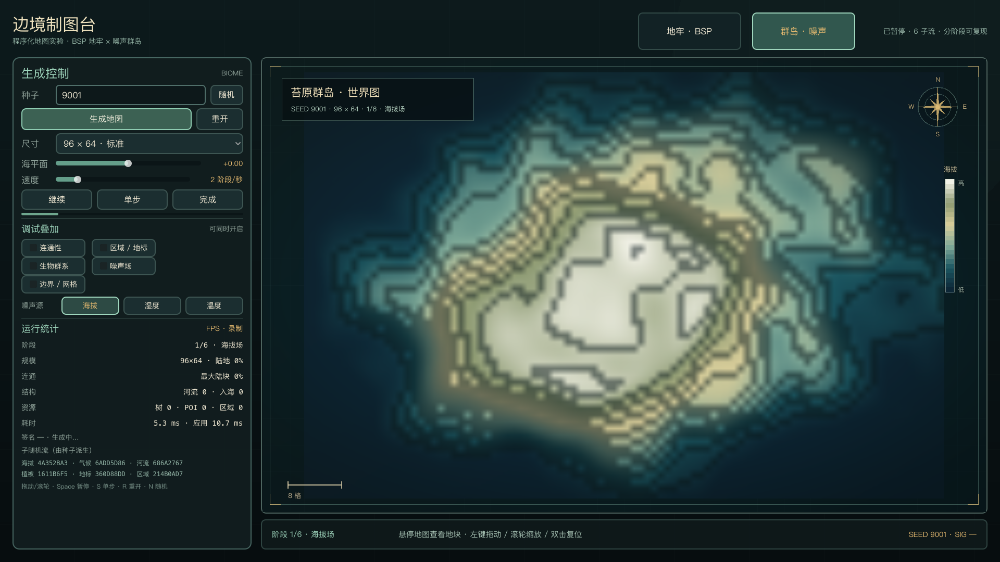
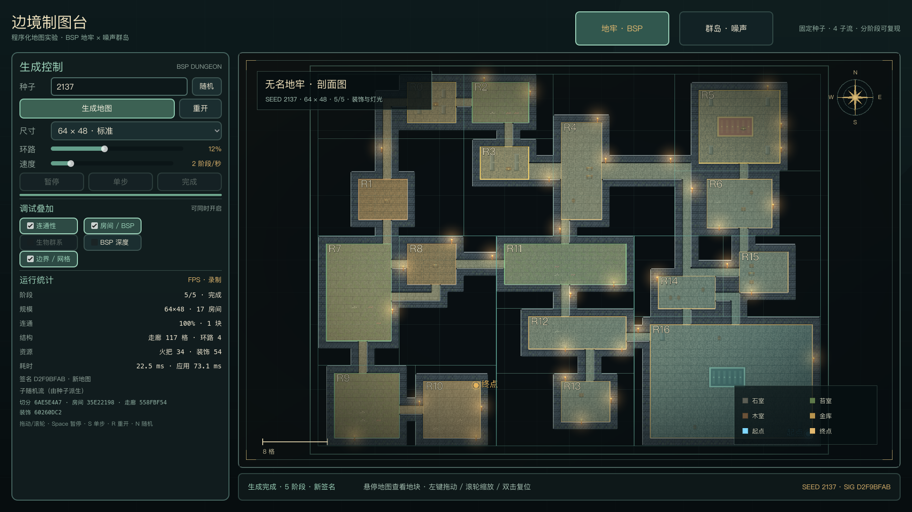

# 边境制图台 · 程序化地图实验

Godot 4.6（GL Compatibility）的统一程序化地图查看器：一个种子、一个界面，切换两种完整的地图生成管线：

- **地牢 · BSP**：递归切分 → 房间 → 最近邻生成树 + 环路 → BFS 连通验证 → 起点/终点 → 装饰与火把；
- **群岛 · 噪声（Hero）**：海拔/湿度/温度三通道 → 岛屿遮罩与生物群系分类 → 河流 → Poisson 植被 → 地标与 Voronoi 区域。

按 [程序化地图调研](../docs/godot-procgen-survey.md) 的 brief A/B 复刻算法与视觉语言，**没有**复制任何案例的截图、瓦片、UI、关卡或品牌；全部瓦片、道具、地图装饰由本项目在运行时绘制。





## 运行

```bash
# 从仓库根目录
godot --path godot-proc-map

# 编辑器
godot --editor --path godot-proc-map

# 无头验收（末行 PROC_MAP_SMOKE_OK）
godot --headless --path godot-proc-map -s tools/smoke_proc_map.gd

# 真实 GPU 探针（1280×720 / vsync off）
godot --path godot-proc-map --resolution 1280x720 -s tools/probe_proc_map.gd

# 1920×1080 截图与 10 秒视频
godot --path godot-proc-map --resolution 1280x720 -s tools/screenshot_proc_map.gd
./godot-proc-map/tools/build_media.sh
```

要求 Godot 4.6；无第三方运行时依赖；没有外部贴图/模型/音频。中文 UI 使用系统 CJK 字体（macOS PingFang / Linux 需安装 Noto CJK）。

## 操作

| 输入 | 作用 |
| --- | --- |
| 种子输入框 + `生成地图` | 用当前种子、尺寸、参数从头生成 |
| `随机` / `N` | 换一个随机种子并立即生成 |
| `重开` / `R` | 同种子、同参数、同尺寸重放；完成后显示「签名一致 ✓」 |
| 顶部 `地牢 · BSP` / `群岛 · 噪声` / `1` / `2` | 切换算法（保留当前种子） |
| `尺寸` | 地牢 64×48 / 80×60；群岛 96×64 / 112×72 |
| `环路`（BSP，0–30%） | 额外环路比例；越大走廊越像网络 |
| `海平面`（群岛，−0.08–+0.08） | 调高 → 陆地更少；调低 → 陆地更多 |
| `速度` 1–8 阶段/秒 | 连续生成阶段的推进速度 |
| `暂停/继续` / `Space` | 暂停或继续自动生成 |
| `单步` / `S` | 暂停并只推进一个阶段（阶段：切分/房间/…） |
| `完成` / `F` | 立即执行剩余阶段 |
| 调试叠加 | 连通性 / 房间·BSP 或 区域·地标 / 生物群系 / 噪声场 / 边界·网格（`C M B V O`） |
| 噪声源 | 海拔 / 湿度 / 温度热力图与等值线（`V` 打开噪声叠加） |
| 左键拖动 / 滚轮 / 双击 / `Esc` | 平移 / 缩放 / 复位视角 |
| `H` | 收起/展开左侧控制台 |

> 截图与视频工具会打开 **capture mode**，左侧 FPS 显示为 `FPS · 录制`；这是因为抓取 1920 PNG 会污染实时帧率。正常游玩时显示真实 FPS，真实数值由 `tools/probe_proc_map.gd` 单独测量。

## 两个算法

### A. BSP 地牢

`gen_dungeon.gd`（纯 RefCounted，可在 headless 直接测试）按 5 个阶段推进：

1. **BSP 切分**：64×48 根矩形递归切分，最小叶 10×8，最大深度 6，切分比例被限制在中段；最多 16 个叶节点；
2. **房间**：每叶随机内缩放 5×4 以上的房间，房间类型 `stone / moss / wood / gold`；房间天然不重叠；
3. **走廊**：房间中心按最近距离做 Kruskal 近似生成树，再按 `环路` 参数追加跨子树走廊；L 形 1 格宽走廊；
4. **连通验证**：从首房间 BFS，修复不可达房间、回填不可达地板；再从最远点做第二次 BFS 选起点/终点；独立 smoke 再用 AStarGrid2D 复核；
5. **装饰**：沿墙放火把（最多 34 个，间距约束）、木箱/木桶/桌子/骸骨/蘑菇/柱子/地毯；宝库/木室/苔室用不同陈设。

视觉：原创石板/砖墙/木地板/苔藓/金库瓦片，墙体 16 向接口 + 圆角，地板阴影 16 向，火把用加法光晕；调试叠加显示 BSP 切分线、房间 ID、BFS 连通热力、起点/终点、边界网格。

### B. 群岛 · 噪声（Hero 案例）

`gen_biome.gd` 按 6 个阶段推进：

1. **海拔场**：`FastNoiseLite` Simplex FBM（freq 0.0125，3 octaves）+ 海岸噪声扰动 + 细节噪声；椭圆径向岛屿遮罩，海岸线由噪声打散；
2. **气候场**：湿度 Simplex FBM（freq 0.022）+ 温度 Perlin（freq 0.028）与纬度梯度；
3. **生物群系**：深水/浅滩/海岸/沙滩/草地/森林/岩地/雪原 8 类；海拔阈值 + 湿度/温度阈值 + 雪线抖动；临水强制海滩；最大陆块阈值清理小岛（≥90%）；
4. **河流**：局部高点作河源，8 邻域最陡下降；对角步补正交桥格保证 4 连通；至少 1 条保底入海（全图水体距离场引导）；近海河口加宽；
5. **植被**：按群系分层的 Bridson Poisson（森林密、草地疏、岩雪点状），树/灌木/巨石/花丛/草簇；
6. **地标与区域**：陆地 Poisson 选 3–8 个 POI（塔/村/遗迹/营地/灯塔），清理周边树木；地标 + 额外种子做最近点 Voronoi 区域，用于调试叠加和草地色相微变化。

视觉对齐 survey brief B 的关键观感：

- **生物群系过渡**：16 向 alpha 边缘 + 9–10px 抖动渐隐，海滩/森林/岩地/雪原不是硬方格；
- **地形轮廓与光照**：地图分辨率连续 hillshade（左上光），海面用连续深度色 + 低频噪声叠加，海岸双面泡沫线，中央雪帽 + 雪脊；
- **比例感**：6 个有名字的 POI、树群、河流、区域边界与制图 chrome（罗盘/比例尺/图例/种子/签名）。

## 确定性与子随机流

- 种子支持数字或文字：`hash(text)` 后拆成 `海拔 / 气候 / 河流 / 植被 / 地标 / 区域`（BSP 为 4 条：`切分 / 房间 / 走廊 / 装饰`；群岛 6 条）独立的 PCG32 流；HUD 显示每条子流的值。
- 同一 `seed + 尺寸 + 参数` 在同一算法下逐格一致；签名是网格/房间/装饰/群系/河流/POI 的 FNV-1a 32-bit 摘要，显示在 HUD 与页脚。
- 完成后点 `重开`：若签名与上次相同，显示「同种子一致 ✓」；换参数（例如海平面 +0.06）会改变签名。
- 全部生成随机来自 `RandomNumberGenerator` 或确定性 hash；不混用全局 `randi()`；渲染选瓦片也使用坐标 hash，保证与帧率/线程无关。

## 调试叠加

| 开关 | 地牢 | 群岛 |
| --- | --- | --- |
| 连通性 | BFS 距离热力 + 不可达红 | 陆地连通分量（最大块绿、其它红） |
| 房间 / 区域 | BSP 切分线、房间矩形/ID、起点/终点 | POI 标签 + Voronoi 区域着色/边界 |
| 生物群系 | —（禁用） | 8 类纯色分类叠加 + 图例 |
| 噪声场 | BSP 叶深度热力 | 海拔/湿度/温度热力 + 等值线 + 连续图例 |
| 边界 / 网格 | 地图边界 + 8 格网格 | 地图边界 + 8 格网格；海岸轮廓可由群系叠加查看 |

## 实测与验收

环境：MacBook Air (2015) · Intel HD Graphics 6000 · Godot `4.6.stable.official` · GL Compatibility · 1280×720 逻辑 / 1920×1080 截图 / vsync off 探针。机器同时有其他 worker 负载，因此同时给出 median 与 p95。

### smoke（无头）

```text
UI_CONTRACT_OK
DUNGEON seeds=40 rooms_avg=15.5 median_ms=17.45 p95_ms=24.67 stress_median_ms=42.78
BIOME seeds=100 largest_min=95.9% rivers_min=1 poi_range=6..6 median_ms=63.22 p95_ms=74.21
PROC_MAP_SMOKE_OK
```

覆盖：40 个地牢种子（房间不重叠/不出界、BFS 100% 地板可达、起点→终点 A* 可达、同种子逐步一致、参数影响签名、80×60 压力档）；100 个群岛种子（陆地 44–51%、最大陆块 ≥95.9%、河流 ≥1 且独立复核入海、POI 6 个、树 ≥50、同种子逐格一致、海平面参数有效、生成时间 median ≤100ms）；主场景单步/完成/算法切换/调试开关/同种子重开签名一致。

### 真实 GPU 探针（1280×720，vsync off）

| 场景 | 平均 FPS | 最低采样 |
| --- | ---: | ---: |
| 群岛完成态（241 树 / 6 POI / 水色 + hillshade） | **93.7** | 67 |
| 群岛全调试叠加（群系 + 区域 + 连通 + 噪声 + 边界） | **76.7** | 75 |
| 地牢完成态（17 房间 / 34 火把 / 加法光晕） | **123.3** | 78 |
| 群岛连续生成（2 阶段/秒） | **130.0** | 130 |

生成耗时（算法本体，不含瓦片应用）median：地牢 **17.5ms**、群岛 **63.2ms**；p95：24.7 / 74.2ms。GPU 探针有两轮记录（本机负载波动），另一轮为群岛 97.3 / 全调试 94.0 / 地牢 131.3 / 生成中 122.5 FPS；两轮均远高于 30 FPS。另记录「应用耗时」（TileMapLayer 写格 + 调试纹理 + 装饰重绘）作为单独指标——它是一次性阶段切换成本，不参与算法预算。

### 启动 / 崩溃

- `godot --headless --path godot-proc-map --quit-after 600`：0 SCRIPT ERROR / 0 ERROR。
- 真实 GPU 截图、视频、探针三轮：console 无 SCRIPT ERROR / ERROR。
- 300 帧 @30fps 视频由 SubViewport 固定步进抓取，MP4 时长 10.000s。

## 目录

```
godot-proc-map/
├─ project.godot                1280×720 / GL Compatibility
├─ scenes/main.tscn
├─ scripts/
│  ├─ gen_utils.gd              种子混合 / hash / BFS / 签名
│  ├─ gen_dungeon.gd            BSP 地牢（纯数据，5 阶段）
│  ├─ gen_biome.gd              噪声群岛（纯数据，6 阶段）
│  ├─ tile_art.gd               运行时程序化瓦片/道具/POI 图集
│  ├─ map_view.gd               TileMapLayer 视图 / 相机 / hillshade / 调试叠加 / chrome
│  ├─ hud.gd                    中文控制台 / 统计 / 子随机流
│  ├─ ui_theme.gd               制图台配色 + 系统 CJK 字体
│  └─ main.gd                   生成调度 / 交互 / 工具 API
├─ tools/
│  ├─ smoke_proc_map.gd         算法不变量 + 确定性 + 主场景契约
│  ├─ probe_proc_map.gd         真实 GPU FPS / 生成与应用耗时
│  ├─ screenshot_proc_map.gd    7 张 1920×1080 实拍
│  ├─ render_proc_map_video.gd  300 帧 @30fps 确定性抓帧
│  └─ build_media.sh            帧 → MP4/GIF
└─ docs/
   ├─ TECH.md                   算法、参数、复杂度、跨引擎、差异与风险
   ├─ 迭代记录.md               视觉/性能/UI 迭代与实测
   ├─ shots/                    7 × 1920×1080
   ├─ proc_map_demo.mp4         10s / 1280×720 / 30fps
   └─ proc_map_demo.gif         10s / 960×540 / 15fps
```

## 截图与视频

| 文件 | 内容 |
| --- | --- |
| `docs/shots/01_biome_hero_1920.png` | 群岛 Hero（种子 9001，6 阶段完成） |
| `docs/shots/02_biome_elevation_stage_1920.png` | 单步阶段 1/6：海拔场 + 等值线 + 图例 |
| `docs/shots/03_biome_debug_1920.png` | 群系 + Voronoi 区域 + 连通 + 边界 |
| `docs/shots/04_biome_moisture_1920.png` | 湿度场噪声叠加 |
| `docs/shots/05_dungeon_hero_1920.png` | 地牢 Hero（种子 2137，17 房间） |
| `docs/shots/06_dungeon_debug_1920.png` | BSP 切分/房间 ID/连通/BSP 深度 |
| `docs/shots/07_biome_closeup_1920.png` | 群岛近景：海岸/森林/河流/POI |
| `docs/proc_map_demo.mp4` | 10s：Hero → 地牢/BSP 调试 → 六阶段生成 → 同种子复现 → 近景 |
| `docs/proc_map_demo.gif` | 同上，960×540/15fps |





## 已知限制

- 这是 **2D 瓦片地图查看器**，没有玩家/敌人/战斗；连通与 A* 用于验证，不是玩法 AI。
- 生成在**主线程分阶段**执行。当前 96×64 的算法本体 median 63ms，已低于 brief 的 100ms；没有引入 `WorkerThreadPool`，以免把渲染应用引入线程同步问题。若把地图扩大到 128×96，建议把纯数据生成移到后台线程。
- TileSet 使用**运行时烘焙的 Atlas + 自定义 16 向 terrain 解析器**，不是 `TileSet.set_cells_terrain_connect`。原因是所有瓦片运行时生成、需要多层 alpha 叠加（地面/沙/森林/岩/雪/河）与同一格多地形；16 向 mask 的边/角语义与 terrain 自动过渡一致。详见 `docs/TECH.md` §4.4。
- 阶段切换时 TileMapLayer 批量写格会产生一次性应用卡顿（高负载下实测约 100–200ms 总和，分阶段摊开）；生成本身的 median/p95 见上。
- 视觉是程序化几何/纹理的**统一风格化瓦片**，不是手绘资产；近景能看出 32px 瓦片与 1 格轮廓。
- 中文 UI 依赖系统 CJK 字体；Linux 需安装 Noto CJK，不随工程分发字体。
- 截图/视频的 FPS 标签显示 `FPS · 录制`，因为抓帧本身会把帧率压低；真实 FPS 以探针为准。

## 许可与致谢

见 [CREDITS.md](CREDITS.md)。算法只研究公开资料，代码/瓦片/UI 全部原创；未使用任何商业游戏素材或品牌。
