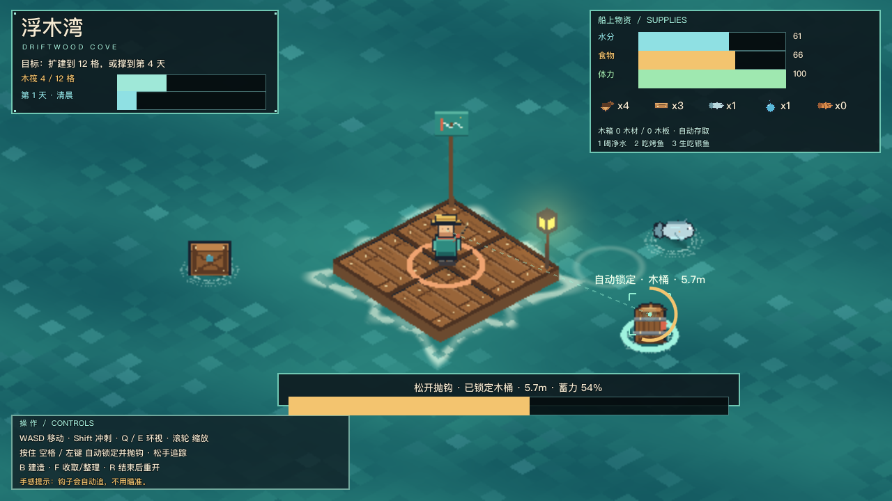
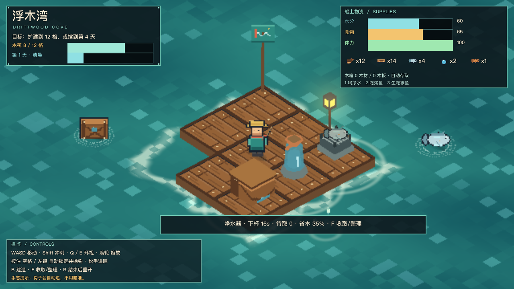
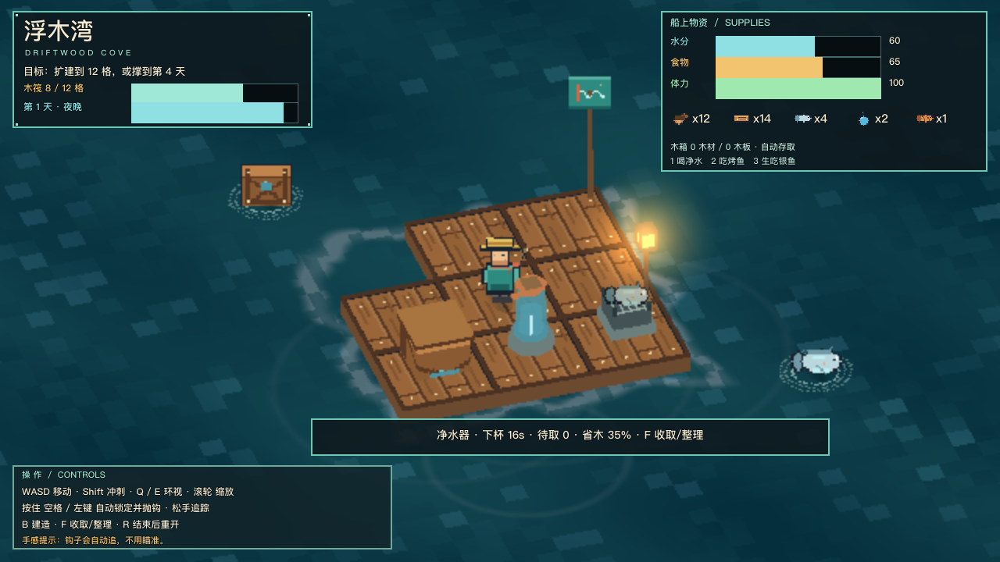

# 浮木湾 · Driftwood Cove

一个 **Godot 4.6** 原创像素木筏钓鱼 vertical slice：按住蓄力自动锁定最近漂浮物，松手抛钩追踪，命中入包；用木板扩筏、造木箱/净水器/烤鱼架；喝水吃鱼，扩到 **12 格** 或撑到 **第 4 天**。

> 名字、角色、木筏、UI、文案、音效全部原创。机制参考只在 B 站 devlog 中看到的“自瞄 + 追踪 + 自动存取”思路，没有复制原作名称、界面、美术或任何素材。参考链接见 [assets/CREDITS.md](assets/CREDITS.md)。



## 运行

```bash
cd godot-raft-fishing
godot --path .                       # 1280x720 窗口
# 或
godot --path . --resolution 1280x720
```

需要 Godot **4.6**（GL Compatibility）。无外部资产、无第三方运行库，贴图/音效均在运行时程序化生成。

## 操作

| 输入 | 作用 |
| --- | --- |
| `WASD` / 方向键 | 在木筏上移动（相机相对） |
| `Shift` | 冲刺，消耗体力 |
| 按住 `空格` / 鼠标左键 | 蓄力并自动锁定最近的漂浮物 |
| 松开 | 抛出钩子，钩子会追踪移动目标 |
| `Q` / `E` | 环绕相机 |
| 鼠标滚轮 | 缩放（8.5–20m 正交视野） |
| `B` | 打开/关闭建造菜单 |
| 建造菜单点击 → 点甲板 | 放置预览格，左键确认；右键/`ESC` 取消 |
| `F` | 靠近设施时收取产出 / 整理木箱 |
| `1` / `2` / `3` | 喝净水 / 吃烤鱼 / 生吃银鱼 |
| `R` | 结算后重开 |

## 一局的循环

1. **浮漂物**：木桶（50%）、木箱（30%）、银鱼（20%）围绕木筏刷新，最多 8 个；木桶/木箱平均各给 **3 木材**，木箱额外给 1–2 木板。
2. **抛钩**：射程 20m，蓄力 1.1s，松手后钩子以 17–28 m/s 追踪目标；命中后物资飞入背包，溅起水花、飘字、音效和轻微震动。
3. **建造**：扩建 2 木板；木箱 3 木板（自动存入溢出木材/木板，建造时自动取出）；净水器 2 木板 + 2 木材（18s/杯，35% 批次免木）；烤鱼架 3 木板 + 2 木材（12s/条，鱼→烤鱼）。
4. **生存**：水分/食物持续下降，体力支持冲刺；净水 +38 水分，烤鱼 +46 食物，生鱼 +18。水分或食物归零失败。
5. **目标**：木筏扩到 12 格，或活到第 4 天黎明（约 3–4 分钟）；结算界面可重开。

## 画面与反馈

- 3/4 正交视角，世界渲染在 **640×360** 子视口后最近邻放大；HUD 独立 1280×720。
- 程序化像素水面（分块浪纹、木筏泡沫圈、钩子水花涟漪、昼夜色）。
- 角色为手工像素帧（4 朝向 × 2 帧），木桶/木箱/鱼、桨旗、灯柱、净水器、烤鱼架均为程序化造型/贴图。
- 自动锁定 HUD 括号、蓄力环、距离文字、钩绳/金色钩头、toast、资源飘字、结算面板。
- 9 个运行时合成音效（锁定、抛钩、水花、命中、建造、错误、喝水、吃鱼、产水）。



夜晚：



完整 9 秒演示：[docs/driftwood_cove.gif](docs/driftwood_cove.gif) · [docs/driftwood_cove.mp4](docs/driftwood_cove.mp4)

其余截图在 [docs/shots/](docs/shots/)。

## 验证

```bash
tools/verify.sh                 # 导入 + 无头启动 + smoke + 产物检查
CAPTURE=1 tools/verify.sh       # 额外重跑 1280x720 截图与 GIF/MP4（需要 GPU）
INPUT=1 tools/verify.sh         # 真实键盘/鼠标/UI 点击接线测试（需要窗口）
PERF=1 tools/verify.sh          # 真实 GPU 平均帧率（需要 GPU）
```

单独运行：

```bash
godot --headless --path . -s tools/smoke_raft.gd   # 输出 RAFT_SMOKE_OK
godot --path . --resolution 1280x720 -s tools/input_raft.gd  # RAFT_INPUT_OK
godot --path . --resolution 1280x720 -s tools/perf_raft.gd   # RAFT_PERF_OK
```

已实测（本机 Intel HD Graphics 6000 / OpenGL Compatibility）：

- smoke：`RAFT_SMOKE_OK checks=697`；
- 真实输入：`RAFT_INPUT_OK checks=9`（空格、左键、B、按钮点击、甲板放置）；
- 9 张 1280×720 截图；9.0s GIF 8.1MB / MP4 1.8MB；
- 性能探针 360 帧：平均 **123.0 FPS**、最低瞬时 **43.0 FPS**（vsync 关，加压 8 个漂浮物，360 帧）；
- 导入/无头启动/截图/smoke 均无 `SCRIPT ERROR`。

## 关键参数

见 [docs/TECH.md](docs/TECH.md)。速查：

| 项目 | 值 |
| --- | --- |
| 木筏格 | 2.0m，初始 4 格，目标 12 格 |
| 钩子 | 锁定/射程 20m，蓄力 1.1s，冷却 0.5s，追踪寻的 7m |
| 漂浮物 | 上限 8，刷新 2.7s，寿命 58s |
| 木材 | 桶/箱均为 2–4（均值 3） |
| 净水器 | 18s/杯，上限 3，35% 批次免木 |
| 烤鱼架 | 12s/条，上限 3 |
| 生存 | 水 -0.28/s、食物 -0.18/s；开始 62/66 |
| 一天 | 80s；第 4 天黎明（约 232s）胜利 |

## 文件

```
scenes/main.tscn            Control → SubViewportContainer → 3D World → HUD
scripts/main.gd             输入映射、鼠标拾取、场景接线
scripts/raft_world.gd       核心循环/建造/生存/钩子/水花/音效
scripts/raft_station.gd     木箱/净水器/烤鱼架
scripts/player_fisher.gd    木筏上的小人
scripts/loot_float.gd       漂浮物
scripts/hud.gd              HUD/建造菜单/锁定标记/飘字
scripts/art.gd              全部程序化像素贴图
shaders/water.gdshader      像素水面
tools/*.gd, tools/verify.sh 验收工具
docs/                       TECH / 迭代记录 / 截图 / GIF / MP4
```

## 已知差距 / 下一步

- 只有一套钩子循环，没有钓鱼 QTE、鱼种稀有度、装备成长。
- 角色只有 4 朝向 2 帧；无抛竿/收线/吃鱼动作帧。
- 木筏不做浮力起伏；水面是分块着色 + 涟漪，没有真实波浪网格。
- 背包只有资源条 + 木箱存储，无独立背包页/合成树。
- 无存档、无手柄/触屏；中文依赖系统字体；音效为程序化占位，无音乐。
- Intel HD 6000 实测平均 123.0 FPS、最低瞬时 43.0 FPS（vsync 关、8 个漂浮物加压）；仍建议在不同机器上复测。

参考视频与原创声明见 [assets/CREDITS.md](assets/CREDITS.md)。
