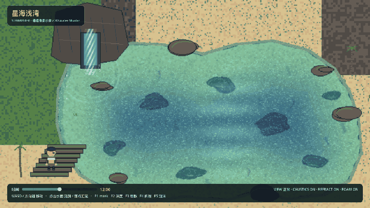

# 星海浅湾 · Starwater

参考 B 站视频 **BV1C44w62Ebp**《Godot 复刻〈星之海〉通透像素水体效果｜2D 水面 Shader
原理拆解》做的 **原创 2D 像素水体 study**。

没有使用视频的 Quark 工程，也没有使用《星之海》的美术/代码；场景、角色、瀑布、
焦散与泡沫贴图全部由 `tools/gen_art.py` 程序化生成。



视频版：`docs/sea_water.mp4`（7.5s，1280×720）。

## 复刻的效果

- **深浅渐变**：水体颜色按水深从浅绿松石过渡到深蓝。
- **像素折射**：只扭曲水底（沙、石、珊瑚），岸上的岩石/台阶不扭曲。
- **水下焦散**：平铺的焦散纹理在水底流动。
- **岸线泡沫**：沿真实水 mask 边缘的白色泡沫 + 时间闪烁。
- **交互涟漪 / 落点汇流**：角色踩水、静止、点击水面都会生成环形波，叠在折射/泡沫上。
- **角色入水曲面水线**：角色站在水里时，按脚下水深画出弯曲的泡沫水线，
  水下部分做水色/涟漪/焦散处理。
- **昼夜反光**：0–24 点时间滑杆，水色、陆地、角色、冷暖反光一起变化。

## 运行

```bash
godot --path godot-sea-water
```

- **WASD / 方向键** 移动
- **点击水面** 生成涟漪（落点汇流）
- **时间滑杆** 拖动昼夜
- **F1** 水 mask · **F2** 深度图 · **F3** 焦散开关 · **F4** 折射开关 · **F5** 泡沫开关

世界按 **640×360** 渲染，再用最近邻 **2×** 放大到 1280×720；HUD 保持 1280×720 清晰。

## 五层结构

| 层 | 实现 |
| --- | --- |
| 1 水 mask | 640×360 的池塘多边形；shader 在 mask 外 `discard` |
| 2 折射底 | 水底 Sprite 先画；水层用 `hint_screen_texture` 采样并做像素级 UV 偏移 |
| 3 水色 | 由深度图混合浅/深色 + alpha，让水底透出来 |
| 4 泡沫 | 深度 < 阈值的岸线 + 噪声/涟漪 |
| 5 焦散 | 可平铺 Voronoi 焦散图，按屏幕像素尺度平铺、滚动 |
| 额外 | 8 槽事件涟漪、角色水线 shader、昼夜/反光 |

详细原理与踩坑见 `docs/TECH.md`，本轮问题清单见 `docs/迭代记录.md`。

## 文件

```
godot-sea-water/
├── scenes/main.tscn          640×360 SubViewport + 1280×720 HUD
├── scenes/world.tscn         bottom → water → props → waterfall → player
├── scenes/player.tscn        角色 + 水线 ShaderMaterial
├── src/
│   ├── world.gd              昼夜、涟漪槽、深度查询、教学开关
│   ├── player.gd             移动、脚下水深、水线与涟漪
│   ├── hero_frames.gd        从图集切 SpriteFrames
│   ├── hud.gd                时间滑杆 / F1-F5 / 状态
│   └── main.gd               点击水面 → 涟漪
├── assets/
│   ├── shaders/water.gdshader
│   ├── shaders/character_water.gdshader
│   ├── world/                mask / depth / bottom / props / 焦散 / 泡沫 / 瀑布
│   └── char/hero.png         4 方向 ×（2 idle + 4 walk）
├── tools/
│   ├── gen_art.py            全部像素素材的程序化生成器
│   ├── smoke_sea.gd          无头验收
│   ├── screenshot_sea.gd     日/夜/mask/深度/涟漪截图
│   ├── capture_sea_gif.gd    GIF 录制
│   └── verify.sh             一键导入 + 验收
└── docs/
    ├── TECH.md               技术拆解
    ├── 迭代记录.md            本轮问题、根因与修复
    └── sea_water.gif / mp4
```

## 验证

```bash
python3 tools/gen_art.py           # 重新生成像素素材（需要 Pillow）
godot --headless --path godot-sea-water --editor --quit   # 重新导入改过的 PNG
godot --headless --path godot-sea-water -s tools/smoke_sea.gd
godot --path godot-sea-water --resolution 1280x720 -s tools/screenshot_sea.gd
godot --path godot-sea-water --resolution 1280x720 -s tools/capture_sea_gif.gd
```

- `SEA_SMOKE_OK`：mask/深度、昼夜、涟漪槽、角色动画/入水、移动、开关。
- 截图输出 `/tmp/sea_shots/`；GIF 帧输出 `/tmp/sea_gif/`。

## 说明

- **像素风是刻意选择**：这支参考视频本身就是像素水体；与 `godot-garden` 的
  写实高清路线不同。
- 画面是 640×360 像素网格；折射/焦散/泡沫都按像素 snapped，放大后不会糊。
- 素材与代码均为原创；参考只来自视频可见画面。详见 `assets/CREDITS.md`。
